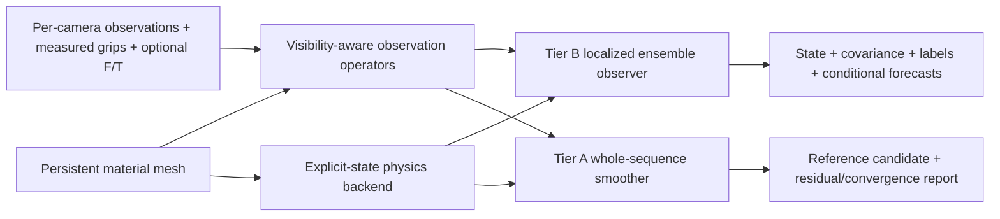

# Implementation and interfaces

## Boundaries between modules



Numerical modules import NumPy/SciPy/OpenCV, not ROS. ROS conversions and orchestration are separate. Newton/Warp is imported only when selecting `newton_style3d`; CPU tests and recorded-data tools can run without it. Neither package publishes robot commands.

| Module | Responsibility and independent entry point |
|---|---|
| `fabric_state_estimator/mesh.py` | `MaterialMesh`: topology, rest UV, lumped masses, boundary edges, rest-mesh geodesics, UV stencils, geometric initialization |
| `physics.py` | `PhysicsSpec`, `make_physics`, explicit `advance(q,v,dt,grips,loads)` contract and CPU spring test model |
| `newton_backend.py` | Newton Style3D worlds, prescribed corners, force-buffer ordering, material-consistent internal-force/reaction operator |
| `data.py` | Validated `Frame`, `View`, `Grip`, `Force`, versioned JSON sequence import/export |
| `observations.py` | Projection, frontmost ray/triangle intersections, depth/boundary/track/UV/grip/force factors |
| `ensemble.py` | Ensemble initialization, material-geodesic localization, robust transform update, q/v projection, covariance and forecasts |
| `transforms.py` | Recorded TF graph interpolation at capture time, without latest-TF fallback |
| `ros_adapters.py` | ROS message ↔ numerical data conversion; source-stamp and depth-provenance checks |
| `node.py` | Tier B buffering, capture-time TF and grip selection, prediction deadlines and ROS publication |
| `visualization.py` | Optional model/state identity-checked, expiring RViz wireframe |
| `replay.py` | Deterministic Tier B execution on a saved sequence |
| `metrics.py` | Independent material-indexed truth comparison and empirical covariance coverage |
| `fabric_reference_reconstruction/smoother.py` | Tier A weak-constraint optimization with fixed nominal material |
| `bag.py` | MCAP/sqlite import using recorded TF, raw per-view glove observations and perception factors |
| `synthetic.py` | Deterministic small test plant and separate ground-truth artifact |
| `cli.py` | Offline solve and convergence/report export |

Paths in the table are inside each package's Python module directory under `src/`. Each numerical class can be instantiated directly in a unit test; see [testing.md](testing.md).

## Material mesh and units

Coordinates, velocities, force, time, mass and covariance use SI units: metres, m/s, N, seconds, kg, and squared units. Material UV is dimensionless. The common world frame must have z up. Camera frames have optical axes x right, y down, z forward.

The mesh is row-major. `u` increases along columns and `v` along rows. Triangle topology, rest UV and vertex IDs remain fixed while the sheet moves. The four attachments are ordered:

| Corner number | Material UV | Measurement |
|---|---|---|
| 0 | `(0,0)` | Blue calibrated grip frame |
| 1 | `(1,0)` | Silver calibrated grip frame |
| 2 | `(0,1)` | `human_left` tagged grip |
| 3 | `(1,1)` | `human_right` tagged grip |

These are physical material identities, not camera-image left/right. Configure the glove pipeline's `human_corner_uv` accordingly. Orient the ply so u/v correspond to the intended warp/weft convention. Mesh masses are triangle-area lumped, including attachment-vertex mass; total mass is width × height × areal density. `model_id` hashes the complete mesh specification. It does not identify the material parameter calibration; archive the physics configuration separately.

Initialization rejects grip sets that are farther apart than the material allows or whose bilinear patch is twisted (a swapped robot/hand corner assignment). The first prior is a bilinear surface between four measured grips, with downward sag and sampled smooth modes. It is explicitly a **geometric prior**, not learned completion or recovered truth. Reinitialization after a large capture gap repeats that prior. Initialization must already be within the association gates; this version cannot recover arbitrary folded configurations from scratch.

## Physics backends

Both backends take `(N,V,3)` q/v arrays, `(N,4,3)` target grips, elapsed time and `(N,3)` residual forces. They return new q/v arrays; internal scratch buffers must not become hidden dynamical state between calls. Grips move linearly between their initial and target positions over the interval. Their velocities follow that prescribed trajectory.

`spring` is a small, explicit CPU test plant with edge springs, gravity and velocity damping. Its automatically reduced substep respects a conservative mass/stiffness scale. It has no directional bending or weave model. Use 3×3 or 5×5 meshes for software tests, not as a validated substitute for the composite material.

`newton_style3d` builds one material mesh per independent world and advances all members together. Prediction can use `cpu` or `cuda:0`; the ensemble update remains NumPy/SciPy on the host, so transfers and CPU update cost must be profiled. The implementation was exercised against local Newton **1.0.0** and Warp **1.12.0**. It explicitly uses the installed `_precompute(builder)` API and verifies mass and topology. The builder-local NumPy compatibility namespace supplies `atan2`/`pow` aliases when ROS uses NumPy 1.26; it changes neither installed files nor the global NumPy namespace. The adapter also runs on Newton **1.6.1** / Warp **1.17.0** (Isaac Sim 6.2): 1.6 performs `_precompute(model)` in the solver constructor, so the explicit call is made only when the installed signature still expects a builder. The contract and force-operator checks were repeated on 1.6.1. Upgrade versions only after the backend contract tests pass.

The installed Style3D collision handler does not isolate overlapping ensemble worlds. This adapter disables that handler. **Self-contact, cloth/robot contact, cloth/table contact and obstacles are unsupported in both backends.** The current physics case is a freely hanging sheet held at four point attachments. Finite grip patches, compliance, slipping and regrasp are not modeled.

Style3D's `0.998` velocity multiplier remains part of the solver. Effective damping depends on actual substeps, so archive `max_step_sec`, timestamps, solver version and iteration count. `damping_per_sec` and `spring_stiffness_n_m` apply only to `spring`; they are not conversions of Newton's anisotropic coefficients.

The optional force observation uses the installed Newton bending law separately from native
state prediction. For Newton 1.6 and newer, its quadratic bending matrix coefficient is
`3*k/A`; the supported older backend used `(k/A)^2`. An isolated bending-only native-kernel
regression checks this coefficient, since a mixed membrane/bending comparison can hide a
bending error under the much larger membrane-force tolerance. This correction does not make
point-grip reactions equivalent to a finite grip patch or validate dynamic force fusion.

The residual load has exactly three coefficients: total world force distributed proportional to lumped mass. This represents uniform distributed acceleration, not an arbitrary per-node force field. Tier B owns it online; Tier A owns a separate offline sequence estimate. Turn off any other online disturbance observer before consuming it elsewhere.

## Observation operators

All camera transforms are `world_from_camera` at the **camera capture time**. Distortion-aware projection uses the supplied raw RGB intrinsics. The depth source must be `raw_registered_quality_gated`; future learned repaired depth requires an explicit provenance/uncertainty contract and is rejected here if presented under another source.

| Factor | Association and residual | Important limit |
|---|---|---|
| Depth | Intersect the RGB pixel ray with every candidate triangle and retain the closest positive intersection. Use its barycentric material stencil and a scalar point-to-plane residual with the visible triangle's normal. | Only normal displacement is directly measured. No nearest-neighbour attraction to hidden layers. Invalid/missing depth supplies no factor. |
| Boundary | Associate positive-confidence contour samples to a visible projected **topological outer edge** and compare perpendicular image distance. | Holes, zero-confidence hand/robot/ROI edges and hidden outer edges are excluded. It does not infer a material boundary along a fold. |
| Point track | At birth, bind the tracked ray to a visible material stencil. On subsequent frames compare its projected pixel with the retained identity. | Birth supplies no self-measurement. The binding is an inferred correspondence; 60 px/image and metric gates reject large discrepancies. Camera ID, track ID and first stamp identify a track. |
| UV prior | Use known mesh UV interpolation, projected pixel residuals and propagated configured UV variance. | Disabled by default. Requires independently validated learned UV weights; never derived from image-normalized coordinates. Visibility and distance gates still apply. |
| Grip | Position residual in covariance principal axes. | Tier A uses these soft factors. Tier B already samples their uncertainty into prescribed boundary motion and excludes the duplicate likelihood. |
| Robot force | Compare predicted quasi-static force **on the sheet** with calibrated force transformed at its own sample time. | Never reapply measured reactions as external forces. Only the three force components are used, not torque. Fast grip acceleration/inertial reactions and finite-patch couples are unsupported. |

Association is computed from the current mean/reference linearization. Factor stencils stay fixed during one ensemble update or one offline optimization round. Tier A rebuilds associations between outer rounds. Association gates are deliberate limits: increasing them to fit a poorly initialized folded surface can create wrong material correspondence.

Per-camera factors are bounded by `max_depth`, `max_boundary` and `max_tracks`. Temporally grouped offline views retain their individual capture stamps/transforms. Their residual variance is inflated using the maximum declared surface speed and capture skew. This is a conservative timing allowance, not clock synchronization.

## Tier B update

Each member carries q, v and the three residual-force coefficients. Material parameters are fixed, not adapted online in this version. Boundary error uses persistent standard-normal corner samples transformed by the current grip covariance. Prediction adds configured residual-force random walk and velocity process noise.

For each mesh vertex, ensemble-transform weights are computed in ensemble space. In abbreviated form:

```text
Y = predicted observation anomalies, shape N×M
rho = Gaspari–Cohn taper(material-geodesic distance / localization_m)
precision = rho / observation_variance × Huber innovation weight
C = (N−1)/inflation × I + Y × diag(precision) × Yᵀ
w = C⁻¹ × Y × diag(precision) × innovation
T = symmetric_sqrt((N−1) × C⁻¹)
local updated ensemble = prior mean + wᵀ × state anomalies + T × state anomalies
```

The localization support ends at twice `localization_m`, using **rest-mesh graph distance**, not spatial proximity between folds. Position and velocity are updated together through ensemble covariance. Velocity is never obtained by differencing observed point clouds. The residual-force coefficients receive a global update against the same factors.

Projection bounds overextended edges, preserves the sampled attachment positions during projection, and couples the projection displacement into velocity. It does not expand compressed edges, which may represent slack. Remaining overextension, low numerical ensemble rank, missing visual factors or large marginal innovation score marks the estimate degraded. The innovation score is a diagnostic; it is not a calibrated NIS/chi-square consistency claim. There is no automatic nudging fallback or learned reacquisition model yet.

`covariance` contains 36 row-major values per vertex, ordered `(x,y,z,vx,vy,vz)`, including q/v cross terms. A position floor is added to the published blocks. It is assumed noise/model uncertainty, not demonstrated coverage. `OBSERVED` means a direct retained factor touches the vertex, including measured grips; a depth-only observation does not establish tangential certainty. `INFERRED` means never directly observed since initialization. `STALE` means direct observation age exceeds the configured threshold. Age `−1` means never observed.

The analysis clock advances only with accepted capture-time observations. Prediction and forecasts branch from that analysis and do not mutate it. They retain `measurement_stamp`. Live predicted state stops after `prediction_limit_sec`; a timer cannot make old observations fresh. Each publish tick resumes the current analysis' rollout rather than re-simulating from the analysis; forecasts are published at `forecast_rate_hz` and their horizons share one chained rollout, so a forecast set costs its longest horizon, not the sum. Forecast horizons are relative to their message header, with constant measured grip velocity and fixed sampled residual loads. The distributions are **conditional on that motion assumption** and omit unknown future human actions.

## Tier A objective and outputs

The smoother optimizes every frame's q, v and uniform residual force together:

```text
robust whitened depth + boundary + track + optional UV + grip + optional force residuals
+ initial-state priors
+ residual-force magnitude and temporal priors
+ (q[t+1] − physics_rollout(q[t],v[t],next_grips,load[t])) / position_model_std_m
+ (v[t+1] − predicted_v[t+1]) / velocity_model_std_mps
```

Raw per-view glove observations enter as uncertain position factors. The input excludes `/fabric/estimated_state` and `/fabric/hand_states`; it does not fit the output of the online fabric or hand filter. “Raw” here means the camera front end's depth/contour/track factors and per-view tag observations. Full RGB photometric optimization and re-estimating segmentation from raw images are not implemented.

Dynamics are a soft constraint. SciPy sparse trust-region least squares uses black-box rollouts with absolute finite-difference steps (0.1 mm position, 1 mm/s velocity, 1 mN load), chosen to survive Newton float32 quantization even at zero-valued states. The Jacobian conservatively couples adjacent complete frames; it does not pretend the nonlinear solver has automatic gradients. Cost grows quickly with mesh size and clip length: each Jacobian needs 2×(6V+3) full-sequence rollouts. With default budgets a 17×17 mesh fits only about four frames and is rejected; a 5×5 mesh over 8 frames took about 75 s on a laptop CPU with two association rounds (synthetic p95 5–8 mm). Use coarse meshes and short clips; at least two association rounds are needed when the bilinear initialization is far from the data.

Material parameters, camera extrinsics, clock offsets and F/T biases remain fixed in this v1 solve. Joint identification, nuisance-calibration refinement and parameter/state posterior estimation remain future work. Configured variable/Jacobian-entry budgets reject overly large problems before sparse-matrix allocation. Output NPZ contains capture stamps, material-indexed q/v and residual forces. Its JSON sidecar reports convergence, evaluations, factor counts, tangential cue availability, normalized measurement RMS and provenance. It explicitly labels the result `reference_candidate` and `covariance_available=false`. Low residual is not proof of surface accuracy. A nonconverged CLI solve writes artifacts but exits with code 2.

## ROS contracts

| Topic | Type | Time/frame |
|---|---|---|
| `/fabric/model` | `FabricModel` | Transient-local; fixed topology/rest coordinates, mass specification and mesh ID |
| `/fabric/estimated_state` | `FabricState` | State time in header; separate last analysis capture in `measurement_stamp`; common world frame |
| `/fabric/predicted_states` | `FabricForecasts` | Forecast origin in header; actual target stamps in each state; explicit motion assumption |
| `/fabric/estimator_status` | `DiagnosticArray` | Publication time; capture-to-analysis age, backend and contact assumption |

Observation/hand/force subscriptions use sensor-data QoS. The model uses reliable transient-local QoS. TF is looked up at source timestamps; missing transforms wait within bounded capture age and are never replaced with latest TF. Late or backward observations are dropped. Cameras whose captures lie within `camera_sync_tolerance_sec` are assimilated together as one analysis, each view keeping its own stamp/TF with skew-inflated variance; without wired sync, each camera is a separate analysis (three times the update cost). Future-dated filtered hand states are not used to constrain an earlier fabric capture. Each hand is taken from the newest causal `HandStates` message that contains it (fusion omits hands a camera group did not see), propagated briefly with its measured velocity and covariance. Its material corner comes from its `grip_uv`; robots hold corners 0 and 1.

The live observation queue holds at most 80 messages, hand history 200 and each force history 200. The bag importer makes two logical passes over stored compact observations/TF and holds them in memory, so use short calibration clips; `--max-frames` limits exported frames, not total bag-reading memory. Restart all estimator nodes after backward bag seeks or bag loops.
