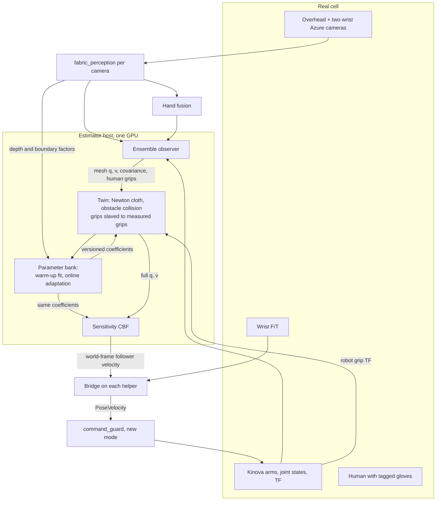

# Hardware demonstration plan: camera estimation, live twin, parameter adaptation, CBF transport

**Date:** 12 November 2026.

> **Status, 13 November 2026:** work items 4.1–4.7 have been implemented and rehearsed in simulation. The results, what changed from this plan, and the remaining on-site steps are in the [test guide](fabric-hardware-test-guide.md).

**Based on:** the [research proposal](fabric-state-estimation-research.md), the [progress report](fabric-state-estimation-progress-report.md), the [learning-methods report](fabric-learning-methods-report.md), the [platform audit](platform-audit.md), and the simulator documents (`SIM_CELL.md`, `FABRIC_INTEGRATION.md`, `PERFORMANCE_REVIEW.md` in `/media/taha/ExtermeLinux/oarbot_simulation`; `capsule_cbf/` in `~/ros2_colcon_ws/src/fabric_sim_isaacsim_newton`).

**Code read for this plan:** `oarbots` `2697eb0` (estimator code unchanged since the progress report's `b7821ac`), `oarbot_simulation` `a196775` plus its uncommitted changes, `fabric_sim_isaacsim_newton` `d068555`.

**Evidence boundary:** this plan comes from the reports and from reading source. Nothing was run, built, or changed. Runtime figures quoted from earlier measurements are labelled as such. Effort figures, gains, and thresholds are proposals to be confirmed in the simulated-cell rehearsal ([§4.7](#47-closed-loop-rehearsal-in-the-simulated-cell)).

## 1. Summary

The demonstration has four parts. Two of them have working pieces that need fixing and deploying. Two have nothing implemented yet.

| Demo item | What exists | What is missing |
| --- | --- | --- |
| **D1. Camera state estimation** on the real sheet | Perception, tagged-glove fusion, and the ensemble observer run in the simulated cell. Scripted runs reach 24–36 mm p95; teleoperated runs reach 54–80 mm p95 with 55–75% coverage. | The human-grip input path is the measured cause of the teleoperation failure and is not fixed. No real-cell launch, configuration, or calibration exists. Depth on real carbon has never been measured. |
| **D2. Simulated fabric running beside the real robots**, with collisions and the CBF active | Newton Style3D cloth with obstacle collision and the sensitivity CBF, validated inside the Isaac plant. | The cloth there *is* the truth and takes no measured input. There is no twin whose four grips follow the real robots and hands. |
| **D3. Warm-up calibration, then continuous adaptation** from the camera estimate | Nothing. Material coefficients are fixed in the estimator, the plant, and the CBF model. Only three uniform residual-force coefficients are estimated online. | The feedback from estimate to twin, the calibration procedure, and the online parameter update. |
| **D4. A-to-B transfer of the real sheet around a simulated obstacle** | The CBF computes follower velocities and has avoided obstacles in simulation at 0.1 m/s. | It has only ever run on plant truth. No path carries its commands to the real arms: the command guard accepts only `teleop` and `admittance`. |

**Order of work.** Each step is detailed in [§4](#4-work-before-the-hardware-tests).

1. Fix the estimator's grip handling and re-run the three recorded teleoperation failures ([§4.1](#41-estimator-fixes)).
2. Create the real-cell deployment: launch, configuration, calibration publisher ([§4.2](#42-real-cell-deployment)).
3. Build the twin node: Newton cloth with its grips slaved to measured robot and hand positions, a simulated obstacle, and the CBF ([§4.3](#43-twin-node)).
4. Add the feedback from estimate to twin ([§4.4](#44-feedback-from-the-estimate-to-the-twin)).
5. Add warm-up calibration and online adaptation ([§4.5](#45-warm-up-calibration-and-online-adaptation)).
6. Add the CBF command path to the real arms, with independent stops ([§4.6](#46-cbf-command-path-to-the-real-arms)).
7. Rehearse the whole loop against the simulated cell, with the Isaac plant standing in for the real world ([§4.7](#47-closed-loop-rehearsal-in-the-simulated-cell)).
8. Pass the hardware gates this demo needs ([§5](#5-hardware-preparation)), then run the test sessions in [§6](#6-test-sessions-on-hardware).

**Scope decisions.** The first two were confirmed on 13 November; the other two are my recommendations. They keep the demo inside what the current code can support.

- **Arms only, bases parked (confirmed).** Moving bases need odometry fusion that does not exist (gate H8). Parked bases also let the base poses be published as static transforms and let the robot computers be wired ([§3.1](#31-which-machine-runs-what)).
- **The twin is a headless ROS node shown in RViz, not the Isaac plant (RViz confirmed as the display).** Kit must not sit in a loop that commands real arms: a rendering stall would become a command dropout. The headless node also fits the real-time budget and an 8 GB GPU.
- **Adapt two coefficients, a bending scale and a shear scale.** Mass is weighed, not fitted. Stretch stiffness stays nominal because shape does not constrain it. A sensitivity study in simulation must confirm the choice before any hardware claim ([§4.5](#45-warm-up-calibration-and-online-adaptation)).
- **Tagged gloves, hanging sheet, no real contact.** The obstacle exists only in the twin. Release, slip, folds, and table contact stay outside the declared envelope.

**Work the reports describe that this demo does not need:** a scalable offline smoother, learned segmentation, UV, depth, or completion models, MANO hands, contact-mode estimation, force fusion inside the estimator, learned dynamics, and moving bases. Leave them until after the demo.

## 2. What the demonstration is

**Confirmed setup (13 November).** There is no keyboard or tablet teleoperation during the tests. A person holds two corners with green gloves that carry ArUco tags, and the two arms hold the other two. The simulated sheet runs alongside the real one: its robot grips follow TF and its human grips follow the tracked gloves. The pinch point is a fixed, measured offset from each tag, so the grip point is computed, not estimated. The obstacle's shape, size, and position, and the points A and B, are set in the lab on the day; the transfer is a short pass from one side of the obstacle to the other, within arm reach.

| Item | What an observer sees | Proposed acceptance |
| --- | --- | --- |
| D1 | The estimated mesh drawn in RViz and over each camera image while the human and robots move the sheet. | Analyses delivered at 10 Hz or more with capture-to-state age p95 at most 100 ms. Depth residual on a camera withheld from the estimator at most 30 mm p95. Error at 4–6 temporary markers on a sacrificial ply at most 50 mm p95. No gap longer than 0.5 s. |
| D2 | The twin sheet moving with the real one, the simulated obstacle, and live CBF diagnostics. | Twin frame time p95 under 16.7 ms at 60 Hz. Twin grips within 10 mm of the measured grips. CBF update under 20 ms. No obstacle penetration in the twin. |
| D3 | A 60–90 s warm-up, then a plot of free-running twin error before and after, and the adapted coefficients over time. | After warm-up, the free-running twin's error against camera depth drops by a stated factor on a held-out motion. Adaptation pauses by itself when the sheet is taut or sensing is degraded. |
| D4 | The human walks the sheet from A to B. The arms follow, and the sheet clears the simulated obstacle. | Minimum twin clearance stays at or above the configured margin. Measured wrist force stays under the stop threshold. CBF status is `feasible` in at least 95% of frames. The same path with the filter off enters the margin. |

All thresholds are proposals. The 50 mm figure is the research target, not a measured result.

## 3. Target architecture

Design rules that the rest of the plan relies on:

- **The estimator measures; the twin simulates.** The estimator keeps its own coarse mesh and nominal coefficients, and nothing from the twin flows back into it. The twin is corrected by the estimate.
- **One parameter set.** The twin and the CBF's prediction model always use the same versioned coefficients. The CBF model copies stiffness from the Newton model when it is built, so it must be rebuilt whenever the twin's coefficients change.
- **One owner per disturbance.** The estimator owns the uniform residual load on the real sheet. The CBF's own observer stays on, because it corrects its linear model against the twin state it is given.
- **Commands pass through the guard.** The CBF never publishes to the Kinova driver. The deadman, speed limits, and timeouts in [`command_guard.py`](../src/oarbot_runtime/oarbot_runtime/command_guard.py) stay in force.

### 3.1 Which machine runs what

Place each component by two rules: process images on the machine the camera is plugged into, and keep everything that exchanges full cloth state on one GPU machine.

| Machine | Runs | Why there |
| --- | --- | --- |
| **Blue helper laptop**, **Silver helper laptop** | Kinova driver, joint states, F/T driver and compensation, wrist Azure driver, `fabric_perception` for the wrist camera, `command_guard`, the new CBF bridge. Body tracking off. | Raw images never leave the laptop. The guard and bridge sit next to the driver, so a network loss stops the arm locally. |
| **NUC** | Overhead Azure driver, `fabric_perception` for the overhead camera (sheet factors and glove tags), ArUco only for the one-time base measurement. | The overhead camera is the only view of the glove tags, so this node sets the hand-state rate. Check that the NUC holds 15 Hz at 1080p; if not, lower the colour resolution. |
| **Compute machine** (one NVIDIA GPU, 8 GB or more) | Hand fusion, ensemble observer, twin, parameter bank, CBF, calibration publisher, RViz, recorder for compact topics. | Observer, twin, and bank all use Newton on the GPU and must share one Python environment. Twin and CBF exchange full state every update. One clock removes a synchronization problem. |
| **Tablet** | GUI, mode selection, deadman, held by the second person. | Unchanged. |

**Can the simulation run on a different computer?** Yes. ROS 2 nodes on different computers find each other directly through DDS. No bridge is needed if all of these hold:

- they are on the same network segment, where discovery multicast passes;
- they use the same middleware and domain (the cell uses `rmw_cyclonedds_cpp`, domain 0);
- their clocks are synchronized.

SSH is for starting and watching processes. It does not carry topics. Two details apply to this cell:

- **The CycloneDDS profile names the interface.** [`config/profile.xml`](../config/profile.xml) pins `wlp2s0`. A new computer needs its own copy naming its own interface, and a wired computer names its Ethernet interface.
- **The Dingo domain bridges are unrelated.** They connect each base's own domain to domain 0 and stay as they are.

If you want to split the compute machine in two, split between the observer and the twin, and keep the twin, bank, and CBF together. Only compact data crosses that boundary: the 8×8 estimated state at 15 Hz (about 0.3 MB/s), hand states, camera factors, and TF. Connect the two with a cable.

**If the other computer is reachable only by SSH**, for example a server on another network, DDS discovery will not reach it. A VPN or a Zenoh bridge can carry the topics, but the delay and jitter are too high and too variable for anything in the command loop, where the guard discards commands older than 150 ms. Use such a machine for recording, plotting, or offline fitting only. The twin and CBF must be physically in the lab.

**Use cables while the bases are parked.** The command loop is: robot TF to the compute machine, CBF, follower command back to the helper. Over Wi-Fi it crosses the air twice. With parked bases, each helper laptop, the NUC, and the compute machine can plug into one Ethernet switch, which takes Wi-Fi out of the loop. Update each host's CycloneDDS profile to its wired interface, synchronize clocks with chrony against one host, and measure the round trip under full load before the first closed-loop run.

**The compute machine is the development laptop (confirmed 13 November).** It has an RTX 5070 Laptop GPU with 8 GB, 24 CPU threads, and 30 GB of memory. An Ethernet switch is available. A check of the laptop on that date found three things to prepare before it can join the cell:

- **CycloneDDS is not installed.** Only `rmw_fastrtps_cpp` is present, and the cell runs `rmw_cyclonedds_cpp`. Install `ros-jazzy-rmw-cyclonedds-cpp` and export `RMW_IMPLEMENTATION` and `CYCLONEDDS_URI` in the launch environment. The simulated-cell rehearsal keeps using Fast DDS on domain 42, so keep the two environments in separate shells or scripts.
- **No wired interface is present.** The only network interface is Wi-Fi (`wlp130s0`). A USB or dock Ethernet adapter is needed to reach the switch, and the laptop's CycloneDDS profile must name that adapter's interface.
- **chrony is not installed.** The laptop uses the default systemd time service. Install chrony and make one host on the switch the time reference for the others.

The laptop does not need `kinova_msgs` or the robot drivers: the bridge that produces Kinova messages runs on the helpers, and the laptop only publishes a standard stamped twist.

**Optional simplification.** If the overhead camera's USB cable can reach the compute machine, plug it in there and run overhead perception on that machine. Glove detection then has no network hop at all.

## 4. Work before the hardware tests

### 4.1 Estimator fixes

This is the first blocker. D2 and D4 use the human grip positions and velocities as the leader input, so the grip error passes straight into the twin and the CBF.

The progress report traced the teleoperation failure to the boundary-input path ([§3.3](fabric-state-estimation-progress-report.md#33-where-the-teleoperation-error-enters), [§8.2](fabric-state-estimation-progress-report.md#82-additional-findings-from-the-second-pass)). Hand states are accurate to 2–5 mm, but the corners that consume them are off by 60–220 mm. All four causes are still in the code.

| Change | Where | Check |
| --- | --- | --- |
| Propagate the hand state to capture time with the hand filter's own model and add its process noise `Q(τ)`. Publish acceleration and the 9×9 covariance in `HandState`. | [`node.py` `grips_at()`](../src/fabric_state_estimator/fabric_state_estimator/node.py), [`HandState.msg`](../src/fabric_state_msgs/msg/HandState.msg), [`fusion.py`](../src/human_hand_tracking/human_hand_tracking/fusion.py) | New test: consumed-grip covariance grows with age as `σ_j² τ⁵/20`. |
| A missed tag must not drop the analysis. Coast the unseen grip with growing covariance. | `grips_at()` and `flush()` in `node.py` | New test: one hand absent for 0.4 s; analyses continue and the grip covariance increases. |
| Robot corners stay prescribed: exclude their rows from the analysis increment. | [`ensemble.py` `localized_update()`](../src/fabric_state_estimator/fabric_state_estimator/ensemble.py) | The boundary probe in the progress report (§11.1) must return zero corner motion instead of 49.9 mm. |
| Centre and rescale the per-member grip perturbations. | `EnsembleObserver.__init__` (`corner_noise`) | Per-corner ensemble mean offset is zero; sample spread equals the stated σ. |
| Replace fixed 1.02 inflation with relaxation to prior spread. | `ensemble.py` | Coverage on the teleoperation replays, reported with region size. |
| Log the consumed grip, its age and covariance, dropped frames, and reinitializations at every analysis. | `node.py` | Present in every recorded run. |

**Decision test.** Re-run the three teleoperation clips (`20261108_222046`, `_223543`, `_223917`) with (a) oracle hands decimated to the glove rate, (b) the changes above. If (b) brings human-corner p95 to about 20 mm and surface p95 under 50 mm with coverage near 90%, stop there. If not, implement the full version from the progress report [§8.1](fabric-state-estimation-progress-report.md#81-the-boundary-probe-and-its-interpretation): human grips carried as filter state, with glove detections assimilated at their own capture times.

The real overhead camera launches at 15 Hz, not the 5 Hz used in the simulated cell, so hand-state age on hardware should be about a third of what the replays saw. Do not rely on that: verify the NUC can run perception at 15 Hz ([§5](#5-hardware-preparation)).

Two smaller items from the same report belong here because the twin shares these conventions:

- **One hand-to-corner mapping** used by fusion, the estimator, the bag importer (which hard-codes left to corner 2 and right to corner 3), the twin, and the CBF bridge.
- **One Newton version.** [`requirements-newton.txt`](../src/fabric_state_estimator/config/requirements-newton.txt) and [hardware.md](fabric-estimation/hardware.md) pin Newton 1.0.0 and Warp 1.12.0. The tested environment (`~/venvs/fabric_ros`) has Newton 1.6.1, Warp 1.17.0, and NumPy 1.26.4, and `capsule_cbf` requires 1.6 or later. Pin 1.6.1 and 1.17.0 everywhere and run the estimator and the twin from that one environment. Do not upgrade to 1.7 or 1.8 before the demo.

### 4.2 Real-cell deployment

Today the only launch that starts the fabric stack is [`sim_cell.launch.py`](../src/fabric_sim_cell/launch/sim_cell.launch.py). The helper and NUC launches do not start perception at all.

Create a deployment package (proposed name `fabric_cell`) that mirrors `fabric_sim_cell` without the simulation parts:

- **Launch files:** one for each camera host (perception next to its camera), one for the estimator host (hand fusion, observer, twin, parameter bank, RViz), and the recorder.
- **A calibration publisher** for the static transforms: `world` to `nuc/camera_base`, `world` to each parked `base_link`, each end effector to `fabric_grip`. Parked bases are measured once with ArUco, averaged over about 10 s, then published as static. That removes ArUco jitter and marker occlusion from the estimate.
- **Configuration from the `fast` profile:** start from [`estimator_fast.yaml`](../src/fabric_sim_cell/config/estimator_fast.yaml) (8×8 mesh, 16 members, no KLT). Replace the simulation-specific values: measured sheet width, height, and areal density; `max_capture_age_sec` back to 0.75; `hand_max_age_sec` to 0.25 once gloves arrive at 15 Hz.
- **Per-camera perception YAML:** HSV thresholds, region of interest, glove colour, tag size, and tag-to-pinch offsets tuned on recorded images of the real cell. Paint the static exclusion mask for each wrist camera's own gripper.
- **Body tracking off.** Both helper launches hard-code `body_tracking_enabled: "true"` ([line 59](../src/oarbot_launch/launch/oarbot_blue_helper_laptop.launch.py#L59)). The fabric stack does not use it, and it takes the helper GPU. Make it a launch argument and disable it for these tests.
- **Recorder topics:** add the twin state, CBF diagnostics, follower commands, parameter releases, and guard mode to [`record_fabric_baseline.sh`](../scripts/record_fabric_baseline.sh).

Network: only compact observations, glove measurements, TF, joint states, F/T, and follower commands cross between machines. Raw images are recorded on the camera hosts. Machine placement and cabling are in [§3.1](#31-which-machine-runs-what).

### 4.3 Twin node

**What it is.** A ROS node (proposed package `fabric_twin`) that runs in the `fabric_ros` environment and reuses the cloth library from `fabric_sim_isaacsim_newton` unchanged: [`ClothRuntime`](../../fabric_sim_isaacsim_newton/capsule_cbf/newton_runtime.py), [`ReducedCloth`](../../fabric_sim_isaacsim_newton/capsule_cbf/reduced_cloth.py), `SensitivityCbfController`, and the headless plant builder in [`scenario.py`](../../fabric_sim_isaacsim_newton/capsule_cbf/scenario.py). No Isaac, PhysX, or RTX.

**Why not the Isaac plant.** Measured frame costs in the plant (`FABRIC_INTEGRATION.md`, real-time section) are: cloth solver 13–26 ms, CBF 4–20 ms, with robot physics and three RTX cameras making up the rest. The twin needs only the first two. The `lean` settings (29×29 particles, 8 substeps, 7-cell CBF model at 15 Hz) reached 1.03× real time overall and 0.90× after the grasp with the full simulated cell attached, so without rendering and robot physics they should leave margin. That is an expectation to measure, not a result.

Tasks:

1. **Slaved grips.** Each frame, set every corner's command so its patch ends the frame on the measured grip, as `held_velocity` does in `oarbot_simulation/oarbot/fabric_coupling.py`. Robot corners use `fabric_grip` TF. Human corners use the estimator's grip state. Limit the per-frame jump so a glove outlier cannot yank the sheet, and coast through dropouts.
2. **A fixed delay.** Run the twin about 60–100 ms behind the wall clock so measured grips are interpolated, not extrapolated. Add `v_max × delay` to the CBF margin: 10 mm at 0.1 m/s and 100 ms.
3. **Initialization from the estimate.** Start the twin from the estimator's mean mesh lifted to the fine grid, then settle for about a second. Do not spawn flat and inset, as the plant does. Start only after both grippers report closed, as the simulated cell's grasp gate does.
4. **Obstacle, set on site.** Read the obstacle from a YAML file: centre in the `world` frame and box half extents. The node builds the Newton collision box and the CBF capsule from the same numbers, as the plant does from the table half extents. Changing the obstacle is then an edit and a restart, with no code change. The capsule is a vertical cylinder of radius `sqrt(hx² + hy²)` with a rounded top, so it fits a compact object well and a long, thin one badly: for a different shape, enter the bounding box and check the drawn envelope in RViz before running. If the twin sheet touches the obstacle, flag a virtual collision and stop the run: the real sheet has nothing to collide with, so the twin and reality have already diverged.
5. **Patch size.** Set the gripper patch to the measured contact size of the real fingers. The estimator still uses point corners.
6. **Outputs.** `/fabric/twin/state` (all particles, q and v), corners, timing, CBF diagnostics, and RViz markers for sheet, obstacle, and active clearance rows.
7. **CBF in its own process**, with `OPENBLAS_NUM_THREADS=1`, at 15 Hz with the command held between updates, as `--cbf-period 4` does in the plant.

The CBF was validated on a 56×56 sheet. The 29×29 configuration has passed plant validation in `lean` runs but has far less evidence, and the CBF README reports stretch rows becoming infeasible at 20×20. Confirm it in the rehearsal before relying on it.

### 4.4 Feedback from the estimate to the twin

Slaved grips alone already make the twin follow the real sheet in the taut regime, because four corners fix most of a taut sheet's geometry. The feedback handles what remains.

- **State correction by force.** At each estimator analysis, compare the estimated mesh, lifted to the twin grid through material coordinates, with the twin state stored for that same measurement time. Apply a bounded spring-damper force per particle toward the estimate. Weight it by the estimator's per-vertex covariance and visibility label, and apply none on grip patches. Write it after the force buffer is cleared in each substep, inside the captured CUDA graph, which needs a small `ClothRuntime` subclass.
- **Why force and not overwriting positions.** A position jump violates constraints, injects energy, and lands in the CBF's conformal margins as prediction error. The simulator has already shown this: a 1 cm tool drop at hand-over drove the CBF to `relaxed_hard` on most frames.
- **Residual load.** Apply the estimator's uniform residual force to the twin as an external load.
- **A free-running copy.** Keep a second cloth with the same grips and coefficients but no corrective force. Its error against the cameras is the evidence for D3: it shows how well the calibrated simulation follows reality unaided.
- **A health signal.** Publish the total corrective force. A large, persistent correction means the coefficients or the boundary are wrong. It is the signal the adaptation should remove.

### 4.5 Warm-up calibration and online adaptation

**Which coefficients.** Fit multipliers on Style3D's bending stiffness (`edge_bending_properties`) and on the shear component of `tri_aniso_ke`, in log coordinates. Weigh the sheet and fix areal density. Leave warp and weft stretch at nominal.

**Why these, and a caution.** In the simulated cell, changing density by 10%, stretch by half, and bending by two left the estimator's shape error unchanged, because a taut sheet's shape is set by its grips. Coefficients are identifiable from shape only when the sheet is slack. Even then, bending acts over a short length, roughly `(B / ρg)^(1/3)`, which is 4–8 cm if `B` is 10⁻⁴ to 10⁻³ N·m (an assumed range, to be measured). The 8×8 estimator mesh has 12 cm spacing and cannot see that. Two consequences:

- **Warm-up must create slack**, and must be fitted against raw depth points, not against the coarse estimator mesh.
- **Run a sensitivity study in simulation first.** Sweep each multiplier over 0.25–4 at several slack levels and record how far the sheet surface moves. A coefficient whose effect is smaller than the depth noise cannot be claimed as calibrated. If neither passes, say so and adapt whichever single coefficient moves the shape most.

**The parameter bank.** One module serves both phases. It holds K independent cloth worlds at the twin's resolution in one Newton model, each with its own coefficients, the way the estimator's [`newton_backend.py`](../src/fabric_state_estimator/fabric_state_estimator/newton_backend.py) already builds one world per ensemble member. Each world is driven by the recorded grips and scored against camera depth and boundary factors with the estimator's existing observation operators ([`observations.py`](../src/fabric_state_estimator/fabric_state_estimator/observations.py)). Coefficients are mesh- and timestep-specific, so the bank must use the twin's discretization.

**Warm-up procedure (60–90 s).**

1. Hold still for 10 s. The estimator converges; record the F/T baseline.
2. The two arms move their corners toward the human by about 3, 6, and 9 cm at 0.05 m/s or less, holding 5 s at each, then return. The human keeps both hands still. This is the plant's "gripper inset", done by the robots.
3. Optionally, one arm raises its corner 5 cm and holds, to load the sheet in shear.
4. Fit: replay the recorded grips through K of 32–64 candidate coefficient sets, score each hold window by point-to-surface distance of the depth samples plus boundary reprojection, and refine over three or four rounds (a log grid followed by a local search is enough for two parameters).
5. Release the fitted set with its version, mesh, timestep, and residuals, and apply it to the twin and the CBF model.

Style3D's step cost in these configurations is dominated by kernel launches, not mesh size, so one replay pass over 60 s should take seconds on the GPU. Measure it.

**Online adaptation.** After warm-up, the bank keeps 4–8 worlds: the current set and perturbed neighbours. Every 2–5 s it re-synchronizes them to the twin state, runs them free over the next window, scores them against the same camera factors, and moves the coefficients a bounded step toward the better-scoring side.

Gate the update. Skip it when any of these hold:

- The candidates' predictions barely differ. This means the sheet is taut and the data carry no information; it is the natural excitation test.
- The estimator is degraded, a hand is coasting, or camera coverage is low.
- The twin is near the obstacle or a virtual collision is flagged.

Bound the rate (a few percent per second) and the range (a factor of four either side of the warm-up value).

**Applying new coefficients.** Style3D folds stiffness into a matrix built in the solver constructor, so a change needs the solver's precompute step, a new CUDA graph capture, and a rebuilt CBF model. Prepare all three on a second model in the background and swap at a frame boundary. Apply only when the change exceeds about 5%.

**What this is and is not.** It is an effective-coefficient fit of one solver on one mesh that makes the simulated sheet track the real one. It is not material identification: the progress report's coupon-first procedure ([§6.4](fabric-state-estimation-progress-report.md#64-fabric-specific-identification-precedents)) remains the route to that. One cheap independent check is worth doing: a cantilever bending test of a strip in both directions takes minutes, and simulating the same strip with the fitted coefficients shows whether the warm-up result is physically reasonable.

### 4.6 CBF command path to the real arms

1. **Guard mode.** Add a mode (proposed `fabric_cbf`) and a source topic `commands/fabric_cbf/arm` to [`guard.py`](../src/oarbot_runtime/oarbot_runtime/guard.py) and `command_guard.py`, include it in the multiple-publisher check, and add the mode to the tablet GUI. The existing 0.1 m/s arm limit already matches the CBF's follower cap used in simulation.
2. **Bridge on each helper.** It receives the stamped world-frame follower velocity, rejects anything older than 100 ms, rotates it into the frame the Kinova driver expects, sets angular velocity to zero, and publishes `PoseVelocity` at 100 Hz. Silver's arm base is mounted 180° about Z, so the rotation must come from TF and be verified per robot (gate H3). Running it on the helper means a Wi-Fi loss stops the arm locally.
3. **Arm response.** The plant's Cartesian servo is not the Kinova firmware's velocity controller. Measure the real step response, lag, and low-speed deadband at 0.01–0.1 m/s. Set the CBF's `max_speed` to what the arm delivers. The simulator showed that a filter planning faster than the arm can move does worse than no filter (−4.3 cm clearance, 63 N).
4. **Leader input.** The human hands are the leaders. Use the estimator's filtered grip velocity. The CBF bounds leader acceleration at 0.3 m/s²; set that bound from recorded hand motion and ask the human to move at 0.1 m/s or less, which is the validated range. The CBF moves only the two robot corners. The person must carry their own two corners above the obstacle: the CBF README records that leaders descending below the capsule top make clearance and the stretch limits incompatible, and stretch has priority.
5. **Margin.** Derive the clearance margin from what the twin does not know: `margin = twin error p95 + v_max × delay`, about 4 cm with the rehearsal's twin error (superseded: an earlier draft added the simulator's 5 cm, which has no physical basis; see the [test guide](fabric-hardware-test-guide.md#3-tension-what-limits-it-and-how-it-is-controlled)).
6. **Independent stops in the bridge.** Zero the command and require a deliberate re-arm when any of these occur:
   - twin state or estimator analysis is stale, or the estimator reports degraded for longer than a set time;
   - a human grip has coasted longer than 0.5 s;
   - CBF status is `solver_failure`;
   - measured wrist force departs from its baseline at arming by more than a threshold derived from the arm's payload margin, the grip's slip force and what the person holds comfortably (superseded: this draft proposed 15 N and relied on a 20 N CBF tension limit; neither had a physical basis, see the [test guide](fabric-hardware-test-guide.md#3-tension-what-limits-it-and-how-it-is-controlled));
   - twin and estimate disagree by more than a threshold;
   - the tool leaves a workspace box.
7. **Two people.** The person holding the sheet has both hands occupied. A second person must hold the tablet deadman for every closed-loop run.

### 4.7 Closed-loop rehearsal in the simulated cell

No run so far has controlled the arms from estimated state. The platform audit (gate H14) and the simulator's own critical review both require that before hardware.

Use the Isaac plant as the real world: `run_oarbot_fabric.sh --attach --sensors --gloves`, with the estimator, twin, parameter bank, and CBF running outside it exactly as they will on hardware. The plant needs one addition: a flag that takes follower velocities from the twin's command topic instead of its internal `--route-cbf` controller.

Run, in this order:

1. Twin following with the plant's coefficients known. This checks slaved grips, delay, and state correction.
2. Twin with deliberately wrong coefficients, then warm-up. This checks that the fit lowers free-running error, and tells you which coefficients are identifiable.
3. A-to-B with an obstacle placed so the unfiltered path enters the margin. Judge clearance on plant truth, not on the twin.
4. The same with degraded sensing: depth dropout on the sheet, glove dropouts, added latency.
5. Every stop condition in [§4.6](#46-cbf-command-path-to-the-real-arms), triggered on purpose.

**Exit:** no contact on plant truth, clearance at or above the margin minus the measured twin error, 60 Hz held on the demo laptop with everything running, and every stop verified.

## 5. Hardware preparation

**First, before anything else on site: carbon observability (H11).** Record the real ply with the overhead and one wrist camera at working distance, flat and sagging. Measure the valid-depth fraction and whether the HSV mask separates the sheet. If depth is mostly invalid, the estimator falls back to boundaries and grips, D1's accuracy claim weakens, and warm-up must use boundary factors. Find this out on the first day.

| Needed for this demo | Gate | Notes |
| --- | --- | --- |
| Physical E-stop, command loss, restart | H1, H2 | Include Wi-Fi loss with the new mode active. |
| Command axes and units | H3 | Run through the new bridge and mode at 2 cm/s, each world axis, each arm, in free air. |
| F/T sign, axes, unloaded residual | H5 | Needed for the force stop. Calibrate bias before attaching the sheet; do not tare under load. |
| Camera intrinsics and extrinsics | H7 | Overhead pose into [`nuc_extrinsics.yaml`](../src/oarbot_launch/config/nuc_extrinsics.yaml) (currently `publish_camera_tf: false` with zeros). Wrist hand–eye checked by cross-view alignment, target 1–2 cm. |
| Clocks and camera sync | H9 | Host clock error under 5 ms. Three ToF cameras on one sheet can interfere; use wired sync with emitter offsets if cables are available, otherwise measure the interference. |
| Sustained load | H12 | 30 minutes with all cameras, perception, estimator, twin, and CBF. Confirm the NUC holds 15 Hz perception at 1080p, or drop the colour resolution. |
| Grip frames | H15 | Measured end-effector to `fabric_grip` transform per robot. |

Not needed for this demo: H4 (position actions), H6 dynamics (motion stays slow), H8 (bases parked), H10 (body tracking off).

Physical items to prepare:

- **The sheet:** rest width and height, mass, weave direction, and which corner is `(0,0)`. A second, sacrificial ply with 4–6 small ArUco markers at known material positions for D1 scoring.
- **Gloves:** bright green, with rigid 8 cm `DICT_4X4_50` tags (ID 21 on the left hand, 20 on the right) facing up. The pinch point is a fixed offset from the tag, measured once in tag coordinates and entered in `tag_to_grip_offsets_m`; nothing estimates it at run time. That is only true if the tag cannot move relative to the pinch. A tag on the back of the hand shifts by centimetres when the wrist or fingers flex, so a small hand-held clip with the tag plate fixed to it is the more reliable fixture. In simulation the wrist cameras never saw the tags, so the overhead camera is the only glove view. If dropouts are frequent on hardware, add a static camera facing the human.
- **Scene:** a light, matte floor covering under the workspace and light sleeves for the human. The HSV baseline selects dark, low-saturation pixels and cannot tell dark carbon from a dark floor or sleeve.
- **Obstacle and path:** decided on site. Measure the lab object's bounding box and its centre in the `world` frame, enter them in the twin's obstacle file, and confirm the drawn envelope in RViz. The real object can stay in place only if the sheet cannot touch it and it does not confuse the dark-pixel mask; otherwise mark its footprint with floor tape and remove it. Pick A and B on opposite sides, a short pass within arm reach of the parked bases (the simulated descent used 0.5 m of travel), and low enough that the unfiltered sag would enter the margin, so the filter has something to do.

## 6. Test sessions on hardware

Each session records a bag and ends with a go or no-go. Do not start a session until the one before it passes.

| Session | Arms | What runs | Go when |
| --- | --- | --- | --- |
| S0. Bench | Off | Sheet measurements, cantilever strips, carbon depth recording | Depth and mask are usable, or the boundary-only fallback is chosen |
| S1. Platform | One at a time | Gates in §5; bridge axis test | All listed gates pass |
| S2. Estimation (D1) | Holding still, then human moves | Perception, fusion, observer in shadow | D1 acceptance on the marker ply and the withheld camera |
| S3. Twin in shadow (D2) | Holding still while the human moves their corners | Twin, obstacle, CBF computing but not commanding | Frame time, grip tracking, and CBF timing meet D2; CBF commands look sane against the motion |
| S4. Warm-up (D3) | Scripted insets through the guard | Parameter bank | Free-running twin error drops on a held-out motion; adaptation pauses when taut |
| S5. Closed loop, no obstacle | CBF mode | Human leads slowly, arms follow | Stable following, force under threshold, every stop tested once |
| S6. Transfer (D4) | CBF mode | Obstacle far from the path, then on it; then filter off for contrast | D4 acceptance |

## 7. Risks and fallbacks

| Risk | Fallback |
| --- | --- |
| ToF depth unusable on carbon | Boundary and grip factors only; tighter lighting and background; lower D1 claim. A stereo pair is the larger fix and is out of scope for this demo. |
| Glove tags drop out | Static camera facing the human; larger tags; rigid cuff. |
| Grip fix does not close the gap on replay | Full grip-as-state formulation ([§4.1](#41-estimator-fixes)). |
| Twin misses 60 Hz on the laptop | Fewer solver iterations, CBF at 10 Hz, estimator in monitor profile, or a second machine for the estimator. |
| Coefficients not identifiable from shape | Adapt the single most sensitive coefficient and state the limit; the corrective force still keeps the twin on the real sheet. |
| Kinova velocity response too slow or has a deadband | Lower CBF speed cap and leader speed; model the lag in the twin delay. |
| Network latency trips the guard | Wire all hosts to one switch ([§3.1](#31-which-machine-runs-what)); otherwise run the CBF nearer the helpers. |
| Prediction from an uncalibrated twin is wrong near the obstacle | Larger margin from measured twin error; obstacle placed with generous clearance first. |

## 8. Inputs I need from you

- Sheet dimensions, mass, and weave (to be confirmed before the test), and the finger contact patch size.
- Whether there are wired camera sync cables for the three Azure cameras.
- Whether a second operator is available for the deadman.

Settled on 13 November: gloves with tags and a fixed pinch offset, RViz as the display, parked bases, obstacle and A/B chosen on site, the development laptop as the compute machine, and an Ethernet switch available.

## 9. Order and indicative effort

For one engineer; hardware days assume working robots. These are estimates.

| Step | Effort | Depends on |
| --- | --- | --- |
| 4.1 Estimator fixes and replay | 3–5 days | — |
| 4.2 Real-cell deployment files | 2–3 days | — |
| 4.3 Twin node | 4–6 days | — |
| 4.4 Estimate-to-twin feedback | 2–3 days | 4.3 |
| 4.5 Sensitivity study, parameter bank, warm-up, online update | 6–9 days | 4.3, 4.4 |
| 4.6 Guard mode, bridge, stops | 2–3 days | 4.3 |
| 4.7 Rehearsal in the simulated cell | 3–5 days | all above |
| 5. Hardware gates and calibration | 3–5 days on site | 4.2 |
| 6. Test sessions | 3–5 days on site | all above |

Steps 4.1, 4.2, and 4.3 can proceed in parallel. S0 and the carbon recording can be done now and should be, because their result changes the plan.

If time is short, cut in this order: the second adapted coefficient, the full grip-as-state estimator (keep the interim fix), and the degraded-sensing rehearsal cases. Do not cut the rehearsal itself, the independent stops, or the gates in §5.

No code, configuration, calibration, or hardware setting was changed while preparing this plan.
