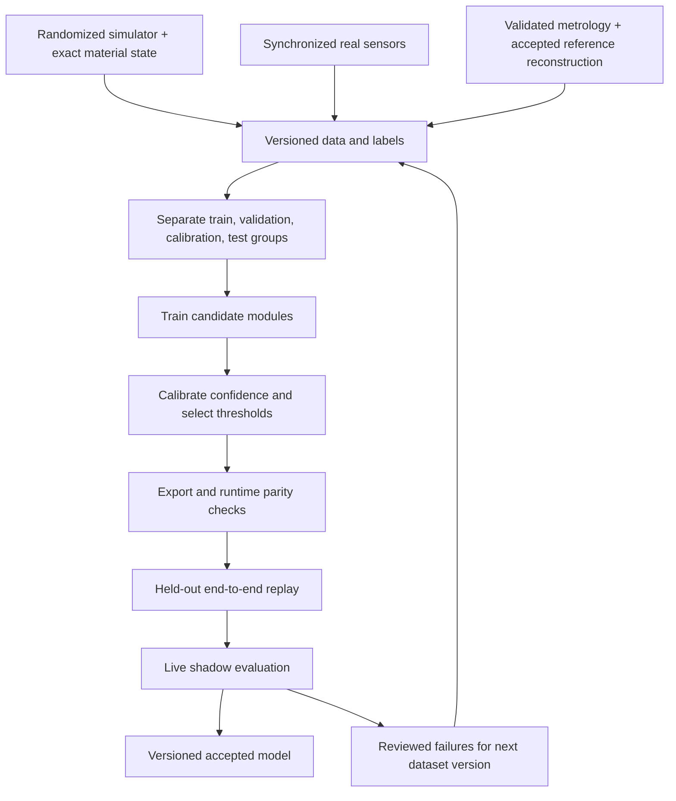

# Learning methods for fabric perception, state estimation, identification, and control

**Date:** 10 November 2026, America/New_York.

**Scope:** a separate implementation and training reference for learning-based methods already exposed by the code, proposed in the [research document](fabric-state-estimation-research.md), or useful extensions of the OARbot fabric project. Read alongside the [progress report](fabric-state-estimation-progress-report.md), which audits the non-learning implementation and existing experiment results.

**Evidence boundary:** source inspected at `b7821acce0e6ddbde252092c5f3fa251d66f7f13`, with the preceding documentation changes present. No training, new dataset collection, model download, GPU benchmark, or robot experiment was performed for this report. Architectures, losses, dataset sizes, tuning ranges, and package layouts below are **proposed engineering recipes**, unless explicitly identified as existing behavior or a cited author's result. They are not qualified hyperparameters or measured project performance.

**Second-pass revision (same day):** every arXiv identifier cited here was resolved against its record. Code-contract statements were re-checked against `b7821ac`, and the priorities were re-derived from the progress report's new localization of the teleoperation failure. Changes: [§1.1](#11-what-the-current-evidence-implies-for-learning) (priorities), [§13.1](#131-predict-distributions-over-future-grip-motion) (grip propagation is now an estimation problem, not only a planning one), plus additions on causal tracking ([§7.1](#71-learned-image3d-tracks)), a second UV configuration trap ([§7.3](#73-uv-training-confidence-and-estimator-use)), fabric identification precedents ([§12.1](#121-begin-with-identifiable-physics-not-a-parameter-network)), classical adaptive filtering ([§12.5](#125-learning-filter-settings-instead-of-replacing-the-filter)), sequential conformal methods ([§14.3](#143-conformal-regions-and-limitations)), sensor continuity ([§6.3](#63-alternatives-and-integration-changes)), and the work plan ([§17.2](#172-work-items-in-dependency-order)).

Reading guide: [current status](#1-current-status-and-recommended-priorities), [statistical roles](#2-where-learning-belongs-in-the-estimator), [data](#3-build-the-data-and-label-system-first), [shared training practice](#4-common-training-and-tuning-protocol), [perception](#5-sheet-segmentation-boundaries-and-occlusion), [depth](#6-depth-quality-refinement-and-stereo), [correspondence](#7-tracks-material-uv-and-yarn-orientation), [completion](#8-full-state-completion-and-reacquisition), [hands/contact](#9-hands-grip-location-and-contact-modes), [appearance](#10-learned-appearance-and-photometric-reconstruction), [dynamics](#11-residual-dynamics-and-differentiable-surrogates), [identification](#12-learning-material-parameters-and-their-posterior), [planning](#13-human-motion-active-sensing-and-control), [uncertainty](#14-calibration-uncertainty-and-out-of-distribution-behavior), [deployment](#15-export-ros-integration-and-model-release), [experiments](#16-evaluation-that-can-justify-a-learned-component), [delivery plan](#17-an-implementable-development-sequence), and [sources](#18-source-guide-and-literature-coverage).

## 1. Current status and recommended priorities

The repository is ready to **receive two types of learned image model**, but it does not yet contain a trained learning system. Most deployed operations remain geometric, signal-processing, filtering, or numerical optimization methods. Training an ONNX model is not the same milestone as implementing the inference adapter that can load it.

| Component | What exists now | Proposed learned extension | Priority and reason |
| --- | --- | --- | --- |
| Fabric/hand/robot image labels | HSV/ROI/mask baseline; optional four-class ONNX adapter | Small semantic segmenter, teacher-assisted annotation, boundary quality | Early if masks are a measured source of failure; fits an existing interface |
| Depth | Raw registered-depth quality gating | Learned validity/noise; metric refinement; optional learned stereo | Measure carbon observability first; depth synthesis can add bias |
| Point tracks | Sparse KLT with forward/backward checks | CoTracker/DELTA/TAPIP3D-class tracks and calibrated visibility | Offline comparison first; current fast profile disables KLT |
| Material UV | Optional RGB→UV/confidence ONNX adapter; no weights | Dense material correspondence with oriented grip/context conditioning | High value for initialization/tangential identity; symmetry must be handled |
| Full mesh initialization | Bilinear four-corner surface, sag, smooth random modes | Deterministic coarse completion, then conditional multiple hypotheses | After a useful dataset and correspondence baseline exist |
| Hands | Colored, identified glove tags; PnP/depth assistance; multi-view Kalman fusion; consumer extrapolates $p+\tau v$ without process noise | Short-horizon grip-motion prediction with calibrated uncertainty; gloved hand/keypoint detection, MANO fitting, learned grip offset if necessary | **Highest current value is propagation, not detection** ([§1.1](#11-what-the-current-evidence-implies-for-learning)); retain tagged fixtures; articulation is optional |
| Contact | Holding the configured corners is assumed | Learned emission likelihoods plus a hybrid mode filter | Required if release/slip/regrasp are allowed |
| Appearance | No mesh-bound photometric model | Gaussian/texture appearance optimized against multi-view RGB | Offline research branch; appearance must not absorb geometric errors |
| Dynamics | Fixed-parameter Newton; three uniform residual-force coefficients | Residual GNN/temporal model; material-conditioned or reduced surrogate | After boundary, calibration, and material-model problems are isolated |
| Material identification | Fixed nominal parameters in both tiers | Parameter encoder, neural posterior, differentiable inverse model | Needs identifiable physical experiments and valid force/grip models |
| Uncertainty/monitoring | Ensemble marginal covariance, fixed floors, heuristic diagnostics | Learned heteroscedastic noise, confidence calibration, shift detection | Required alongside each learned module, not a final cosmetic feature |
| Planning/control | Existing guard/admittance and simulated controller; estimator not yet driving the twin | Human-motion forecasting; learned dynamics in MPC; later imitation/RL | Begin with shadow planning after estimator acceptance |

Source evidence: [`fabric_perception/core.py`](../src/fabric_perception/fabric_perception/core.py), [`camera.yaml`](../src/fabric_perception/config/camera.yaml), [`human_hand_tracking`](../src/human_hand_tracking/human_hand_tracking), [`ensemble.py`](../src/fabric_state_estimator/fabric_state_estimator/ensemble.py), and [`smoother.py`](../src/fabric_reference_reconstruction/fabric_reference_reconstruction/smoother.py). No weights or project training/data-generation pipeline were found in the inspected source. The small [`synthetic.py`](../src/fabric_reference_reconstruction/fabric_reference_reconstruction/synthetic.py) generator is a software fixture, not a rendered carbon-learning dataset.

The first useful learning milestone should be **one independently validated component improving the existing pipeline**. Start with a reviewed real-data benchmark, a compact segmentation model, and an offline correspondence comparison. Advance UV/completion when material identity or initialization is limiting. Add dynamics learning after fixing boundary and physical-force inconsistencies. More networks cannot compensate for an undefined grip convention or biased labels.

### 1.1 What the current evidence implies for learning

The [progress report](fabric-state-estimation-progress-report.md#33-where-the-teleoperation-error-enters) finds that, in every glove run, human-held fabric corners have p95 errors of about 60–220 mm while the hand states feeding them are accurate to 2–5 mm. In the matched lean scripted run, oracle hands bring the same corners to 3.5–6.5 mm. The likely mechanism is non-learning: sparse 5 Hz hand states extrapolated up to 0.45 s without process noise, prescribed corners moved by the analysis, and analyses dropped when a tag is missed. Three consequences for learning:

1. **No image model in this report addresses the dominant measured failure.** Segmentation, UV, depth repair, and completion should wait until the boundary replay in Phase 1 has been run. Otherwise their gains or losses will be confounded with boundary error.
2. **The most valuable learning-adjacent work now is short-horizon grip prediction with calibrated uncertainty** over 0.05–0.45 s at fabric capture times ([§13.1](#131-predict-distributions-over-future-grip-motion)). Start with the classical constant-acceleration and IMM baselines; a learned model must beat them on coverage *and* error.
3. **Filter tuning before filter learning.** Adaptive or relaxation inflation and spread diagnostics from data assimilation are cheaper, better understood, and must be in place before any learned noise model can be judged ([§12.5](#125-learning-filter-settings-instead-of-replacing-the-filter)).

This does not change the long-term plan. It changes the order: L0 contracts and the grip-propagation item (L0b in [§17.2](#172-work-items-in-dependency-order)) come before L1.

## 2. Where learning belongs in the estimator

### 2.1 Keep physical state, observations, and learned priors distinct

Let $x_t=(q_t,v_t,d_t)$ describe material-indexed position, velocity, and residual loads; let $g_t$ be measured grips, $m_t$ contact modes, $\theta$ material parameters, and $y_t$ raw sensors. A conceptual posterior is

$$
p(x_{0:T},m_{0:T},\theta\mid y_{0:T},g_{0:T})
\propto p(\theta)p(x_0,m_0)
\prod_t p(y_t\mid x_t,m_t,\theta)
\prod_t p(x_{t+1},m_{t+1}\mid x_t,m_t,g_t,\theta).
$$

Learning can enter several factors without replacing the entire estimator:

| Role | Example | Proper use |
| --- | --- | --- |
| Observation extraction | Segmentation, track, tag/keypoint detector | Emit sensor-time observations with quality, visibility, and provenance |
| Observation error model | Depth variance or track reliability | Set calibrated likelihood weights; account for systematic/shared errors |
| Proposal/initialization | UV or full-state completion | Seed/repair hypotheses, then test against sensor residuals |
| Dynamics | Residual force or neural surrogate | Change the transition model and its process uncertainty |
| Parameter inference | Material posterior encoder | Initialize parameter distribution from an informative experiment |
| Decision support | Human-motion distribution or learned view utility | Condition planning/measurement scheduling; retain explicit constraints |

A discriminative predictor $p_\phi(x\mid y)$ already contains its training prior. It is not generally a likelihood $p(y\mid x)$. Multiplying it into a filter as an independent likelihood and then assimilating the same images again can double count evidence and the prior. Useful approximations exist, but must be declared and calibrated. For a first implementation, use UV/completion as **proposal mechanisms** or as deliberately conservative correlated cues, not unquestioned independent truth.

This distinction already matters in the code: [`UVPrior.msg`](../src/fabric_state_msgs/msg/UVPrior.msg) calls the network output a prior, but `observations.py` can convert it into pixel factors. Enabling that option requires an explicit fusion approximation and an ablation of joint UV/depth/track weighting. The comment alone does not solve statistical dependence.

### 2.2 Online causality and offline supervision

Tier B must use only inputs available by its decision time. A bidirectional tracker, a full-clip smoother, or a future-aware teacher can generate offline labels, but its delay/accuracy cannot be presented as causal performance. A temporal network must reset at bag seeks, time reversals, stream restarts, and calibration changes; hidden memory is part of its state contract.

Tier A can use future frames and expensive optimization. It can help label difficult real sequences only after validation. Its current output is a **reference candidate with fixed nominal physics and no posterior covariance**, not ground truth. Learned models trained on it can inherit its bias. Reserve independent physical truth to assess both the labeler and the learner.



The final test set stays locked. Once a failure clip influences model selection, relabel it as development data and acquire a new independent final test, retaining the original failure as a regression case.

## 3. Build the data and label system first

### 3.1 Data units, metadata, and split hierarchy

Use a **recorded episode** as the main unit, not an individual image. Each episode should identify:

- Physical ply ID, dimensions, areal mass, weave and oriented material axes; condition and handling history.
- Grips, patch sizes, corner/UV assignments, tag-to-pinch transforms, glove/fixture type, and any known contact transitions.
- Camera serial/pose/intrinsics/distortion, RGB-depth registration, exposure, IR geometry, sync configuration, host/device clock mapping, and source timestamps.
- Robot kinematics, base localization, TF, tool payload and force calibration; separate raw and compensated wrenches.
- Solver/mesh/timestep/material configuration for synthetic data; renderer, actual camera pose, appearance/noise seed, capture-consistency validation.
- Ground-truth source, visibility/support mask, label quality and known failure modes; annotator/teacher versions.
- Data split group and content hashes. All simultaneous camera views and all derived crops/labels from the same episode belong to the same group.

Prefer a small metadata index plus array storage chunked by episode/time; retain MCAP as the recording source. Integer nanoseconds must stay integers. Compact observations alone are insufficient to retrain a segmenter or repair depth; retain original images, IR, and calibration. The existing [`record_fabric_baseline.sh`](../scripts/record_fabric_baseline.sh) records the relevant standard streams when they are published, but does not automatically create training labels or complete experiment metadata.

One proposed sample schema is:

```text
episode metadata: ply_id, session_id, camera_id, calibration_id, split_group
capture: rgb_stamp_ns, depth_stamp_ns, image geometry, source frame
inputs: rgb, registered_depth_m, depth_valid, optional native_ir + calibration
pixel labels: semantic_class, annotation_valid, visible_uv, uv_valid
geometry labels: triangle_id, barycentric, surface_normal, occlusion
trajectory labels: material q/v, grip poses, contact modes, parameters
label metadata: source, uncertainty/support, accepted/rejected, content hashes
```

Do not require all labels for all samples. A manually segmented frame can train segmentation even when UV is unknown. Represent unavailable labels with explicit validity masks, not plausible defaults such as UV=(0,0) or zero force.

An initial split could allocate roughly 60/15/10/15% of **groups** to training, validation, calibration, and final test, adjusted to the number of independent sessions. The exact fractions are less important than enough independent groups and intended generalization. With very few sessions, use grouped cross-validation for development and acquire a final held-out session. Avoid tuning on the calibration set after calibrating it.

Define separate tests for same-ply/new-motion, new-session/lighting, new-glove/operator, new-ply/material, camera loss, and new contact regimes. Do not claim new-material generalization if material identity is shared across every split. Randomly splitting neighboring video frames yields misleadingly easy tests.

### 3.2 Synthetic labels: what to generate and how

The simulator already exposes private material state and rendered RGB/registered depth. Relevant external sources are [`truth.py`](/media/taha/ExtermeLinux/oarbot_simulation/oarbot/truth.py) and [`cell_sensors.py`](/media/taha/ExtermeLinux/oarbot_simulation/oarbot/cell_sensors.py). A dense per-pixel semantic/UV exporter is additional work, not an already provided training service.

For each synchronized camera capture:

1. Advance physics and verify that image, state, and camera pose refer to the same capture. Retain the simulation's strengthened render-freshness checks.
2. Export exact q/v, fixed vertex UV, topology, material parameters, grip state, camera pose, and source time.
3. Rasterize or ray-intersect the *first visible* triangle at each fabric pixel. Compute material UV by perspective-correct interpolation or triangle barycentric intersection, not screen-linear interpolation of a tilted triangle.
4. Render semantic/instance IDs and true depth/normal, with hand/gripper occlusion. Label back/front sides consistently if both are visible. A UV hidden behind a foreground layer is not a visible UV target.
5. Form cross-frame point trajectories by following a fixed material coordinate, reprojecting it, and separately checking visibility/depth ordering at each frame. Do not choose nearest visible pixels anew every frame.
6. Corrupt the input sensors; keep clean labels unchanged. Store corruption parameters to support diagnosis and held-out corruption families.

Start with a few dozen episodes to validate labels visually and geometrically. Then grow to thousands of varied episodes if learning curves justify it. A proposed initial development campaign is 1,000–5,000 synthetic episodes plus several hundred to a few thousand reviewed real frames across many clips, not a promised sufficient sample count. Temporal/contact/dynamics models need independent trajectories and transition diversity, not millions of redundant frames from one descent.

### 3.3 Randomize mechanisms that can actually vary

| Randomization | Correct implementation | Common error |
| --- | --- | --- |
| Appearance | Carbon BRDF, yarn texture scale/orientation tied to material axes, illumination/exposure, background and sleeves | Random texture unrelated to yarn/UV labels teaches nonphysical shortcuts |
| Camera | Pose, focal length and distortion with consistently updated calibration; motion blur/exposure | Warp image without updating geometry or UV/track labels |
| Physics | Identifiable material ranges, grip compliance, load/drag, valid contact regimes | Independent arbitrary parameters yield unstable or physically irrelevant samples |
| Depth | Empirically fitted range/incidence/amplitude-dependent bias, dropout, edges, spatial/temporal correlation | White Gaussian noise alone does not model dark-carbon ToF failures |
| Timing/transport | Capture offsets, source-time motion, dropped/late frames, outages | Shifting images in time while leaving their timestamp label unchanged |
| Occlusion | Realistic hand/gripper masks, multi-layer visibility, partial field of view | Treat every rendered cloth vertex as visible supervision |

Keep the actual ply's nominal dimensions and orientation known to models that assume them. If training cross-ply models, vary dimensions with explicit conditioning. Rotating a fabric patch's visual weave without rotating its constitutive axes is appropriate only when deliberately modeling a measured appearance/axis mismatch.

Current estimator physics disables self/obstacle contact. Do not manufacture training folds by letting cloth pass through itself and then claim contact-aware completion/dynamics. Use a qualified contact-capable data generator or limit the training/support envelope. Include multiple solver families or measured trajectories to reduce dependence on one simulator's artifacts.

### 3.4 Real labels, teachers, and independent truth

Use SAM-class models to propose masks, then review material boundary, robot, sleeve, glove, and fold cases. A teacher's high confidence is not an annotation audit. Review all early labels; later use risk-stratified review with mandatory checking of challenging conditions and a random sample of easy frames.

Create separate labels for semantic surface, visible external material boundary, occlusion edge, and ignore/uncertain region. A fold silhouette may be a valid sheet/background boundary for segmentation but is not necessarily the topological outer boundary used by the current estimator. Preserve that distinction.

For UV/state, temporary material markers or other independent correspondence on a sacrificial ply are valuable. Avoid teaching the production network to depend on evaluation-only markers: mask/inpaint only with an audited strategy, use synthetic unmarked counterparts, and test on genuinely unmarked data. Markers can change mechanics/appearance; record those changes. Static scans help shape, not dynamic material velocity. Multi-view fitting helps labels only where camera/offset calibration and triangulation are reliable.

Accept Tier A pseudo-labels only after convergence, sensor agreement, correspondence and independent-truth checks, and sensitivity to reasonable prior changes. Keep their quality masks/weights. Do not treat a low dynamics residual as proof of correct cloth geometry. Train an independent-label-only baseline to measure pseudo-label bias.

## 4. Common training and tuning protocol

### 4.1 Establish a small, reproducible experiment before scaling

For every task, define the input/output tensor contract, label validity, normalization, deployment latency budget, classical baseline, and downstream metric **before** selecting a network. Freeze dataset/split hashes and record seed, source commit, dependency lock, optimizer/schedule, initialization checkpoint hash, and preprocessing.

Run this sequence:

1. Visualize raw samples and augmented labels in the same coordinates. Reproject UV/geometry to catch flipped axes, wrong depth units, and time mismatch.
2. Overfit 8–32 independent labeled samples or short clips. Failure usually indicates a label, loss, masking, preprocessing, or gradient problem.
3. Train a small model on the full training set. Compare with frozen pretrained inference and the existing classical pipeline.
4. Tune a limited search on grouped validation. Select by physical/downstream quality and deadline compliance, not training loss alone.
5. Calibrate on the separate calibration split, export, and test runtime parity. Evaluate the locked test once for the selected release.
6. Replay complete sequences, then run shadow operation. Save failures for the next dataset version.

### 4.2 Starting optimization ranges, not defaults to trust

For compact supervised perception models, a practical **initial search** is AdamW, pretrained encoder learning rate $10^{-5}$–$10^{-4}$, new-head learning rate $10^{-4}$–$10^{-3}$, weight decay $10^{-5}$–$10^{-2}$, a short warm-up followed by cosine/plateau scheduling, and batch size determined by measured memory. Use 3 or more seeds on shortlisted runs. Architecture-specific official fine-tuning recipes take precedence when adapting their code; record any changes.

Freeze the encoder briefly if annotations are scarce, then compare partial and full fine-tuning. Do not change batch normalization statistics accidentally with tiny batches; consider a frozen encoder's normalization or a normalization design suitable for small batches. Mixed precision, gradient accumulation, and clipping can help, but inspect numerical/gradient behavior and final precision parity. Increasing accumulation does not necessarily replicate large-batch normalization.

Train until grouped validation saturates, with an explicit budget and early stopping. For first planning, 20–100 epochs for a compact model is a reasonable range to test, but an epoch is not comparable across different dataset samplers. Record optimizer updates and effective episode diversity. Large pretrained teachers, diffusion models, and simulator surrogates require their own measured budgets.

Use log-spaced coarse searches before local refinement. Search one uncertainty/quality threshold only after predictions are fixed. Control the number of trials and report it; repeated selection against one small validation set overfits it too. Never tune on future test episodes or silently choose the best seed's test result.

### 4.3 Augmentation must preserve the problem's physics

Photometric jitter is usually harmless within realistic sensor conditions. Spatial transforms require corresponding transforms of masks, pixels, intrinsics, tracks, and geometry. Horizontal flips require special care: mirror image geometry consistently, preserve physical hand identity with a declared convention, and transform UV only if the intended material-coordinate task changes. A screen flip does not automatically turn warp into weft or human-left into human-right.

Use the **same sampled temporal augmentation** across a track clip when it represents one camera change; independently jittering geometry each frame creates fake dynamics. Apply plausible varying exposure/noise separately. For metric tasks avoid resizing/cropping that discards calibration information the model needs.

Balance rare release/slip/failure events by episode/transition sampling rather than duplicating adjacent frames until they dominate. Track the resulting training priors, because class reweighting affects calibrated probabilities. Include hard negatives such as dark sleeves and empty gloves. Keep validation/test prevalence representative of the declared operating distribution and report condition-specific metrics.

### 4.4 Losses must respect missing and uncertain labels

For valid labels $\mathcal V$, minimize a normalized masked objective

$$
\mathcal L=\frac{\sum_{j\in\mathcal V}w_j\ell(\hat y_j,y_j)}{\sum_{j\in\mathcal V}w_j+\epsilon}.
$$

Normalize per episode/view/task where appropriate so densely sampled easy pixels do not overwhelm rare transitions or small boundaries. Weights for uncertain teacher labels should be externally justified; a network must not assign its own weights solely to erase difficult training errors. Keep uncertainty on the labels separate from predicted model uncertainty.

For multiple losses with different units, normalize by declared task scales, inspect gradients, and ablate added terms. An arbitrary sum of metres, pixels, newtons, and UV error can silently prioritize the wrong physical quantity. A low composite loss must be accompanied by each physical error and failure metric.

## 5. Sheet segmentation, boundaries, and occlusion

### 5.1 Choose the teacher and student for different purposes

Use a large promptable model to assist annotation and audit propagation. [SAM 2's official training guide](https://github.com/facebookresearch/sam2/blob/main/training/README.md) supports custom image/video fine-tuning; its published multi-GPU example is not a required resource specification for a small cell model. [SAM 3](https://github.com/facebookresearch/sam3) is another teacher candidate. Test both on carbon/gloves before selecting one. Prompted binary object tracking does not directly produce the repository's four mutually exclusive semantic classes.

For live deployment, first train a compact encoder-decoder with convolutional operations known to work in the target OpenCV runtime. Inputs are RGB; outputs are background, sheet, human, and robot logits. Add explicit boundary/quality heads only if a consumer exists. [EdgeTAM](https://github.com/facebookresearch/EdgeTAM) and [EfficientTAM](https://arxiv.org/abs/2411.18933) are video-model alternatives, but their prompt/memory interfaces require a new runtime wrapper. Their mobile/server speed claims do not establish helper-laptop throughput or compatibility with the current one-image ONNX contract.

**Practical implementation:** retain the present ROI, exact robot/static mask exclusions, component handling, and boundary-occlusion rules around the learned model. Training segmentation need not replace calibrated gripper masks. A deployed student's failure must remain observable in debug masks and diagnostics.

### 5.2 Labels and training objective

The current network classes are 0=background, 1=sheet, 2=human, 3=robot. Runtime label 4 means uncertain; it is **not** a fifth network output. Map uncertain training pixels to an ignore mask. Keep glove surfaces in the human class; label industrial sleeves and bare skin as human when visible.

A suitable proposed loss is

$$
\mathcal L_{\rm seg}=\mathcal L_{\rm weighted\ CE}
+\lambda_D\mathcal L_{\rm Dice,sheet}
+\lambda_B\mathcal L_{\rm boundary}.
$$

Cross-entropy learns class separation; Dice can counter foreground/background imbalance; a boundary term emphasizes the edge accuracy that drives cloth factors. A binary boundary target can be a narrow band around the annotated sheet boundary. If a separate signed-distance head is used, supervise truncated distance in image pixels or normalized physical scales with clear units. Exclude uncertain occlusion junctions from outer-material-boundary supervision.

Begin with CE, add Dice only if imbalance warrants it, and add boundary loss only if it improves held-out boundary distance without raising false sheet detections. Oversampling boundaries or inverse-frequency weighting changes optimization and can harm probability calibration; calibrate the final model, not an intermediate one.

Optional temporal consistency compares predictions after a valid flow warp, only where the same material/background is visible and the warp is reliable. Do not penalize changed visibility, true contact transitions, or cloth motion as flicker. Static image consistency without motion compensation encourages lagging masks.

For distillation, train a student with reviewed hard labels and temperature-scaled teacher probabilities:

$$
\mathcal L_{\rm distill}=T^2\operatorname{KL}
\big(p_{\rm teacher}^{(T)}\,\|\,p_{\rm student}^{(T)}\big),
$$

restricted to accepted teacher regions. A mask teacher may supply only a binary sheet target; it cannot invent trusted human/robot labels. Compare with hard-label training alone. Distillation transfers teacher errors as well as useful features.

### 5.3 Tuning, evaluation, and acceptance

Tune resolution, loss balance, foreground sampling, and encoder fine-tuning first. Then tune the runtime softmax threshold and component size on validation/calibration data, preserving the exact softmax→probability-resize→threshold ordering in [`Segmenter.infer()`](../src/fabric_perception/fabric_perception/core.py). The current example 0.65 threshold and area=300 pixels are unvalidated operating points.

Report class IoU, sheet precision/recall, boundary precision/recall and p95 boundary distance, missed visible components, and false boundaries near hands/robots. Convert pixel error into metric error using depth/local geometry where possible. A high IoU can coexist with unacceptable edge bias. Also report dropout rate, processing latency, and downstream mesh/corner errors on complete clips.

A learner is accepted when it improves the failure classes that motivated it and keeps the observation-time deadline on the deployment host. Compare HSV, frozen teacher/student, fine-tuned student, and mask+geometry exclusions. Robust background/fixture design may still be the best solution for a narrow cell.

## 6. Depth quality, refinement, and stereo

### 6.1 Begin by learning when raw depth is reliable

A lower-risk first model predicts the probability that a raw depth sample is usable and its error scale. Inputs can include RGB, raw depth, validity, local depth gradient, range, and properly registered IR/amplitude. The current ToF pipeline only quality-gates raw depth; it has no learning or amplitude fusion.

Create labels from independent reference depth at the same surface/time. For raw value $D_r$ and reference $D^*$, define a task-specific validity event such as

$$
c^*=\mathbf1\{\text{same visible surface and }|D_r-D^*|<\tau_D\}.
$$

Train quality with a proper binary scoring loss, and regression error/variance only where the reference is trustworthy. Evaluate bias, error tails, and retained-pixel coverage versus quality threshold. A model retaining only easy pixels can obtain low error while leaving the important region unobserved; show the entire risk/coverage curve.

IR images originate in depth-camera geometry, while the existing adapters consume RGB geometry. Either register IR with its geometry and validity/occlusion handling or use a calibrated multi-branch fusion model. Resizing IR to RGB resolution alone is not registration. Sensor-specific calibration is a prerequisite, not an optional learned correction.

### 6.2 Metric refinement

[Camera Depth Models (CDM)](https://arxiv.org/abs/2509.02530) and the [official code](https://github.com/ByteDance-Seed/manip-as-in-sim-suite) motivate RGB/raw-depth refinement. The released [Kinect checkpoint card](https://huggingface.co/depth-anything/camera-depth-model-kinect/blob/main/README.md) identifies a model and its terms; do not infer that it is calibrated for these serials, modes, carbon weave, and viewing angles. Establish frozen-checkpoint performance before collecting fine-tuning data. The official repository currently provides inference-oriented material; verify the exact training resources at a pinned revision rather than assuming a complete camera-specific training engine is supplied.

A proposed trainable model takes $(I,D_r,V_r)$ and optionally registered IR. It predicts positive metric depth $\hat D$ and bounded uncertainty. For valid raw samples, a residual $\hat D=D_r+\Delta D$ is a useful bias toward metric scale; invalid pixels need a separate completion path because adding to a zero placeholder does not encode a measured anchor.

Use a masked robust metric loss plus optional surface-normal and within-surface gradient losses:

$$
\mathcal L_D=\sum_{p\in\mathcal V}\rho(\hat D_p-D_p^*)
+\lambda_n\big(1-\hat n_p^Tn_p^*\big)
+\lambda_g\|\nabla\hat D_p-\nabla D_p^*\|_1.
$$

Normals use correct intrinsics. Gradient/normal supervision must not cross depth discontinuities or hidden foreground layers. Avoid an affine scale-aligned depth loss as the sole criterion: absolute metric accuracy is the objective. A consistency penalty on high-quality raw anchors is useful only after their bias is measured; blindly forcing all valid sensor returns to be correct preserves ToF bias.

For heteroscedastic Gaussian regression, the per-pixel objective can be

$$
\ell_p=\tfrac12e^{-s_p}(\hat D_p-D_p^*)^2+\tfrac12s_p,
\qquad s_p=\log\sigma_p^2.
$$

Include a physically measured variance floor, prevent numerical extremes, and check real held-out coverage. This construction, related to [Kendall and Gal](https://arxiv.org/abs/1703.04977), learns an error model under its assumptions; it does not establish calibrated uncertainty under arbitrary shifts. Shape-completion uncertainty and raw-depth noise are different quantities.

**Training progression:** validate labels on static planar/curved carbon targets; characterize conditional sensor errors; pretrain on measured-noise synthetic pairs; fine-tune on independently referenced real samples; then test motion and unseen incidence/lighting. Time-averaged depth cannot label moving cloth unless motion/material correspondence is known. Reference stereo also has errors; do not automatically label every disagreement as ToF failure.

### 6.3 Alternatives and integration changes

[Prompt Depth Anything](https://arxiv.org/abs/2412.14015) can use metric depth prompts, but Azure prompts differ from its original acquisition regimes. Test anchor density/bias and complete dropout explicitly. If neither ToF nor appearance constrains a hidden layer, a plausible prediction remains a prior.

[FoundationStereo](https://github.com/NVlabs/FoundationStereo) is an independent stereo candidate. For rectified focal length $f$, baseline $B$, and disparity $d$,

$$
Z=fB/d,\qquad \sigma_Z\approx(fB/d^2)\sigma_d.
$$

Choose geometry from the required working-distance precision, then test repeated weave, glare, lighting, motion synchronization, and occlusion. Learned matching cannot remove the geometry/visibility limitations of the rig. Frozen inference before fine-tuning often gives the most informative feasibility result.

The current [`ros_adapters.py`](../src/fabric_state_estimator/fabric_state_estimator/ros_adapters.py) rejects nonempty depth under provenance other than `raw_registered_quality_gated`. A refinement deployment therefore requires an explicit new source/uncertainty contract and consumer changes; relabeling repaired depth as raw is incorrect. Retain raw/refined streams separately, carry model/calibration IDs and support masks, and avoid assimilating both as independent evidence. Calibration error should be shared or conservatively modeled across samples.

**Acceptance:** visible-surface metric bias/tails, dropout coverage, edge leakage, covariance coverage and size, downstream q/v performance, and processing age improve over raw gating. Report repaired-but-unmeasured regions separately. Faster or denser predictions alone are not evidence of more information.

**Sensor continuity matters for any learned depth model.** Azure Kinect noise depends on target reflectivity ([Tölgyessy et al. 2021](https://doi.org/10.3390/s21020413)), and no published measurement of dry carbon weave was found. Microsoft ended Azure Kinect DK production in 2023, and Orbbec's Femto Bolt is the announced successor with the same depth module. A quality or refinement model trained on one unit's noise must be re-validated on replacement hardware and modes. Keep camera serial, depth mode, and firmware in the dataset metadata and as model-release conditions.

## 7. Tracks, material UV, and yarn orientation

### 7.1 Learned image/3D tracks

Begin with frozen offline [CoTracker3](https://github.com/facebookresearch/co-tracker) on representative recorded RGB. Compare with KLT using independently known material trajectories. [DELTA](https://arxiv.org/abs/2410.24211), [DELTAv2](https://arxiv.org/abs/2508.01170), and [TAPIP3D](https://arxiv.org/abs/2504.14717) are alternatives for 3D/long-range tracking. Choose a causal variant for Tier B and retain the original capture timestamps even when predictions arrive after buffering.

For Tier B specifically, compare a tracker designed to be online. [Track-On (ICLR 2025)](https://arxiv.org/abs/2501.18487) processes frames one at a time with spatial and context memory and reports state-of-the-art online accuracy on TAP-Vid-style benchmarks; CoTracker3's online mode is the other natural candidate. Uniform, low-texture regions are a known difficulty for this class of tracker, and dark carbon weave is close to that worst case. Measure track survival and material-swap rate on real plies before assuming benchmark accuracy transfers. Offline bidirectional trackers remain appropriate for Tier A and for labeling.

Implementation steps:

1. Sample points on visible sheet interior away from uncertain masks and problematic edges, with spatial diversity. Keep a bounded track budget.
2. Track in the model's resized/cropped coordinates and transform predictions back to raw RGB pixels with the exact inverse transform. Keep camera ID, process/stream ID, track ID, and original birth time.
3. Carry visibility/occlusion and quality; gate implausible jumps, loss of sheet support, and disagreement with geometry. Do not turn an occluded prediction into an observed pixel.
4. On moving wrist cameras, use the pose/intrinsics of each original capture. A 3D prediction in a camera coordinate system must be transformed at that time, not by latest TF. View-dependent recovered depth may share the same depth prior as other observations.
5. At material binding, retain competing matches where needed and track uncertainty from the birth association. A consistent pixel trajectory is not automatically the correct yarn identity.

For fine-tuning, synthetic fixed-material trajectories supply point positions and visibility. A proposed loss combines visible coordinate error, visibility BCE, and reliability/temporal terms. Sample long occlusions, fold crossings, highlights, and close repeats. Bootstrap real tracks using accepted independent correspondence or reviewed multi-view constraints; do not fine-tune solely to agree with the nominal cloth observer.

The current [`PointTrack.msg`](../src/fabric_state_msgs/msg/PointTrack.msg) has no general learned track covariance/visibility probability, and the estimator conversion retains essentially ID/birth/pixel while using configured noise. Add fields and pass them through the adapter/operator if learned quality should affect weights. A new tracker can otherwise improve points without delivering its calibrated uncertainty. Do not reinterpret learned visibility as `forward_backward_error`.

Tune number of queries, temporal window, model resolution, confidence and gap reset; measure total buffering latency, not kernel time alone. Metrics include pixel/metric trajectory error, occlusion accuracy, false material swaps, long-occlusion recovery, and the mesh ablation. A visually smooth trajectory or high average track accuracy can hide rare catastrophic correspondence swaps.

### 7.2 UV prediction and identifiability

For each visible pixel, predict its persistent material coordinate $s=(u,v)\in[0,1]^2$. Synthetic labels come from the visible triangle's material stencil. [GarmentTracking](https://arxiv.org/abs/2303.13913) motivates canonical-coordinate inference; this project's rectangular dry ply is a different category and sensing domain.

The current RGB-only ONNX adapter expects `[u,v,confidence]`. A first model can share a compact encoder with segmentation offline, or use its own encoder to simplify debugging. During training supervise UV only on visible, identified sheet material and define confidence independently. With dimensions $(W,H)$, use metric-scaled rest-coordinate error

$$
\mathcal L_{UV}=\sum_{p\in\mathcal V}w_p\rho\left(
\operatorname{diag}(W,H)(\hat s_p-s_p^*)\right).
$$

This makes the meaning of a UV tolerance explicit. It measures rest-material displacement; actual deformed 3D error also depends on the local deformation gradient. Do not substitute raw image-normalized coordinates for UV.

**Symmetry is a real ambiguity.** A uniform unmarked rectangle can have indistinguishable rotations/reflections or repeated weave locations. If an image contains no oriented anchor or temporal context, a network cannot recover unique material identity from nonexistent evidence. Options are conditioning on projected identified grips/UV anchors and camera calibration, adding temporal memory, multi-view features, or retaining a finite symmetry/hypothesis set. These require extending the current three-channel image input/contract or encoding anchors explicitly; they are not enabled by setting `uv_model`.

A single squared-error prediction can average valid alternative assignments into an invalid one. For an ambiguous sample, use a symmetry-aware hypothesis loss only if the task permits equivalence, or train separate oriented hypotheses and evaluate assignment likelihood under measured anchors. Do not change the coordinate convention opportunistically per frame when velocity/strain need persistent identities.

### 7.3 UV training, confidence, and estimator use

Add cross-view and temporal UV consistency only for accepted matches of the same material point. Spatial smoothness belongs inside a continuous visible surface, not across silhouettes or overlapping folded layers. Oversample human/gripper borders and partial folds; masking them all out can leave the most useful anchors unlearned.

Define confidence as a measurable event, e.g. $P(\|\operatorname{diag}(W,H)(\hat s-s^*)\|<\tau_s\mid I)$, and calibrate it. To avoid a network trivially hiding every hard regression sample, do not multiply the supervised UV loss by freely predicted confidence without a proper probabilistic objective or external label weights. Train quality against correctness of out-of-fold/frozen predictions, or use a validated joint likelihood. Synthetic visibility alone is not UV correctness.

Tune architecture/conditioning first; then calibrate threshold and variance by range, texture support, occlusion, and motion. The current node publishes configured isotropic UV variance, not network-predicted covariance. Its adapter discards off-diagonal entries, and the factor builder uses a conservative scalar approximation. A covariance-output network requires coordinated message/conversion/operator changes. Near a symmetry ambiguity, one covariance ellipse may still be the wrong representation.

Use the model first to bind tracks or seed hypotheses. If adding UV factors to the current filter, apply conservative weighting and a matched ablation of correlated image cues. A full local covariance propagated to pixels would be approximately

$$
\Sigma_{\rm pixel}=J_{\pi q}J_{qs}\Sigma_sJ_{qs}^TJ_{\pi q}^T+\Sigma_{\rm image}.
$$

The current simplified operator does not implement this full expression. High confidence must not override visibility/depth ordering, attachment convention, or contradictory measured evidence. Test flat-state UV error, hidden/visible material identity, symmetry errors, fold initialization, tangential drift, and downstream velocity/strain.

The example `uv_stddev=0.05` corresponds to 42 mm per material axis for a 0.84 m ply before deformation/projection; it is not a measured error. The adapter bilinearly resizes UV channels. Interpolating coordinates across an occluding fold can create a material coordinate belonging to neither layer. Exclude such neighborhoods or implement visibility/edge-aware sampling and verify it end to end; high confidence averaged across the same boundary is not a cure.

There is also a current configuration trap: `ObservationBuilder` uses its `max_tracks` limit for **both tracks and UV sampling**. Fast/monitor configs set that limit to zero. Thus `use_uv=true` alone still creates no UV factors there. Add a separate UV budget, or set an appropriate positive observer track/UV budget while leaving perception KLT disabled. Verify factor counts rather than assuming a loaded network changed estimation.

A second trap: the factor builder discards UV samples with confidence below a **hard-coded 0.7**, independently of the perception node's `uv_confidence` parameter, which also defaults to 0.7. Lowering `uv_confidence` after calibration therefore changes what is published but not what is assimilated. Make the estimator-side gate configurable, and treat it as part of the calibrated operating point, before tuning the UV threshold.

### 7.4 Yarn orientation and shear

Before training, test whether RGB resolves warp/weft at the working distance. A structure tensor or Fourier method is a valuable classical baseline. A network can then regress a line orientation with a periodic encoding $(\cos2\alpha,\sin2\alpha)$, avoiding the artificial discontinuity between 0 and $\pi$. For two indistinguishable yarn families, use a permutation-aware representation until warp/weft identity is independently established.

Synthetic material axes and close-range independently measured fiber angles supply labels. A cosine loss on normalized periodic vectors handles line ambiguity; confidence needs to measure resolvability, not just contrast. Include blur, glare, weave repeat, and severe tilt. Ordinary projected 2D angle difference is **not** the material shear angle: recover tangent-plane directions with calibrated surface geometry before comparing with $\gamma=\pi/2-\alpha_{\rm warp,weft}$. Grazing views can be ill-conditioned.

An angle factor needs a new observation message/operator and proper uncertainty; it is absent today. Validate against an independent angle instrument or metrology before using it to identify shear stiffness. [Osterberger et al.](https://www.frontiersin.org/journals/materials/articles/10.3389/fmats.2023.1133788/full) support separate shape/fiber-angle validation while also documenting geometric measurement limitations.

## 8. Full-state completion and reacquisition

### 8.1 Start with a deterministic coarse baseline

Inputs should include visible image/depth features, validity, camera calibration, measured oriented grips and their covariance, and material dimensions. Predict a **material-indexed coarse mesh**, preferably a residual over the current grip-conditioned bilinear prior. Normalize position by a declared sheet scale and represent camera/world transformations explicitly. Predicting arbitrary unordered points is insufficient when the downstream task needs velocity, strain, and parameter identification.

Useful losses include material-indexed q error, visible depth/boundary reprojection, directional stretch/shear penalties, and attachment consistency. Chamfer distance is an auxiliary shape metric, not an identity metric: it can be small after swapping material assignments. Do not enforce zero hidden-state variance merely because synthetic data has one exact state per input.

Measure errors separately on visible, hidden, and grip-near regions. Compare corners-only initialization, learned initialization with identical subsequent refinement, and the complete observer. The objective is a larger convergence basin and faster recovery, not a plausible isolated rendering.

[MEDOR (Huang et al., RSS 2022)](https://arxiv.org/abs/2206.02881) is a useful precedent for the "predict, then refine against observations" pattern. It predicts a full cloth mesh in canonical space from a partial point cloud and then applies test-time optimization against the observation to correct it. That matches the proposal-then-refinement role recommended here. Its garments and canonical-pose assumptions differ from a gripped flat ply.

### 8.2 Conditional VAE or diffusion when there are real alternatives

[RaggeDi](https://arxiv.org/abs/2409.11831) and [Diffusion Dynamics Models with Generative State Estimation](https://arxiv.org/abs/2503.11999) motivate conditional generation for occluded cloth. Adapt the representation and hypotheses to this ply rather than copying reported runtime/accuracy numbers.

For a conditional VAE, encode ground-truth mesh residual $r$ and observations $c$ into $q_\eta(z\mid r,c)$, learn a conditional prior $p_\psi(z\mid c)$, and decode $\hat r=f_\phi(z,c)$. A standard proposed objective is

$$
\mathcal L_{\rm CVAE}=\mathbb E_{q_\eta}\ell(r,f_\phi(z,c))
+\beta\operatorname{KL}\big(q_\eta(z\mid r,c)\,\|\,p_\psi(z\mid c)\big).
$$

At deployment sample the **prior**, not the label-dependent encoder. Tune latent size, reconstruction scaling, and KL schedule; inspect whether samples actually differ in the occluded uncertainty rather than arbitrary jitter. A strong decoder can ignore its latent variable. [Sohn et al.](https://papers.nips.cc/paper_files/paper/2015/hash/8d55a249e6baa5c06772297520da2051-Abstract.html) provide the conditional generative framework.

A conditional diffusion model corrupts a normalized mesh residual or latent representation:

$$
r_k=\sqrt{\bar\alpha_k}r_0+\sqrt{1-\bar\alpha_k}\epsilon,
\quad \mathcal L_{\rm diff}=\mathbb E\|\epsilon-\epsilon_\phi(r_k,k,c)\|^2.
$$

This is the noise-prediction construction from [Ho et al.](https://arxiv.org/abs/2006.11239), applied here as a proposed mesh model. The temporal noise index $k$ is distinct from physical frame time. Train conditioning dropout only if a corresponding inference method is planned. Stronger guidance can reduce diversity and calibration; compare sampling steps, guidance, and physical projection rather than maximizing visual sharpness.

Use a coarse UV-grid residual or learned low-dimensional latent to keep training/inference practical. Preserve exact material topology. Hard-prescribe trusted grip degrees of freedom or model them jointly and consistently; ensure the decoder does not move a supposedly prescribed corner. Physical projection must distinguish diagonal changes from true warp/weft extension and must not erase supported folds. Completion training needs physically valid fold/contact data that the present hanging-sheet backend does not provide.

### 8.3 Turn samples into estimator hypotheses properly

At initialization/reacquisition:

1. Generate several q hypotheses conditioned on the current measurements and their quality. Associate each with its contact/UV orientation interpretation.
2. Reject impossible attachment assignments and unsupported topology/intersections using a qualified physical/contact model. Re-score visible raw residuals without pretending the proposal is a new sensor.
3. Retain diverse plausible hypotheses. Refine them with separate local ensembles or a hypothesis bank when alternatives differ topologically/contact-wise.
4. Estimate velocity from a causal temporal model/history or initialize it with appropriately broad uncertainty. A single still image does not determine v; setting v=0 with tight covariance gives false certainty.
5. Record that a reset occurred, its input timestamp, hypothesis weights, and subsequent acceptance/failure. Do not refresh measurement age with generated states.

The present LETKF is a local approximately Gaussian update. Pooling incompatible fold hypotheses into one ensemble and publishing their mean can put cloth through empty space. Multiple generated samples do not automatically make the current filter multimodal; hypothesis management is new implementation work.

For tuning, compare a small CVAE, deterministic completion plus calibrated perturbations, and diffusion under the same latency budget. Measure top-1 accuracy, best-of-K **and** weighted coverage, calibration, identity preservation, false resets, recovery time, and downstream q/v. Best-of-K alone uses hindsight and can reward thousands of mostly bad samples. Verify that diversity is larger where evidence is genuinely missing, and that identical clear observations give concentrated hypotheses.

## 9. Hands, grip location, and contact modes

### 9.1 Learn only the missing hand information

The existing tagged-glove path already provides identity and a calibrated point used as the grip. Preserve it as a baseline and label aid. If the immediate problem is occasional missed tags, options include better viewing geometry, a rigid marked pinch fixture, or a learned glove/tag-region detector before committing to full finger articulation.

The current tag search is color-region supported. A learned hand/glove mask can improve search regions, but simply enabling ONNX semantic segmentation does not automatically replace that search: tag detection occurs earlier in [`FabricCamera.images()`](../src/fabric_perception/fabric_perception/node.py). Integration may require reordering or an independent detector while retaining timing and missing-data behavior.

For arbitrary pinch geometry, evaluate [WiLoR](https://arxiv.org/abs/2409.12259) and [HaMeR](https://geopavlakos.github.io/hamer/) first with actual gloves, views, motion, and truncations. [MANO](https://mano.is.tue.mpg.de/) is a parametric hand model mapping pose/shape to vertices/joints, not a detector or contact sensor. Its surface is not the true outer glove, and licenses for code, checkpoints, and MANO assets are separate artifacts to record.

### 9.2 Build and fine-tune a gloved-hand pipeline

**Labels:** hand boxes/identity, visible/occluded 2D keypoints, calibrated multi-view 3D keypoints, a physical pinch point or fixture transform, and confidence/support. Instrumented/marked gloves can supply some labels; tag position is not ground truth for every finger joint or pinch under glove deformation.

**Model:** separate detector and crop-based pose model unless an end-to-end system measurably helps. Retain crop/rescale transforms and handedness; adjust camera intrinsics for crops. Use calibrated perspective projection for world-frame metric recovery. Weak-perspective root-relative hand accuracy does not establish absolute grip-position accuracy.

An example objective is

$$
\mathcal L_H=\lambda_{2D}\sum w_j\rho(\pi(J_j)-k_j)
+\lambda_{3D}\sum w_j\rho(J_j-J_j^*)
+\lambda_G\rho(p_{\rm pinch}-p_{\rm pinch}^*)
+\mathcal L_{\rm pose/shape\ prior}+\mathcal L_{\rm temporal}.
$$

Bone/pose priors prevent implausible articulation but should not dominate observed glove geometry. Temporal smoothness must allow fast release/regrasp. Root/world-position loss should be evaluated without Procrustes alignment that hides scale/translation errors. Separate detection recall from conditional pose error; reporting only pose on detected hands excludes the common failure.

Fine-tune in stages: detector and crop convention first; pose head with a frozen backbone; then partial/full backbone adaptation if held-out gains justify it. Augment realistic glove material, wrinkles, contamination, sleeves, tag occlusion, motion blur, crossed hands and partial framing. Evaluate across operators and glove types. If fitting per-person hand shape, estimate it on calibration data without leaking test trajectories.

Multi-view fusion can robustly triangulate synchronized keypoints and fit MANO by minimizing reprojection/3D/prior factors. [TriHands Appendix B](https://arxiv.org/html/2606.06627v1) is a relevant pipeline example. Initialize fitting from a single-view network; reject poorly conditioned triangulation and calibrate residuals. Do not assume multiple views eliminate a shared camera calibration or glove-to-pinch bias. Retain the current covariance/identity/time contracts in the replacement point output.

**Acceptance:** absolute world pinch error, availability, identity swaps, covariance coverage, propagation-to-fabric-time error, transition delay, and compute/transport age. Full hand mesh error is secondary if only the pinch point affects the fabric observer.

### 9.3 Learn contact emissions; keep the hybrid mechanics explicit

Required modes are free, pinch, slip, and release/transition, with material attachment $s_h=(u_h,v_h)$ and uncertain offset. A useful first learner is a small classifier/temporal model over hand-sheet separation, relative velocity, occlusion/boundary features, grip aperture/tactile signal where available, force consistency, and measurement age. It should not infer contact solely from hand position or zero relative velocity.

Labels must come from independent contact evidence: instrumented pinch fixtures, reviewed multi-view video, tactile/pressure sensing, or controlled release/slip trials. Force alone does not split total human load between hands, and a held corner can carry nearly zero load. Keep ambiguous labels uncertain; do not supervise every visible glove as holding because the current code says so.

A transparent model uses an HMM or IMM for mode persistence plus learned observation evidence. For HMM transitions $A_{ij}$ and emission $L_t(j)$,

$$
p_t(j)\propto L_t(j)\sum_i A_{ij}p_{t-1}(i).
$$

If a classifier outputs $p_{\rm train}(m\mid f)$, it is not directly the generative emission $p(f\mid m)$. Under justified prior-shift assumptions, divide by its training mode prior to obtain relative likelihoods, or train/validate a discriminative sequence filter directly. Otherwise mode persistence can be counted twice. Oversampled rare events make this distinction particularly relevant.

Train balanced transition windows, then calibrate on representative prevalence. Tune dwell-time/transition penalties and decision hysteresis against transition delay and false attachment cost. Pinch creates an uncertain material constraint, slip allows changing material coordinates, and free/release removes it. Carry ambiguous modes as hypotheses instead of averaging a fixed attachment with a released one.

The current `HandState` only exposes binary holding and configured `grip_uv`; no mode probabilities or slip velocity are represented. Introduce a versioned contact message and update both tiers. Raw detector observations should remain raw for Tier A; do not fit a contact-filter output as a fresh independent measurement without its dependence model. Geometry, learned contact, and wrench features may be correlated because they came from the same estimated sheet.

**Acceptance:** per-mode precision/recall and confusion, false-held events during release, slip-location error, transition-delay distribution, calibrated probabilities, and downstream fabric failure/recovery. Overall frame accuracy can be near perfect while every rare release is missed.

### 9.4 Tactile, force residuals, and anomaly learning

If grip slip remains unobservable from cameras, tactile images/pressure or relative grip markers can supply direct local evidence. Train a contact-state classifier and edge/pinch-pose regressor against instrumented/reviewed grasps, including empty grip, interior, edge, corner, sliding, release, and failed grasp. Split by material, sensor/fixture session, and grasp episode. Synthetic tactile rendering can help only after validating its deformation/illumination/contact model against real sensors.

[Touch G.O.G.](https://arxiv.org/abs/2603.10609) and [Sunil et al.](https://arxiv.org/abs/2212.05108) give cloth-specific tactile classification/pose precedents; [VIRDO++](https://arxiv.org/abs/2210.03701) motivates multimodal deformable beliefs. These require new sensing/hardware/interfaces; their reported task accuracies are not predictions for carbon in the OARbot grippers. Begin with offline sensor feasibility and simple supervised heads, then fuse observations once with their correlation/provenance preserved.

For F/T, retain analytic axes/gravity/inertia compensation first. A learned correction for repeatable cable/thermal/friction residuals can be trained on **known unloaded-tool** trajectories covering orientation, motion, temperature, and routing. Inputs should be physical nuisance predictors; targets are error remaining after the mechanical compensation. Compare a small regression/GP/MLP with the analytic baseline. A network trained to zero arbitrary loaded measurements can erase the real cloth force.

Validate on held-out unloaded motions **and known applied loads**, showing that the learner preserves load magnitude/direction and does not absorb payload/model changes. Its residual uncertainty must enter force weighting. Learning cannot fix an incorrect sensor moment origin, missing timestamp, or invalid point-versus-patch reaction operator. Fault/anomaly classifiers can aid diagnostics but do not replace the driver freshness/status path or distinguish contact force from model error without supporting evidence.

## 10. Learned appearance and photometric reconstruction

This category often uses **per-sequence optimization**, not a universal pretrained network. Appearance can be learned as a texture or Gaussians bonded to material triangles, with a differentiable renderer linking q to RGB. [Cloth-Splatting](https://arxiv.org/abs/2501.01715), [DeformGS](https://arxiv.org/abs/2312.00583), [PEGS](https://arxiv.org/abs/2406.10788), and [PhysTwin](https://arxiv.org/abs/2503.17973) motivate this branch. Their representations/benchmarks differ; they are not interchangeable ready-made cloth observers.

For a Gaussian attached to triangle material coordinates, its center follows the same barycentric material point. Its orientation/scale follow a declared local surface deformation, rather than an unconstrained world-space drift. A candidate objective combines robust RGB residual, silhouette/depth, temporal/material coherence, and constrained appearance regularization:

$$
\mathcal L_{\rm photo}=\sum_{c,t,p\in\mathcal V}\rho\big(\mathcal R(q_t,a,c)_p-I_{c,t,p}\big)
+\lambda_D\mathcal L_D+\lambda_S\mathcal L_S+\mathcal L_{\rm regularization}.
$$

Implementation sequence:

1. Calibrate exposure/cameras and initialize geometry from independent depth/grips/tracks. Separate hand/robot masks.
2. Fit a bounded appearance model for a reliable geometry segment, using multi-view evidence and held-out views.
3. Alternate state refinement and appearance optimization; freeze or limit appearance updates when geometric corrections are being assessed.
4. Keep material attachment and plausible Gaussian covariance; restrict densification/deformation that could paint away geometry error.
5. Evaluate new views and future motion plus independent q/material identity, not just rendered training-view similarity.

Carbon highlights are strongly view/lighting dependent and repeated weave can alias. A flexible appearance network can fit the image while putting the mesh in the wrong place. Exposure/shadow parameters can also hide calibration error. Include diffuse-texture and simple photometric baselines, and inspect whether geometry improves when appearance capacity is constrained.

Begin offline in Tier A. Online visual-force correction requires bounded updates, latency profiling, velocity consistency, and separate uncertainty calibration. Image-space gradients w.r.t. current q are not equivalent to derivatives through the Newton time integrator. Photometric loss can help state fitting without supplying material-parameter gradients.

## 11. Residual dynamics and differentiable surrogates

### 11.1 Choose what the network corrects

A residual model can predict force/acceleration, velocity correction, or a reduced latent transition. These have different units and integration semantics. Declare exactly one, condition on timestep, and compare against physics alone.

For acceleration residual $a_\phi$, a simple illustrative discrete model is

$$
v_{t+1}=v_{t+1}^{\rm phys}+\Delta t\,a_\phi(h_t,g_{t:t+1},\theta,\Delta t),
\qquad q_{t+1}=q_{t+1}^{\rm phys}+\Delta t^2 a_\phi(\cdot).
$$

This is a proposed semi-implicit correction convention, not an exact identity or the present backend. Alternatively inject mass-scaled residual force into the solver before integration. That route preserves the solver's own integration/constraints but requires the residual to be available inside each chosen substep. Directly setting q from a network and leaving v unchanged is inconsistent.

Current dynamics accept only `(ensemble,3)` total residual forces. A per-node GNN cannot be connected by putting its flattened output into that field. Extend the backend to a clearly defined spatial load basis or `(ensemble,vertices,3)` forces, preserve ensemble/world isolation, and write forces after clearing them. Decide how a learned residual and the existing estimated uniform load divide responsibility; they must not freely explain the same discrepancy twice.

### 11.2 A concrete graph model

Use the persistent mesh as a graph. Initial node features can include material UV, mass/area, q relative to a declared frame, v, gravity, boundary role, contact mode, uncertainty/observation support, and material parameters. Edge features include rest-material direction/length, current relative displacement/length, and relative velocity. Distinguish physical material neighbors from spatial contact edges; proximity alone must not join two unconnected fold layers.

A message-passing block has the form

$$
m_{ij}=\phi_e(h_i,h_j,e_{ij}),\quad
h_i'=\phi_v(h_i,\sum_{j\in\mathcal N_i}m_{ij}),\quad
\hat a_i=\phi_o(h_i').
$$

A temporal GRU/transformer or recurrent latent can capture effects absent from instantaneous state, but hidden-state reset/caching must be part of replay and ensemble branching. Do not share one mutable memory across ensemble members or forecast branches. Camera calibration/noise should not be encoded as material dynamics; include sensor support or train on reliable reference states to avoid that shortcut.

[MeshGraphNets](https://arxiv.org/abs/2010.03409) motivates mesh-structured learned simulation; [AdaptiGraph](https://arxiv.org/abs/2407.07889) motivates material conditioning. [PGRD, July 2026 preprint](https://arxiv.org/abs/2607.13451), uses a velocity-residual hybrid formulation and temporal architecture. [PhysCoRe](https://arxiv.org/abs/2607.20653), listed as accepted to CoRL 2026 on its current record, uses a different MPM-based material/refinement structure. These motivate design choices; they do not demonstrate a ready Style3D/carbon residual.

Encode translation invariance with relative features. For rotation equivariance, either use an appropriate equivariant architecture or train/test consistent coordinate transforms including gravity, loads, camera poses, and boundary inputs. Randomly rotating q alone changes the physical problem. Mesh resolution generalization requires area/mass-aware normalization and data across meshes; ordinary message-passing is not automatically resolution invariant.

Separate internal corrective forces from external drag/contact. Pairwise antisymmetric internal forces can enforce net-force cancellation; central pairwise forces also conserve angular momentum, but may be too restrictive for anisotropic bending/couples. External load models should not be forced to sum to zero. Check physical balances and known boundary work; a generic penalty without this distinction can make the learned model physically wrong.

### 11.3 Targets, losses, and rollout training

Use accepted reference trajectories with uncertainty/support masks. A one-step velocity residual target is $v_{t+1}^*-v_{t+1}^{\rm phys}$, conditioned on the **same actual grips and timestep** used for the reference. Dividing by a very small $\Delta t$ to create acceleration labels amplifies velocity noise. Avoid unvalidated second differences of raw point positions.

A proposed rollout objective is

$$
\mathcal L_{\rm dyn}=\sum_{k=1}^{K}\big[
\|q_{t+k}-q_{t+k}^*\|^2_{W_q}+\|v_{t+k}-v_{t+k}^*\|^2_{W_v}
+\lambda_F\|F_{t+k}-F_{t+k}^*\|^2_{W_F}\big]
+\lambda_r\|a_\phi\|^2+\mathcal L_{\rm physical}.
$$

Use force loss only with a validated finite-patch/dynamic force model and independently calibrated loads. Otherwise it teaches the network to compensate a measurement/boundary mistake. Choose physical penalties for edge/metric strain, contacts, dissipative/external power, and smoothness within valid regimes. Avoid blanket smoothing that suppresses actual wrinkles.

Train one-step first, then multi-step windows that reach and exceed planning horizons. Gradually include model-generated states and realistic state-estimation perturbations, not only perfect teacher-forced inputs. A common failure is excellent one-step MSE and unstable autonomous rollout. Fit normalization only on training trajectories; weight episodes so long static holds do not dominate motion.

If retaining black-box Style3D, differentiating a long loss through it is not provided by the current adapter. Options are supervised detached one-step residual targets, derivative-free outer fitting, truncated schemes with an explicit approximation, or a differentiable surrogate. Detaching physics may allow a useful local residual gradient, but loses the full dependence of future physics on earlier learned corrections; report and validate that approximation.

**Validation:** free-running q/v, tangential/strain error, tension/force, constraint violations, energy/load transients, stability over longer horizons, and behavior under material/speed/grip/contact shift. Test simulated states and actual estimator inputs separately. Learning the corrections required by a biased observer can yield a visually good closed loop but physically wrong open loop.

### 11.4 Reduced models, CVAE motion, and differentiable surrogates

For the near-tensioned four-corner regime, a reduced model may outperform a large GNN in cost and identifiability. Fit a POD/autoencoder basis on **training** deformations after removing declared grip/global motion. Quantify reconstruction error on unseen folds before claiming any forecasting capability. A decoder with small basis error can still have bad temporal dynamics or gradients.

[Forouhar et al.'s October 2026 preprint](https://arxiv.org/abs/2610.06641) motivates a physics-residual recurrent conditional VAE for cloth co-transport planning. A local adaptation can model a distribution over future reduced deformation conditioned on current state/grips and candidate robot/human trajectories. Keep future human action distinct from stochastic material response; train/test the observation history and prediction horizons actually used online.

A differentiable surrogate for Tier A should predict transitions **and** provide useful local sensitivities to state, grips, and parameters. Match q/v, reaction loads, multi-step behavior, and directional finite-difference derivatives across the fitting domain. A low output MSE does not guarantee correct parameter derivatives. Use held-out perturbation tests before gradient-based material inference. Changing to differentiable XPBD/[DiffCloth](https://arxiv.org/abs/2106.05306) is an alternate mechanics choice, not a direct conversion of Style3D coefficients. [DiffCloud](https://arxiv.org/abs/2204.03139) supplies an inverse-simulation precedent.

Mesh/timestep/solver/grip parameters belong in the model's scope or conditioning. The installed Style3D per-substep damping makes the numerical schedule part of the target dynamics. Avoid changing simulation resolution/iterations to accelerate data generation without checking that the learned target behavior remains appropriate.

## 12. Learning material parameters and their posterior

### 12.1 Begin with identifiable physics, not a parameter network

The current estimators hold material parameters fixed. Neither a low geometry residual nor the existing uniform residual-load estimate identifies stiffness. Choose an initial positive parameter vector in log coordinates, for example a small number of warp/weft/shear/bending scales, while measuring mass and grip geometry independently. Do not fit every node's stiffness from a few similar motions and two wrist sensors.

Construct normalized observation sensitivities, including calibration, time offsets, force biases, and grip compliance as nuisance variables. Inspect singular values/profile likelihoods before training an encoder. Shape near a taut constraint can be almost insensitive to tensile stiffness; force, frequency, shear-angle, and controlled deformation experiments add different information. A classifier can memorize simulated parameter labels even when the physical experiment cannot identify them.

[Antonova et al.](https://arxiv.org/abs/2112.05068) motivate posterior rather than single-value real-to-sim inference. [Ru et al.](https://arxiv.org/abs/2503.16310) demonstrate that both simulator and inference method matter, including a gap between quasi-static and dynamic performance for a PINN approach. A physics-informed loss is not proof of an adequate constitutive model or useful identifiability.

Fabric-specific precedents show where learning has actually helped identification. [Feng et al. (TOG 2022)](https://doi.org/10.1145/3550454.3555464) train a regressor from multi-view depth of a standardized Cusick drape to bending parameters. They used synthetic data from a parameter subspace fitted to cantilever measurements of 618 real fabrics. [Gong, Mao and Wang (CVPR 2024)](https://arxiv.org/abs/2402.17664) learn a *posterior* over cloth parameters from drape data with a Bayesian differentiable simulator. Both learn from a **controlled, standardized experiment** rather than from arbitrary manipulation, which is the lesson to copy. For a dry carbon reinforcement, the corresponding experiments are bias-extension or picture-frame shear tests run to the [benchmark protocols](https://doi.org/10.1016/j.compositesa.2008.02.016) plus cantilever or drape bending. An amortized encoder is worth training only if many plies or lots must be characterized repeatedly; for one material, direct fitting to coupons is cheaper and more transparent ([progress report §6.4](fabric-state-estimation-progress-report.md#64-fabric-specific-identification-precedents)).

For an early low-dimensional fit, compare ordinary black-box optimization/profile likelihood and a Gaussian-process surrogate over simulation discrepancy. The surrogate can guide where to run expensive simulations, but its uncertainty concerns the discrepancy function under its training assumptions, not automatically a physical parameter posterior. Use noise-aware objectives, constrain the search to stable meaningful parameters, and verify the selected point with the actual simulator.

### 12.2 Supervised parameter encoder as an initializer

Generate controlled experiments with known $\theta$, nuisance conditions $\nu$, and excitation $a$. A temporal encoder maps sensor/feature histories and excitation descriptors to $\widehat{\log\theta}$, optionally with a covariance/mixture. Include force/shape/angle/motion summaries and their support/missingness. Normalize units and retain time intervals; changing duration or sampling rate must not silently change the feature meaning.

Train over realistic prior ranges, with nuisance variation derived from measured camera/grip/force errors. If the real material lies outside the simulated prior, a network cannot recover a calibrated posterior by extrapolation. Use train/validation/test parameter regions and hold out motion families. A random frame split tests memorization of one experiment.

Use relative/log-parameter error for a regression baseline, but assess **posterior-predictive shape/force error** too. Multiple parameter sets can explain the same observations. Treat the encoder as a candidate initializer for raw-measurement fitting, and reject unsupported inputs rather than silently publishing a confident material calibration.

### 12.3 Neural posterior estimation

A principled simulator-based recipe is:

1. Define priors $p(\theta)$ and measured nuisance distribution $p(\nu)$, including calibration/clock/bias/grip uncertainties that affect the experiment.
2. Sample $\theta,\nu$, run the actual controlled excitation, and generate observations through the same sensor/perception pipeline used at inference, with realistic missingness/noise.
3. Encode the variable-length observed trajectory as $z=s_\eta(y,a,\text{support})$. Preserve sufficient information about loads, strain, transient phase, and excitation.
4. Fit a conditional density $q_\phi(\theta\mid z)$, such as a normalizing flow, by minimizing

$$
\mathcal L_{\rm NPE}=-\mathbb E_{p(\theta)p(\nu)p(y\mid\theta,\nu,a)}
\log q_\phi(\theta\mid s_\eta(y,a)).
$$

5. Test simulation-based calibration, expected coverage, posterior predictive checks, and failure under model mismatch. Then evaluate real held-out experiments with independent material tests where available.

The [current `sbi` documentation](https://sbi.readthedocs.io/en/latest/) provides neural posterior/likelihood/ratio inference, time-series embeddings, and diagnostics. Its older GitHub Pages documentation explicitly redirects to the maintained site. Pin a tested library version and follow that API; do not paste a stale sequential-inference example and ignore proposal correction.

Simulation-based calibration draws parameters/observations from the assumed generative model and checks whether the inferred posterior behaves appropriately within it. It does not prove that the simulator/noise model describes the real carbon. Posterior predictive checks compare simulated observations from inferred parameters to held-out observations, with raw-force and geometry residuals inspected separately. A posterior can be precise and wrong when nuisance/model error is omitted.

Do not multiply per-frame posterior predictions as independent factors: frames share one material and correlated dynamics. Use an episode-level model, a valid joint likelihood/ratio approach, or a declared aggregation approximation. Sequential simulation rounds also need their algorithm's correction for the changed simulation proposal. Start with amortized prior-predictive training for clarity before optimizing sample efficiency.

### 12.4 Experiment design and slow adaptation

Select excitation to reduce uncertainty in identifiable parameter combinations while respecting measured loads/clearances. An information criterion such as expected posterior entropy reduction is useful only if the predictive model and uncertainty are credible. Compare with simpler sensitivity-based designed coupon/oscillation tests and verify predicted information gain against actual posterior contraction and held-out prediction.

For online material adaptation, freeze large network weights initially. Estimate a low-dimensional latent/material parameter with a prior, bounds, excitation checks, and slow updates. Condition on a known contact mode and reliable sensing; pause adaptation during release, slip, time/TF anomalies, or poor support. Otherwise the model may “adapt material” to explain an incorrect hand boundary or sensor dropout.

Publish accepted parameter versions with posterior summaries, model/solver/mesh/timestep/grip assumptions, calibration IDs, and training/evaluation provenance. Carry parameter uncertainty into predictions/ensembles. Releasing a new parameter set is separate from updating a residual load every frame. A posterior seed for Tier B requires extending the current member state, which presently contains no material-parameter samples.

### 12.5 Learning filter settings instead of replacing the filter

Learning need not produce a new neural state observer. First tune process/observation noise scales, localization, and inflation against grouped replay using position/velocity error, coverage/sharpness, innovation behavior, and delivered availability together. Pure likelihood tuning can favor a wrong model with inflated noise; pure position tuning can produce overconfidence.

Data assimilation already has *online* adaptive methods that should be the baseline for any learned noise model. Relaxation to prior spread rescales posterior anomalies toward the prior spread ([Whitaker and Hamill 2012](https://doi.org/10.1175/MWR-D-11-00276.1)). Spatially and temporally adaptive inflation estimates its factor from innovation statistics ([Anderson 2009](https://doi.org/10.1111/j.1600-0870.2008.00361.x)). Judge calibration with rank histograms, spread–skill ratios, and proper scores, as listed in [progress report §5.4](fabric-state-estimation-progress-report.md#54-calibrating-ensemble-spread). A learned noise predictor is justified only if it beats these on held-out trajectories, because they adapt without training data and fail in well-understood ways.

A later network could predict bounded noise-scale adjustments from raw quality/age/support features, or an amortized low-dimensional correction for a reduced observer. Preserve positive covariance, causal inputs, versioned normalization, and failure detection. Train on held-out-in-the-loop trajectories, not just perfect synthetic states, and compare with fixed calibrated settings. Do not treat a learned gain or covariance as statistically valid merely because it minimizes supervised state MSE.

This is a lower-scope alternative to replacing all of Tier B. A fully learned recurrent filter is another research branch, but it must still represent material identity, inputs, contact ambiguity, timestamps, and uncertainty, and pass the same independent tests. The existing ensemble numerical tests would no longer establish its correctness.

## 13. Human motion, active sensing, and control

### 13.1 Predict distributions over future grip motion

The current forecasts use constant measured grip velocity. A learned human-motion model can improve short-horizon planning when enough reliable causal histories exist. Inputs might include both hand p/v/covariance, contact mode, recent robot/grip motion, sheet state/support, and current task phase. Predict future **grip trajectories**, not an unobservable psychological intent label.

**The same problem already exists inside the estimator, at shorter horizons.** Every fabric analysis consumes a hand state propagated from its own timestamp to the fabric capture time. With 5 Hz glove observations that interval spans roughly one detection period plus transport latency, and the fast profile allows up to 0.45 s. The current consumer extrapolates $p+\tau v$ without process noise ([progress report §4.4](fabric-state-estimation-progress-report.md#44-tagged-hand-pose-and-filtering)), and that is the leading explanation for the teleop corner errors. A grip-motion predictor for estimation should therefore:

- **Predict at the fabric capture times actually used**, for $\tau\in[0,0.45]$ s, with a full position covariance or quantile set. Its evaluation target is the *consumed* grip at fabric time, scored for error and coverage, not the next hand sample.
- **Beat the classical baselines first**: a CA filter with its white-jerk $Q(\tau)$, then an interacting-multiple-model filter mixing stationary, constant-velocity, and constant-acceleration modes. IMM handles stop–start teleoperation and is cheap. A small learned model (a GRU or temporal convolution over the last 0.5–1 s of hand states, with Gaussian-mixture or quantile output) is justified only if it improves both p95 error and calibrated coverage at the 0.2–0.45 s ages.
- **Be causal and restartable**: no future hand samples; reset on gaps, bag seeks, and calibration changes; and condition on the time since the last real detection, since the error grows sharply with it.
- **Feed the filter honestly.** If the estimator carries grips as state, as the progress report recommends, the learned model supplies the grip *process model* and its noise, and glove detections remain the observations. Do not also inject its prediction as a measurement.

Start with constant velocity/acceleration, then a small temporal model with Gaussian-mixture or quantile outputs. Use a conditional VAE only if demonstrable multimodality warrants it. Train on properly time-aligned contact-conditioned human sequences with whole-session/operator splits, horizon-balanced loss, and realistic missing/late histories. Evaluate at 0.1/0.2/0.33 s and any planning-specific horizons, not only one-step hand RMSE.

Train a future-trajectory distribution jointly in time, rather than sampling unrelated next-step positions that create impossible jitter. Tune history length and complexity against causal latency and calibration. Condition on candidate robot actions only if training data or a validated interaction model supports the counterfactual response; human behavior under an unseen robot action cannot be inferred from correlations alone.

Evaluate ADE/FDE together with high-quantile displacement error, interval/region coverage, calibration/sharpness, and resulting cloth clearance/strain. Classify which gains come from task-phase knowledge versus actual response prediction. Keep a conservative motion-envelope fallback when history is missing or out of distribution.

### 13.2 Learned camera/sample utility

The existing monitor throttles fabric checks using heuristic pre-correction evidence. A learned quality/utility model could predict which camera/sample is informative or how likely a check is to reveal a meaningful discrepancy. Useful inputs include view angle, occlusion, age, raw quality, material coverage, residual history, and computational cost.

Create labels by comparing candidate observations with independent reconstruction/error reduction **offline**, accounting for their cost. Begin with supervised utility/ranking rather than reinforcement learning. Avoid training only on accepted/gated observations; rejected and missing views contain critical failure examples. Record exploration samples at a fixed minimum cadence so a confident model cannot hide its own future failures by stopping acquisition.

Active wrist-camera motion is a coupled robot-action problem: it changes viewpoints, grips, load, and the human interaction simultaneously. Simulate these effects with validated mechanics, compare information gain with geometric coverage heuristics, and evaluate in shadow before executing. A scheduling model must not redefine an old capture as fresh or suppress required contact/availability checks.

### 13.3 Use learned dynamics inside explicit planning first

A learned transition model can evaluate candidate actions in MPC/MPPI while a conventional optimizer/guard enforces the declared action pathway. A task-specific cost may combine material deformation, calibrated tension, progress, obstacle clearance, action smoothness, and intervention. Normalize terms in meaningful physical units and evaluate constraint violations separately from total reward/cost.

Roll out multiple parameter/residual/human hypotheses and evaluate risk over the relevant surface/trajectory. Do not substitute the mean of incompatible hypotheses for a conservative prediction. Planner actions may drive the model into untrained states; track out-of-domain behavior and validate candidate-action coverage. Planning against an optimistic learned model can exploit its errors.

For this project, residual physics plus explicit planning is the first control-oriented learning comparison. It retains interpretable grips/loads and is easier to diagnose than direct raw-image-to-driver commands. The [progress report](fabric-state-estimation-progress-report.md) explains why state/twin acceptance and robust margins are still missing dependencies.

### 13.4 Imitation learning, diffusion policy, and RL as later branches

**Behavior cloning:** collect demonstrations with calibrated inputs, human/contact annotations, executed robot state/actions, command-guard decisions, and intervention outcomes. Learn desired task/grip references in a declared frame/rate rather than undocumented vendor-unit commands. Distinguish requested action from the actually executed filtered/saturated action. Train with supervised loss and test autonomous rollouts; one-step action agreement does not solve compounding state-distribution shift.

**Diffusion policy:** [Diffusion Policy](https://arxiv.org/abs/2303.04137) models multimodal action chunks conditioned on observation history. It requires a versioned action convention, horizon, execution chunk, and causal observation timestamp. New observation latency and changing contact must interrupt/replan chunks. Compare with simpler behavior cloning before spending on a large action model.

**Corrective data collection:** the [DAgger framework](https://arxiv.org/abs/1011.0686) motivates labeling states visited by the learner. In this setting, collect such states under qualified simulation or supervised shadow/intervention protocols; do not assume a behavior-cloned policy remains in the demonstration distribution.

**RL:** useful questions include viewpoint scheduling or constrained high-level motion choices after the simulator/force/contact model is validated. Begin in simulation, define task success and failures explicitly, randomize measured uncertainty, and verify physical trajectories outside the reward optimizer. A policy can exploit interpenetration, absent force inertia, or relaxed simulated constraints. Offline RL from narrow demonstrations has unsupported-action/extrapolation problems; logged success alone is not a transfer guarantee.

No learning policy should bypass the existing command guard, frame/unit conventions, freshness, or operator-authorized modes. This is a concrete integration requirement of the project, not a claim that those mechanisms by themselves validate a learned controller.

## 14. Calibration, uncertainty, and out-of-distribution behavior

### 14.1 Define the uncertainty being predicted

Separate:

- **Measurement noise:** depth/pixel/tag error conditional on actual observed evidence.
- **Epistemic/model uncertainty:** uncertainty from finite training data, architectures, wrong mechanics, or unfamiliar conditions.
- **Ambiguity:** genuinely different hidden shapes, contacts, or material identities compatible with observations.
- **Future-input uncertainty:** unknown human motions, disturbances, and candidate robot actions.
- **Label uncertainty:** imperfect reference/metrology/pseudo-labels used for training/evaluation.

One confidence scalar cannot represent all of these. [Kendall and Gal](https://arxiv.org/abs/1703.04977) motivate heteroscedastic/epistemic distinctions; [deep ensembles](https://arxiv.org/abs/1612.01474) are a useful model-uncertainty baseline. They add multiple trained parameter sets, distinct from the existing **physics state ensemble**. Sampling one network prediction across 32 physical states does not automatically sample network epistemic uncertainty.

If several trained models predict means $\mu_b$ and covariances $\Sigma_b$, a total predictive approximation is

$$
\operatorname{Cov}(y\mid x)\approx
\frac1B\sum_b\Sigma_b+
\frac1B\sum_b(\mu_b-\bar\mu)(\mu_b-\bar\mu)^T.
$$

This decomposition is useful but still conditional on the models and data. Correlated training biases can make all ensemble members wrong together. Multiple folds/contact modes require mixture management, not merely a wider ellipse around their average.

### 14.2 Calibrate each output against a physical event

For segmentation/contact logits, fit temperature scaling on the calibration split and evaluate NLL/Brier score and reliability diagrams, including rare classes. [Guo et al.](https://proceedings.mlr.press/v70/guo17a.html) motivate this simple baseline. Temperature scaling changes probabilities, not geometry or detection recall; one global temperature may not calibrate every camera/condition.

For UV/track quality, specify the correctness threshold and units. For depth/hand/mesh regression, inspect standardized errors, covariance-ellipse coverage, residual bias, and interval size versus range/speed/visibility/contact. Expand covariance only under a declared model; broadening everything until a pooled coverage target passes sacrifices useful precision and may conceal systematic errors.

Evaluate uncertain reference labels separately. If the reference error is comparable to the model error, measured residual is not the model's true error distribution. Use independent uncertainty bounds, higher-quality reference subsets, or an explicit observation model; do not simply assign all disagreement to the learner.

### 14.3 Conformal regions and limitations

For a fixed predictor and positive scale $s_i$, calibration scores can be $r_i=\|y_i-\hat y_i\|/s_i$. A split-conformal radius uses an appropriate finite-sample quantile of these scores on exchangeable calibration units. In a cloth trajectory, frames and vertices are not independent units. Use episode/block-level scores aligned with the actual guarantee sought, and document assumptions. For whole-sheet/forecast safety, a maximum over relevant vertices/times is closer to the intended event than a pooled pointwise percentile, but yields a different, often larger region.

[Angelopoulos and Bates](https://arxiv.org/abs/2107.07511) explain the framework and extensions; [Yang et al.](https://arxiv.org/abs/2304.00194) motivate uncertainty regions in robust perception-based control.

Two sequential variants fit this project better than plain split conformal. [Adaptive conformal inference](https://arxiv.org/abs/2106.00170) adjusts its working miscoverage level online from realized errors. It gives long-run coverage guarantees without exchangeability, which suits drifting calibration and changing operators. [Lindemann et al.](https://arxiv.org/abs/2210.10254) build conformal prediction regions for multi-step trajectory forecasts and use them as planning constraints. That is the right template for human-grip or cloth-clearance forecasts consumed by a planner. Both still require the calibration stream to resemble deployment; they adapt to shift, they do not anticipate it. A conformal threshold does not repair missed contact, unmodeled domain shift, arbitrary active-selection bias, or delayed state. Report empirical coverage after those conditions change and define abstention/fallback behavior. Do not claim a generic 95% controller guarantee from a 95% per-vertex covariance check.

### 14.4 Shift detection and online tuning

Monitor input domain cues, model disagreement, support/coverage, residual consistency, and calibrated prediction failures. Softmax confidence is not a reliable unknown-condition detector by itself. Include explicit unknown/background examples and held-out shifts, while acknowledging unknown shifts remain possible.

Return “unavailable/degraded” and restore conservative sensing/priors when support is inadequate. Test false alarms and missed shifts. Avoid automatic continual fine-tuning from the model's own confident labels: it can reinforce a wrong mask, contact assumption, or material assignment. Prefer periodic reviewed offline updates with retained prior-domain data and rollback, then consider tightly bounded online adaptation only after it beats that baseline.

## 15. Export, ROS integration, and model release

### 15.1 Existing image-model contracts

These are verified current contracts, not proposed APIs:

| Item | Segmentation | UV |
| --- | --- | --- |
| Loader | OpenCV DNN `readNetFromONNX` | Same |
| Input | float32 `[1,3,H,W]`, RGB in `[0,1]` | Same |
| Resize | Direct resize to `model_input_size`=(width,height), default (640,384) | Same |
| Output | Finite `[1,4,h,w]` **logits** | Finite `[1,3,h,w]` **u,v,confidence in [0,1]** |
| Runtime handling | Softmax, resize probabilities to raw RGB, threshold, masks/components | Resize channels to raw RGB, sample sheet pixels, threshold confidence |
| Parameters | `segmentation_backend=onnx`, `segmentation_model`, `segmentation_confidence` | `uv_model`, `uv_confidence`, configured `uv_stddev` |
| Missing weights | HSV baseline when selected | Empty UV observations, no invented fallback |

Source: [`core.py`](../src/fabric_perception/fabric_perception/core.py), [`node.py`](../src/fabric_perception/fabric_perception/node.py), and [perception contract guide](fabric-perception.md). The current DNN adapters do not explicitly select a CUDA backend/target; an ONNX file does not automatically make this callback GPU-accelerated. Benchmark the actual build/backend and desired host placement.

Training must reproduce BGR→RGB, scaling, direct aspect-ratio-changing resize, and output resampling. If a pretrained encoder needs mean/std normalization, embed it in the exported graph or change both runtime and training with a versioned contract. Do not silently normalize twice or export a final softmax for segmentation, which the runtime would softmax again.

The following **illustrative wrapper**, for a core returning four-channel logits, puts normalization and a fitted temperature in the graph. Values for mean/std must match that core's training; `(0,1)` is appropriate only when the core was trained that way.

```python
import torch
from torch import nn

class SegmentationExport(nn.Module):
    def __init__(self, core, mean, std, temperature=1.0):
        super().__init__()
        if temperature <= 0 or min(std) <= 0:
            raise ValueError("Positive temperature and standard deviations required")
        self.core = core
        self.register_buffer("mean", torch.tensor(mean).view(1, 3, 1, 1))
        self.register_buffer("std", torch.tensor(std).view(1, 3, 1, 1))
        self.register_buffer("temperature", torch.tensor(float(temperature)))

    def forward(self, rgb01):
        return self.core((rgb01 - self.mean) / self.std) / self.temperature
```

A UV wrapper would produce sigmoid/bounded u/v/confidence with their trained semantics, not four semantic logits. A material-conditioned or temporal model requires a separate contract; packing arbitrary extra channels into the present RGB-only model will not work.

### 15.2 Export compatibility and parity

Train in an isolated environment; keep ROS Jazzy's known NumPy/OpenCV/cv_bridge environment intact. Export a frozen evaluation model at fixed batch/image size first. Pin PyTorch/exporter/ONNX opset/runtime versions. [PyTorch ONNX documentation](https://docs.pytorch.org/docs/2.9/onnx.html) describes exporter choices; modern exports may contain operators unsupported by [the project's OpenCV 4.6 DNN runtime](https://docs.opencv.org/4.6.0/d6/d0f/group__dnn.html). Select an actually supported graph/operator set rather than choosing an opset number by habit.

Run parity on a fixed test batch in three stages:

1. Training-framework inference with exact deployment preprocessing.
2. ONNX inference/reference backend, if used, confirming tensor values/shapes/precision.
3. `cv2.dnn` inside the ROS environment and the actual postprocessing/observation pipeline.

An ONNX checker or successful load does not establish numeric agreement. Check maximum/percentile logit/UV errors and downstream masks/boundaries, finite ranges, calibration, folds, channel order, raw-pixel geometry, and completely empty/no-sheet inputs. Compare float32 first; recalibrate and replay after quantization/pruning or mixed-precision changes. Evaluate latency distributions including preprocessing, CPU/GPU transfer, resampling, and serialization.

If a model cannot export reliably to OpenCV, a separate PyTorch/ONNX Runtime/TensorRT inference process is a possible new architecture. Define request/result capture IDs, bounded queues, transport cost, and fail-closed missing results. Prefer device-local compact outputs, preserving source time. Do not force a heavy prompt/memory model into the stateless adapter just to avoid a proper interface.

### 15.3 Required integration changes beyond the two adapters

| Model | Minimum implementation work |
| --- | --- |
| RGB semantic student | Train/export/parity, calibrated thresholds, YAML/model provenance; existing adapter usable |
| RGB UV prior | Same plus measured confidence/UV variance, symmetry strategy, explicit fusion role; covariance/conditioning extensions if needed |
| RGB+depth/IR model | New calibrated input assembly and output source contract; current RGB-only adapter insufficient |
| Learned tracks | Streaming history/reset and ID mapping; visibility/covariance in messages/conversion and factor weights |
| Completion | Proposal interface, initialized q/v/contacts/uncertainty, rejection and multiple-hypothesis management |
| MANO/grip model | Per-view metric measurement adapter; calibration/offset/covariance; retain raw-view outputs for Tier A |
| Contact | Probability/mode/UV-slip message and hybrid constraints in both tiers |
| Photometric model | Mesh-bound renderer/appearance state, camera/exposure factors, offline solve; new observations |
| Learned residual/surrogate | Backend force/transition/state-memory contract, ensemble branching, numerical/force checks, versioned dynamics |
| Material posterior | Identification pipeline, identifiable input schema, parameter posterior/version interface, ensemble parameter samples |
| Human/action model | Causal history and candidate-action forecast contract, shadow planner/guard integration |

Add inference cost without starving existing hand inputs. In the current camera callback, due fabric checks publish gloves after the fabric work; slow segmentation/UV can make the whole capture expire. The sampler's skipped-fabric path publishes gloves earlier. Separate scheduling or inference processes may be needed to preserve hand availability. Dropping stale inference is appropriate; restamping the result with publication time is not.

### 15.4 Release manifest and rollback

For each deployable model, archive a manifest such as the following **proposed schema**:

```yaml
schema_version: 1
task: fabric_semantic_segmentation
model_id: cell_seg_v001
checkpoint_sha256: "REPLACE_WITH_ACTUAL_HASH"
onnx_sha256: "REPLACE_WITH_ACTUAL_HASH"
training_source_commit: "REPLACE_WITH_COMMIT"
dataset_manifest_sha256: "REPLACE_WITH_ACTUAL_HASH"
split_manifest_sha256: "REPLACE_WITH_ACTUAL_HASH"
input:
  layout: NCHW
  shape: [1, 3, 384, 640]
  color: RGB
  range: [0.0, 1.0]
  resize: direct
  normalization: embedded_in_graph
output:
  shape: [1, 4, 384, 640]  # adapt to the actual exported shape
  meaning: logits
  classes: [background, sheet, human, robot]
calibration:
  artifact: calibration.json
  validation_distribution: "REPLACE_WITH_DECLARED_SCOPE"
runtime:
  opencv: "4.6.0"
  backend: "REPLACE_WITH_TESTED_BACKEND"
  hardware: "REPLACE_WITH_MEASURED_HOST"
qualification:
  status: candidate
  report: acceptance.json
licenses:
  code: "RECORD_SOURCE_AND_TERMS"
  weights: "RECORD_SOURCE_AND_TERMS"
  datasets: "RECORD_SOURCES_AND_TERMS"
```

Include training seed/config, pretrained initialization, labeling provenance, calibration split, sensor/model limitations, and measured performance in the full release. The runtime already hashes model files for observation provenance; add associated preprocessing/calibration/parameter-release identity as needed. A filename and mesh `model_id` do not uniquely identify the learning pipeline.

Use an immutable accepted artifact, preserve the previous accepted version, and keep configuration changes reviewable. Stage candidate outputs beside the current baseline for replay/shadow comparison; change one major module at a time. A live auto-retraining loop should not silently replace a qualified model.

## 16. Evaluation that can justify a learned component

### 16.1 Task metrics and downstream evidence

| Task | Component metrics | Essential downstream/failure test |
| --- | --- | --- |
| Segmentation/boundary | Class IoU, sheet precision/recall, outer-boundary distance in pixels/metres, calibration | False sheet/sleeve/robot edges, missing components, fabric q error and retained support |
| Depth quality/repair | Metric bias/MAE/p95, edge leakage, valid/retained coverage, risk/coverage, uncertainty | Dark-carbon angle/range failures, raw-vs-repaired provenance, normal/tangential mesh errors |
| Stereo | Disparity and metric depth error, invalid/occlusion rate, cross-view consistency | Repeat/glare/motion errors and actual rig synchronization |
| Tracks | Pixel/3D trajectory error, visibility, material swaps, recovery | Drift under repeated weave/highlights, camera motion, velocity/strain identity |
| UV | Rest-metric error, symmetry assignments, confidence, visibility support | Reinitialization, material consistency through folds, downstream tangential/velocity error |
| Completion | Material q error by visibility, top-1 and sample-set coverage, physical feasibility | Successful refinement basin, recovery delay, no invalid average of hypotheses |
| Hands/grips | Absolute world error, detection/identity availability, timestamped covariance | Consumed propagated grip error at fabric time, contact transitions, camera occlusion |
| Contact/tactile | Per-mode confusion/calibration, false-held, slip UV error, transition delay | Correct attachment insertion/removal and downstream recovery |
| Appearance | Held-out RGB/view fit, independent geometry/track error | Appearance cannot hide geometric drift; unfamiliar lighting/view behavior |
| Dynamics/surrogate | Free rollout q/v/strain/load errors, horizon curves, stability, derivative checks | Speed/material/contact shift, actual estimator inputs, solver/mesh/timestep changes |
| Material inference | Identifiability, posterior coverage/predictive checks, parameter intervals | Held-out shape **and force** under distinct excitations; nuisance sensitivity |
| Human motion | Horizon-wise trajectory error, coverage/sharpness, unknown-mode behavior | Cloth trajectory/clearance under candidate actions and missed history |
| Planner/policy | Task success, time, effort, deformation and physical violations | Intervention, domain shift, guard rejection, worst episodes; no reward-only acceptance |

Match truth and outputs in material identity, capture/state time, frame, and resolution. Score a dense reference grid as well as the estimator vertices; a coarse 8×8 grid can miss fine wrinkles. Include unavailable outputs, longest observation gaps, per-frame/per-region maxima and error quantiles. A model may improve mean error while increasing rare catastrophic swaps or missed releases.

The current [`metrics.py`](../src/fabric_state_estimator/fabric_state_estimator/metrics.py) and [`fabric_sim_cell/evaluate.py`](../src/fabric_sim_cell/fabric_sim_cell/evaluate.py) cover only part of this matrix, primarily position and position covariance. New learning acceptance requires new independent metrics/artifacts, not a rename of the existing scorecard. Keep analyses, current predictions, and true future forecasts distinct.

### 16.2 Experimental comparisons

For each component compare at least the current baseline, frozen pretrained inference where available, trained/fine-tuned model, and its uncertainty/provenance-aware integration. Include real-only, synthetic-only, and mixed-data variants for important releases. Test teacher pseudo-labeling separately from architecture changes so their contributions are identifiable.

For the full stack, keep the same raw recordings, initialization policy, measured grip inputs, and evaluation windows. Compare segmentation only; tracking only; UV only; completion reset only; residual dynamics only; then justified combinations. Explicitly test correlated cues together with reduced weights/shared-error alternatives. Do not improve a network and simultaneously relax hand freshness, change the mesh/material, and claim the network caused the entire gain.

Use multiple independent physical episodes and seeds. Bootstrap/confidence intervals should resample episodes/sessions, not individual correlated pixels. Report all predeclared conditions, budget, seeds, and failures. For simulated timing-sensitive stacks repeat identical inputs when scheduling matters. Do not combine oracle hands with measured gloves in a single headline metric.

Run the existing teleoperation failure clips from the progress report as regression/development tests; they are already known, so they cannot alone serve as a new locked final test. Their relatively accurate recorded hand outputs and poor mesh coverage make them useful for isolating material/boundary/model failures. Re-baseline every learned-component comparison after the Phase 1 boundary fix. Gains measured on top of 60–220 mm corner errors are unlikely to persist once those errors are removed.

### 16.3 Acceptance thresholds and compute budgets

Derive thresholds from the actual downstream requirement. The research's 50 mm online surface p95, 10–15 mm offline reference proposal, 20–30 mm hand p95, 100 ms online age, and contact transition proposals are **unproven targets**. They do not allocate an independent budget to every network. For example, a UV prior used to initialize within a 150 mm association gate may have a different acceptable error than a UV measurement used for fine shear identification.

Define before training: improvement required over the baseline; allowable increase in missing outputs and tail errors; physical/tangential identity limits; calibration/coverage and interval-size targets; and latency/memory/power envelope on the actual deployment host. Separate offline labeling/training budgets, online per-camera work, estimator load, and simultaneous Isaac rendering. Historical simulation GPU measurements do not establish combined throughput with several new networks.

Profile p50/p95/p99 capture-to-output age and each major compute stage, queue growth/drops, sustained delivered rate, memory, and thermal behavior. A batch throughput number from an accelerator is not a single-camera causal latency measure. Quantized models and asynchronous pipelines need the same end-to-end evaluation.

An accepted model must beat its declared baseline on independent physical data or be clearly labeled a simulation-only candidate. If no real labels yet exist, the useful output of a training experiment is feasibility and identified gaps, not a deployment claim.

## 17. An implementable development sequence

### 17.1 Package and artifact organization

Keep training dependencies out of camera/estimator runtime packages. One possible future organization is below; **these paths/scripts are proposals, not existing commands**:

```text
fabric_learning/             # separate development package/repository
  configs/                  # task, data, train, export, calibration configs
  data/                     # schemas/importers/label QA; not checked-in raw recordings
  models/                   # segmentation, UV, completion, dynamics, posterior
  train/                    # deterministic task trainers and episode samplers
  evaluate/                 # independent task + end-to-end metrics
  export/                   # graph wrappers, compatibility and parity tooling
  manifests/                # dataset/split/model schema definitions
artifacts/<model_id>/        # immutable weights, ONNX, configs, calibration, report
```

Implement shared sequence/time/calibration utilities once. Use explicit task-specific output adapters to existing packages. Dataset artifacts and checkpoints should be content-addressed/versioned externally rather than mixed with ROS source or silently downloaded at startup. Keep model code/API/license provenance with every artifact.

Every future training entry point should accept dataset/split manifests, model/train config, pretrained artifact, seed, and output directory. Export/calibration/evaluation should be separate commands with immutable input model IDs. A `--resume` operation must restore optimizer/scheduler/random/sampler state and verify unchanged data/split identity; a new dataset is a new run.

### 17.2 Work items in dependency order

| Work item | Concrete deliverable | Exit evidence and next decision |
| --- | --- | --- |
| **L0: learning benchmark and contracts** | Episode/label/split schema, independent physical samples, classical baseline, runtime contract tests | Coordinate/time/units and label QA pass; known failure conditions are represented |
| **L0b: grip propagation at fabric capture time** | Logged consumed grips with age and covariance; CA+$Q(\tau)$ and IMM baselines; optional small causal sequence model ([§13.1](#131-predict-distributions-over-future-grip-motion)) | Human-corner p95 and grip coverage at 0.2–0.45 s ages approach the oracle-hand result on the teleop replays; only a learned model that beats IMM on both is retained |
| **L1: first segmentation student** | Reviewed masks, small four-class model, calibration, ONNX parity, baseline replay | Better boundary/support/downstream error at the required age; otherwise improve data/fixtures or retain HSV |
| **L2: correspondence feasibility** | Offline KLT/CoTracker comparison and visible UV exporter/label QA | Material identity gains on actual weave; decide tracking/UV conditioning versus additional view/lighting |
| **L3: UV initialization** | Calibrated UV/confidence, explicit prior/factor role, separate sample budget, oriented anchors | Larger refinement convergence basin and less tangential drift; no symmetry-induced confident swaps |
| **L4: depth branch if needed** | Raw quality model, reference depth, measured-noise model; refinement/stereo comparison | Bias/tails/coverage improve on real carbon; new provenance contract accepted |
| **L5: contact/hand branch if needed** | Labeled releases/slips, contact mode output, validated grip point; articulation only if useful | Attachment changes and availability meet the declared task; ambiguity stays explicit |
| **L6: completion/hypothesis recovery** | Deterministic baseline, then CVAE/diffusion if justified; q/v proposal manager | Recovery and calibrated hidden-state coverage improve against realistic initialization/folds |
| **L7: physical material identification** | Valid force/patch model, informative tests, low-dimensional baseline then parameter posterior | Held-out free-running geometry and force improve; uncertainty and nuisance effects reported |
| **L8: learned dynamics/surrogate** | Residual/reduced model, consistent integration, calibrated process uncertainty | Stable longer rollouts and q/v/load gains over calibrated physics without hiding sensing errors |
| **L9: learned planning/human model** | Candidate-action/human forecast interface, shadow MPC comparisons | Measured task/clearance/constraint gains under held-out interactions |

L0b is listed early because it addresses the largest measured error; it is mostly classical filtering, with learning as an optional comparison. Some data collection/model experiments can proceed independently, but their acceptance dependencies remain. In particular, L8 physical residual deployment depends on reliable boundaries/calibration/material evidence, even if synthetic network prototypes are developed earlier. Do not make diffusion training or a new GPU purchase the prerequisite for measuring whether the sheet is observable.

### 17.3 Three complete starter experiments

**A. Segmentation ready for the existing adapter.** Select representative reviewed real clips and synthetic appearance variations. Freeze grouped splits. Train a compact four-logit RGB model with CE, then compare Dice/boundary additions; test frozen/partial/full encoder fine-tuning. Select validation resolution/latency tradeoff, fit temperature, export normalization/logits, check framework/ONNX/OpenCV parity, and replay the same clips with HSV versus ONNX. Archive mask/boundary/downstream/age and failure results. Only then set a deployment camera YAML to the accepted model and calibrated threshold.

**B. UV for initialization.** Validate visible triangle/barycentric synthetic labels and material axes; collect independent correspondence/anchor evaluation. Train visible material-metric UV loss and calibrated correctness confidence, starting with the existing RGB-only interface. Test whether ambiguity demands anchored/temporal input before increasing model size. Compare UV-based proposals followed by identical refinement with the bilinear prior. If testing UV factors, set a nonzero UV sample budget and quantify dependence with depth/tracks. Archive orientation/swap failures, recovery rates, and physical UV/q/v metrics.

**C. Dynamics residual after physical calibration.** Start from accepted reference q/v and actual measured grip trajectories, identify a compact material baseline, and hold out complete motions/speeds. Train a zero-initialized small residual predictor so its first behavior matches physics; compare one-step and multi-step training. Choose consistent force/velocity correction semantics and enforce declared boundary behavior. Evaluate free rollout, force/strain, energy/transients, estimation-noise robustness, and longer horizons. If it fails to transfer, inspect model/label/solver error before adding temporal capacity.

These experiments produce independently useful artifacts while testing the main architectural assumptions. Training every proposed network at once would make failure attribution and covariance calibration much harder.

### 17.4 Frequent failure symptoms and what to inspect

| Symptom | Likely checks before increasing capacity |
| --- | --- |
| Excellent random-split metrics, poor new session | Frame/session leakage, calibration/glove/background shortcut, duplicate samples |
| High segmentation IoU, wrong fabric mesh | Boundary bias/occlusion semantics, consumed grip/time, material correspondence, rejected sample selection |
| Smooth tracks, wrong strain/velocity | Specular-feature drift, repeated weave swaps, birth binding, camera pose at wrong time |
| Plausible completion, optimizer cannot converge | Wrong UV orientation/topology/contact, absent input anchors, projected boundary inconsistency |
| Accurate one-step dynamics, rollout explodes | Teacher-forcing shift, inconsistent q/v, timestep/normalization, unbounded residual, hidden memory shared across branches |
| Tiny material posterior, wrong loads | Unidentifiable experiment, omitted nuisance variables, point/patch mismatch, simulator misspecification |
| High model confidence during dropout | Confidence trained as visibility only, absent OOD cases, shared bias, unrepresented contact hypotheses |
| Learned model loads but has no effect | Wrong config/path/model hash, UV disabled/shared zero budget, no factors retained, stale inference rejected |
| New network makes hand/fabric output intermittent | Blocking callbacks, buffering age, transfer/serialization cost, queue policy, combined compute budget |

## 18. Source guide and literature coverage

### 18.1 Repository sources

| Area | Inspect when implementing |
| --- | --- |
| Intended learning methods | [Research sections 4 and 12](fabric-state-estimation-research.md), [progress/critical review](fabric-state-estimation-progress-report.md) |
| Exact segmentation/UV behavior | [Camera core](../src/fabric_perception/fabric_perception/core.py), [camera node](../src/fabric_perception/fabric_perception/node.py), [config](../src/fabric_perception/config/camera.yaml), [perception guide](fabric-perception.md) |
| Hand/contact replacement boundary | [Tag detector](../src/human_hand_tracking/human_hand_tracking/tags.py), [fuser](../src/human_hand_tracking/human_hand_tracking/fusion.py), [hand node](../src/human_hand_tracking/human_hand_tracking/node.py), [HandState](../src/fabric_state_msgs/msg/HandState.msg) |
| New observation semantics | [Message definitions](../src/fabric_state_msgs/msg), [ROS conversion](../src/fabric_state_estimator/fabric_state_estimator/ros_adapters.py), [factor builder](../src/fabric_state_estimator/fabric_state_estimator/observations.py) |
| Initialization/uncertainty/dynamics | [Ensemble](../src/fabric_state_estimator/fabric_state_estimator/ensemble.py), [mesh](../src/fabric_state_estimator/fabric_state_estimator/mesh.py), [backend interface](../src/fabric_state_estimator/fabric_state_estimator/physics.py), [Newton adapter](../src/fabric_state_estimator/fabric_state_estimator/newton_backend.py) |
| Labels from offline reconstruction | [Smoother](../src/fabric_reference_reconstruction/fabric_reference_reconstruction/smoother.py), [bag importer](../src/fabric_reference_reconstruction/fabric_reference_reconstruction/bag.py), [reference CLI](../src/fabric_reference_reconstruction/fabric_reference_reconstruction/cli.py) |
| Recording and actual scope of metrics | [Recorder](../scripts/record_fabric_baseline.sh), [metrics](../src/fabric_state_estimator/fabric_state_estimator/metrics.py), [sim evaluator](../src/fabric_sim_cell/fabric_sim_cell/evaluate.py), [sim guide](../src/fabric_sim_cell/README.md) |
| Existing checks to extend | [Perception tests](../src/fabric_perception/test), [hand tests](../src/human_hand_tracking/test), [estimator tests](../src/fabric_state_estimator/test), [reference tests](../src/fabric_reference_reconstruction/test), [independent test guide](fabric-estimation/testing.md) |
| External synthetic-data starting points | [Simulation truth recorder](/media/taha/ExtermeLinux/oarbot_simulation/oarbot/truth.py), [sensor renderer/bridge](/media/taha/ExtermeLinux/oarbot_simulation/oarbot/cell_sensors.py), [capture/performance limitations](/media/taha/ExtermeLinux/oarbot_simulation/PERFORMANCE_REVIEW.md) |

External filesystem links require the mounted simulation checkout. Source paths describe extension points, not proof that proposed training/export tools already exist. Previous test and simulation results remain scoped to the [progress report's evidence](fabric-estimation/progress-evidence-2026-11-10.json); they do not validate an untrained model described here.

### 18.2 Primary learning sources and their role

The sources below were checked against primary papers, author/project pages, or official documentation on 10 November 2026. Per-task recipes in this report are an engineering synthesis; they are not claimed reproductions of every paper's architecture or training schedule. Published results from different fabrics, objects, cameras, and GPUs should not be used as project acceptance measurements.

| Family and original/proposed methods | Primary sources | Use and qualification |
| --- | --- | --- |
| Labeling and semantic/video segmentation | [SAM 2 training](https://github.com/facebookresearch/sam2/blob/main/training/README.md), [SAM 3 official code](https://github.com/facebookresearch/sam3), [EfficientTAM](https://arxiv.org/abs/2411.18933), [EdgeTAM](https://github.com/facebookresearch/EdgeTAM) | Teachers, efficient alternatives; video prompting/memory need new integration; four-class student remains a proposed local design |
| Depth/noise and metric prompting | [CDM paper](https://arxiv.org/abs/2509.02530), [official suite](https://github.com/ByteDance-Seed/manip-as-in-sim-suite), [Kinect model card](https://huggingface.co/depth-anything/camera-depth-model-kinect/blob/main/README.md), [Prompt Depth Anything](https://arxiv.org/abs/2412.14015), [FoundationStereo](https://github.com/NVlabs/FoundationStereo) | Test camera/domain compatibility, measured bias and provenance; no demonstrated carbon-ply guarantee |
| Learned image/3D trajectories | [CoTracker3](https://github.com/facebookresearch/co-tracker), [Track-On](https://arxiv.org/abs/2501.18487), [DELTA](https://arxiv.org/abs/2410.24211), [DELTAv2](https://arxiv.org/abs/2508.01170), [SpatialTracker](https://arxiv.org/abs/2404.04319), [TAPIP3D](https://arxiv.org/abs/2504.14717) | Correspondence alternatives under the Section 7 recipe; Track-On is the online-by-design candidate for Tier B; external/depth priors and online/offline timing differ |
| Canonical correspondence and generative completion | [GarmentTracking](https://arxiv.org/abs/2303.13913), [MEDOR](https://arxiv.org/abs/2206.02881), [RaggeDi](https://arxiv.org/abs/2409.11831), [generative state/dynamics for cloth](https://arxiv.org/abs/2503.11999), [conditional VAE](https://papers.nips.cc/paper_files/paper/2015/hash/8d55a249e6baa5c06772297520da2051-Abstract.html), [DDPM](https://arxiv.org/abs/2006.11239) | Material representation and hypothesis priors; unique visible UV and multimodal management remain explicit tasks |
| Gloved detection and articulated hands | [WiLoR](https://arxiv.org/abs/2409.12259), [HaMeR](https://geopavlakos.github.io/hamer/), [MANO](https://mano.is.tue.mpg.de/), [TriHands pipeline](https://arxiv.org/html/2606.06627v1), [MC-hands-1M](https://arxiv.org/abs/2210.10428), [HAGS](https://arxiv.org/abs/2407.14649) | Pretraining/architecture/data candidates; absolute pinch, glove domain and contact labels need local validation |
| Contact/interaction/tactile | [HACO](https://arxiv.org/abs/2505.11152), [HMDO](https://arxiv.org/abs/2301.07652), [ViTaM-D](https://openaccess.thecvf.com/content/ICCV2025/html/Yu_Dynamic_Reconstruction_of_Hand-Object_Interaction_with_Distributed_Force-aware_Contact_Representation_ICCV_2025_paper.html), [VIRDO++](https://arxiv.org/abs/2210.03701), [Touch G.O.G.](https://arxiv.org/abs/2603.10609), [visuotactile affordances](https://arxiv.org/abs/2212.05108) | Class imbalance, joint interaction and new sensing precedents; dense hand-contact prediction is not a ready pinch/slip mode observer |
| Mesh-bound photometric methods | [Cloth-Splatting](https://arxiv.org/abs/2501.01715), [DeformGS](https://arxiv.org/abs/2312.00583), [PEGS](https://arxiv.org/abs/2406.10788), [GaussTwin](https://arxiv.org/abs/2603.05108), [PhysTwin](https://arxiv.org/abs/2503.17973) | Per-sequence appearance/state fitting and corrective models; retain independent geometry validation and distinguish supported deformables |
| Neural mesh/material dynamics | [MeshGraphNets](https://arxiv.org/abs/2010.03409), [AdaptiGraph](https://arxiv.org/abs/2407.07889), [PGRD preprint](https://arxiv.org/abs/2607.13451), [PhysCoRe](https://arxiv.org/abs/2607.20653), [Forouhar et al. preprint](https://arxiv.org/abs/2610.06641) | Structural priors, material conditioning, residual/temporal methods; solver/force/contact and rollout validation remain necessary |
| Inverse physics and material inference | [DiffCP](https://arxiv.org/abs/2311.05141), [DiffCloud](https://arxiv.org/abs/2204.03139), [DiffCloth](https://arxiv.org/abs/2106.05306), [Bayesian real-to-sim](https://arxiv.org/abs/2112.05068), [dynamic-fabric evaluation/PINN](https://arxiv.org/abs/2503.16310), [Bayesian differentiable cloth](https://arxiv.org/abs/2402.17664), [drape-tester regression](https://doi.org/10.1145/3550454.3555464), [maintained `sbi` docs](https://sbi.readthedocs.io/en/latest/) | Differentiable or probabilistic alternatives; gradient paths and parameter equivalence are solver-specific; drape-based learners need standardized experiments |
| Coupon tests for woven reinforcements | [Cao et al. benchmark](https://doi.org/10.1016/j.compositesa.2008.02.016), [Clyde et al.](https://doi.org/10.1145/3099564.3099577) | The non-learning first source of material parameters; learned encoders should be validated against these |
| Online filter adaptation | [Whitaker & Hamill RTPS](https://doi.org/10.1175/MWR-D-11-00276.1), [Anderson adaptive inflation](https://doi.org/10.1111/j.1600-0870.2008.00361.x) | Classical baselines any learned noise/gain model must beat |
| Independent fiber/shape metrology | [Osterberger et al.](https://www.frontiersin.org/journals/materials/articles/10.3389/fmats.2023.1133788/full) | Validating orientation separately from shape; specialized sensing restrictions matter |
| Calibration and uncertainty | [Kendall & Gal](https://arxiv.org/abs/1703.04977), [deep ensembles](https://arxiv.org/abs/1612.01474), [temperature scaling](https://proceedings.mlr.press/v70/guo17a.html), [conformal introduction](https://arxiv.org/abs/2107.07511), [adaptive conformal inference](https://arxiv.org/abs/2106.00170), [conformal planning regions](https://arxiv.org/abs/2210.10254), [perception-based robust CBF](https://arxiv.org/abs/2304.00194) | Error models and empirical/statistical checks; none removes domain shift or turns pointwise coverage into trajectory safety |
| Sensors and application context | [Azure Kinect evaluation](https://doi.org/10.3390/s21020413), [depth-based co-manipulation of composites](https://arxiv.org/abs/2301.05609), [carbon-ply co-manipulation](https://arxiv.org/abs/2606.11818) | Reflectivity-dependent ToF noise; task-level learned deformation state; multimodal co-manipulation control; none supplies a carbon-weave depth model |
| Learning-supported planning/policies | [Diffusion Policy](https://arxiv.org/abs/2303.04137), [DAgger](https://arxiv.org/abs/1011.0686), [simulator-in-the-loop cloth refinement](https://arxiv.org/abs/2606.24552) | Later policy/data-collection and proposal+rollout design alternatives; direct transfer is not assumed |
| Deployment | [PyTorch 2.9 ONNX documentation](https://docs.pytorch.org/docs/2.9/onnx.html), [OpenCV 4.6 DNN](https://docs.opencv.org/4.6.0/d6/d0f/group__dnn.html) | Check pinned exporter/operator/runtime compatibility; successful export alone is insufficient |

The original research combines historical names and evolving preprints. For example, arXiv `2312.00583` currently carries the title **DeformGS**; older references use **MD-Splatting**. Pin paper/code/checkpoint versions when reproducing a result. PhysCoRe's current record reports CoRL 2026 acceptance, while PGRD and the cited Forouhar work are treated here as preprints according to the records checked. Dataset resources such as HAGS or MC-hands-1M are not turnkey glove-to-grip estimators. Consult the original broader research inventory for additional background; the methods above cover the principal learnable blocks and implementation routes relevant to this project.

### 18.3 What a complete learning release means here

For this project, completeness means a task-defined model, independent and auditable labels, reproducible grouped training, calibrated outputs, compatible source-time interfaces, measured runtime, and a held-out end-to-end acceptance report. A checkpoint or attractive demonstration supplies only one part of that result. The recommended first release is a small accepted perception/correspondence component with those artifacts; more ambitious completion, dynamics, posterior, and policy models should earn their place through the same evidence.


