# Simulation evaluation of the perception–simulation–control loop

Study run 15–16 November 2026 in Isaac Sim, with the Isaac cell standing in for the real system.
The test procedures are in [experiments/sim_eval/README.md](../experiments/sim_eval/README.md), the code
in [experiments/sim_eval/](../experiments/sim_eval/), and the figures (PDF for the paper, PNG here) in
[experiments/sim_eval/figures/](../experiments/sim_eval/figures/).

## Bottom line

1. **Visual correction does improve the twin, but only a little, and perception is not what limits it.**
   On 11 datasets with a hidden material mismatch, correcting the twin from the estimator lowered its
   error on held-out motion by 0.63 mm (15 %; 95 % CI 0.39–0.86 mm; Wilcoxon p = 0.001; better on 11 of 11).
   Feeding the same correction perfect state from plant truth gave the same result (difference
   0.00 mm, p = 0.83). The bounded nudging design caps the benefit, not the estimator. With no mismatch,
   correction slightly hurt (+0.12 mm on 3 of 3 datasets).
2. **The material coefficients matter more than the correction.** A grip-only twin with the true
   coefficients was 52 % better than one with nominal coefficients (−2.16 mm, p = 0.003, 10 of 11). So the
   loop's value depends on identifying the material.
3. **The warm-up and the parameter bank can identify the material, but only from true inputs.** Given
   the true sheet state, true grips and the true surface, the bank recovered bend ×3 / shear ×0.4 to its
   search resolution in all 3 repeats, (2.83, 0.42). Given what the live system measures, it returned
   repeatable but wrong values: about ×5 bend for the control material, ×6.7 for B and ×0.15–0.30 for C.
   Swapping one input at a time shows that depth noise and grip error are harmless: **the corrected
   twin's state, used as the start of each fit case, causes the whole error.** Longer cases,
   under-relaxed iteration and an output-error fit over the whole warm-up all reduced but did not remove
   it.
4. **Online adaptation is inert.** Its informativeness check passed on 0–6 % of updates, so it moved the
   coefficients 0–4 times in 62 updates on every dataset.
5. **The extended warm-up did not identify better** than its 4-hold subset on the same data (paired
   p = 0.72–0.78 with true inputs).
6. **In closed loop the CBF keeps the sheet off the obstacle, and the stretch guard keeps the pull
   bounded.** Without the CBF the sheet touched the box in every run; with it, the closest approach was
   7–8 cm. Without the guard the pull reached 59–1146 N p95; with it, 4–7 N. The fitted twin cut the time
   inside the 4 cm margin from 7.3 s to 2.8–3.1 s, but no condition held the full margin (true minimum
   2–3 cm).
7. **The full live loop works end to end** (2 runs). The live bank released exactly the offline fit
   (6.73, 0.42), the twin adopted it, adaptation never moved, and the carry stayed clear with 6 N p95 pull.

For the paper, these results support a narrower claim than "visual correction beats grip-only
simulation". They support: *grip-only simulation is limited mainly by the material model; correction
gives a small, consistent gain that perfect perception does not increase; identifying the material
from a corrected twin is biased by the twin's own state, and that is the part to fix.*

## How the study was built

The Isaac plant hides a material from the twin: bend and shear scales θ* applied to the plant only.
Every module sees only what hardware would give it: rendered RGB-D, tagged gloves, robot joint states.
Two plant structures were used:

- **matched:** 28 × 28 cells and 2 × 2 grip patches, exactly the twin's model class. θ* is the true answer, and a
  twin with θ* stays within 0.05–0.08 mm of the plant over 2 s.
- **fine:** 56 × 56 cells, the default rehearsal plant. It is structurally different, as reality will be.

Materials were A (×1, ×1), B (×3, ×0.4) and C (×⅓, ×2.5). Fourteen datasets: matched A/B/C × 3, fine A × 2, fine B × 3.

To isolate modules, the plant's robots in the identification datasets were driven only by the warm-up
script and by following the measured hands (CBF unfiltered), and every input was recorded. Each module
was then replayed offline with **one switch changed and all inputs identical**, so comparisons are
paired by dataset. An offline replay of the live configuration stayed within 1.0 mm mean (3.6 mm p95)
of the twin that had run live, so offline results describe the live twin.

### Problems found and fixed along the way

- **Grip patch.** The "matched" plant pinned a 6 cm corner patch (3 × 3 particles at 3 cm spacing),
  while the twin and the real gripper hold 3 cm. A twin with the true coefficients then sagged 14 mm away
  from the plant in 2 s. Fixed with `--gripper-size 2`; the first pilot was excluded. Your two
  `experiments/material_*` runs used the 6 cm patch, so their (6.73, 0.42) fit is not an identification
  result.
- **Stale install.** Those runs also used the original warm-up: the installed `fabric_twin` predated
  the `warmup.py` change (the log says "insets [0.02, 0.04] … 21 s"). Rebuilt.
- **Correction switch.** The twin zeroes robot commands when the estimator is stale, so "correction
  off" cannot be done by cutting the estimate topic. Added `feedback.enabled` (`FeedbackSpec.enabled`):
  the estimator still runs and is monitored, and its analyses are not applied.
- **A flaw in the bank's cost.** It compares only the case's final state with depth pooled over the
  last second. When the sheet is still moving, a wrong candidate can score better than the truth: on
  matched A with all-truth inputs this moved the fit to bend 0.59 although the twin with (1, 1) tracked
  the plant to 0.05 mm.

## S1 Perception, scored against plant truth

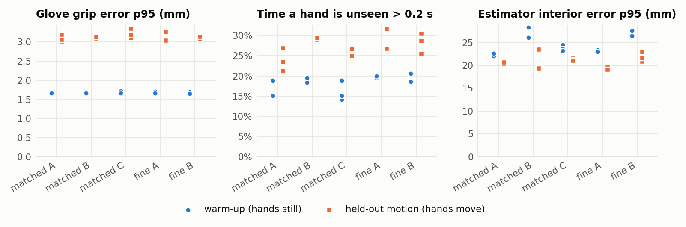

| | hands still (warm-up) | hands moving (held-out motion) |
| --- | --- | --- |
| Glove grip error p95 | 1.6–1.7 mm | 3.1–3.2 mm |
| Glove latency p50 | 39–50 ms | 39–50 ms |
| Time a hand is unseen for > 0.2 s | 16–20 % | 24–29 % |
| Longest glove gap | 0.8–1.2 s | 1.2–1.4 s |
| Estimator interior error p50 / p95 | 8.2–8.8 / 22–27 mm | 7.6–8.0 / 19–22 mm |
| Estimator 95 % coverage | 0.92–0.95 | 0.95–0.96 |

Ranges are over plant groups; each group has 2–3 repeats. The glove tracker is accurate when it sees
the glove, but it loses each hand a fifth to a quarter of the time. The estimator's accuracy barely
depends on the material mismatch, and its uncertainty is close to calibrated.

## S2 Material identification

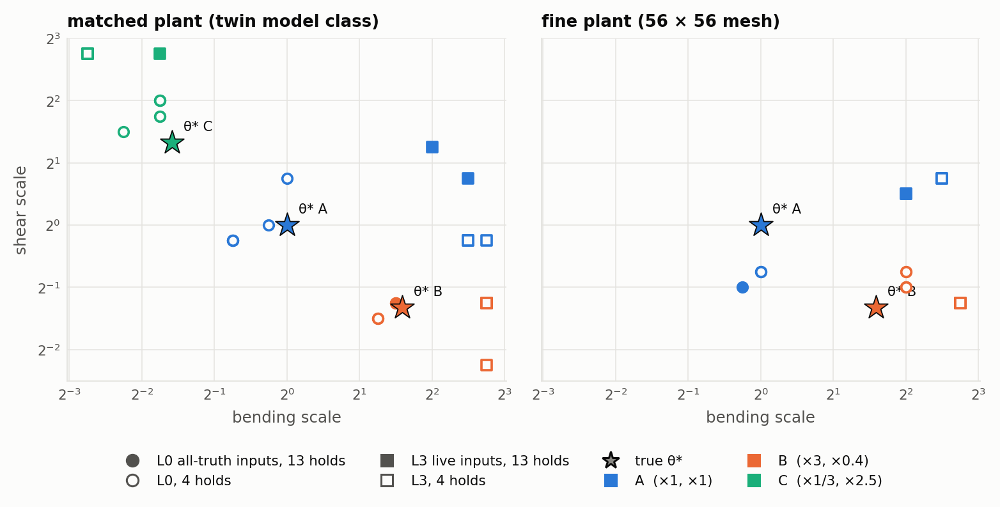

Fits per repeat, 13-hold extended warm-up:

| Plant | θ* | All-truth inputs (L0) | Live inputs (L3, production) |
| --- | --- | --- | --- |
| matched A | (1, 1) | (0.59, 0.84) × 3 | (5.66, 1.68), (4.00, 2.38), (5.66, 0.84) |
| matched B | (3, 0.4) | (2.83, 0.42) × 3 | (6.73, 0.42) × 3 |
| matched C | (0.33, 2.5) | (0.30, 4.00), (0.30, 4.00), (0.30, 3.36) | (0.30, 6.73), (0.15, 6.73), (0.15, 6.73) |
| fine A | none exact | (1.00, 0.59), (0.84, 0.50) | (4.00, 1.41) × 2 |
| fine B | none exact | (4.00, 0.50) × 3 | (6.73, 0.42) × 3 |

The bank's search returns values on a 2^(1/4) grid, so about ±9 % is its resolution. The fine-plant
all-truth fits are the effective coefficients of the coarser twin for that plant (for example shear
about 0.55 for nominal fine material).

**Identifiability.** With true inputs the cost has a clear minimum, but along a diagonal valley: the
bend/shear ratio is determined better than their common scale.

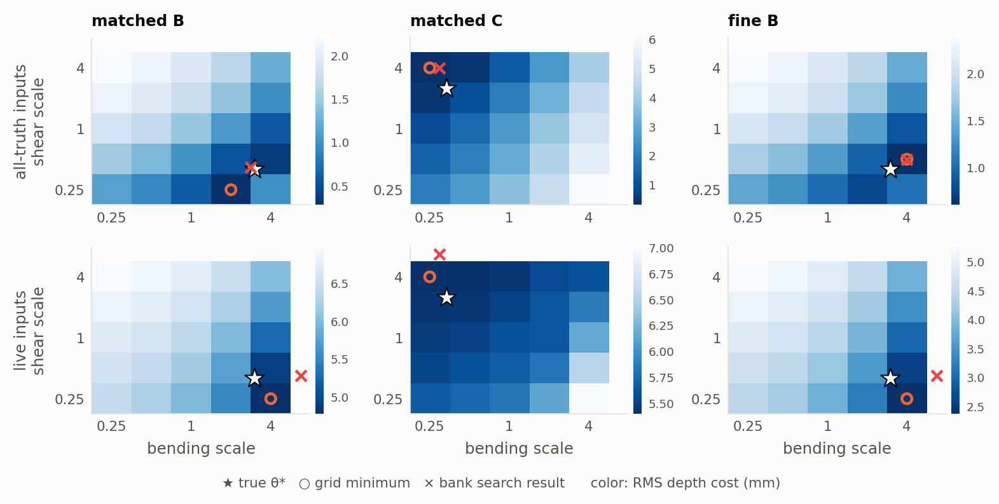

**Which input breaks it.** Replace one truth input at a time with what the live system measured
(repeat 1 of matched B, matched C, fine B):

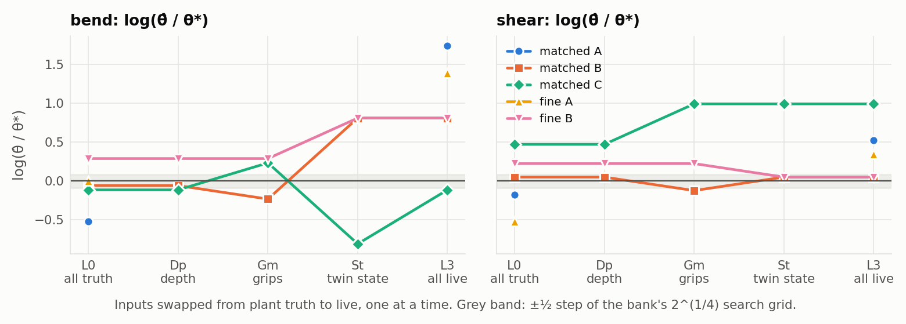

Rendered depth (Dp) and measured grips (Gm) leave the fit essentially unchanged. Starting the cases
from the corrected twin's state (St) reproduces the full live-input error. The corrected twin is within
2–7 mm mean of the truth during the warm-up. But a slack sheet's fold pattern depends on its history:
the twin's folds formed under its own coefficients, and the 8 × 8 correction (12 cm spacing) cannot
reshape them. A candidate started from those folds stays in them, and the fit explains the difference
with exaggerated coefficients. The error roughly doubles the log-deviation from the coefficients the
twin was run with.

**Remedies tried** (repeat 1, live inputs):

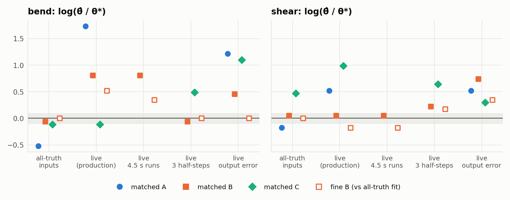

- **Longer free runs** (4.5 s instead of 2 s) changed almost nothing.
- **Plain iteration** (re-run the twin with the new fit, refit) oscillates.
- **Half-step iteration** reached bend within the search resolution for B (matched and fine) after 3
  steps, but left C off by +0.5 / +0.6 in log.
- **An output-error fit** (one free run through the whole warm-up, scored at every hold against the
  depth at the same times) recovers θ* from true inputs, (2.83, 0.35) for B, but from live inputs it is
  still biased: A (3.36, 1.68), B (4.76, 0.84), C (1.0, 3.36).

**Warm-up length.** Paired over 14 datasets, the 13-hold sequence was not more accurate than its
4-hold subset with true inputs (|log error| bend 0.21 → 0.22, shear 0.29 → 0.27; p ≥ 0.72). With live
inputs it trimmed the bend error from 1.16 to 1.01 (p = 0.03), but both stay far off.

**Online adaptation** (the bank's `adapt`, every 2 s through the warm-up and the held-out motion, from
nominal coefficients):

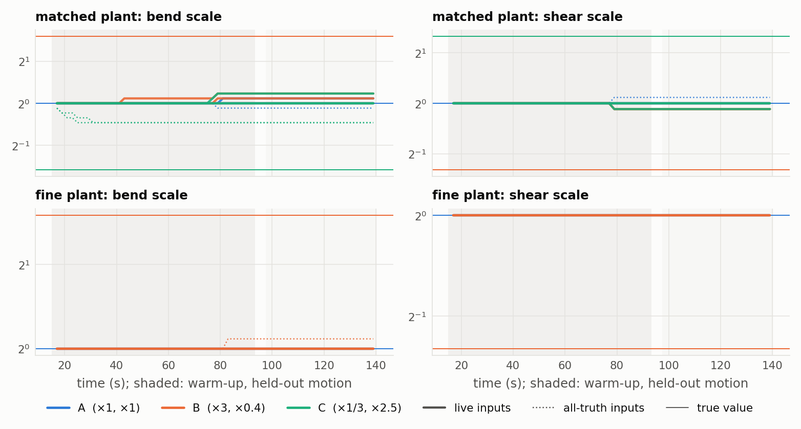

It almost never moves, because its sensitivity check (±22 % must change the 2 s end shape by 1.5 mm RMS)
fails on 94–100 % of updates.

## S3 Twin accuracy: correction, calibration, perception

The twin was replayed over every dataset with recorded grips and estimates. Scores are the mean
particle error against plant truth during the held-out motion (97.5–140 s) and open-loop forecasts.

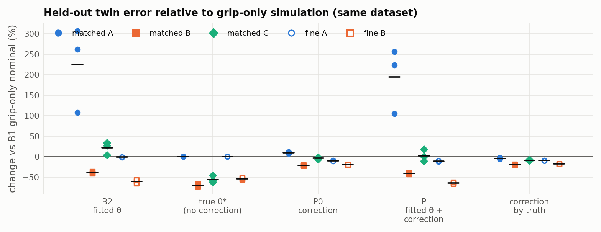

Held-out mean error (mm), mean of repeats:

| Plant | B1 grip-only, nominal | B2 grip-only, fitted θ̂ | grip-only, true θ* | P0 corrected, nominal | P corrected, fitted θ̂ | corrected by truth |
| --- | --- | --- | --- | --- | --- | --- |
| matched A | 1.2 | 3.9 | 1.2 | 1.3 | 3.5 | 1.2 |
| matched B | 4.4 | 2.7 | 1.3 | 3.5 | 2.6 | 3.6 |
| matched C | 3.5 | 4.2 | 1.5 | 3.3 | 3.5 | 3.2 |
| fine A | 3.2 | 3.1 | 3.2 | 2.8 | 2.8 | 2.9 |
| fine B | 5.4 | 2.1 | 2.5 | 4.4 | 1.9 | 4.4 |

Paired over the 11 mismatched datasets (matched B and C, fine A and B):

| Change | Mean (mm) | 95 % CI | Wilcoxon p | Datasets improved |
| --- | --- | --- | --- | --- |
| P0 vs B1: visual correction | −0.63 | −0.86 … −0.39 | 0.001 | 11 / 11 |
| B2 vs B1: production fit | −1.17 | −2.13 … −0.22 | 0.07 | 8 / 11 |
| P vs B1: full loop | −1.49 | −2.34 … −0.66 | 0.014 | 9 / 11 |
| P vs B2: correction on top of the fit | −0.32 | −0.48 … −0.18 | 0.001 | 11 / 11 |
| true θ* vs B1: perfect calibration | −2.16 | −2.78 … −1.44 | 0.003 | 10 / 11 |
| perfect observer vs estimator, both corrected | 0.00 | −0.07 … +0.06 | 0.83 | 3 / 11 |
| true vs measured grips, grip-only | −0.41 | −0.48 … −0.35 | 0.001 | 11 / 11 |

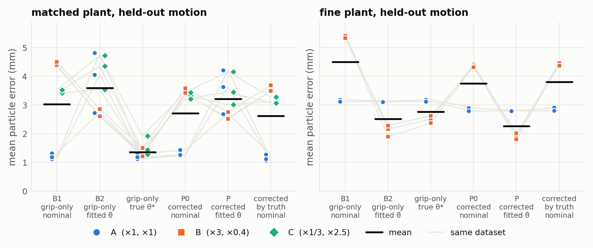

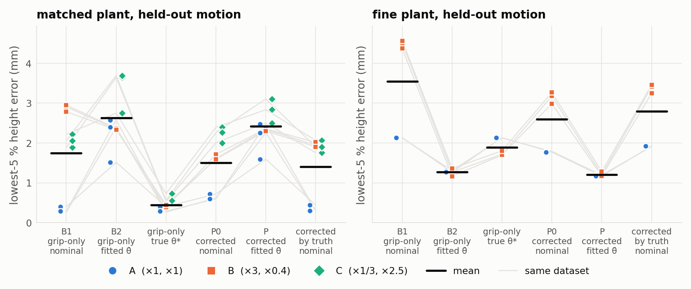

**Forecasts.** From each second of the held-out motion, the twin was cloned and run open-loop for 1 s
with the recorded future grips. Forecast error grows by at most about 0.3 mm over 1 s in every condition.
Prediction quality is set by the current state and coefficients, not by drift.

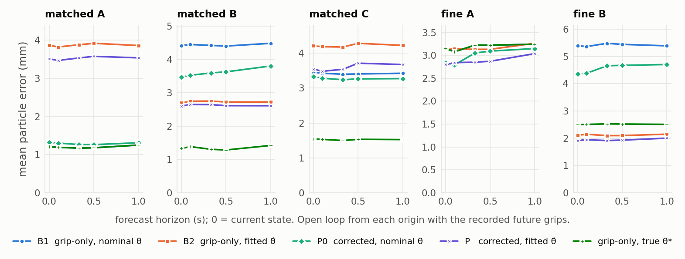

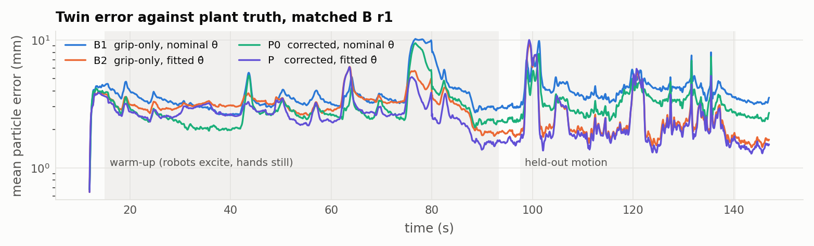

**What limits the corrected twin.** With the exact model (matched A), true grips bring the grip-only
twin to 0.1 mm, while the corrected twin stays at 0.7 mm: the correction adds the estimator's error.
Raising the correction gains ×4 helped somewhat under mismatch (repeat 1: matched B 3.5 → 3.2 mm,
fine B 4.4 → 4.2 mm) and hurt without it (matched A 1.3 → 1.4 mm).

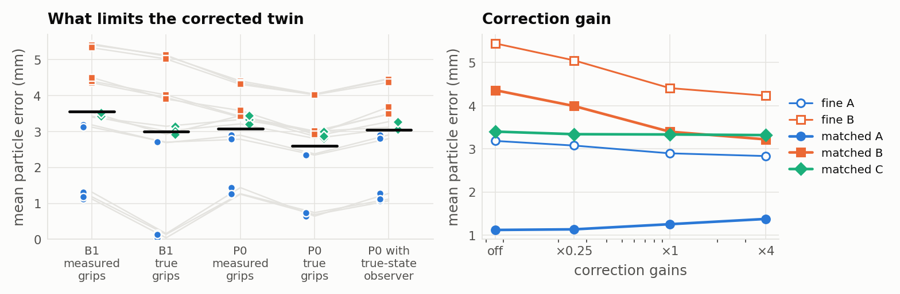

## S4 Closed-loop carry

Fine plant, hidden material B, the rehearsal carry (hands lower 0.55 m past the box, ±8 cm, rise); 3
repeats per condition, interleaved. B2, P and G0 use the production fit (6.73, 0.42), which every
fine-B dataset returned. True clearances and pulls come from plant truth (pull from the plant's own
cloth mechanics at the grip patches).

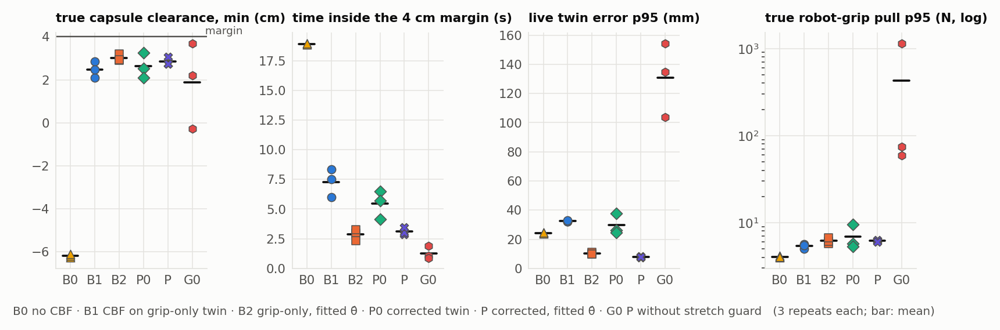

| Condition | Box min (cm) | Capsule min (cm) | Inside 4 cm margin (s) | Robot pull p95 (N) | Pull max, 0.1 s low-pass (N) | Live twin p95 (mm) |
| --- | --- | --- | --- | --- | --- | --- |
| B0 no CBF | 0.0 (contact 0.3–1.5 s) | −6.2 ± 0.1 | 18.9 ± 0.1 | 4.1 ± 0.1 | 6.3 ± 1.5 | 24 ± 0 |
| B1 CBF, grip-only twin | 7.2 ± 0.4 | 2.5 ± 0.4 | 7.3 ± 1.2 | 5.4 ± 0.3 | 10.8 ± 2.3 | 33 ± 0 |
| B2 grip-only, fitted θ̂ | 7.6 ± 0.1 | 3.0 ± 0.2 | 2.8 ± 0.5 | 6.2 ± 0.5 | 11.6 ± 2.1 | 10 ± 1 |
| P0 corrected, nominal | 7.5 ± 0.2 | 2.6 ± 0.6 | 5.4 ± 1.2 | 6.9 ± 2.3 | 13.2 ± 6.5 | 30 ± 7 |
| P corrected, fitted θ̂ | 7.5 ± 0.1 | 2.9 ± 0.2 | 3.1 ± 0.3 | 6.2 ± 0.2 | 9.9 ± 0.8 | 8 ± 0 |
| G0 P without stretch guard | 6.0 ± 1.6 | 1.9 ± 2.0 | 1.3 ± 0.5 | 59–1146 | 187–2289 | 131 ± 26 |

Mean ± SD over 3 runs. No CBF update needed a hard relaxation in any condition.

- **The CBF is what keeps the sheet off the obstacle.** Without it the sheet touched the box in every
  run. With it, the closest approach to the box was 7–8 cm. But no condition held the full 4 cm capsule
  margin: the true minimum was 2–3 cm, and the time spent inside the margin is the measure that
  separates the twins.
- **The fitted coefficients produced the closed-loop gain.** The fitted twins (B2, P) spent 2.8–3.1 s
  inside the margin, against 7.3 s for the grip-only nominal twin (B1). Their live error was 8–10 mm
  p95 against 33 mm. Correction alone (P0) gave 5.4 s and 30 mm, with the largest run-to-run spread. On
  this plant the biased production fit happens to suit the coarse twin (it was also the best grip-only
  replay in S3). On matched A and C, S3 shows the same fit makes the twin worse.
- **The stretch guard is essential.** Without it the true pull reached 59, 75 and 1146 N p95 (the last
  run stretched the sheet until the twin could not follow). With it, every condition stayed at 4–7 N p95.
  The guard costs pull relative to no CBF (4.1 N) only because clearance needs the robots to move.
- The robots stopped on 5–10 % of updates because a glove was unseen for more than 1 s (S1).

Runs took 163–189 s of wall time. The slower ones overlapped background CPU scoring; the plant runs
unpaced and the stack follows simulation time, so this gives the stack more time per simulated
second, not less.

## S5 Full live loop

Everything live, as on hardware:

1. The plant hides material B.
2. The twin runs the 13-hold warm-up at 15 s.
3. The live bank fits the coefficients beside Isaac and releases them to the twin and its CBF model.
4. Online adaptation runs every 10 s.
5. At 480 s the hands carry the sheet past the box. Two runs.

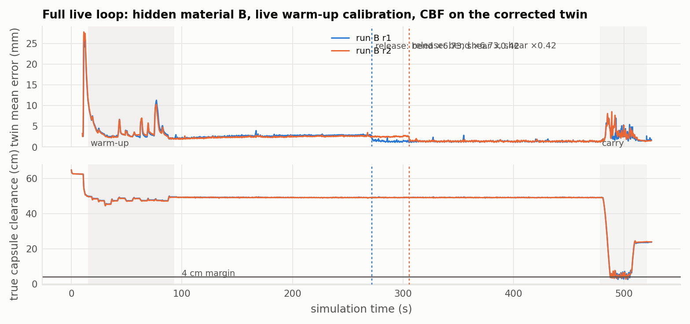

| | Run 1 | Run 2 |
| --- | --- | --- |
| Live calibration time (beside Isaac) | 731 s wall | 790 s wall |
| Released coefficients | bend ×6.73, shear ×0.42 | bend ×6.73, shear ×0.42 |
| Adopted by the twin at (simulation time) | 272 s | 306 s |
| Online adaptation updates / moves | 26 / 0 | 22 / 0 |
| Twin error p95, whole run | 6.5 mm | 6.3 mm |
| Carry: box min / capsule min | 7.4 / 2.5 cm | 7.6 / 2.6 cm |
| Carry: time inside 4 cm margin | 6.7 s | 5.1 s |
| Carry: robot pull p95 / max (low-pass) | 6.1 / 8.9 N | 6.0 / 9.7 N |
| Carry: zero-command updates (glove dropouts) | 13 % | 10 % |

The live system did exactly what the offline studies predict:

- The live bank released the same (6.73, 0.42) as the offline fit on recorded data.
- The twin applied it in 99–152 ms.
- Adaptation never moved.
- The carry stayed clear of the box with bounded pull.

It spent more time inside the margin than the S4 runs with the same coefficients (5–7 s vs 3 s). The
long still period before the carry and more glove dropouts are the visible differences; two runs are
not enough to separate them.

## S1b Observer: vision on/off, hand tracking removed

The recorded camera observations, gloves, TF and joint states of repeat 1 of each group were replayed
through the estimator three ways:

- **as live:** cameras and glove grips;
- **without camera factors:** `max_depth: 0`, `max_boundary: 0`, so every analysis returns the prior,
  i.e. the same ensemble driven by grips alone;
- **with plant mocap for the hands:** labelled oracle.

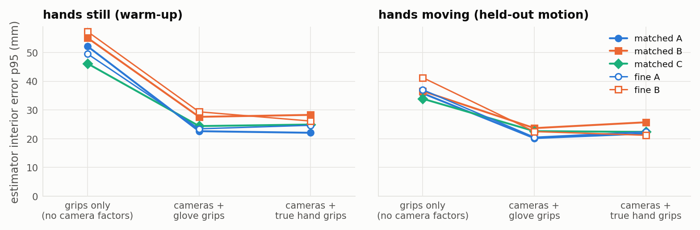

| Interior error p50 / p95 (mm) | Grips only | Cameras + gloves | Cameras + true hands |
| --- | --- | --- | --- |
| Warm-up | 20.5–25.9 / 46–57 | 8.3–9.2 / 22–29 | 8.3–8.8 / 22–28 |
| Held-out motion | 12.3–18.7 / 34–41 | 7.7–8.1 / 20–24 | 8.2–8.9 / 21–26 |

- **Vision halves the observer's error** on every dataset, and glove error does not matter to it.
- **But the observer's coarse 8 × 8 mesh, even with vision (p50 ≈ 8 mm), is less accurate than the
  29 × 29 grip-only twin itself** (S3: 1–5 mm mean on held-out motion). That is why correcting the twin
  from it gains so little, and why perfect values at the same 64 vertices gain no more.

The replays mark 10–20 % of analyses "degraded", against under 1 % live. All three conditions are
replays, so they are compared only with each other.

## What this means for the paper

Supported by these simulations:

- **The perception–simulation–control loop runs live, end to end.** It keeps a carried sheet clear of
  an obstacle (contact in every run without the CBF, 7–8 cm from the box with it) with bounded grip loads.
- **The measured-grip stretch guard is necessary** for bounded loads. Without it the pull is unbounded
  (59–1146 N p95).
- **Material coefficients dominate twin accuracy.** True coefficients cut held-out error by 52 %. A
  good-enough fit cut closed-loop time inside the margin from about 7 s to about 3 s.
- **Vision makes the observer twice as accurate.**
- **Visual correction of the twin gives a small but consistent gain** (15 %, 11 of 11 datasets,
  p = 0.001) that perfect perception does not increase.

Not supported as the system stands:

- **"Visual correction beats grip-only simulation" as the main claim.** The effect is small and is
  limited by the coarse correction channel, not by perception.
- **"The warm-up identifies the material."** It does so only from true inputs. From live inputs the
  production bank is biased, repeatably, by the start state it takes from the corrected twin. The live
  loop released the same wrong coefficients as the offline fit.
- **Online adaptation.** It never moved.

A paper built on these results would be about *why* the loop helps (calibration and geometry) and what
limits the visual channel. The obvious next step is to remove the identification bias.

## Recommendations

1. **Fix identification before claiming it.**
   - Make the bank's cost time-resolved: each depth capture against the candidate's state at its own
     time. This removes the moving-sheet flaw.
   - Remove the start-state bias. Candidates: reset the fold state before each hold with a near-taut
     pose, then release into the hold; start the cases from the measured surface rather than from the
     corrected twin; or estimate the start state jointly with the coefficients.
   - Re-run S2 with the same datasets: they are recorded, so this costs only GPU time.
2. **Online adaptation:** either remove it from the demo or redesign its informativeness test. It is
   currently inert.
3. **Correction channel:** if visual correction is to matter, it needs more than 64 vertices, or a
   residual model that acts where the twin is wrong (the low point near the obstacle) rather than a
   uniform nudge. Doubling or quadrupling the gains is not enough (repeat 1: matched B 3.5 → 3.2 mm,
   fine B 4.4 → 4.2 mm with gains ×4).
4. **Glove dropouts** (hands unseen 16–29 % of the time, gaps up to 1.4 s) stop the robots on
   5–13 % of updates in the closed loop. This is still the main operational weakness for hardware.
5. **The 4 cm margin is not held** (true minimum 2–3 cm). For hardware, either enlarge it to the
   measured shortfall or tighten the CBF's prediction near the obstacle.

## Limitations

- Simulation only. The plant's material is Style3D with scaled coefficients, not measured carbon fabric.
- One hand script per study: the held-out motion for S1–S3, the rehearsal carry for S4–S5.
- Two to three repeats per condition in Isaac. Repeats differ only in the timing of the asynchronous
  stack, which made identification results identical across repeats.
- S3 paired statistics pool plant groups (n = 11 mismatched datasets). Closed-loop results are
  descriptive (n = 3).
- Pull is the plant's mechanical resultant at the grip patch, not a simulated wrist sensor.

## Reproduce

- Procedures: [experiments/sim_eval/README.md](../experiments/sim_eval/README.md).
- Run data (about 20 GB) on the external drive: `/media/taha/ExtermeLinux/oarbot_simulation/logs/sim_eval/`
  (`id/`, `closed/`, `full/`, `obs/`).
- Tables: [experiments/sim_eval/results/](../experiments/sim_eval/results/): `s1_*.csv`, `s1b_observer.csv`,
  `s2_fits.csv`, `s2_adapt.csv`, `s3_replays.csv`, `s4_closed.csv`, `stats.json`; raw fit and replay
  outputs in `s2/`, `s2x/`, `s3/`.
- Figures: `python experiments/sim_eval/analysis/figures.py`.
- Code state: oarbots at commit 30e5a30 plus uncommitted changes:
  - `FeedbackSpec.enabled`;
  - twin recorder grips and depth;
  - one-hand moves in `leader_script`;
  - your extended warm-up.
