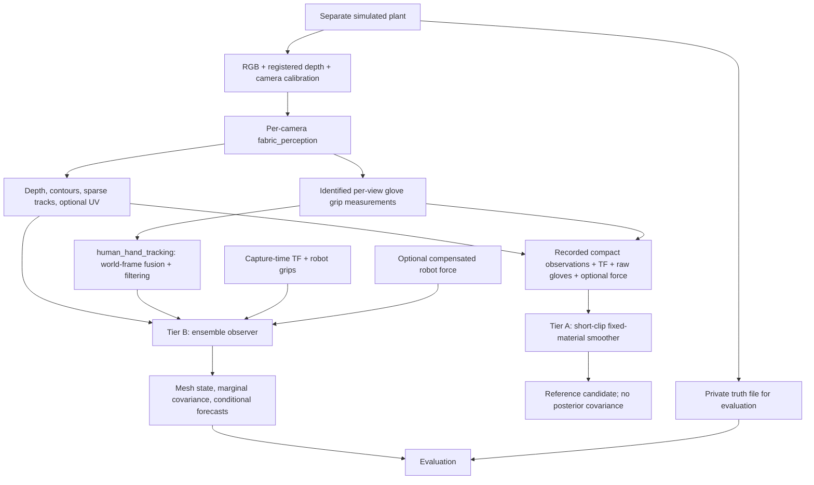

# Fabric state estimation: progress, technical review, and next steps

**Assessment date:** 10 November 2026, America/New_York.

**Code reviewed:** `oarbots` commit `b7821acce0e6ddbde252092c5f3fa251d66f7f13`; the working tree was clean before this report.

**Design baseline:** [fabric-state-estimation-research.md](fabric-state-estimation-research.md), revised 4 November.

**Learning implementation companion:** [fabric-learning-methods-report.md](fabric-learning-methods-report.md) covers model choices, data/labels, training, tuning, uncertainty, deployment and validation for the learned components.

**Evidence snapshot:** [progress-evidence-2026-11-10.json](fabric-estimation/progress-evidence-2026-11-10.json). It preserves selected existing simulation metrics, source paths and SHA-256 hashes, the fresh test result, and the boundary probe described below.

**Second-pass revision (same day, same commit):** the test suite and boundary probe were re-run, every tabulated metric was re-checked against the evidence JSON, every cited arXiv identifier was resolved against its record, and the human-grip input path was audited line by line. The pass confirmed the earlier findings. It added a localization of the teleoperation failure to the boundary-input path ([§3.3](#33-where-the-teleoperation-error-enters)), four further code-level findings ([§8.2](#82-additional-findings-from-the-second-pass)), and ensemble-calibration practice from data assimilation ([§5.4](#54-calibrating-ensemble-spread)). It also added fabric-identification literature ([§6.4](#64-fabric-specific-identification-precedents)) and reordered [Phase 1](#phase-1-make-the-present-results-diagnostically-trustworthy). Corrected statements were changed in place.

Reading guide: [diagnosis](#1-diagnosis), [implementation inventory](#2-what-is-implemented-where-and-why), [measured results](#3-what-the-measurements-actually-say), [theory](#4-theory-what-state-is-being-estimated-and-what-can-be-observed), [critical findings](#8-challenges-to-the-implementation-and-research-plan), [next steps](#9-recommended-next-steps-with-acceptance-evidence), [alternatives](#10-alternatives-and-when-to-choose-them), and [verification/sources](#11-reproducibility-and-sources).

## 1. Diagnosis

The project has an executable first implementation of the proposed two-tier architecture. It can extract compact camera observations, track identified glove grip points, reconstruct a persistent material mesh with an online ensemble observer, and smooth short recorded sequences offline. It also has a useful simulated-cell deployment and evaluation harness. This is substantial implementation progress beyond the research document.

It has **not yet demonstrated a calibrated physical carbon-fabric state estimator or a simulator-identification system**. The principal shortcomings are:

1. Human holding and four fixed corner identities are assumptions. Contact, release, slip, regrasp, and finite grip patches are not estimated.
2. Material parameters are fixed in both estimators. No joint material identification or parameter posterior exists.
3. The offline smoother is a small-problem prototype; its current finite-difference formulation cannot meet the proposed fine-mesh, long-trajectory goal.
4. Good scripted simulation results do not generalize to the available teleoperation runs. Their surface error and uncertainty coverage expose failures even when reported hand observations are accurate. The existing metrics localize much of that failure to the **boundary-input path**. In every glove run, estimated human-held fabric corners have p95 errors of about 60–220 mm, while the hand states they come from have p95 errors of 2–5 mm. In the one matched comparison (the lean scripted descent), oracle hands bring those corners down to 3.5–6.5 mm ([§3.3](#33-where-the-teleoperation-error-enters)).
5. The human-grip path is statistically inconsistent. Hand states are extrapolated up to 0.45 s with no process noise or acceleration term. Under the hand filter's own motion model, that omits about 91 mm/axis of position standard deviation at the age limit. A single missing hand discards the whole analysis. The sampled grip perturbations are drawn once per run and never centred ([§8.2](#82-additional-findings-from-the-second-pass)).
6. Force compensation exists, but the estimator's point-grip, quasi-static force operator is not a validated model of the plant's patch loads or dynamic wrist reactions.
7. Physical observability, calibration, uncertainty coverage, sustained latency, and independent reference accuracy remain unestablished by the evidence inspected here.
8. The online estimate does not yet assimilate into the fine twin or supply the current simulated controller's state.

**Recommended direction:** retain the material mesh, observation-time processing, separate offline/online roles, and derivative-free ensemble baseline. The single most valuable next change is to **estimate the human grips as filter state rather than prescribe extrapolated samples**. That means a motion model with process noise, delayed glove measurements assimilated at their capture times, and coasting with growing uncertainty when a tag is missed. Robot grips stay prescribed from TF. Then calibrate ensemble spread against held-out replay (adaptive or relaxation inflation, spatially smooth process noise, rank-histogram and spread–skill checks) before tuning anything else. After that, prioritize physical sensing/calibration and an independent reference pipeline. Keep the present observer in replay/shadow use while those gates are closed. The evidence does not justify immediately expanding to every proposed learned component or making the ensemble the permanent estimator choice. In particular, none of the proposed image networks addresses the dominant measured failure.

### 1.1 What this assessment establishes

Four kinds of evidence are distinguished throughout:

| Evidence | Meaning and limits |
| --- | --- |
| Source inspection | The implementation and configuration contain the behavior described. This does not establish physical accuracy. |
| Fresh software verification | On the first pass, **71 tests passed, one skipped**, across perception, hand tracking, online estimation, reference reconstruction, and simulated-cell utilities. The skip was CUDA graph equivalence because that execution environment exposed no CUDA device. On the second pass, at the same commit and with an RTX 5070 Laptop GPU visible, **72 passed, 0 skipped, 5 warnings in 18.1 s**: the CUDA-graph equivalence test ran and passed. CPU Newton, localhost ROS, and MCAP tests ran in both passes. |
| Existing simulation measurements | Selected metrics and validation markers were read from `/media/taha/ExtermeLinux/oarbot_simulation/logs/`. These experiments were **not rerun** for this report. They use rendered sensors and simulated truth. |
| Proposed work or interpretation | Recommendations, derived equations, and causal hypotheses are explicitly presented as such. A plausible explanation of a failure is not a completed diagnosis of its cause. |

The fresh environment was Python 3.12.3, NumPy 1.26.4, SciPy 1.11.4, OpenCV 4.6.0, Newton 1.6.1, and Warp 1.17.0. The test warnings concern Newton's deprecated `Model.contacts()` API. Newton has since released 1.7.0 (14 October 2026) and 1.8.0rc2 (10 November 2026). The 1.8 notes move `SolverStyle3D` options into `SolverStyle3D.Config` and continue deprecating collision APIs the adapter touches, so pin 1.6.1 until an upgrade test exists ([§8.2](#82-additional-findings-from-the-second-pass)). No hardware launch, robot command, new Isaac experiment, material fit, or physical calibration was performed. The selected external simulation checkout was at `a196775be353938b5dcd20fb5186324fbf8cb516`; that checkout's HEAD alone does not establish the source version of every historical run.

### 1.2 Progress against the research roadmap

There is no defensible single percentage-complete: code availability and experiment acceptance are different milestones.

| Research stage | Current implementation | Acceptance status |
| --- | --- | --- |
| 0: carbon/glove observability | Recording, diagnostics, raw-depth gating, tagged gloves | Actual-ply ToF, weave, glove, lighting, and timing study not established here |
| 1: calibration and recording | TF contracts, YAML calibration, F/T calibration/compensation, MCAP tools | Software exists; physical gates H5–H9/H11/H12/H15 remain to be evidenced |
| 2A: Tier A v1 | Fixed-material weak-constraint smoother and bag importer | Synthetic behavior verified; independent physical reference target unproven |
| 2B: hands/contact | Tagged-glove grip tracking and multi-view filtering | Useful deliberate simplification; consumer-side propagation, dropout handling, MANO, contact modes, slip/release missing |
| 3: identification | Force observation hooks and residual-load state | Sensitivities, experiment design, joint parameter fit, posterior absent |
| 4: learned priors | ONNX segmentation/UV inference interfaces | No trained weights or training/data-generation pipeline found in this checkout |
| 5: Tier B ensemble | Localized ensemble update, Newton prediction, covariance, forecasts | Implemented ahead of several dependencies; real operating envelope not qualified |
| 6: twin/shadow control | Sensor-consumer simulation harness and scoring | Estimated-state assimilation, residual-model deployment, robust control margins absent |
| 7: speed/adaptation | CUDA graph and workload improvements; monitoring profiles | Dynamic compensation, accepted speed envelope, online parameter adaptation absent |

The research's [hardware gates](platform-audit.md#hardware-and-manual-acceptance-gates) remain useful. An earlier platform audit is evidence of its stated software checks, not a continuing certificate for subsequently added modules.

## 2. What is implemented, where, and why

### 2.1 Data flow and package boundaries



There is currently no estimate-to-plant correction arrow. In the combined simulation, the plant's own cloth state supplies the existing CBF/controller. Sensor reconstruction runs separately. That separation is valuable for measurement evaluation, but it must not be described as an already synchronized physical digital twin.

| Subsystem | Implemented behavior and source | Remaining boundary |
| --- | --- | --- |
| ROS contracts | [`fabric_state_msgs/msg`](../src/fabric_state_msgs/msg): persistent topology/UV, camera factors, gloves, hand states, fabric q/v, uncertainty, forecasts | No dedicated contact-mode probability, accepted material-posterior, or standalone versioned residual-load interface from the full research design |
| Camera front end | [`core.py`](../src/fabric_perception/fabric_perception/core.py), [`node.py`](../src/fabric_perception/fabric_perception/node.py): HSV or explicit ONNX segmentation, masks, contours, depth gating, sparse KLT, optional UV, source timestamps | No learned depth repair, dense long-range tracker, photometric factor, yarn-angle factor, or general robot-mesh renderer |
| Glove measurement | [`tags.py`](../src/human_hand_tracking/human_hand_tracking/tags.py): color-supported ArUco identity, planar pose candidates, offset calibration, covariance, optional registered-depth assistance | Measures a configured grip point; no articulated hand mesh or contact inference |
| Hand fusion | [`fusion.py`](../src/human_hand_tracking/human_hand_tracking/fusion.py), [`node.py`](../src/human_hand_tracking/human_hand_tracking/node.py): consistency selection, information fusion, joint position/velocity filtering | `HOLDING` is explicitly assumed; no force-based contact evidence |
| Material state | [`mesh.py`](../src/fabric_state_estimator/fabric_state_estimator/mesh.py), [`data.py`](../src/fabric_state_estimator/fabric_state_estimator/data.py): fixed IDs, UV, triangles, area masses, graph distances, validated saved sequences | Rectangular topology; four corner attachments; no changing attachment UV or topology |
| Physics | [`physics.py`](../src/fabric_state_estimator/fabric_state_estimator/physics.py), [`newton_backend.py`](../src/fabric_state_estimator/fabric_state_estimator/newton_backend.py): explicit q/v interface, CPU spring fixture, parallel Newton worlds | Self/obstacle contact disabled; point grips; fixed coefficients |
| Observation model | [`observations.py`](../src/fabric_state_estimator/fabric_state_estimator/observations.py): frontmost triangles, projected outer edges, persistent track binding, optional UV and force factors | Mean-based hard association, scalar factor noise, no raw-image optimization |
| Online estimator | [`ensemble.py`](../src/fabric_state_estimator/fabric_state_estimator/ensemble.py), [`node.py`](../src/fabric_state_estimator/fabric_state_estimator/node.py): localized robust ensemble transform, uncertainty, stale labels, bounded prediction | Every analysis requires all four grips; grip error is a frozen per-member offset; fixed 1.02 inflation; no contact hypotheses, parameter adaptation, nudging fallback, learned reacquisition, or command-conditioned forecast API |
| Offline reconstruction | [`smoother.py`](../src/fabric_reference_reconstruction/fabric_reference_reconstruction/smoother.py), [`bag.py`](../src/fabric_reference_reconstruction/fabric_reference_reconstruction/bag.py), [`cli.py`](../src/fabric_reference_reconstruction/fabric_reference_reconstruction/cli.py) | Fixed material/calibration/time/bias; severe scaling limits; reference candidates only |
| Monitoring | [`monitoring.py`](../src/fabric_state_estimator/fabric_state_estimator/monitoring.py), [`sampling.py`](../src/fabric_perception/fabric_perception/sampling.py): reduce fabric checks after acceptable pre-update evidence; restore rate on bad/stale evidence | Agreement diagnostic; neither physical identification nor an obstacle-safety guarantee |
| Evaluation/deployment | [`fabric_sim_cell`](../src/fabric_sim_cell/README.md), [`evaluate.py`](../src/fabric_sim_cell/fabric_sim_cell/evaluate.py), [`scorecard.py`](../src/fabric_sim_cell/fabric_sim_cell/scorecard.py) | Rendered-sensor domain; ordinary surface scoring samples truth at the estimator vertices |

Packages proposed as `fabric_contact_estimation`, `fabric_identification`, and `fabric_sim_bridge` are not present. Their responsibilities have not been completed merely because neighboring packages publish suitable inputs.

### 2.2 Perception and hand tracking

The HSV fabric baseline selects sufficiently dark, low-saturation pixels within a workspace ROI, removes glove/robot exclusions, and retains sufficiently large disconnected components. Keeping disconnected pieces is correct under occlusion; joining them would invent observed cloth. Its obvious weakness is semantic ambiguity: a dark sleeve, robot, shadow, or background can satisfy the same thresholds. The optional ONNX segmenter is an inference adapter, not evidence of a trained carbon-specific model.

Depth must already be registered into RGB geometry. The code handles integer millimetres and floating-point metres, rejects invalid/out-of-range samples, and removes neighborhoods of discontinuities, holes, and occlusion boundaries. This prevents some flying-pixel factors; it does not repair ToF systematic bias or recover missing surface. Contours and RGB tracks can survive depth dropout. The detailed contracts are in [fabric-perception.md](fabric-perception.md).

Boundary confidence is suppressed near hands, robots, image/ROI edges, and holes. This matters because an occluder's edge does not identify the sheet's physical material boundary. KLT supplies sparse image identities with forward/backward rejection. Those identities become material identities only after the estimator associates them to its predicted mesh. The fast profile disables KLT following adverse simulation measurements; this is a measured configuration decision, not proof that all visual tracking is unhelpful.

Tagged gloves are a sensible substitution for the research's more ambitious MANO pipeline in the four-corner task. The marker-free requirement applies to the production sheet. Unique glove IDs avoid relying on image-left/image-right when hands cross. A calibrated tag-to-grip offset converts tag pose to the presumed pinch point. Optional depth assistance resolves some planar-pose ambiguity and tag-range bias; it also makes hand and sheet errors potentially correlated through the same depth camera.

The fuser transforms observations at capture time, rejects inconsistent views, finds a unique maximum mutually consistent subset, and fuses its positions by information weighting. A constant-acceleration Kalman filter estimates position, velocity, and acceleration internally; only the relevant output state/covariance is published. Missing hands are omitted. A calibration covariance floor prevents repeated views or frames from making a persistent offset appear arbitrarily certain. This is stronger than the older Azure-body-joint adapter, but it still emits `holding_is_assumed=true`.

### 2.3 Physics and operational profiles

The CPU spring backend is a controlled software plant with edge springs, gravity, and damping. It is useful for deterministic testing and small offline examples. It is not a calibrated woven-carbon constitutive model.

The Newton adapter builds one cloth world per ensemble member, preserves material indexing, checks lumped masses, reloads explicit q/v, moves prescribed corners linearly, and writes distributed residual force **after** clearing the force buffer. CUDA graph replay reduces repeated Python kernel-launch overhead. The LETKF and observation processing still use host NumPy/SciPy; this is not a fully GPU-resident estimator. Version-sensitive private Newton APIs and the separate reaction calculation remain maintenance risks.

The adapter disables the collision handler to avoid cross-world interactions. Consequently, **self-contact, cloth-table/robot contact, and obstacles are not modeled**. Camera visibility reasoning can handle one layer hiding another geometrically, but that does not make the underlying cloth dynamics contact-correct.

| Configuration | Mesh / ensemble | Purpose and important choices |
| --- | --- | --- |
| [General estimator example](../src/fabric_state_estimator/config/estimator.yaml) | 17×17 vertices / 32 | Example physical dimensions/material; CUDA; 15 Hz publication timer; 2 Hz forecasts when consumed; forces and UV off |
| [Sim nominal](../src/fabric_sim_cell/config/estimator.yaml) | 15×15 / 32 | Simulator-specific material and sensing configuration |
| [Sim fast](../src/fabric_sim_cell/config/estimator_fast.yaml) | 8×8 / 16 | Fewer boundary samples, no KLT, longer permitted hand age, fixed simulated material; forces off |
| [Sim monitor](../src/fabric_sim_cell/config/estimator_monitor.yaml) | 8×8 / 16 | Intermittent capture-time checks; no continuous predicted state or future forecasts; allows 1 Hz gaps |
| Lean deployment | Same small estimator; 29×29-particle plant | Changes plant fidelity and CBF resolution as well as workload; not a like-for-like estimator optimization |

The general example density is 0.3 kg/m²; simulated-cell examples use 0.2 kg/m². For a 0.84 m square these mean 0.21168 kg and 0.14112 kg. Neither establishes the physical ply's measured mass. Similarly, simulation stiffness coefficients must not be presented as identified material properties.

## 3. What the measurements actually say

### 3.1 Existing scripted and teleoperation runs

The following values were extracted directly from existing `analysis_attached` metrics and the performance comparison. Every selected run's plant log contains `COMBINED_VALIDATED` and `plant exit 0`. That validates the plant runner's own checks; it does not certify the estimator's accuracy. Source hashes and exact paths are retained in the [evidence snapshot](fabric-estimation/progress-evidence-2026-11-10.json).

| Existing run | Analyses | Material-indexed surface p50 / p95 / max | Nominal 95% position-region coverage |
| --- | ---: | --- | ---: |
| Fine fast, gloves; scripted descent | 97 | 9.1 / 23.8 / 142.5 mm | 98.3% |
| Fine monitor, gloves; scripted descent | 33 | 9.3 / 30.4 / 113.2 mm | 96.1% |
| Lean, gloves; scripted descent | 40 | 8.3 / 35.5 / 153.4 mm | 94.3% |
| Lean, **oracle hands**; scripted descent | 22 | 3.0 / 9.5 / 39.6 mm | 100% |
| Teleop `20261108_222046`, gloves | 651 | 12.8 / 53.5 / 269.0 mm | 75.4% |
| Teleop `20261108_223543`, gloves | 667 | 18.7 / 79.6 / 306.5 mm | 54.6% |
| Teleop `20261108_223917`, gloves | 381 | 15.9 / 74.4 / 379.0 mm | 67.0% |

The three teleoperation runs are different recorded motions, not controlled repeats of the same input. They are valuable failure evidence, not a statistically established failure rate. They all exceed the proposed 50 mm whole-sheet p95 target. Their reported glove-position p95 values are approximately 2–4 mm **at the available hand-state timestamps**. Thus improving the tag detector alone cannot be assumed to resolve the mesh failure. Delayed/propagated hand boundaries, assimilation-induced corner motion, weak material correspondence, model error, and missing ensemble modes all need isolation.

For example, fine fast reports left/right fabric-corner p95 errors of about 87/62 mm while the separately scored hand outputs report about 3/4 mm. These are different populations and times; the difference is not an arithmetic contradiction. It is a strong reason to log the exact propagated grip that the fabric analysis consumed and compare it with both the hand measurement and resulting corner state at that same instant.

Scripted fine-fast and lean-glove real-time factors were approximately 0.554 and 1.034 overall. The [external performance review](/media/taha/ExtermeLinux/oarbot_simulation/PERFORMANCE_REVIEW.md) reports only about 0.90 after grasp for lean gloves. Whole-demo 1× therefore does not establish sustained 1× manipulation. Its reported RTX 5070 Laptop GPU measurements are historical observations, not fresh GPU results from this audit. A 20 ms analysis computation, simulation-time capture age, displayed prediction lag, and combined simulation real-time factor measure different things.

### 3.2 Why the favorable numbers are insufficient

- **Shared mechanics and ideal depth:** plant and estimator use Style3D-family mechanics, and RTX depth does not reproduce carbon ToF absorption, multipath, or real calibration drift. Held-out private truth prevents direct input leakage, but does not remove this shared-model advantage.
- **Resolution:** normal evaluation interpolates plant truth onto the estimator's grid. At 8×8, vertex spacing is 0.84/7 = **120 mm**. A narrow wrinkle can fall between vertices and be missed. Evaluate the interpolated estimate over a dense truth grid too, including strain and normals.
- **Selection:** errors describe successfully published analyses. Fine-fast's historical longest gap was 1.8 s. A low error during available states does not establish continuous availability.
- **Pooling:** a pooled p95 across vertices/times can hide a small critical region or a bad interval. Fine-fast's worst per-state p95 was 56.8 mm despite its pooled 23.8 mm. Report per-frame, per-region, corner, and maximum errors alongside pooling.
- **Coverage:** a 100% coverage result may simply be excessively broad covariance. The scorecard's threshold of 90% for “consistent or conservative” is not evidence of calibrated 95% coverage. Report region size/sharpness as well as empirical coverage, and stratify by condition.
- **Offline target confusion:** an online observer's “observed” subset meeting 15 mm does not validate Tier A. They are different algorithms, label semantics, and outputs. Remove that implication from future scorecards.
- **Missing dimensions:** current common metrics evaluate position and position covariance, not complete velocity error, tangential identity error, future-horizon error, contact transitions, or material-posterior accuracy. These remain real deliverables.

The latest scripted evidence is more informative than the early “5–8 mm” synthetic examples and configuration comments. Preserve those earlier numbers with their scope, but do not promote them to current general performance claims. For example, the header of [`estimator_fast.yaml`](../src/fabric_sim_cell/config/estimator_fast.yaml) still quotes dense-grid p95 4.6–5.6 mm, against the 23.8 mm pooled p95 of the later fine-fast run.

### 3.3 Where the teleoperation error enters

`grip_error_m` in the evaluator is the p95 distance between the *estimated fabric-corner vertex* and the true sheet at that material corner, at analysis times ([`evaluate.py`](../src/fabric_sim_cell/fabric_sim_cell/evaluate.py)). `hand_error_m` is the p95 error of the *hand state* at its own timestamp. Placing them side by side for every selected run isolates the step between the two.

| Run (p95, mm) | Robot corners blue / silver | Human corners left / right | Hand states left / right | Hand states vs. analyses |
| --- | --- | --- | --- | --- |
| Lean, **oracle hands** | 8.3 / 7.1 | **6.5 / 3.5** | 0 / 0 (oracle) | 128 + 128 vs. 22 |
| Lean, gloves | 13.5 / 11.5 | **93.8 / 59.2** | 3.1 / 4.4 | 41 + 29 vs. 40 |
| Fine fast, gloves | 11.7 / 12.2 | 87.1 / 62.3 | 2.9 / 3.8 | 38 + 27 vs. 97 |
| Fine monitor, gloves | 12.9 / 12.9 | 94.5 / 56.6 | 2.7 / 5.3 | 38 + 22 vs. 33 |
| Teleop `222046` | 14.9 / 13.9 | 110.6 / 121.6 | 2.9 / 3.9 | 212 + 192 vs. 651 |
| Teleop `223543` | 19.1 / 19.2 | 95.8 / **220.1** | 2.3 / 3.8 | 227 + 273 vs. 667 |
| Teleop `223917` | 16.2 / 15.1 | 101.8 / 137.8 | 2.7 / 4.1 | 112 + 277 vs. 381 |

Three conclusions follow, with the stated caveats:

1. **Detection accuracy is not the bottleneck.** In the lean profile, moving from oracle hands to gloves leaves hand-state error at 2–5 mm but raises the human-corner error by an order of magnitude. The fine profiles have no oracle run, but their glove-run corner errors are the same size. This rests on one matched oracle/glove pair of scripted runs; repeat it under teleoperation before treating it as settled. The error is introduced *after* the hand state exists: propagation to the fabric capture time, sampling of grip perturbations, the analysis update moving corners, or the corner path within the prediction step.
2. **Hand states are sparse relative to analyses.** Fine-fast assimilated 97 analyses with 38 and 27 hand states. Each analysis therefore consumes a hand state propagated over a typical age of one to several analysis periods. The fast-profile header states that glove hands come only from the 5 Hz overhead, which is why `hand_max_age_sec` was raised to 0.45 s. The estimator extrapolates $p+\tau v$ and propagates only $[I\ \ \tau I]\,\Sigma_{pv}\,[I\ \ \tau I]^T$ ([`grips_at()`](../src/fabric_state_estimator/fabric_state_estimator/node.py)). The hand filter's acceleration state and its own white-jerk process noise are dropped ([§4.4](#44-tagged-hand-pose-and-filtering)).
3. **Robot corners also degrade with gloves**, from 7–8 mm with oracle hands to 12–19 mm. Robot grips come from exact simulated TF in both cases. A plausible mechanism is the analysis moving supposedly prescribed corners in response to a wrong sheet ([§8.1](#81-the-boundary-probe-and-its-interpretation)). This is consistent with, but not proof of, the P0 boundary-contract finding.

The omitted term is quantitatively large. For the hand filter's white-jerk model with $\sigma_j=3\ \mathrm{m/s^3}$ (the default and the [sim-cell setting](../src/fabric_sim_cell/config/fusion.yaml)), position variance grows by $\sigma_j^2\tau^5/20$ over a propagation interval $\tau$. An unmodelled acceleration $a$ adds a bias $\tfrac12a\tau^2$:

| Propagation age $\tau$ | Omitted white-jerk std per axis | $\tfrac12a\tau^2$ at $a=1\ \mathrm{m/s^2}$ |
| ---: | ---: | ---: |
| 0.10 s | 2.1 mm | 5 mm |
| 0.20 s | 12.0 mm | 20 mm |
| 0.30 s | 33.1 mm | 45 mm |
| 0.45 s (fast/monitor limit) | 91.1 mm | 101 mm |

These magnitudes are comparable to the observed 57–220 mm human-corner p95 values and explain why coverage collapses under teleoperation: the boundary is both biased and declared too certain. **This is a strongly supported hypothesis, not yet a completed diagnosis.** The decisive replay is in [Phase 1](#phase-1-make-the-present-results-diagnostically-trustworthy). Log the consumed grip, its age, and its covariance at every analysis, then repeat the teleop clips (a) with oracle hands decimated to the glove rate and latency, (b) with honest propagation noise, and (c) with grips estimated as filter state. If (a) reproduces the glove error, rate/latency is the cause and better tag detection will not help.

## 4. Theory: what state is being estimated and what can be observed

### 4.1 Material coordinates, geometry, and mechanics

Let a physical material point have fixed coordinates $s=(u,v)$. Its world position is $q(s,t)$, with velocity $\partial_tq(s,t)$. The mesh stores these quantities at persistent vertices. A point on triangle $(i,j,k)$ is represented by barycentric weights:

$$
q(s,t)=\lambda_iq_i(t)+\lambda_jq_j(t)+\lambda_kq_k(t),
\qquad \sum\lambda=1.
$$

This identity is essential. Two unindexed point clouds may describe the same geometric surface while assigning different trajectories to the yarns. They therefore need not agree on material velocity, strain, or shear. A shape-only nearest-neighbor error cannot validate material tracking. The choice of a persistent mesh is sound; learned canonical correspondence methods such as [GarmentTracking](https://arxiv.org/abs/2303.13913) support the broader use of canonical material representations, but do not establish correspondence accuracy on this ply.

For physical rest coordinates $X=(Wu,Hv)$, define the surface deformation gradient and metric

$$
F=[\partial q/\partial X_1\ \ \partial q/\partial X_2],
\quad C=F^TF,\quad E=\tfrac12(C-I).
$$

The columns of $F$ describe deformed warp/weft directions. Their angle is

$$
\alpha=\cos^{-1}\frac{F_1^TF_2}{\|F_1\|\|F_2\|},
\qquad \gamma=\pi/2-\alpha.
$$

This gives a physically meaningful yarn-shear measure. It requires correct material identity, not merely a visually plausible surface. As an illustrative continuum model, a woven sheet might have energy

$$
\mathcal E=\int_A\left[
\tfrac12 k_u\epsilon_u^2+\tfrac12 k_v\epsilon_v^2+
\psi_s(\gamma)+\tfrac12\kappa^TD_b\kappa+
\psi_{\mathrm{coupling}}\right]dA.
$$

Here $\psi_s$ may stiffen nonlinearly, $D_b$ describes directional bending, and the coupling term can express tension–shear effects. **This is a candidate modeling framework, not the implemented Style3D energy or a conversion of its coefficients.** Dry reinforcement behavior must be measured rather than borrowed from cured-laminate properties. [Boisse et al.](https://doi.org/10.1016/j.compscitech.2011.01.011) show why tensile, shear, and bending behavior all matter to reinforcement wrinkling. A single locking-angle threshold is insufficient to predict wrinkle onset under arbitrary boundary loading.

The implemented state propagation has the general form

$$
\dot q=v,\qquad M\dot v=f_{\rm int}(q;\theta)+Mg+B d+G^T\lambda,
$$

with prescribed grip positions replacing selected degrees of freedom. $\theta$ denotes material/numerical parameters; $\lambda$ denotes boundary reactions. The current residual basis has only three coefficients: a total world force $d$ distributed as

$$
f_{{\rm residual},i}=(m_i/M_{\rm total})d.
$$

Every free vertex therefore receives the same additional acceleration $d/M_{\rm total}$. This can represent a broad load discrepancy, but cannot represent local finger contact, spatially varying aerodynamic pressure, or asymmetric material error. Expanding it too freely would make material identification ambiguous: a flexible residual field can explain the very force mismatch intended to identify stiffness.

The installed Newton 1.6.1 Style3D kernel still computes a velocity multiplier of 0.998 per substep, at local `.../newton/_src/solvers/style3d/kernels.py:282`. For a free decay interpretation,

$$
0.998^k=e^{-\beta t},\qquad \beta=-\log(0.998)/\Delta t.
$$

At 240 substeps/s, $\beta\approx0.4805\,s^{-1}$; at 480 it doubles. These are derived equivalent decay rates, not identified cloth damping. Changing timestep can therefore change apparent dissipation even with identical material YAML. Archive timestep policy, actual capture intervals, iterations, mesh, and solver version with each material release. The current adapter also changes its bending-force matrix by Newton version, underscoring that matching names alone does not match mechanics.

### 4.2 Projection, depth, boundaries, and tangential ambiguity

For a camera-to-world pose $(R,t)$, a world point becomes $q_c=R^T(q_w-t)$. Ignoring distortion just for notation,

$$
\pi(q_c)=\left(f_xx/z+c_x,\ f_yy/z+c_y\right).
$$

The implementation uses distortion-aware OpenCV projection/unprojection. For depth, the predicted ray intersects the **frontmost** triangle. With its normal $n$ and the measured world point $p$, the scalar residual is

$$
r_D=n^T(q(s,t)-p).
$$

For any small tangent displacement $\delta q$ with $n^T\delta q=0$, this linearized residual is unchanged. This is the precise sense in which the current depth factor does not directly observe tangential material motion. It is **not** a statement that all multi-view depth geometry has no tangential information: curved shape, changing visibility, known edges, and temporal coupling can help. A textureless planar interior nevertheless admits major correspondence ambiguities.

Boundary factors measure perpendicular image displacement between a detected contour sample and a projected visible topological outer edge. They constrain edge location but do not uniquely label points along a straight uniform edge, nor do they identify arbitrary interior shear. The current model does not turn an internal fold silhouette into a material outer edge. Such folds require an occluding-contour observation model or should remain excluded rather than incorrectly associated.

Track factors compare $\pi(q(s_j,t))$ with pixel $z_{j,t}$. At birth, the code binds $s_j$ through the predicted mesh and deliberately does not count that inferred binding as a new measurement. Later frames retain it. This avoids immediate self-confirmation, but the original binding can still be wrong. Forward/backward optical consistency is not proof of material correspondence when specular highlights or repeated weave move misleadingly. [CoTracker's official implementation](https://github.com/facebookresearch/co-tracker) is a reasonable alternative to test offline; adopting a stronger tracker does not remove the need for material-identity validation.

A learned UV observation could help global correspondence, but a uniform rectangle has symmetries. Without oriented grips, a visible distinguishing feature, or a strong temporal prior, some UV assignments are genuinely ambiguous. A network can choose a plausible answer without having measured it. Test symmetry, corner occlusion, mirrored folds, and out-of-distribution shapes; retain multiple hypotheses when needed. [RaggeDi](https://arxiv.org/abs/2409.11831) supplies a precedent for completion priors, not a guarantee that a single Gaussian ensemble can represent arbitrary fold alternatives.

### 4.3 Noise, timing, and calibration

Covariance must account for more than sensor repeatability. For a transformed point,

$$
\Sigma_w\approx R\Sigma_cR^T+J_{\rm ext}\Sigma_{\rm ext}J_{\rm ext}^T,
\qquad J_{\rm ext}=[I\ \ -R[p_c]_\times],
$$

using a small translation/camera-frame rotation perturbation convention. Rotational calibration error grows into position error with range. The implementation mostly substitutes isotropic calibration floors; that is a useful approximation, not a fitted full pose-error model. Calibration bias is shared across many points and frames, so treating every pixel factor as independent overcounts evidence.

For a measured 3D camera-point covariance $\Sigma_p$, the depth-normal factor variance should include $n^TR\Sigma_pR^Tn$. The current scalar depth variance plus floor is a simpler approximation. Calibrate it across range/incidence and include pixel/unprojection uncertainty when it matters; valid depth alone is not a calibrated likelihood.

With a bounded surface speed $v_{\max}$ and capture skew $\delta t$, the current factor builder adds a conservative position-variance allowance approximately $(v_{\max}\delta t)^2$. This does not estimate a clock offset or undo exposure blur. At 0.1 m/s, 100 ms age is 10 mm; at 0.5 m/s it is 50 mm before considering state-estimation error. For a wrist camera, orientation and moving-base timing errors also move the whole observation cloud.

The source now uses the node clock for estimator camera liveness and forecast scheduling, while bounded reorder waiting uses wall time. Hand-fusion liveness still includes `monotonic()` wall time. Some README/config comments describe an older clock policy. Audit the actual code and instrument both clocks. Wired acquisition synchronization, host clock alignment, and transport freshness are separate tasks; Microsoft's [multi-camera synchronization guide](https://learn.microsoft.com/en-us/previous-versions/azure/kinect-dk/multi-camera-sync) documents device trigger coordination, not network-wide host time correctness.

### 4.4 Tagged-hand pose and filtering

PnP estimates tag pose by minimizing corner reprojection error, as described in [OpenCV's pose documentation](https://docs.opencv.org/4.x/d5/d1f/calib3d_solvePnP.html). If $o$ is the calibrated tag-to-grip offset, the measured grip is $p_g=R_{\rm tag}o+t_{\rm tag}$. Offset uncertainty and tag flex therefore matter even with low pixel reprojection error.

For an approximately frontal tag of size $L$ and image width $w$, $Z\approx fL/w$, hence $\delta Z/Z\approx-\delta w/w$. A subpixel corner bias becomes significant at small tag widths. The external simulator study observed range and planar-ambiguity problems, motivating registered-depth assistance and enlarged detection crops. Physical depth on glove/tag materials must be tested before assuming the same improvement on hardware.

For mutually consistent independent position estimates, information fusion is

$$
\Sigma^{-1}=\sum_c\Sigma_c^{-1},\qquad
\mu=\Sigma\sum_c\Sigma_c^{-1}\mu_c.
$$

Shared camera/world biases violate strict independence. The published floor partly protects against this but does not recover cross-camera correlations.

The hand filter uses $x=[p,v,a]$ and

$$
F(\Delta t)=\begin{bmatrix}
I&\Delta tI&\tfrac12\Delta t^2I\\0&I&\Delta tI\\0&0&I
\end{bmatrix},
$$

with integrated white-jerk process noise. This estimates velocity through a joint motion model rather than directly differencing noisy observations. For independent position noise $\sigma_p$, naive first differencing has $\sigma_v=\sqrt2\sigma_p/\Delta t$: 5 mm at 30 Hz gives about 0.21 m/s. The same principle motivates storing fabric velocity as a state. During fast, unpredictable human motion, constant acceleration and brief propagation can still be biased; evaluate the actual consumed grip at fabric capture times.

**Consumer-side propagation must use the same model.** When the estimator needs the grip at fabric capture time $t_c$ from a hand state at $t_h$, $\tau=t_c-t_h$, the consistent prediction is

$$
\hat x(t_c)=F(\tau)\hat x(t_h),\qquad
P(t_c)=F(\tau)P(t_h)F(\tau)^T+\sigma_j^2\,Q(\tau),\qquad
Q(\tau)=\begin{bmatrix}\tau^5/20&\tau^4/8&\tau^3/6\\ \tau^4/8&\tau^3/3&\tau^2/2\\ \tau^3/6&\tau^2/2&\tau\end{bmatrix}\otimes I_3 .
$$

The current [`grips_at()`](../src/fabric_state_estimator/fabric_state_estimator/node.py) receives only $(p,v)$ and a $6\times6$ covariance in `HandState`. It applies $p+\tau v$ with $[I\ \ \tau I]$ and adds no $Q(\tau)$, so both the acceleration term and the process noise are lost ([§3.3](#33-where-the-teleoperation-error-enters)). There are two adequate fixes. An interim fix publishes $(p,v,a)$, the $9\times9$ covariance, and $\sigma_j$, and predicts with the expressions above. The better fix carries each human grip as filter state and assimilates glove measurements at their own capture times as delayed observations ([§8.1](#81-the-boundary-probe-and-its-interpretation)). In both, a missed detection should increase uncertainty rather than discard the analysis.

## 5. Theory and review of the online ensemble observer

### 5.1 Prediction and localized analysis

The implemented member state is

$$
x^{(i)}=[q^{(i)},v^{(i)},d^{(i)}],\qquad i=1,\ldots,N.
$$

Unlike the proposed full design, it has no random material parameters or discrete contact modes. Prediction advances Newton under uncertain measured grips and sampled process perturbations. Initialization is a bilinear four-grip patch with sag and three smooth spatial modes. This is a geometric prior with a limited basin of convergence, not measured completion.

The update can be understood directly from [`ensemble.py`](../src/fabric_state_estimator/fabric_state_estimator/ensemble.py). Let the row matrix $Y\in\mathbb R^{N\times m}$ contain centered predicted measurements, $e=y-\bar h$, and $A_j\in\mathbb R^{N\times6}$ contain centered position/velocity at vertex $j$. With scalar factor variances $r_k$, localization $\rho_{jk}$, and robust weights $\omega_k$, define

$$
W_j=\operatorname{diag}(\rho_{jk}\omega_k/r_k),\qquad
C_j=\frac{N-1}{\lambda}I+YW_jY^T,
$$

$$
w_j=C_j^{-1}YW_je,\qquad
T_j=\left((N-1)C_j^{-1}\right)^{1/2}.
$$

Each output member row is

$$
x_{j,i}^{a}=\bar x_j+w_j^TA_j+(T_jA_j)_i.
$$

$\lambda$ is the configured inflation factor. The code obtains a symmetric matrix square root by eigendecomposition and reduces the influence of large normalized innovations with Huber-style weights. This ensemble-space computation avoids differentiating the simulator. It updates velocity through cross-covariance with observations, even when no direct velocity sensor exists. The linear test checks its mean and joint covariance against a known Kalman result.

This belongs to the method family described by [Hunt, Kostelich, and Szunyogh](https://doi.org/10.1016/j.physd.2006.11.008). Their work motivates local analysis and inflation; the formulas above describe this repository's orientation and robust modifications. Successful use in another field does not establish calibration for nonlinear cloth with contact and uncertain correspondence.

Localization uses rest-mesh graph distance with a Gaspari–Cohn taper that vanishes beyond twice the radius. This is a good default because two spatially close folded layers can be distant material points. It is not universally correct: a taut near-inextensible sheet can transmit constraints over long material distances, and a force measurement can encode a global load. Compare localization radii and observation-specific localization on replay rather than fixing 0.3 m by convention. The three residual-force coefficients already receive a separate global update.

### 5.2 What uncertainty means here

The sample covariance is

$$
P\approx\frac1{N-1}\sum_i(x^{(i)}-\bar x)(x^{(i)}-\bar x)^T.
$$

Its global anomaly rank is at most $N-1$. A 17×17 mesh has 1,737 implemented state variables including loads, represented by 32 members; an 8×8 mesh has 387 variables and 16 members. Localization helps suppress spurious long-distance correlations, but it does not create observations or guarantee correct tail probabilities. Sparse initial modes, fixed parameters, wrong associations, and absent contact hypotheses can yield small spread around a wrong state.

The published covariance consists of a 6×6 block per vertex plus a position floor. It omits cross-vertex blocks from the message. This is suitable for marginal visualization and some pointwise checks; it is insufficient by itself for the covariance of a multi-vertex strain, total load, or whole-sheet collision event. Forecasts keep fixed residual loads and prescribed constant measured grip velocity. They omit unpredictable future human actions and do not add a new stochastic load/noise trajectory during each rollout. Consequently, their spread is **conditional**, not the full future-state uncertainty.

The current marginal innovation score is approximately

$$
s=\frac1m\sum_k\frac{(y_k-\bar h_k)^2}{r_k+\operatorname{var}(h_k)}.
$$

A full normalized innovation squared would use $e^TS^{-1}e$, with observation cross-covariance and an appropriate statistical model. Robust weighting, hard association, and correlated pixels complicate the reference distribution further. The source correctly labels the present statistic as a diagnostic. It should not be used as a calibrated chi-square acceptance test.

Published labels also have narrower semantics than physical observability: `OBSERVED` means a retained direct factor touched the vertex recently, `INFERRED` means no such direct touch since initialization, and `STALE` means its age exceeded a threshold. A depth-touched vertex may remain tangentially ambiguous. In every selected scripted run, **all** scored vertices were `OBSERVED` (the inferred and stale summaries are empty). In the teleop runs, at most 0.5% were not. At 8×8 the split therefore carries almost no information, partly because grip-touched corners and any factor with barycentric weight above 0.05 refresh `last_seen`. Add modality-specific support and uncertainty direction diagnostics before treating “all observed” as “all coordinates measured.”

### 5.3 Projection, freshness, and fallbacks

The code bounds overstretched edges while allowing compression/slack, couples position projection into velocity, and preserves corners **during that projection**. It does not implement strain-dependent carbon failure limits. The configured 40% edge-extension cap is a permissive numerical guard, not a measured admissible warp/weft strain. Tightening every edge indiscriminately is also wrong: triangulation diagonals change under shear. Derive directional limits from the material metric and task, with a separate initialization gate.

Capture-order processing, bounded TF waits, retained measurement timestamps, nonmutating prediction branches, and stopping live predictions after a deadline are good decisions. The default publication timer is currently 15 Hz, not the proposed 60 Hz, and a timer does not guarantee delivered rate. Forecasts are skipped when unused. These choices sensibly prioritize useful work; acceptance must measure delivered analysis/prediction availability and age under load.

There is currently no automatic corrective-force fallback, discrete hypothesis reset, or learned reacquisition. A large gap triggers the same bilinear initialization. For folds that violate that prior, repeated reinitialization may repeatedly fail. A fallback needs its own tested semantics: return degraded/capture-only output, preserve uncertainty, or recover a new topology/contact hypothesis; silently continuing with a plausible mesh is insufficient.

Gaps are not only caused by cameras. `grips_at()` raises if either human hand has no fresh `HOLDING` state within `hand_max_age_sec`, and `flush()` then drops that camera group. A single missed tag therefore discards all visual evidence for that capture. After `max_gap_sec` (0.5 s in the fast profile) the next analysis reinitializes from the bilinear prior and loses the accumulated velocity and spread. Tier A's importer, by contrast, tolerates missing hands after the first frame. The online observer should coast an unseen grip with growing covariance and keep assimilating the sheet.

### 5.4 Calibrating ensemble spread

Teleop coverage of 55–75% for a nominal 95% region means the ensemble is under-dispersed relative to its actual error. Part of that comes from the boundary inputs ([§3.3](#33-where-the-teleoperation-error-enters)). The filter also has no mechanism that adapts its spread to observed innovations:

- **Inflation** is a fixed multiplicative 1.02 on the prior inside the transform. That is equivalent to scaling the background covariance by 1.02 (Hunt et al.'s formulation), which is small for a model with known structural error.
- **Process noise** is white per vertex and per axis on velocity ($0.02\ \mathrm{m\,s^{-1/2}}$). On a stiff membrane, independent per-vertex kicks mostly excite high-frequency stretching modes, which the solver and the Style3D velocity factor damp quickly. Little spread is left in the low-frequency bending and sag modes where the error actually lives. This is a mechanism hypothesis; check it by projecting ensemble anomalies onto the smooth initialization modes before and after prediction.
- **Grip perturbations** are drawn once and never centred ([§8.2](#82-additional-findings-from-the-second-pass)).

Data-assimilation practice offers well-tested remedies, which should be compared on replay *after* the boundary fix, because inflation cannot remove bias:

1. **Relaxation to prior spread (RTPS).** After each analysis, rescale anomalies so that the posterior spread at each variable is $\sigma_a\leftarrow\sigma_a+\alpha(\sigma_b-\sigma_a)$, with $\alpha\in[0,1]$. Whitaker and Hamill found that multiplicative-type inflation suits sampling and unrepresented assimilation error ([MWR 2012](https://doi.org/10.1175/MWR-D-11-00276.1)). It is one line of code and localizes automatically to where observations reduced spread.
2. **Adaptive inflation**, estimated from innovation statistics in space and time ([Anderson 2009](https://doi.org/10.1111/j.1600-0870.2008.00361.x); [DART inflation guide](https://docs.dart.ucar.edu/en/latest/guide/inflation.html)). It is preferable when error varies between scripted and teleop motion.
3. **Spatially correlated process noise** in a smooth basis, for example the same low-order sine modes used at initialization or a Gaussian-process field over material coordinates. Scale it with $\sqrt{\Delta t}$ and keep separate magnitudes for in-plane and out-of-plane components.

**Verify spread with ensemble diagnostics, not only pooled coverage.**

- *Rank histograms* of the truth among sorted members, per vertex region and per axis ([Hamill 2001](https://doi.org/10.1175/1520-0493(2001)129%3C0550:IORHFV%3E2.0.CO;2)). A U shape means under-dispersion; a dome means over-dispersion.
- *Spread–skill ratio* with the finite-ensemble correction $\mathbb E\|\bar x-x\|^2\approx\frac{N+1}{N}\,\overline{\sigma^2}$ ([Fortin et al. 2014](https://doi.org/10.1175/JHM-D-14-0008.1)).
- *NEES* per vertex and per frame against its $\chi^2_3$ distribution, reported with its sharpness.
- *CRPS or energy score* as proper scores that reward calibration and sharpness jointly ([Gneiting and Raftery 2007](https://doi.org/10.1198/016214506000001437)).

Tune inflation, localization radius, and process-noise magnitude on grouped held-out trajectories using these diagnostics together with position and velocity error. Tuning on pooled coverage alone rewards inflating everything.

## 6. Theory and review of offline reconstruction and identification

### 6.1 What Tier A v1 actually optimizes

The implemented unknowns are every frame's $q_t,v_t,d_t$, with fixed material parameters. In abbreviated form its objective is

$$
\begin{aligned}
J={}&\sum_{t,k}\rho\left(\frac{h_k(q_t,d_t)-y_{t,k}}{\sigma_{t,k}}\right)
+\|q_0-q_{\rm seed}\|^2_{\Sigma_0^{-1}}+\|v_0\|^2_{\Sigma_{v0}^{-1}}\\
&+\sum_t\left(\|q_{t+1}-\Phi_q(q_t,v_t,g_{t+1},d_t;\theta_0)\|^2_{Q_q^{-1}}
+\|v_{t+1}-\Phi_v(\cdot)\|^2_{Q_v^{-1}}\right)\\
&+\sum_t\|d_t\|^2_{\Sigma_d^{-1}}+
\sum_t\|d_{t+1}-d_t\|^2_{\Sigma_{\Delta d}^{-1}}.
\end{aligned}
$$

Here $g_{t+1}$ comes from the optimized next-frame corner state; measured grips enter as soft observation factors. The model is a weak constraint: the trajectory may depart from exact dynamics to fit measurements. Future evidence can influence past states, unlike the causal online filter. This is an appropriate problem class; [Abedini and Dubinkina](https://arxiv.org/abs/2304.05858) discuss the importance of measurement/model weighting in weak-constraint Gauss–Newton assimilation.

The smoother uses SciPy sparse trust-region least squares with custom absolute finite differences, not automatic differentiation through Style3D. The local [implementation](../src/fabric_reference_reconstruction/fabric_reference_reconstruction/smoother.py) applies robustification to measurement factors and rebuilds associations between outer rounds. SciPy documents the relevant [least-squares solver contract](https://docs.scipy.org/doc/scipy/reference/generated/scipy.optimize.least_squares.html). Fixed associations make each inner problem manageable; they also mean incorrect association can survive to a low-residual local minimum.

The bag path deliberately excludes online estimated fabric/hand trajectories. It reads camera front-end factors, raw per-view glove grip observations, recorded TF, and optional force. This avoids fitting the online filter's posterior as though it were a fresh measurement. However, **front-end observations are not raw image likelihoods**: segmentation errors, quality-gating selection, and track binding remain part of the reconstruction pipeline. Full-image photometric fitting, repaired-depth inference, and resegmentation are not implemented.

Outputs are correctly named `reference_candidate`; material is `fixed_nominal`, covariance is unavailable, and a nonconverged CLI run exits with code 2 after saving diagnostic artifacts. Optimizer convergence and low whitened residual do not prove physical accuracy. Dynamics still impose a nominal-model prior, so separating Tier A from Tier B reduces one circularity without removing all model bias.

### 6.2 The scalability gap is architectural

With $V$ vertices and $T$ frames there are

$$
n_{\rm variables}=T(6V+3).
$$

The current conservative adjacent-frame Jacobian structure includes approximately

$$
2(T-1)(6V+3)^2
$$

dynamics nonzero entries, plus measurement/prior entries. Each custom Jacobian needs roughly $2(6V+3)$ whole residual evaluations, each containing the sequence's dynamics rollouts; factor evaluations add more cost. Temporal coloring helps, but full-frame simulator coupling remains expensive.

For 17×17 vertices, a frame block is 1,737 variables. Four frames already need about 18.1 million dynamics Jacobian entries before observations, close to the default 20 million budget. Five exceed it. A 57×57 frame has 19,497 variables; even the required two-frame sequence exceeds the 12,000-variable default budget. Raising budgets changes when memory/time fail, not the underlying complexity.

The research's “minutes per fine trajectory” goal therefore requires a redesigned solve: a reduced differentiable state, a surrogate with verified gradients, ensemble trajectory-space optimization, or a structured multiple-shooting solver with matrix-free derivatives. A factor-graph library is useful infrastructure but cannot by itself make black-box full-frame derivatives local.

There is one inexpensive constant-factor improvement before any redesign. `numerical_jacobian()` perturbs one column colour at a time and re-evaluates the **entire** residual, including all $T-1$ rollouts, serially with ensemble size 1. The Newton adapter already advances many independent worlds in one call. Stacking the perturbed copies of a frame as a batch of worlds, and evaluating only the two adjacent dynamics blocks a column touches, removes most of the Python and launch overhead. It does not change the $O(T\,V^2)$ Jacobian storage, so it extends useful clip length without meeting the fine-mesh goal.

For the derivative-free trajectory route, the **ensemble smoother with multiple data assimilation** (ES-MDA) is the most widely used practical baseline. It assimilates the same data $N_a$ times with inflated noise $\alpha_iR$, $\sum_i\alpha_i^{-1}=1$, over an ensemble of whole trajectories plus parameters. It needs only forward runs and has been applied to large inverse problems ([Emerick and Reynolds 2013](https://doi.org/10.1016/j.cageo.2012.03.011)). The iterative ensemble Kalman smoother is the more rigorous relative for strongly nonlinear dynamics ([Bocquet and Sakov 2014](https://doi.org/10.1002/qj.2236)).

The fixed model-error and residual-load-walk standard deviations also need a time-scale contract. If input stride changes $\Delta t$ while these weights remain fixed, the implied continuous-time stochastic model changes. Derive the position/velocity process covariance from the intended driving noise and timestep, and distinguish per-frame regularization from a physical spectral density.

### 6.3 Identification, observability, and nuisance parameters

The desired inverse problem is approximately

$$
p(q_{0:T},v_{0:T},d_{0:T},m_{0:T},\theta,c,b,\delta t\mid y_{0:T}),
$$

where $m$ denotes contact modes, $c$ calibration, $b$ force biases, and $\delta t$ timing offsets. None of $m,\theta,c,b,\delta t$ is currently optimized by Tier A. It is premature to call the current smoother “joint identification.”

For a candidate experiment, construct whitened sensitivities to **scaled parameters**, such as log stiffness,

$$
S_{k,j}=\frac{\partial r_k}{\partial\log\theta_j},\qquad
\mathcal I\approx S^TS+\mathcal I_{\rm prior}.
$$

Small singular values indicate weakly distinguishable parameter combinations. Pose/time/force-bias sensitivities belong in the same analysis. Eliminating nuisance variables changes the effective information on material parameters through a Schur complement; inspecting $S_\theta^TS_\theta$ alone can overstate identifiability.

This explains why a taut sheet can reconstruct well under perturbed stiffness: geometry is largely fixed by grips, while tension changes. The external scripted material ablation is evidence of this effect, not evidence that parameter errors are harmless. Force can provide additional information, but the research's claim that it is the **only** route to in-plane stiffness is too absolute. Known mass and independently observed modal frequencies, instrumented displacement/load tests, or other calibrated force sources can also identify stiffness under adequate excitation. In this cell wrist F/T is the most direct available load channel, subject to grip/force-model validity.

For example, a simplified mode has $\omega^2\approx k_{\rm eff}/m_{\rm eff}$; observing $\omega$ alone confounds stiffness and mass unless one is independently measured. Static sag has similar tradeoffs among mass, tension, and boundary conditions. Measure dimensions/mass first, excite distinct mechanisms, and report unidentifiable parameters as such.

Start with a small identifiable parameter set. A zero-order outer optimization over log parameters can profile the state/nuisance objective

$$
L(\theta)=\min_{q,v,d,c,b,\delta t}J(q,v,d,c,b,\delta t;\theta).
$$

Avoid fitting only the already smoothed trajectory; retain raw-factor fit and held-out free-running prediction. [PhysTwin](https://arxiv.org/abs/2503.17973) motivates staged inverse modeling, while [DiffCloud](https://arxiv.org/abs/2204.03139) demonstrates the alternative value of differentiable simulation/rendering. Neither demonstrates that their parameterization is directly interchangeable with this Style3D backend.

Parameter posterior estimation is a later, separate task. [Antonova et al.](https://arxiv.org/abs/2112.05068) motivate Bayesian real-to-sim inference. Begin with profile likelihoods, bootstrap across independent trajectories, and sensitivity checks before adopting simulation-based inference. A sophisticated posterior sampler cannot repair an unobservable experiment or a biased force model.

### 6.4 Fabric-specific identification precedents

Material identification for woven sheets has a direct literature that should anchor the first material release before any in-cell inverse problem:

- **Standardized reinforcement tests.** The international woven-composite benchmark ([Cao et al. 2008](https://doi.org/10.1016/j.compositesa.2008.02.016)) compares picture-frame and bias-extension shear testing across laboratories. It shows how fixture differences and normalization change the reported shear response. Use its protocols for in-plane shear, and record which normalization was used, before fitting Style3D's shear coefficient.
- **Orthotropic thin-shell fitting from commercial tests.** [Clyde, Teran and Tamstorf (SCA 2017)](https://doi.org/10.1145/3099564.3099577) fit an orthotropic hyperelastic woven-fabric model to stretch, shear, and bending tests by inverse simulation. They validate against photographed drapes. It is the closest published template for turning coupon data into simulation parameters with a declared constitutive model.
- **Drape-based and Bayesian estimation.** [Feng et al. (TOG 2022)](https://doi.org/10.1145/3550454.3555464) regress bending parameters from multi-view depth of Cusick drapes. [Gong, Mao and Wang (CVPR 2024)](https://arxiv.org/abs/2402.17664) estimate a *posterior* over cloth parameters from drape data with a differentiable simulator. Both use apparel fabrics; a dry carbon ply is far stiffer in-plane, so these supply method, not priors.
- **In-cell differentiable identification.** [DiffCP](https://arxiv.org/abs/2311.05141) jointly identifies anisotropic elasto-plastic parameters and cloth state from RGB-D. [Ru et al.](https://arxiv.org/abs/2503.16310) show that real-to-sim methods tuned on quasi-static data can fail on dynamic fabric behavior. That supports fitting static and dynamic experiments separately and checking whether one parameter set explains both.

The practical consequence is an ordering. Measure areal mass and dimensions, then shear by bias extension, bending by cantilever or drape, and tension where the fixture allows. Fit a small set of log-scaled Style3D coefficients to those coupons. Only then use in-cell motion and wrist force to *test* the transfer, rather than to identify everything at once.

## 7. Force and contact: the most consequential modeling gap

### 7.1 Compensation, reference frames, and reactions

The repository has actual raw sensing, calibration, and static gravity/bias compensation. The shared [`compensation.hpp`](../src/rokubi_force_torque_publisher/include/rokubi_force_torque_publisher/compensation.hpp) maps the differently mounted Blue/Silver sensor axes and subtracts payload gravity, its moment about the sensor, and fitted biases. Calibration mathematics lives in [`calibration_math.py`](../src/force_torque_calibration/force_torque_calibration/calibration_math.py). These are useful completed components.

A wrench transformed from sensor origin $S$ to world reference point $O$ requires

$$
f_O=Rf_S,\qquad \tau_O=R\tau_S+r_{OS}\times f_O.
$$

The current estimator retains **force components only**, so rotation is sufficient for those three components. It does not already implement the proposed full six-dimensional patch-wrench factor. Torque requires the reference-point term, patch geometry/orientation, and a contact model capable of transmitting a couple. Static payload subtraction also does not remove payload linear/angular inertia during acceleration.

For a prescribed cloth boundary degree of freedom,

$$
\lambda_i=m_i a_i-f_{{\rm int},i}-m_ig-f_{{\rm residual},i}.
$$

The current reaction operator approximates the quasi-static case by omitting $m_i a_i$, evaluating one pinned vertex per corner. A finite patch requires summing forces and their moments over the patch, with consistent masses and constraints. This is why force fusion should remain off by default until the model is made compatible with the actual grips and intended motion regime.

The external [SIM_CELL.md](/media/taha/ExtermeLinux/oarbot_simulation/SIM_CELL.md) documents a particularly revealing result: the point-corner operator predicted about 1.8 N where the plant's 3×3 cm patch carried about 5.5 N in the examined static configuration, with additional velocity-dependent discrepancy during descent. That historical comparison needs repeating after force-model changes, including the corrected Newton bending coefficient. The correction is important, but matching the native internal-force kernel does not by itself fix the boundary model or dynamic compensation.

The research's double-counting rule is correct: if grip motion is imposed, the measured wrench is a reaction **observation**, not another external force to apply at that same constrained grip. The current backend follows that rule. In a compliant force-driven grip model, the degrees of freedom and equations must change consistently.

### 7.2 Momentum balance does not identify arbitrary hand contact

Sheet linear momentum obeys

$$
F_{h,L}+F_{h,R}=M a_c-Mg-F_B-F_S-F_{\rm other}.
$$

$F_{\rm other}$ includes air loads and any table/robot/obstacle contact. The research formula implicitly neglects these. Near static, obstacle-free conditions that approximation may be useful. During faster handling or support contact, an omitted load becomes a false human-force estimate. Center-of-mass acceleration must come from a validated dynamical estimate or suitably instrumented measurement, not noisy second differences of a reconstructed surface.

Even perfect robot F/T and known mass provide only **total** human force through this balance. Moment balance adds constraints, but with known hand positions and two unknown point forces, an equal-and-opposite component along the line connecting the hands produces neither net force nor net moment. More generally, cloth tension priors can select a split, but that is model-conditioned inference, not newly measured independent evidence. A hand can also be holding with almost zero load. Thus “nonzero residual force means both hands pinch” and “zero force means release” are invalid classifiers.

The proposed hybrid contact state remains appropriate:

$$
m_h\in\{\text{free},\text{pinch},\text{slip},\text{release}\},\quad
s_h=(u_h,v_h),\quad o_h=\text{grip offset}.
$$

A pinch supplies $q(s_h,t)\approx p_h(t)+o_h$ and near-zero relative tangential velocity. Slip allows $\dot s_h\ne0$, and release removes the attachment. An HMM/IMM or small discrete hypothesis bank can combine persistence, geometry, relative motion, and force consistency. Training/test labels must distinguish these modes independently of the estimator.

For the immediate task, instrumented or tagged pinch fixtures can be more useful than a full MANO hand mesh. Add MANO when finger articulation, arbitrary pinch location, or contact geometry improves a defined metric. [Ojanen et al.](https://arxiv.org/abs/2606.11818) support multimodal carbon-ply co-manipulation; their result does not supply this missing dense contact estimator. The research's cited [TriHands paper, Appendix B](https://arxiv.org/html/2606.06627v1), does contain a multi-view hand/MANO pipeline despite its broader policy-learning title; use it as a pipeline precedent, not a glove-domain accuracy result.

## 8. Challenges to the implementation and research plan

The following findings should become tracked engineering decisions. Priority reflects their impact on the requested estimator/identification goal, not a claim that every feature is immediately needed.

| Priority and finding | Evidence and consequence | Recommended resolution |
| --- | --- | --- |
| **P0: human-grip propagation is overconfident, and a missing hand blocks estimation** | `grips_at()` extrapolates $p+\tau v$ with $[I\ \tau I]$ covariance and no process noise, up to $\tau=0.45$ s in fast/monitor; omitted std ≈ 91 mm/axis at the limit under the hand filter's own model. Human-corner p95 is 57–220 mm against 2–5 mm hand-state error; 3.5–6.5 mm with oracle hands in the matched lean run ([§3.3](#33-where-the-teleoperation-error-enters)). A missing hand raises and drops the whole analysis ([§5.3](#53-projection-freshness-and-fallbacks)). | Carry human grips as filter state with the CA/white-jerk model and assimilate glove measurements at capture time. In the interim, publish $(p,v,a)$, $P_{9\times9}$, and $\sigma_j$, and propagate with $Q(\tau)$ ([§4.4](#44-tagged-hand-pose-and-filtering)). Coast unseen grips with growing covariance instead of dropping frames. Raise glove observation rate (wrist-camera detection, a second human-facing view). |
| **P0: prescribed-corner contract is inconsistent** | `localized_update()` updates q/v at every active vertex, including sampled attachment vertices; `_project()` only prevents further corner movement. A controlled `assimilate()` probe moved corner 0's ensemble mean by **49.9 mm** under one visual factor, despite a 10 mm grip prior. | Choose hard sampled boundary trajectories or a joint uncertain-grip posterior. Preserve the selected semantics across analysis and prediction. Add an assimilation-level test, not only the existing projection test. |
| **P0: teleoperation errors are overconfident** | Three existing teleop runs have p95 53.5–79.6 mm and coverage 54.6–75.4%. Small reported tag error does not bound consumed/propagated grip error. | Replay exactly these failures, log every boundary input and output, add truth-matched timing, and isolate boundary/association/model/spread causes before further speed optimization. |
| **P0 for identification: force model and boundary patches differ** | Quasi-static point reactions, no torque/inertia; historical patch mismatch; default force fusion off. | Model physical patch size, offset/orientation, compliance where needed, and dynamic reaction/compensation. Validate sign/origin and known-load cases independently before parameter fitting. |
| **P1: offline hand-to-material mapping differs from online configuration** | Online `grips_at()` uses configured `HandState.grip_uv`; `bag.extract()` hard-codes left→2/right→3. `GloveObservation` carries no UV. | Store a shared per-sequence hand/corner mapping, use it in import, and reject missing/contradictory metadata. Test swapped physical corner assignments. |
| **P1: Tier A cannot scale to the stated goal** | Full-frame finite differences and explicit sparse blocks exceed budgets at fine resolution. | Benchmark a reduced/surrogate formulation and redesign derivatives/trajectory representation before extending clip length or adding parameters. |
| **P1: shared-model validation hides domain failure** | Same mechanics and ideal rendered depth; coarse truth sampling; no physical-ply dataset established. | Add physical truth, explicit ToF/camera/timing perturbations, independent mechanics baselines, dense-grid error, and held-out motion families. |
| **P1: correspondence uncertainty is absent from the ensemble** | Hard mean-based association; tracks inherit a single mesh binding; fast profile removes tracks; UV off. | Quantify tangential error, compare geometric tracking and learned/offline tracks, and retain multiple correspondences where ambiguity matters. |
| **P1: covariance and labels are too easy to overinterpret** | Marginal blocks/floors; no parameter/contact spread; depth touch marks “observed” (100% of scripted vertices); scorecard accepts ≥90% coverage as conservative. | Evaluate conditional and simultaneous coverage with interval size, preserve cross-vertex information when needed, and publish modality support. |
| **P1: ensemble spread has no calibration mechanism** | Fixed 1.02 inflation; white per-vertex velocity noise; frozen, uncentred grip draws (N=16: mean offset 0.35–0.47σ, spread 0.85σ for the default seed). | Centre/rescale grip perturbations; add RTPS or adaptive inflation and smooth-mode process noise; verify with rank histograms, spread–skill, NEES, and CRPS on held-out replay ([§5.4](#54-calibrating-ensemble-spread)). |
| **P1: monitoring can accept selective agreement** | It checks retained depth factors and their pre-update residual. Missing rays, rejected matches, silhouette failure, and tangential drift may escape that statistic. | Track candidate/retained/rejected counts and spatial coverage. Include boundary/contact/age checks and challenge monitoring with deliberately wrong states. |
| **P1 when folds/contact are required** | No self/obstacle collision, point grips, bilinear initialization, no release/slip states. | Declare a hanging-sheet envelope, or introduce collision isolation and hybrid attachments before collecting those scenarios as supported operation. |
| **P2: fixed solver/numerical settings can masquerade as material** | Substep-dependent damping, version-dependent bend operator, example densities and stiffness, mesh dependence. | Version parameters with solver/mesh/integrator/grip settings; run convergence studies and coupon tests. |
| **P2: operational provenance and clocks need completion** | Some comments retain old wall-clock descriptions; model ID hashes mesh specification but not physics or learned models; installed code can differ from source. | Capture source/config/model hashes and clock policy in every run; publish a distinct parameter-set ID; eliminate stale documentation. |
| **P2: hidden constants diverge from configuration** | Huber threshold 3 hard-coded in `localized_update()`; UV factors gated at confidence 0.7 in `ObservationBuilder` independent of perception's `uv_confidence`; Tier A import adds $(\Delta t)^2$ to glove variance, i.e. an implicit 1 m/s, while online uses `max_surface_speed_mps`. | Move each into configuration with one owner; add tests that changing the YAML changes factor weights. |
| **P2: Newton upgrade will break the adapter** | Adapter uses private `_precompute`, sets `solver.collision=None`, and calls deprecated `Model.contacts()`; Newton 1.7.0 and 1.8.0rc2 are out, and 1.8 moves Style3D options into `SolverStyle3D.Config`. | Pin 1.6.1 in the environment; add a version-matrix CI job that runs the Newton tests (including CUDA-graph equivalence and bending-force checks) before upgrading. |

### 8.1 The boundary probe and its interpretation

The fresh probe used a 3×3 spring mesh, 16 members, seed 7, flat z=1 m grips with 10 mm standard deviation, and zero extra initial sag/position/velocity perturbations. It compared deterministic initialization with `assimilate()` using one normal factor at corner 0, z=1.05 m, variance $10^{-6}\,m^2$. Mean corner displacement was 0.0498757 m; maximum member displacement was 0.0740109 m. Other corner means were unchanged. Details are saved in the evidence JSON.

It is statistically legitimate for independent strong visual evidence to refine an **uncertain** grip. The inconsistency is that the code/documents describe those samples as prescribed boundaries, remove the grip likelihood because it was already sampled, then permit a visual update to move them, while the next prediction again drives them toward samples from the original grip measurement model. This needs an explicit choice:

- **Prescribed sampled grips:** keep each sample's q/v boundary fixed during the analysis; update only free cloth degrees of freedom and loads. Visual disagreement should diagnose calibration/contact failure, rather than move a supposedly prescribed robot corner.
- **Joint uncertain grips:** include actual grip position/velocity/offset in the filter state, condition it on robot/glove measurements once, let vision refine that state, and propagate its posterior consistently. Grip confidence can differ between robots and human hands.

The existing `test_projection_bounds_overextension_without_moving_attachments` verifies only `_project()`. It does not test the complete analysis/prediction contract. This probe is a confirmed behavior, but it does **not** establish that corner drift alone caused the historical teleoperation errors.

**Recommended choice:** treat the two kinds of grip differently. Robot grips come from TF with millimetre repeatability; keep them prescribed and exclude corner degrees of freedom from the analysis increment (zero the localization weight for those rows, or restore their pre-analysis q/v). Human grips arrive sparsely, late, and with an uncertain tag-to-pinch offset; augment the state with their position, velocity, and acceleration (optionally a slowly varying offset bias). Evensen describes this augmented-state construction for combined state and parameter estimation ([IEEE CSM 2009](https://doi.org/10.1109/MCS.2009.932223)). Each member then carries its own grip trajectory, which Newton consumes as that member's prescribed boundary over the prediction step. Glove measurements update the grip state, and visual factors refine it through the ensemble cross-covariance. Because the grip state persists across the prediction, the posterior is not overwritten by fresh samples of the original measurement. Apply the same localization weight to a grip state and to its corner vertex so the linear update keeps them equal. This removes the double use of glove data, the frozen-draw problem, and the frame-drop behavior at once.

### 8.2 Additional findings from the second pass

These were found by reading the boundary-input path end to end and confirmed by direct probes on commit `b7821ac`.

1. **Propagation without process noise** ([§3.3](#33-where-the-teleoperation-error-enters), [§4.4](#44-tagged-hand-pose-and-filtering)). `HandState` carries only position, velocity, and their 6×6 covariance. `grips_at()` extrapolates linearly and adds no $Q(\tau)$. The fast and monitor profiles permit $\tau\le0.45$ s.
2. **All-or-nothing grip availability** ([§5.3](#53-projection-freshness-and-fallbacks)). A missing human hand raises `ValueError` in `grips_at()`. `flush()` waits up to `max_wait_sec`, then drops the camera group, and gaps beyond `max_gap_sec` reinitialize the ensemble.
3. **Frozen, uncentred grip perturbations.** `EnsembleObserver.__init__` draws `corner_noise` once with shape (members, 4, 3). `_sample_grips()` reuses the same draws for every prediction and every reinitialization for the life of the node. The draws are not centred or rescaled. For the default seed 7, the per-corner ensemble-mean offset is 0.35–0.47σ (3-D norm, N=16) or 0.18–0.29σ (N=32), and the per-axis sample spread is 0.85σ or 0.93σ. The boundary prior is therefore biased and under-dispersed by fixed amounts for the whole run. Fully time-correlated per-member offsets are a defensible model of calibration bias, but not of tag noise, and the choice should be explicit. Centre and rescale the draws; if both components matter, use an AR(1) per-member offset plus white noise.
4. **Spatially white process noise and fixed inflation** ([§5.4](#54-calibrating-ensemble-spread)).
5. **Hidden constants** (Huber threshold, UV confidence gate, implicit 1 m/s in Tier A import) and **Newton version exposure** (table above).

Everything else checked in this pass matched the first-pass description. That covers the LETKF algebra against Hunt et al., the Gaspari–Cohn taper, the quasi-static reaction operator, uniform residual-load distribution, the Style3D 0.998 velocity factor at `kernels.py:282`, the smoother's dense frame blocks and two-colour finite differences, the hard-coded left→2/right→3 import mapping, the shared track/UV budget, and the ONNX adapter contracts.

### 8.3 Research assumptions that should change

**“A causal observer cannot support identification” is too strong.** Innovation-likelihood, dual filtering, ensemble parameter methods, and particle methods can support identification under suitable assumptions. The actual problem is treating a nominal-model posterior trajectory as independent truth. Raw-measurement joint inference, uncertainty propagation, independent excitation, and held-out validation address that circularity. Offline smoothing remains attractive here, but it is not the only valid statistical route.

**“Synthetic labels cost almost nothing” understates the challenge.** Vertex labels are available from a simulator, but realistic ToF failure, carbon BRDF, yarn-scale ambiguity, glove deformation, camera timing, and contact diversity require substantial data-engine work. Synthetic and Tier A labels share model assumptions; using both without independent real validation can reinforce the same bias. Include measured sensor-noise models and an independently labeled test set from the start.

**“An ensemble supplies uncertainty directly” needs qualification.** It supplies spread under chosen uncertainty sources and update approximations. Contact alternatives, calibration bias, model discrepancy, and missing correspondence can be absent from that spread. Teleoperation coverage is direct evidence that “has covariance” and “calibrated covariance” are different milestones.

**“Larger mesh and more members are inherently better” is unsupported.** Smaller configurations worked better on some rendered trajectories. Conversely, 120 mm grid spacing cannot certify fine wrinkles. Choose resolution by the shortest task-relevant feature and validate mesh convergence; choose ensemble size by held-out accuracy/coverage/runtime, not the research table alone.

**“Depth repair solves carbon observability” is unproven.** [Camera Depth Models](https://arxiv.org/abs/2509.02530) predict denoised metric depth from RGB and raw depth; generated detail can be a prior rather than measurement. The official [Kinect model card](https://huggingface.co/depth-anything/camera-depth-model-kinect/blob/main/README.md) labels its checkpoint CC-BY-NC-4.0. Verify the intended camera/checkpoint, noise regime, provenance, and use conditions. Do not feed raw and repaired depth as independent measurements from the same pixels. The current estimator deliberately accepts only its declared raw-depth provenance, so repaired depth also needs an interface change.

**“Hand reconstruction must precede contact usefulness” is unnecessary for the known-corner case.** Identified, mechanically stable pinch fixtures and a measured grip offset can solve the immediate boundary problem with fewer unknowns. Full hand articulation is justified when it improves contact geometry or broadens the supported manipulation task, not solely because it is more sophisticated.

**“Accurate tag detection solves the human boundary” is also incomplete.** The measured hand states are already accurate to a few millimetres; the corners consuming them are not. Observation *rate*, *latency*, and how the estimator *propagates and assimilates* the measurement dominate in the available evidence. Plan sensing for glove visibility at the analysis rate, for example wrist-camera detection or a human-facing view, not only for per-detection accuracy.

## 9. Recommended next steps, with acceptance evidence

The next implementation increment should produce a reliable, measurable four-corner baseline. Each phase below names an artifact, the reason for it, and a decision gate. Durations from the research document should be re-estimated after physical sensing and offline-solver benchmarks; a week estimate is not a substitute for an exit criterion.

### Phase 1: make the present results diagnostically trustworthy

**Deliverables:** a reproducible replay bundle for the three teleoperation failures; an estimated-grip boundary formulation; calibrated spread; a shared hand/corner mapping; an expanded evaluation report.

1. Log the measured robot/glove positions, their original timestamps/covariances, propagation interval, consumed grip targets and covariances, prior/posterior corner ensembles, and corner velocities at every fabric analysis. Include frames dropped for missing hands, rejection reasons, reinitializations, factor counts, candidate-to-retained ratios, and the final source/config hashes.
2. **Run the decisive boundary replay** ([§3.3](#33-where-the-teleoperation-error-enters)) on the three teleop clips: (a) oracle hands decimated to the measured glove rate and latency; (b) current gloves with $Q(\tau)$ propagation; (c) the estimated-grip formulation below. Report human-corner p95, surface p95, and coverage for each. This experiment decides whether to spend effort on sensing rate, propagation, or the filter.
3. Implement the boundary choice in [§8.1](#81-the-boundary-probe-and-its-interpretation): prescribed robot grips excluded from the analysis increment, and human grips as augmented CA state with delayed glove updates and coasting during dropouts. Add assimilation-level tests: a corner-only visual factor must not move a robot corner; a missed tag must increase grip covariance without dropping the frame. Centre and rescale grip perturbations as an immediate one-line fix even before the redesign.
4. Calibrate spread ([§5.4](#54-calibrating-ensemble-spread)): compare fixed inflation, RTPS, and adaptive inflation, with white versus smooth-mode process noise, using rank histograms, spread–skill, NEES, and CRPS on grouped held-out replay.
5. Use one recorded hand-to-material mapping online and offline. Test crossed hands, swapped physical holding sides, missing tags, and corner-identity errors.
6. Evaluate the *same* recorded observations with corners-only, current depth/boundary, no boundary update, different hand age limits, tracks on/off, larger/smaller ensembles, and a geometric baseline. Change one mechanism at a time and repeat where scheduling matters.
7. Add dense material-grid errors, per-frame/region/corner errors, tangential/normal error, velocity error, dropped/late state fraction, maximum observation gap, and delivered update rate. Score predictions separately from analyses, at actual future target times. Include regions with unavailable truth explicitly.

**Exit gate:** boundary tests agree with the selected contract; human-corner p95 under gloves approaches the oracle-hand result at matched rate; the failure reproductions have a documented error budget and causal ablations. Proposed 50 mm p95 and calibrated coverage must be evaluated on an operating envelope that includes the failure motions. If they still fail, preserve the failure and select an alternative from Section 10; do not tune only the scripted descent.

### Phase 2: qualify physical sensing before choosing more algorithms

**Deliverables:** measured ply/grip metadata, a synchronized observability dataset, calibration files with held-out errors, and a sensor-budget decision.

- Measure width/height, mass and areal density, weave and material axes, handling speed, grip patch dimensions, clamp offset/compliance, allowable slip/regrasp, and the smallest wrinkle/clearance of interest. Current YAML values are examples.
- Record actual carbon at working ranges, incidence angles, weave orientations, lighting, slack/tension, and motion. Preserve RGB, raw/registered depth, IR, CameraInfo, TF, raw/calibrated force, raw glove observations, and diagnostics. Measure depth valid fraction **and bias**, boundary precision/recall, material-track consistency, glove detection availability, and tag-to-pinch error.
- Calibrate intrinsics/depth scale, static extrinsics, wrist hand–eye transforms, robot/TCP/grip offsets, and payload/force axes. Validate at poses and distances withheld from calibration. Start with fixed bases to separate cloth estimation from localization error.
- Measure device capture skew, host clock offsets, RGB/depth pairing, exposure, and capture-to-consumer delay under realistic workload. Use hardware synchronization where available, and check multi-emitter interference. Do not infer synchronized acquisition from similar message headers alone.
- Run the sustained recording/compute experiment in H12, including thermal and transport drops. Record compact factors near cameras; provision storage/network for raw training recordings deliberately.

**Error-budget method:** approximate independent zero-mean terms in variance, but keep biases separately. A planning expression is

$$
\sigma_{\rm total}^2\approx\sigma_D^2+\sigma_{\rm ext}^2+
\sigma_{\rm grip}^2+\sigma_{\rm time}^2+\sigma_{\rm model}^2.
$$

This is not a formula for adding p95 values, nor a reason to average away shared bias. Allocate the offline reference budget after measuring these terms. If calibration alone is 15–20 mm, the proposed 10–15 mm reference target is already unattainable without improving it.

**Decision gate:** if ToF cannot meet the required visible-surface budget, evaluate synchronized passive stereo and extra oblique/human-facing cameras using measured accuracy/coverage. [FoundationStereo](https://arxiv.org/abs/2501.09898) is a candidate matcher, not a guaranteed solution to repeated weave, glare, or occlusion. A lighting/fixture change or extra view may outperform a more complex estimator.

Two practical constraints belong in this decision. Azure Kinect ToF noise is known to depend on target reflectivity ([Tölgyessy et al. 2021](https://doi.org/10.3390/s21020413)); no published study found here measures dry carbon weave, so the observability dataset is the evidence. Microsoft also ended Azure Kinect DK production in 2023, and Orbbec's Femto Bolt is the announced successor using the same depth module and an SDK wrapper. Plan spares or migration explicitly, and re-run the depth-noise characterization on any replacement unit rather than assuming identical behavior on carbon.

### Phase 3: establish an independent reference and scalable Tier A

**Deliverables:** a physical benchmark with independent material-point/shape truth, a scalable short-window reconstruction method, and a report of reference uncertainty and bias.

Use temporary markers/mocap on a sacrificial ply for material correspondence and motion, static scans for shape, and independent fiber-angle measurements where needed. Keep reference measurements out of estimator inputs for the acceptance test. Recognize that markers/coatings can affect appearance or mechanics; record what changed. [Osterberger et al.](https://www.frontiersin.org/journals/materials/articles/10.3389/fmats.2023.1133788/full) provide a useful example of separately validating shape and fiber orientation, with sensor-geometry limitations that must not be generalized to ordinary RGB cameras.

Benchmark three reconstruction formulations on the same clips:

1. The present tiny-mesh smoother, as a correctness baseline.
2. A reduced state $q=q_{\rm grip}+\Psi a$, with modal/learned deformation coordinates, differentiable dynamics where justified, and overlap between temporal windows. Evaluate representation error against truth before optimizing it.
3. An iterative ensemble trajectory smoother over a small state/load/parameter basis. This retains black-box Newton use and avoids one derivative per full mesh coordinate, at the cost of ensemble-subspace limitations. [Bocquet and Sakov](https://npg.copernicus.org/articles/20/803/2013/) provide a joint state/parameter ensemble-smoothing precedent; ES-MDA is the simplest practical starting point ([§6.2](#62-the-scalability-gap-is-architectural)).

Before choosing, apply the batched finite-difference change in [§6.2](#62-the-scalability-gap-is-architectural) to the present smoother so the correctness baseline can run on longer clips.

If using a factor-graph solver, make the variable blocks, shared calibration/material parameters, and derivative path explicit. [Ceres' nonlinear least-squares documentation](https://ceres-solver.readthedocs.io/latest/nnls_solving.html) explains structured linear solvers; changing libraries alone does not solve the physics sensitivity bottleneck. Verify surrogate or finite-difference derivatives against controlled perturbations, including float32 and contact transitions.

**Exit gate:** held-out reference error and correspondence accuracy satisfy a sensitivity-derived budget; results are stable to reasonable initial guesses and prior/model-error weights; fit/convergence failures remain visible. Report why the reference is more accurate than Tier B and what regions remain underdetermined. Fine-mesh reference acceptance cannot be substituted with tiny synthetic examples.

### Phase 4: make force and material identification physically meaningful

**Deliverables:** validated patch-reaction operators; coupon/controlled-grip experiments; identifiable parameter estimates with uncertainty; a versioned material release.

| Mechanism | Useful excitation | Principal measurements and confounders |
| --- | --- | --- |
| Warp/weft tension | Controlled axial load/displacement in both directions | Calibrated force and displacement; clamp slip/compliance and mass must be distinguished |
| In-plane shear | Bias-extension or picture-frame-style coupon tests | Load and yarn angle; fixture friction, boundary inhomogeneity, and locking nonlinearity matter |
| Bending | Static hangs/cantilevers at several spans and orientations | Independent shape and gravity load; separate grip rotational constraint from sheet bending |
| Damping | Small oscillations over several amplitudes/frequencies | Motion decay and phase/load; distinguish numerical damping, cable/payload inertia, and physical dissipation |
| Grip compliance/slip | Local relative motion and controlled tension ramps | Grip-relative material markers or tactile/fixture measurements; tag pose alone is insufficient |
| Air/residual loading | Faster motion after lower-speed model is accepted | Empty-tool baseline, dynamic compensation, sheet acceleration, and environmental load |

Follow the coupon-first ordering in [§6.4](#64-fabric-specific-identification-precedents). The [woven-fabric benchmark](https://doi.org/10.1016/j.compositesa.2008.02.016) defines how to run and normalize the shear tests. In-cell experiments then validate transfer to the gripped, hanging configuration.

Use the sensitivity singular spectrum to select informative trajectories; a log-determinant information objective can reward broad excitation, but inspect the weakest directions too. Begin with nominal mass fixed from measurement, a small number of stiffness scales, and bounded nuisance corrections. Estimate positive coefficients in log coordinates and use sensible priors. Follow with [profile-likelihood identifiability analysis](https://pubmed.ncbi.nlm.nih.gov/19505944/) and whole-trajectory bootstrap; report broad or one-sided intervals rather than a spurious precise modulus.

**Exit gate:** parameters improve **free-running**, withheld shape **and wrench** prediction across more than one motion family, without relying on unconstrained residual-force corrections. Parameter releases include solver version, mesh, timestep, grip model, camera/force calibration IDs, training/validation split, and uncertainty. If one coefficient set cannot fit both static and dynamic data, diagnose structural model error before adding more fitting effort.

### Phase 5: broaden online robustness with evidence-selected modules

**Deliverables:** an accepted operating envelope, calibrated state/forecast uncertainty, supported loss/recovery behavior, and contact handling if the task requires it.

Train segmentation when HSV errors dominate; train UV or completion when initialization/correspondence dominates; try learned depth when independently measured depth bias dominates. Adapters already exist for segmentation/UV, but training needs a scene/ply-specific dataset, held-out conditions, model hashes, and uncertainty/provenance semantics. Do not train only on nominal trajectories and then validate on adjacent frames of those trajectories.

For contact modes, first add independently labeled release/slip/held episodes and a transparent hybrid state machine or probabilistic mode filter. Use glove positions plus material-relative geometry/motion; add validated F/T momentum evidence. Upgrade to MANO or tactile gloves only when needed to resolve a measured ambiguity.

Tune ensemble size, localization, inflation, noise basis, and parameter spread using held-out trajectories. Validate q/v together. Represent large contact/fold ambiguity with separate hypothesis groups rather than averaging mutually incompatible configurations into one sheet. Compare fallback and reacquisition behavior against geometric and reduced-order alternatives.

**Exit gate:** position, tangential identity, velocity, forecast, coverage/sharpness, availability, and latency targets pass in each declared scenario. Include depth/tag/camera loss, changed lighting, initialization error, and all supported contact transitions. The online and monitoring modes need separate acceptance criteria: 1 Hz intermittent checking cannot claim the 15–30 Hz continuous-observer target.

### Phase 6: twin assimilation and control, after state acceptance

**Deliverables:** a tested material-coordinate bridge, a separate free-running validation twin, and shadow-mode command evaluation.

Map coarse q/v and accepted loads onto the fine material mesh at explicit step boundaries. Correct both position and velocity, preserve constraints, refresh solver caches, and check energy/load transients. Do not overwrite a fine state from a mismatched corner/UV convention. Give the online observer a single owner for residual loads; avoid an independent CBF disturbance estimate fighting the same state.

The present forecasts assume constant measured grip velocity. Command-conditioned planning additionally needs candidate robot trajectories and a modeled/sampled human-motion distribution. [Forouhar et al.'s October 2026 preprint](https://arxiv.org/abs/2610.06641) is relevant motivation for residual cloth dynamics and reduced planning, not evidence that this repository has implemented or validated those capabilities.

For a signed clearance $d(q)$, a conservative planning margin has contributions from estimation error, delay, and actuator response, for example

$$
d(\hat q)>d_{\rm required}+\epsilon_{\rm state}
+v_{\rm rel,max}\tau_{\rm age}+\epsilon_{\rm response}.
$$

This is an error-budget expression, not a proven guarantee. A pointwise 95% ellipsoid is not a 95% guarantee over every vertex and future time. Calibrate task-level trajectory/clearance errors, account for spatial and temporal dependence, and define behavior outside the validated distribution. [Yang et al.](https://arxiv.org/abs/2304.00194) show how uncertainty regions can enter measurement-robust CBF control; [Angelopoulos and Bates](https://arxiv.org/abs/2107.07511) explain conformal assumptions and extensions. Regrasp, systematic drift, and correlated trajectories require more than applying an exchangeable-data quantile formula.

**Exit gate:** assimilated-twin transients and forecast/clearance errors are bounded on held-out tests; shadow decisions are reviewed against measured outcomes; only then connect the controller through the existing command guard. None of these control gates is established by a visually convincing RViz overlay.

## 10. Alternatives and when to choose them

The present method is an appropriate baseline for a near-initialized, freely hanging, four-grip sheet. It is not automatically the best choice for every task. Compare methods under matched sensors, initialization, compute, and failure conditions.

| Alternative | Prefer it when | Advantages and limitations | Concrete comparison |
| --- | --- | --- | --- |
| **Current localized ensemble + estimated human grips + calibrated spread** (recommended next form) | Moderate nonlinear motion near known topology/contact; black-box Newton must be retained | No simulator gradients; joint q/v and empirical spread. Grip state absorbs sparse, delayed hand data. Limited-rank uncertainty, expensive association, weak multimodality. | Replay failure clips with consistent grip semantics and honest noise sources before replacing it. |
| **Low-dimensional task-state regression** | Control needs only a few deformation descriptors (e.g., relative pose of human grasp to robot, sag) | A CNN from depth to a task-level deformation state is cheap and has been used for human–robot co-manipulation of composites and sheets ([Nicola et al., RCIM](https://arxiv.org/abs/2301.05609)). No material-indexed state, velocity field, or identification; generalization to new motions must be tested. | Useful sanity baseline for the controller's needs; compare its task error with the mesh estimator's derived descriptors. |
| **Single-model visual nudging** | Latency matters more than posterior detail; prediction is close | Corrective force can use the gradient of an image/geometric residual w.r.t. current q without differentiating the whole simulator. Cheap, but gains/energy injection need control and uncertainty must be calibrated externally. [Schulman et al.](https://rll.berkeley.edu/tracking/paper.pdf) and [PEGS](https://arxiv.org/abs/2406.10788) motivate physics-assisted correction. | Same sensor factors; compare latency, recovery, force transients, shape error, and availability. |
| **Geometric constrained registration, CDCPD/CDCPD2 family** | Material physics is poorly known but visible geometry is informative | Avoids forcing observations through an incorrect material model; topology/obstacle constraints help. Hidden regions and velocity still need priors; no direct material identification. [CDCPD](https://arxiv.org/abs/2101.00733), [CDCPD2](https://arxiv.org/abs/2011.00627). | Essential baseline under deliberately wrong stiffness and partial occlusion. |
| **Reduced IEKF/MHE** | Deformation occupies a small smooth subspace; latency or accurate constraints favor optimization | Smaller covariance/optimization; calibrated grips/force can be explicit. Surrogate/derivative quality and representation error determine success. Jacobians may be numerical for a small state; “needs gradients” does not imply “requires Style3D autodiff.” | Fixed sensors; measure basis error first, then q/v and deadline performance. |
| **Iterative ensemble smoother / ensemble variational Tier A** | Long offline clips and black-box simulator gradients are the bottleneck | Works in ensemble trajectory/parameter space. May need iterative inflation/localization and can miss directions absent from its ensemble. | Compare with the current tiny exact-coordinate smoother, then physical truth at increasing window length. |
| **Quasi-static orthotropic shell fitting** | Slow transport/static drape is the actual task | Removes unnecessary fast dynamics and can use more physical fabric laws. Invalid during inertial transients and cannot establish dynamic damping. | Static spans/orientations and slow motion; detect breakdown as acceleration increases. |
| **Differentiable cloth surrogate or alternate solver** | Fine Tier A reconstruction/identification justifies new mechanics work | Efficient sensitivities can make joint inference practical. A gradient-enabled XPBD path or [DiffCloth](https://arxiv.org/abs/2106.05306) is not automatically equivalent to Style3D or measured dry carbon. | Validate gradients and material/force predictions, then test transfer to the production twin. |
| **Learned residual/reduced dynamics** | A physically calibrated backbone leaves repeatable residual structure | Can improve speed and systematic discrepancy. May absorb calibration error, fail under new contact, and understate uncertainty. | Hold out whole motion/contact regimes and compare free-running errors against physics alone. |
| **Contact-capable cloth backend (e.g., Newton's VBD solver)** | Folds, self-contact, or table/robot contact enter the supported envelope | Vertex Block Descent handles cloth self-contact in Newton, which Style3D in this adapter does not. World isolation for ensembles, parameter mapping from Style3D, and cost must be verified; not a drop-in swap. | Same hanging-sheet clips first (should match Style3D), then fold/contact clips with dense truth. |

For sensors, retain tagged gloves or a rigid marked pinch fixture while they meet the task; use MANO/data gloves for arbitrary-contact tasks. Add a human-facing view when tag availability is the bottleneck. Use stereo or metrology when ToF fails the physical budget. These are observability decisions, not estimator-brand preferences.

The recommended initial comparison set is therefore small: corrected ensemble, corners-only prediction, geometric registration, and single-model nudging. For Tier A, compare the present tiny smoother with a reduced differentiable method and an ensemble smoother. Expand only when a measured failure identifies the need.

## 11. Reproducibility and sources

### 11.1 Fresh checks and what they cover

The following source-first invocation reproduces the suite used for this report without building or launching physical drivers. It requires the existing built `fabric_state_msgs` and the Newton-enabled environment; adjust interpreter/setup locations on another machine.

```bash
source /opt/ros/jazzy/setup.bash
source /home/taha/ros2_colcon_ws/install/setup.bash
export PYTHONPATH="$PWD/src/fabric_perception:$PWD/src/human_hand_tracking:$PWD/src/fabric_state_estimator:$PWD/src/fabric_reference_reconstruction:$PWD/src/fabric_sim_cell:$PYTHONPATH"
export WARP_CACHE_PATH=/tmp/oarbots-progress-warp
export ROS_LOG_DIR=/tmp/oarbots-progress-ros
export PYTHONDONTWRITEBYTECODE=1
export FASTDDS_BUILTIN_TRANSPORTS=UDPv4
/home/taha/venvs/fabric_ros/bin/python -m pytest -q -ra -p no:cacheprovider \
  --basetemp=/tmp/oarbots-progress-pytest \
  src/fabric_perception/test src/human_hand_tracking/test \
  src/fabric_state_estimator/test src/fabric_reference_reconstruction/test \
  src/fabric_sim_cell/test
```

Result on the first pass: **71 passed, 1 skipped, 3 warnings in 16.75 s**. Second pass, same commit, with a CUDA device visible: **72 passed, 0 skipped, 5 warnings in 18.1 s**. Tests use isolated localhost ROS domain 197. Evidence includes linear Kalman equivalence, visibility/normal-depth semantics, causal forecasts, timestamp retention, hand fusion, synthetic perception, recorded TF, MCAP exclusion of online estimates, CPU Newton world/force checks, CUDA-graph step equivalence (second pass), and simulated-cell truth alignment. Graph equivalence is a correctness check; no GPU throughput claim follows. The broader platform/C++/GUI suite and remote CI were not rerun for this documentation task.

No existing test covers the boundary-input findings of [§8.2](#82-additional-findings-from-the-second-pass). There is no test that a missed hand keeps the analysis running, none that consumed-grip covariance includes propagation noise, and none that grip perturbations are centred. Add those with the Phase 1 changes.

For the reported boundary probe, the reproducible core is:

```python
import numpy as np
from fabric_state_estimator.mesh import MaterialMesh, MeshSpec
from fabric_state_estimator.physics import PhysicsSpec, make_physics
from fabric_state_estimator.data import Frame, Grip
from fabric_state_estimator.ensemble import EnsembleObserver, ObserverSpec
from fabric_state_estimator.observations import Factor

mesh = MaterialMesh(MeshSpec(rows=3, columns=3))
grips = mesh.rest[mesh.corners].copy()
grips[:, 2] = 1.0
frame = Frame(1_000_000_000, grips=[
    Grip(i, p, np.eye(3) * 0.01**2) for i, p in enumerate(grips)])
spec = ObserverSpec(ensemble_size=16, initial_sag_m=0.0,
                    initial_position_std_m=0.0, initial_velocity_std_mps=0.0)

class SingleVisualFactor:
    def __init__(self):
        self.bindings = {}

    def build(self, q, frame):
        return [Factor('normal', mesh.corners[:1], np.ones(1),
                       1.05, 1e-6, np.array([0., 0., 1.]))]

prior = EnsembleObserver(mesh, make_physics(mesh, PhysicsSpec()), spec)
prior.initialize(frame)
updated = EnsembleObserver(mesh, make_physics(mesh, PhysicsSpec()), spec,
                           builder=SingleVisualFactor())
updated.assimilate(frame)
print(np.linalg.norm(updated.q[:, mesh.corners].mean(0)
                     - prior.q[:, mesh.corners].mean(0), axis=1))
# [0.04987566, 0., 0., 0.]
```

This synthetic injected factor isolates assimilation semantics. It does not simulate the full camera pipeline or claim that every real corner receives that exact factor/noise. The second pass reproduced `[0.04987566, 0., 0., 0.]` exactly.

The frozen-draw and propagation numbers in [§8.2](#82-additional-findings-from-the-second-pass) and [§3.3](#33-where-the-teleoperation-error-enters) come from:

```python
from fabric_state_estimator.mesh import MaterialMesh, MeshSpec
from fabric_state_estimator.physics import PhysicsSpec, make_physics
from fabric_state_estimator.ensemble import EnsembleObserver, ObserverSpec
mesh = MaterialMesh(MeshSpec(rows=8, columns=8))
for n in (16, 32):
    noise = EnsembleObserver(mesh, make_physics(mesh, PhysicsSpec()),
                             ObserverSpec(ensemble_size=n)).corner_noise
    print(n, np.linalg.norm(noise.mean(0), axis=1), noise.std(0, ddof=1).mean())
# 16 [0.399 0.471 0.463 0.35 ] 0.848
# 32 [0.182 0.239 0.289 0.271] 0.927
for tau in (0.1, 0.2, 0.3, 0.45):            # HandFilter default jerk_stddev = 3
    print(tau, 3.0*np.sqrt(tau**5/20))       # omitted position std, m/axis
```

### 11.2 Repository evidence map

| Claim area | Primary local sources |
| --- | --- |
| Intended architecture and criteria | [Research baseline](fabric-state-estimation-research.md), [platform gates](platform-audit.md) |
| Installation, scope, interfaces | [Fabric-estimation overview](fabric-estimation/README.md), [implementation](fabric-estimation/implementation.md), [usage](fabric-estimation/usage.md), [hardware](fabric-estimation/hardware.md), [testing](fabric-estimation/testing.md) |
| Camera/hand implementation | [Perception guide](fabric-perception.md), [camera core](../src/fabric_perception/fabric_perception/core.py), [tag detector](../src/human_hand_tracking/human_hand_tracking/tags.py), [fuser](../src/human_hand_tracking/human_hand_tracking/fusion.py) |
| State, dynamics, observations | [Mesh](../src/fabric_state_estimator/fabric_state_estimator/mesh.py), [physics](../src/fabric_state_estimator/fabric_state_estimator/physics.py), [Newton adapter](../src/fabric_state_estimator/fabric_state_estimator/newton_backend.py), [factors](../src/fabric_state_estimator/fabric_state_estimator/observations.py) |
| Filtering, timing, monitoring | [Ensemble](../src/fabric_state_estimator/fabric_state_estimator/ensemble.py), [ROS node](../src/fabric_state_estimator/fabric_state_estimator/node.py), [monitor policy](../src/fabric_state_estimator/fabric_state_estimator/monitoring.py), [sampler](../src/fabric_perception/fabric_perception/sampling.py) |
| Offline capability and limits | [Smoother](../src/fabric_reference_reconstruction/fabric_reference_reconstruction/smoother.py), [bag import](../src/fabric_reference_reconstruction/fabric_reference_reconstruction/bag.py), [CLI](../src/fabric_reference_reconstruction/fabric_reference_reconstruction/cli.py) |
| Force chain | [Compensation](../src/rokubi_force_torque_publisher/include/rokubi_force_torque_publisher/compensation.hpp), [calibration math](../src/force_torque_calibration/force_torque_calibration/calibration_math.py), [standalone compensator](../src/rokubi_force_torque_publisher/src/rokubi_force_torque_compensator.cpp) |
| Evaluation semantics | [Metrics](../src/fabric_state_estimator/fabric_state_estimator/metrics.py), [sim evaluator](../src/fabric_sim_cell/fabric_sim_cell/evaluate.py), [scorecard](../src/fabric_sim_cell/fabric_sim_cell/scorecard.py), [run wrapper](../src/fabric_sim_cell/scripts/run_sim_experiment.sh) |
| Software checks | [Numerical tests](../src/fabric_state_estimator/test/test_numerics.py), [Newton tests](../src/fabric_state_estimator/test/test_newton.py), [reference tests](../src/fabric_reference_reconstruction/test/test_reference.py), [ROS observer tests](../src/fabric_state_estimator/test/test_ros_observer.py), [bag tests](../src/fabric_reference_reconstruction/test/test_bag.py), [CI definition](../.github/workflows/test.yaml) |
| Historical experiment interpretation | External [SIM_CELL.md](/media/taha/ExtermeLinux/oarbot_simulation/SIM_CELL.md), [PERFORMANCE_REVIEW.md](/media/taha/ExtermeLinux/oarbot_simulation/PERFORMANCE_REVIEW.md); portable selected values and hashes in [evidence JSON](fabric-estimation/progress-evidence-2026-11-10.json) |

External filesystem links require that simulation checkout/mount. The companion JSON preserves the values used here for readers without it; it is a selected audit snapshot, not the complete raw experiment archive. Installed Newton kernel findings refer specifically to the inspected 1.6.1 environment. The [official Newton overview](https://newton-physics.github.io/newton/stable/guide/overview.html) describes engine capabilities generally; its differentiability claim must not be taken as a verified gradient path through every solver or this adapter.

### 11.3 Literature: scope of the supporting evidence

Primary papers and official documentation supporting this report are linked next to the claims. They were checked on 10 November 2026. In the second pass, every arXiv identifier cited in this report and the learning report was resolved against its arXiv record (title and authors). The added journal references were checked against publisher or indexing records. The table below makes their role and limits explicit; it is not a claim to have revalidated every reference in the original research inventory.

| Sources | What they support here; what they do not establish |
| --- | --- |
| [Hunt et al., LETKF](https://doi.org/10.1016/j.physd.2006.11.008); [Bocquet & Sakov, joint ensemble smoothing](https://npg.copernicus.org/articles/20/803/2013/); [Bocquet & Sakov, IEnKS](https://doi.org/10.1002/qj.2236); [Emerick & Reynolds, ES-MDA](https://doi.org/10.1016/j.cageo.2012.03.011); [Evensen, augmented-state EnKF](https://doi.org/10.1109/MCS.2009.932223) | Ensemble/local analysis, iterative and multiple-assimilation smoothing, and augmented state/parameter (here: grip) estimation; not cloth-specific accuracy or contact guarantees |
| [Whitaker & Hamill, inflation/RTPS](https://doi.org/10.1175/MWR-D-11-00276.1); [Anderson, adaptive inflation](https://doi.org/10.1111/j.1600-0870.2008.00361.x); [DART inflation guide](https://docs.dart.ucar.edu/en/latest/guide/inflation.html); [Hamill, rank histograms](https://doi.org/10.1175/1520-0493(2001)129%3C0550:IORHFV%3E2.0.CO;2); [Fortin et al., spread–skill](https://doi.org/10.1175/JHM-D-14-0008.1); [Gneiting & Raftery, proper scores](https://doi.org/10.1198/016214506000001437) | Standard spread calibration and verification practice from geophysical data assimilation; transfer to cloth must be shown on replay |
| [Cao et al., woven-fabric benchmark](https://doi.org/10.1016/j.compositesa.2008.02.016); [Clyde et al.](https://doi.org/10.1145/3099564.3099577); [Feng et al.](https://doi.org/10.1145/3550454.3555464); [Gong et al.](https://arxiv.org/abs/2402.17664); [DiffCP](https://arxiv.org/abs/2311.05141); [Ru et al.](https://arxiv.org/abs/2503.16310) | Coupon protocols and fabric parameter/posterior estimation; apparel results are method precedents, not carbon priors |
| [Nicola et al.](https://arxiv.org/abs/2301.05609); [Tölgyessy et al.](https://doi.org/10.3390/s21020413) | Task-level deformation regression for co-manipulated sheets; reflectivity-dependent Azure Kinect noise; neither measures dry carbon weave |
| [Abedini & Dubinkina](https://arxiv.org/abs/2304.05858); [SciPy least squares](https://docs.scipy.org/doc/scipy/reference/generated/scipy.optimize.least_squares.html); [Ceres solvers](https://ceres-solver.readthedocs.io/latest/nnls_solving.html) | Weak-constraint formulation, weighting, and numerical infrastructure; not automatic scalability of the present model |
| [Schulman et al.](https://rll.berkeley.edu/tracking/paper.pdf); [PEGS](https://arxiv.org/abs/2406.10788); [CDCPD](https://arxiv.org/abs/2101.00733); [CDCPD2](https://arxiv.org/abs/2011.00627) | Physics-assisted correction and geometric occlusion-aware tracking alternatives; benchmark before extrapolating to carbon |
| [GarmentTracking](https://arxiv.org/abs/2303.13913); [RaggeDi](https://arxiv.org/abs/2409.11831); [CoTracker official code](https://github.com/facebookresearch/co-tracker) | Canonical correspondence, completion, and image tracking candidates; no current trained integration or carbon-domain result |
| [PhysTwin](https://arxiv.org/abs/2503.17973); [DiffCloud](https://arxiv.org/abs/2204.03139); [DiffCloth](https://arxiv.org/abs/2106.05306); [Antonova et al.](https://arxiv.org/abs/2112.05068); [Raue et al.](https://pubmed.ncbi.nlm.nih.gov/19505944/) | Inverse modeling, differentiable alternatives, posterior inference, and identifiability; no direct Style3D parameter equivalence |
| [Boisse et al.](https://doi.org/10.1016/j.compscitech.2011.01.011); [Osterberger et al.](https://www.frontiersin.org/journals/materials/articles/10.3389/fmats.2023.1133788/full) | Composite reinforcement mechanics and independent shape/fiber-angle evaluation; distinguish dry fabric from other laminate/prepreg systems |
| [CDM paper](https://arxiv.org/abs/2509.02530) and [official Kinect checkpoint](https://huggingface.co/depth-anything/camera-depth-model-kinect/blob/main/README.md); [FoundationStereo](https://arxiv.org/abs/2501.09898) | Candidate depth enhancement/stereo models; no demonstrated physical-ply error budget here |
| [OpenCV PnP](https://docs.opencv.org/4.x/d5/d1f/calib3d_solvePnP.html); [Microsoft synchronization](https://learn.microsoft.com/en-us/previous-versions/azure/kinect-dk/multi-camera-sync); [TriHands appendix](https://arxiv.org/html/2606.06627v1) | Pose, acquisition, and multi-view hand pipeline foundations; no physical glove calibration result for this cell |
| [Ojanen et al.](https://arxiv.org/abs/2606.11818); [Forouhar et al., preprint](https://arxiv.org/abs/2610.06641); [Yang et al.](https://arxiv.org/abs/2304.00194); [Angelopoulos & Bates](https://arxiv.org/abs/2107.07511) | Application context, future planning direction, uncertainty-aware control, and statistical caveats; no present closed-loop acceptance |

The concrete completion criterion for the next milestone is a four-corner observer whose boundary semantics, grip propagation, physical sensing, failure recovery, and reported uncertainty survive independent, time-aligned evaluation. Material identification and twin feedback then become testable engineering goals rather than conclusions inferred from a good-looking reconstruction.


