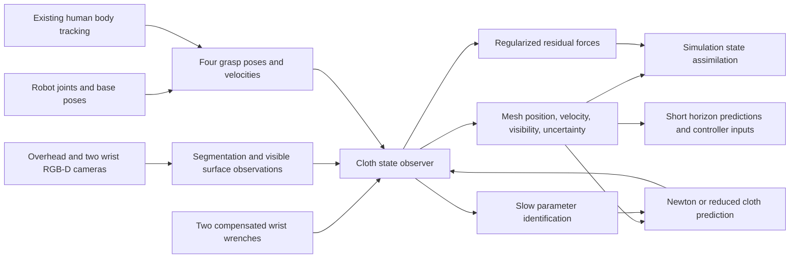

> Repository findings in this research note describe the pre-hardening snapshot. See [the platform audit](platform-audit.md) for subsequent fixes, changed interfaces, and acceptance gates.

**Dry woven carbon-fiber state estimation for OARbot Blue and Silver**

Research and implementation proposal, 3 November 2026.

The confirmed first objective is approximately **5 cm shape accuracy during slow handling**, with a path to faster motion. A human holds two corners and the robots hold the other two. The preferred production setup uses no markers on the fabric. Sheet dimensions, weave specification, intended maximum speed, and deployment computer remain unspecified. Numerical performance targets below are proposed acceptance criteria, not measured system performance.

**1. Recommended approach**

Build a **multi-view RGB-D observer of a material-coordinate cloth mesh**, using the existing Newton model for prediction, the existing body tracker for human grasp priors, robot encoders/TF for robot grasp poses, and both Rokubi sensors for reaction-force constraints. Maintain a complete estimated mesh, but label which parts are observed, inferred, or stale. Publish position and velocity; treat acceleration as an optional derived quantity with substantially higher uncertainty.

For the first milestone, use a coarse mesh of roughly 17×17 to 25×25 vertices, 15–30 Hz visual corrections, and a 60 Hz predicted state stream. Begin with the overhead camera and stationary bases, then incorporate the two moving wrist cameras. Prefer a bounded, warm-started geometric/physical optimization over a large learned reconstruction model. Add a short temporal estimation window and learned dynamics residuals only after the baseline has recorded validation data.

This is an engineering synthesis, rather than a claim that a published system already solves this exact problem. Physics-assisted point-cloud tracking has a long robotics history; recent methods add appearance, learning, and more effective geometric constraints. The key is choosing components that meet causal latency requirements and retain material identity. [Schulman et al., ICRA 2013](https://rll.berkeley.edu/tracking/paper.pdf), [CDCPD2](https://arxiv.org/abs/2011.00627).



**2. Repository and project findings**

I inventoried the 14 local OARbot packages, launch/configuration files, documentation, deployment scripts, and adjacent workspace projects. I read the relevant sensing, transformation, calibration, simulation, and controller implementations. I also inspected the referenced Azure ROS driver online and the installed Newton Style3D implementation. This was a source audit, not a live robot experiment. OARbots was at `a6eb6fa`; the adjacent simulator has substantial pre-existing working-tree changes, so observations below refer to its files as inspected, not solely to its Git HEAD.

| Existing component | Evidence and useful capability | Required extension or limitation |
|---|---|---|
| Wrist cameras | [Blue launch](../src/oarbot_launch/launch/oarbot_blue_helper_laptop.launch.py), [Silver launch](../src/oarbot_launch/launch/oarbot_silver_helper_laptop.launch.py): 1080P RGB, 15 Hz, body tracking enabled. Inherit WFOV_UNBINNED depth. | Select depth modes explicitly; synchronize devices; measure capture-to-estimate latency. |
| Overhead camera | [NUC launch](../src/oarbot_launch/launch/nuc.launch.py): `/nuc`, 5 Hz, NFOV_2X2BINNED; robot ArUco localization. | Raise acquisition rate; separate cloth observations from robot localization; validate coverage. |
| Camera settings | [Azure bringup](../src/oarbot_launch/launch/azure_kinect_bringup.launch.py): wired-sync mode, subordinate delay, serial selection, raw/depth/colored clouds. | Add explicit exposure control and, if needed, `depth_delay_off_color_usec` in both wrapper and driver. Current launches leave hardware sync off. |
| Human tracking | Both wrist launches enable the external Azure driver. It publishes `body_tracking_data` as `MarkerArray` and `body_index_map/image_raw`. | Add a hand/grasp adapter, cross-camera person association, source age, and confidence. No dedicated hand-to-sheet grasp estimator was found locally. |
| Robot kinematics | [State publisher](../src/oarbot_launch/launch/oarbot_state_publisher.launch.py), joint renamer, and robot URDFs provide prefixed robot TF and joint states. | Use measurement-time transforms, a calibrated cloth contact frame, and measured velocities rather than command velocities. |
| Robot localization | [Pose publisher](../src/oarbot_pose_publisher/src/oarbot_pose_publisher.cpp): robot tags 0/4 through overhead camera; fixed camera translation `(0,0,2.6)`, gravity-derived roll/pitch, assumed zero yaw. | Calibrate the world transform; preserve observation stamps and estimate localization uncertainty. A gravity estimate does not determine translation or yaw. |
| Force sensing | [Rokubi publisher](../src/rokubi_force_torque_publisher/src/rokubi_force_torque_publisher.cpp): raw and gravity/bias-compensated `WrenchStamped`, nominal 100 Hz timer. | Populate frame IDs, use sensor timestamps, report validity, remove duplicated stale samples, and add dynamic tool compensation for faster motion. |
| F/T calibration | [Calibration script](../src/force_torque_calibration/force_torque_calibration/main.py): estimates tool mass, CoM, and force/torque bias from several poses. | Recalibrate the assembled payload; check cable forces and Blue/Silver axis conventions. The existing procedure moves the arm. |
| Admittance | [Controller](../src/admittance_control/src/admittance_control.cpp): calibrated wrench to Kinova velocity. | Reuse topic/frame knowledge, not its 5 N motion deadband as an estimator filter. Low sheet loads must remain observable. |
| Operator interface | Tablet GUI/Arduino provide deadman, stop, and enable paths. | Add estimator-health display and an explicit command arbiter before autonomous robot output. |
| Base transport | Dingo domain bridges forward joint states, IMU, commands, and stop. | Bridge odometry/localization if bases move; it is not among the currently configured forwarded topics. |
| Network | [CycloneDDS configuration](../config/profile.xml) explicitly selects wireless interface `wlp2s0`. | Avoid transmitting three full colored clouds on this path. Use local processing or a measured wired transport configuration. |
| MoveIt and descriptions | Both MoveIt configurations and URDF collision/visual meshes exist. | Useful for robot masking, calibration poses, workspace checks, and arm command integration; not cloth perception themselves. |
| Other project | `../robot_tf2_demo` contains TF demonstration nodes. | Illustrative transforms, not a production human tracker or fabric estimator. |

The installed dependencies named in [packages.repos](../packages.repos) are not checked out inside this OARbot source tree. The public `jazzy` Azure driver was inspected separately; the exact deployed revision still needs pinning.

**Human tracking details.** In the inspected [Azure driver source](https://github.com/rpiRobotics/Azure_Kinect_ROS_Driver/blob/jazzy/src/k4a_ros_device.cpp), marker IDs are `body_id * 100 + joint_index`; positions are already converted from millimeters to meters, and marker frames are the depth-camera frames. SDK joints include left wrist/hand/tip at 7/8/9 and right wrist/hand/tip at 14/15/16. Use named SDK constants. IDs are local to a camera tracker and must not be equated between cameras. The driver copies position/orientation but discards the SDK's per-joint confidence; marker alpha is a body color, not confidence. Expose that confidence in a dedicated message. [Microsoft joint definitions](https://learn.microsoft.com/en-us/previous-versions/azure/kinect-dk/body-joints), [SDK joint structure](https://microsoft.github.io/Azure-Kinect-Body-Tracking/release/1.1.x/structk4abt__joint__t.html).

The skeletal hand center is not the fabric contact point. Estimate a hand-to-grasp offset using the local RGB-D sheet boundary, hand orientation when reliable, and temporal attachment consistency. Allow slip/regrasp states. Use body tracking as a noisy boundary observation, not an exact pin constraint. A wrist view aimed down at the sheet may lose the torso needed by the body tracker; measure this explicitly. The overhead camera is not automatically a good skeletal view either.

**Specific source issues to resolve before precision fusion.**

- `oarbot_pose_publisher.cpp` stamps tag-derived poses with `now()` and uses latest TF. Preserve the image observation time. Use a calibrated fixed world-to-overhead transform and a separate timestamped base-pose estimator.
- The F/T publisher sets no `header.frame_id`; compensation copies that empty header. The packet structure contains a sensor timestamp and temperature, but publication uses host `now()`. Verify units/rollover and map device time to the common clock.
- Its timer calls calibrated publication even when no new valid raw frame was read. Reject duplicates by sequence/time and publish validity/age. Do not treat a failed gravity transform as valid compensation.
- Gravity compensation uses latest TF and assumes gravity along base `-z`. This is adequate only when that orientation assumption holds. Faster motions additionally require tool translational/rotational inertial compensation.
- Wrist camera geometry is modeled in the URDF, but CAD offsets are not a measured hand–eye calibration. Mount compliance and cable loading can change the transform.
- Documentation describes body-tracking compute as being inside the Kinect. The actual driver creates the body-tracking SDK instance on the host; include this load in the helper-laptop GPU budget.

**3. What the simulation already supports**

The adjacent [simulation entry point](../../fabric_sim_isaacsim_newton/fabric_newton_isaacsim.py) uses Isaac Sim with Newton Style3D. Its current default sheet is 0.84×0.84 m with 56×56 cells, hence **3,249 vertices**, and four prescribed gripper patches. This is a simulation default, not the confirmed physical sheet size.

Useful reuse points:

- [`ClothState`](../../fabric_sim_isaacsim_newton/capsule_cbf/cloth_state.py) holds every particle's position and velocity.
- `/fabric/sim/state` is a `PointCloud2` with `x y z vx vy vz`. It is output only; no measured-cloth-state input exists in `FabricRosIo`.
- The default `state_publish_every: 3` means 20 Hz output when the simulation actually achieves 60 Hz.
- [`ReducedCloth`](../../fabric_sim_isaacsim_newton/capsule_cbf/reduced_cloth.py) preserves material-coordinate mapping between fine and coarse meshes.
- [`ClothMechanics`](../../fabric_sim_isaacsim_newton/capsule_cbf/cloth_model.py) exposes internal forces and patch-load calculations. These are a useful starting point for a predicted wrench model, but need consistent sign, moment, gravity/inertia, and boundary-mass treatment.
- [`sensitivity_cbf.py`](../../fabric_sim_isaacsim_newton/capsule_cbf/sensitivity_cbf.py) already contains a coarse-model force-bias observer and rolling prediction-error margins. Decide whether it or the new estimator owns the disturbance estimate; do not let two independent observers compensate the same residual.
- Simulation experiments, recorders, and parameter sweeps provide an evaluation framework. Older sections of the capsule README describe removed paths; use the current entry point and current code as authority.

The reduced predictor is a local approximation intended for the tensioned handling regime. Its fast linearized horizon must not be assumed to resolve arbitrary slack folds, changing contacts, or self-contact. Monitor disagreement with observations and the nonlinear twin; use nonlinear corrections, larger uncertainty, or a recovery mode when this approximation breaks down.

I verified the installed Style3D source at `/media/taha/ExtermeLinux/isaacsim/exts/isaacsim.pip.newton/pip_prebundle/newton/_src/solvers/style3d/`:

- `solver_style3d.py` reads `state_in.particle_f` as external force and precomputes a projective-dynamics matrix at construction.
- `kernels.py` updates velocity with a fixed `0.998` factor per substep. Its effective damping changes with substep rate.
- The local simulation exposes `tri_ka`, `tri_kd`, and `edge_kd`, but those are not effective damping/material controls in this solver path. Do not optimize parameters that have no effect.
- [`ClothRuntime._advance()`](../../fabric_sim_isaacsim_newton/capsule_cbf/newton_runtime.py) clears forces each substep. Residual forces must be written after that clearing and before `solver.step()`, including in CUDA graph execution.
- The solver updates input positions during its iterations and uses scratch state. Copy coherent snapshots at step boundaries; never read/update those arrays concurrently from a ROS callback.

No live benchmark was run. `nvidia-smi` could not communicate with the NVIDIA driver in this session. An older project note mentions an RTX 5070 Laptop GPU, but that does not establish the available deployment GPU or current performance.

**4. Options and literature assessment**

The following assessment distinguishes publication claims from suitability for this application. Benchmark error on ordinary cloth, synthetic data, or visible point clouds is not evidence of the same accuracy on dark carbon fabric or hidden material points.

| Approach | Evidence / contribution | Fit for this project |
|---|---|---|
| Multi-view depth + physical mesh observer | [Schulman et al. 2013](https://rll.berkeley.edu/tracking/paper.pdf) integrates point observations, grasping, collisions, and physics in real-time tracking. | Recommended foundation. Modernize the sensor front end and implement around your existing Newton/reduced model. |
| Constrained nonrigid registration | [CDCPD2, ICRA 2021](https://arxiv.org/abs/2011.00627) uses motion regularization and geometric constraints for partial occlusion. | Strong geometric baseline and comparison. Needs a ROS 2 integration and carbon-specific shear treatment; does not itself identify physical forces/materials. |
| Mesh-based learned dynamics and completion | [Mesh-based Dynamics with Occlusion Reasoning, 2022](https://arxiv.org/abs/2206.02881); [action-conditioned reconstruction, 2023](https://arxiv.org/abs/2302.09502). | Useful learned priors for hidden regions, but require training/domain validation and must be corrected by measurements. |
| Differentiable parameter identification | [DiffCP, RA-L 2024](https://arxiv.org/abs/2311.05141); [DiffCloth](https://arxiv.org/abs/2106.05306). | Good references for offline/slow identification. Do not assume their material parameters or differentiability transfer to Style3D. |
| RGB mesh + Gaussian splatting | [Cloth-Splatting, CoRL 2024 / proceedings 2025](https://arxiv.org/html/2501.01715v1). | Useful prediction/update design and optional slow appearance refinement. The paper explicitly says it is insufficiently fast for real time and assumes static appearance. Carbon highlights are a difficult mismatch. |
| Neural thin-shell reconstruction | [Thin-Shell-SfT, CVPR 2025](https://arxiv.org/abs/2503.19976). | Fine-detail reconstruction reference; not the initial causal controller observer. Optimize only after measuring a need for fine wrinkles. |
| Video-to-digital-twin fitting | [PhysTwin, 2025](https://arxiv.org/abs/2503.17973). | Useful offline inverse-modeling direction. Real-time interaction with the resulting twin does not imply real-time reconstruction/identification. |
| Visually learned dynamics | [CloDS, ICLR 2026](https://arxiv.org/abs/2602.01844). | Potential offline dynamics-learning pipeline from multi-view observations. It grounds geometry and trains dynamics in stages; not a ready-made online OARbot estimator. |
| Recent markerless geometric tracking | [TrackDeform3D, 2026](https://arxiv.org/html/2603.17068v1). | Useful initialization/topology ideas and dataset baseline. Its paper assumes unoccluded objects and uses symmetric temporal smoothing. The released hand-held rope example takes about 270 s for 16 s of data, so neither causal real time nor hidden-cloth recovery follows from that demo. [Code](https://github.com/roahmlab/trackDeform3D-core-tracking). |
| Physics + learned residual for co-transportation | [Forouhar et al., October 2026 preprint](https://arxiv.org/abs/2610.06641). | Especially relevant future predictor: coarse physics plus learned residual from grasp observations. It is not a substitute for dense visual correction and is not validation on dry carbon or these two robots. |
| Very high fidelity capture | [SIGGRAPH 2026 two-level cloth capture](https://graphics.cs.utah.edu/research/projects/two-level-cloth-capture-pattern/). | Uses 16 RGB cameras and applied patterns for reported 1 mm spatial resolution. Good reference for what fine capture requires; outside the three-camera markerless first milestone. |
| Industrial carbon draping | [DrapeBot](https://www.profactor.at/en/project/drapebot/), [DLR application](https://www.dlr.de/en/zlp/research-transfer/projects/projects-from-augsburg/englisch/drapebot), [FibreMap](https://cordis.europa.eu/project/id/608768/reporting/fr). | Confirms the relevance of human/robot draping, sensing, and fiber-orientation inspection. Specialized inspection systems are distinct from a dense real-time dynamic state observer. |

RPI's [Aksoy and Wen 2024 work](https://arxiv.org/abs/2401.16560) is directly relevant to the project's prediction/CBF motivation, but its simulation-based results do not establish a perception solution. Retain the distinction between state estimation, prediction, and robot control.

My ranking is: **(A)** constrained RGB-D + Newton observer now; **(B)** add bounded temporal optimization and force factors next; **(C)** add learned residual prediction after data collection; **(D)** specialized high-resolution optical metrology only if later requirements demand it. Avoid beginning with an end-to-end learned black box or a full fine-mesh nonlinear filter.

**5. Cameras, lighting, synchronization, and calibration**

Use the overhead camera as the stable global view. Aim the wrists toward complementary interior/edge regions with sufficiently different viewing angles. Check coverage through the entire handling trajectory, not only the initial flat pose. A camera bolted near a grip cannot obtain valid depth arbitrarily close to that grip. Depending on fold geometry, a lower oblique view can help more than another view from above. Wrist reorientation also changes the grasp and sheet loading; viewpoint planning must respect the manipulation task.

Azure depth-mode choices:

| Mode | Resolution | Maximum rate | Nominal minimum range | Proposed use |
|---|---:|---:|---:|---|
| NFOV_UNBINNED | 640×576 | 30 Hz | 0.5 m | Preferred overhead / wrist mode when geometry fits. |
| WFOV_2X2BINNED | 512×512 | 30 Hz | 0.25 m | Wrist coverage at closer range, with lower angular sampling density. |
| WFOV_UNBINNED | 1024×1024 | 15 Hz | 0.25 m | Existing wrist mode; usable slow-handling baseline, poor path to faster acquisition. |

These are hardware specifications, not carbon-fabric accuracy guarantees. RGB is rolling shutter. Increasing RGB resolution or resizing registered depth does not increase independent depth samples. [Microsoft specifications](https://learn.microsoft.com/en-us/previous-versions/azure/kinect-dk/hardware-specification).

Prefer all three in NFOV_UNBINNED at 30 Hz if coverage and standoff allow. If not, start all at a compatible 15 Hz configuration, characterize mixed modes, and upgrade after validation. Use 1080P RGB initially; keep native-resolution crops for the sheet contour. For a one-camera first prototype use overhead RGB-D; for two cameras add whichever wrist best reveals the hidden folds. Three cameras improve coverage, but cannot observe all surfaces under arbitrary self-contact.

Wire the three synchronization ports, use one master and two subordinates, equal frame rates, and manual RGB exposure. Azure depth emitters must be staggered; Microsoft's guidance is at least 160 μs between depth captures, with timing calculated for the chosen depth pulse schedules. A same-mode 0/160/320 μs schedule is a starting candidate to validate, not a universal mixed-mode configuration. Prefer depth-specific delays when maintaining RGB alignment; subordinate delays also shift that camera's capture timing. Start subordinates before the master. [Microsoft multi-camera guide](https://learn.microsoft.com/en-us/previous-versions/azure/kinect-dk/multi-camera-sync), [SDK configuration](https://microsoft.github.io/Azure-Kinect-Sensor-SDK/master/structk4a__device__configuration__t.html).

Hardware trigger synchronization and computer clock synchronization solve different problems. Map device timestamps to a common host clock and measure offset/drift between laptops and NUC; use wired PTP where supported or validated host synchronization. Preserve actual RGB/depth times. ROS ApproximateTime only pairs stamped messages: it does not synchronize exposure. Apply robot TF at each measurement's time, and motion-compensate staggered views before fusion.

Dry carbon can present low diffuse signal and directional highlights; visible darkness alone does not determine near-IR return. Test the actual ply at all intended distances, yarn orientations, view angles, and speeds. Record valid-depth fraction, temporal noise, plane bias, edge outliers, IR intensity, and three-camera interference. Use diffuse controlled lighting and a contrasting matte background. Evaluate RGB cross-polarization if glare is severe, while measuring its light loss. Do not assume a polarizer on the depth optics improves ToF measurements. Industrial fiber-inspection work explicitly addresses difficult black/reflective surfaces. [FibreMap](https://cordis.europa.eu/project/id/608768/reporting/fr).

Calibration sequence:

1. Check each device's RGB/depth calibration and registration on targets at working distance.
2. Calibrate overhead-to-world with a rigid board covering the working area.
3. Calibrate each wrist camera to the robot flange using diverse arm rotations/translations, initially with the mobile bases stationary.
4. Calibrate flange-to-cloth-contact/patch transforms; include camera, gripper, and F/T payload in tool calibration.
5. Validate transforms on separate poses and known targets throughout the workspace, with loaded wrists as well as unloaded ones.

Use a removable checkerboard or ChArUco board for calibration. This does not require tags on the production fabric. OpenCV provides hand–eye solvers; held-out spatial error matters more than just the calibration reprojection residual. [OpenCV calibration API](https://docs.opencv.org/4.12.0/d9/d0c/group__calib3d.html).

Retain the existing robot ArUco tags for base localization during the first milestone. If “no tags” also includes the robots, use stationary calibrated bases first, then implement a separately validated localization solution. The repository documents UWB as inoperable and roughly decimeter class; it is not a replacement for a 5 cm fabric estimate.

**6. Surface measurements and material correspondence**

Start with known sheet dimensions, warp/weft directions, four corner identities, rest topology, and an initially visible gently spread sheet. Estimate its hanging shape from depth with physical constraints. A rectangle with unlabeled corners can be rotated/reflected ambiguously, so define a persistent mapping such as `robot_blue`, `robot_silver`, `human_left`, `human_right` to material corners. Do not infer this mapping from changing left/right image order.

For each camera:

- Segment the fabric in RGB, using a workspace ROI, four grasp priors, and projected robot geometry/body masks. Keep separate masks for fabric, human, robot, and uncertain boundary pixels.
- For initial development, use prompted SAM 2.1 or SAM 3 to annotate/reinitialize masks. Benchmark a small task-specific segmentation network or lighter classical/temporal method for the live loop. Generic segmentation does not estimate the cloth's material state. [SAM 2](https://arxiv.org/abs/2408.00714), [SAM 3](https://arxiv.org/abs/2511.16719).
- Deproject native depth only where the fabric mask and depth validity agree. Preserve a sample's camera, timestamp, surface side/visibility hypothesis, and uncertainty. Avoid smoothing across a fold, occlusion edge, or hand contact.
- Reject flying pixels, foreground/background blends, extreme incidence angles, and inconsistent multiview depth. Use IR return and empirical noise models as quality features; Azure does not provide a universal calibrated per-pixel depth probability.
- Use silhouette contours even where depth is invalid. Track a modest number of RGB features/patches where weave texture is discriminative. CoTracker3 is a candidate feature source, but its online window and lookahead must be profiled and included in latency. It is not a complete 3D cloth observer. [CoTracker3](https://github.com/facebookresearch/co-tracker/blob/main/README.md).

Fit observations to visible triangles of a persistent material mesh. Use predicted visibility, depth ordering, robust residuals, and barycentric correspondences. Keep front/back and fold branches distinct. A naive nearest-neighbor attraction of every vertex to the fused cloud pulls hidden cloth onto visible layers and changes material identity.

Pure depth strongly constrains normal displacement but can be weak for tangential sliding along a smooth sheet. Repetitive weave and highlights also make RGB correspondence ambiguous. Corner identities, material mechanics, boundary tracking, and occasional features reduce the ambiguity; they do not eliminate it. Report lower tangential confidence when material correspondence is weak. A geometrically good surface match alone is not proof of correct particle velocity or shear strain.

Do not accumulate a conventional static TSDF over moving cloth: it smears different shapes together. If temporal integration is needed, warp prior observations with the estimated material motion and uncertainty. The mesh is the persistent state; point clouds are observations.

**7. Estimator design, velocities, predictions, and confidence**

For fixed topology, use state `x = [q, v, d]`, where `q` and `v` are material-vertex positions/velocities and `d` is a small vector of residual-force coefficients. Keep material parameters `theta`, calibration parameters, and grasp mode separately. Update parameters more slowly than state.

Conceptual dynamics:

```text
q_dot = v
M v_dot = f_internal(q,v; theta) + M g + f_contact + B d + J_grasp^T lambda
grasp constraints: phi(q, measured_grasp_poses) = 0, with uncertainty/slip mode
```

`lambda` represents constraint reactions. `B` is a low-dimensional basis of plausible unmodeled loads. A general free force at every particle is not identifiable from two wrist sensors and partial images.

**First implementation:** predict a coarse physical mesh to the observation time; optimize its correction against robust depth/silhouette residuals, grasp priors, and orthotropic strain/bending regularization. Bound iterations/time, warm-start from the prediction, and reject implausible associations. Start with causal position/velocity filtering using physical prediction and empirically calibrated uncertainty. A per-vertex alpha–beta filter can be a diagnostic baseline, but cannot represent mechanical coupling by itself.

**Second implementation:** use a short, bounded sliding window of recent states, or a reduced-state iterated EKF/ensemble filter. A moving-horizon objective can include:

```text
prior + robust depth/silhouette/feature residuals
      + uncertain grasp residuals
      + wrench residuals
      + dynamics residuals over the window
      + material/contact regularization
```

Weights come from measured noise/covariance and robust loss scaling. Avoid separately adding the same physical prior twice at full strength. Use sparse structure or a reduced basis; a dense full-mesh covariance is inappropriate. At 3,249 vertices, positions plus velocities alone have 19,494 scalar components; their dense double covariance is about 3 GB before factorization.

For delayed images, update the historical state at capture time, then propagate forward with buffered measured grasp motion. Publish both the observation-time estimate and the estimate extrapolated to the present. Keep `last_measurement_time`, estimate time, and publish time distinct. An estimator can run at 60–100 Hz while receiving only 15–30 new image observations per second; those rates must not be conflated.

Velocity should be inferred jointly with position using dynamics and temporal observations. Do not differentiate independently reconstructed, reindexed point clouds. For illustration, independent 5 mm position noise at 30 Hz produces about 0.21 m/s standard deviation in a simple first difference. Double differentiation produces about 11 m/s² acceleration noise. These are noise-propagation calculations, not measured Kinect performance.

Acceleration makes technical sense as a model-derived output over a declared bandwidth. It is not an independent required state for ordinary second-order cloth dynamics. Contact and grasp changes can create impulses; publish filtered acceleration only when its uncertainty and definition are useful. Position, velocity, uncertainty, and contact mode should be the first deliverables.

Predict 0.1, 0.2, and approximately 0.33 s ahead initially, matching the existing controller horizon where appropriate. Condition predictions on measured robot motion and candidate future robot commands. Use constant-velocity human motion initially, with bounded acceleration alternatives. Generate a small set of human-motion/material/disturbance scenarios when evaluating hidden regions and future clearance. A mean prediction alone can hide two physically different fold hypotheses.

For every vertex or patch, retain:

- Observed/predicted/stale status, camera visibility bitmask, and time since direct observation.
- Position and velocity covariance or a conservative approximation; shared calibration uncertainty must not vanish when adding correlated views.
- Data-association quality, view disagreement, and model residual.
- A calibrated error bound at each prediction horizon and a separate contact/grasp reliability state.

Start with per-vertex covariance blocks plus a few global/reduced uncertainty modes, then validate their coverage on held-out sequences. Treat a scalar confidence as a UI summary, not as a physical probability unless calibrated. During occlusion, propagate uncertainty upward; reduce it only when independent evidence warrants. On recovery, use gated association and smooth constrained correction. Reinitialize if attachment identity or topology is lost.

**8. How to use the force–torque sensors correctly**

Both Rokubi sensors measure loads transmitted through their mounting locations. They do not directly measure every internal sheet force, both human hand forces, or a distributed wind/contact field. Robot/tool acceleration, gravity, cable forces, mounting offsets, and biases can all contribute.

Process raw wrench into a documented sensor frame, subtract the calibrated tool wrench, and transform to the comparison frame at the measurement timestamp. A shift of the wrench reference point requires the moment-arm term, not just rotation:

```text
f_world = R f_sensor
tau_about_O_world = R tau_about_S_sensor + r_OS_world cross f_world
```

Here `r_OS` points from the desired origin O to the sensor origin S. Verify action–reaction signs by applying a known load. Blue and Silver have different mounted-axis handling in the current publisher. Confirm that the measured force on the tool is compared with the corresponding cloth-on-tool model quantity.

Use the compensated wrenches for four purposes: estimate/validate boundary tension; identify stiffness/damping during informative motion; detect slip/contact or model mismatch; and constrain a low-dimensional disturbance observer. Include actual finite grip patches and orientation when computing predicted force/moment. At low loads, torque may be less informative than force, so weight it according to the calibrated noise floor.

**Avoid double counting.** With measured robot and human corner trajectories imposed as kinematic boundary conditions, the simulator already generates the sheet's response to those motions. The wrist wrench is then primarily a measurement of the required reaction. Applying that same wrench again as an external force to prescribed corner vertices is redundant or ineffective. To drive a grip by force instead, model its compliant dynamics and stop imposing all of the same degrees of freedom exactly.

Use `B d` only for the discrepancy that remains after accounted gravity, material response, measured boundary motion, and known contacts. Initially use a handful of spatial modes, such as uniform load plus broad regional loads, with smoothness and decay. Geometry, calibration bias, material parameters, and external force can explain similar errors; do not let unrestricted force fitting hide a bad calibration or wrong material.

The existing coarse force-bias observer is a suitable baseline. Feed measurement confidence and valid temporal innovations into it, cap updates, and reset/freeze it on regrasp or contact changes. Its current simulated-state error margins do not automatically transfer to a vision-driven system.

**9. Dry woven carbon material model and identification**

Use separate warp tension, weft tension, shear, and directional bending terms. Dry woven plies can deform substantially through yarn rotation and bending even while yarn extension is small. A model that enforces all triangle-edge lengths equally, including diagonals, may suppress legitimate shear. Do not substitute a cured-laminate carbon-fiber Young's modulus for the response of a dry textile. Textile studies characterize shear and bending separately and show tension–shear coupling. [Carbon fabric draping model](https://journals.sagepub.com/doi/10.1177/15280837231159678), [tension–shear coupling](https://www.mdpi.com/2076-3417/10/4/1551).

Use the existing Style3D anisotropic stiffnesses as an effective low-deformation first model. For larger shear and faster motions, evaluate nonlinear shear stiffening, tension–shear coupling, hysteresis/yarn friction, air drag, and actual grip compliance. Keep this extension driven by measured residuals. Surface reconstruction at 5 cm does not establish fiber-level strain accuracy or a validated damage limit.

Identify in stages:

| Experiment | Parameters or errors it informs |
|---|---|
| Measure sheet dimensions, mass, warp/weft orientation, clamp area | Rest mesh, areal density, material directions, attachment mapping. |
| Unloaded robot tool poses and known loads | Wrench bias, mass/CoM, signs, and frame errors before fabric fitting. |
| Static hangs at several separations/orientations | Bending/sag and boundary offsets; static shape alone usually cannot identify all stiffnesses. |
| Warp/weft tensile coupon measurements or supplier textile data | In-plane extension response; robot motions alone may not excite it observably. |
| Picture-frame or bias-extension test | Shear curve and dependence on preload; use the actual textile architecture. |
| Cantilever/bending test | Directional bending response. |
| Small controlled oscillations at several rates | Damping, delay, grip compliance, and eventually aerodynamic residuals. |
| Independent combined trajectories | Generalization of shape and wrench prediction. |

These characterization practices are established for reinforcement textiles. [TUM test methods](https://www.asg.ed.tum.de/en/lcc/capabilities/characterization/), [carbon-fabric DIC study](https://research.monash.edu/en/publications/a-low-cost-digital-image-correlation-technique-for-characterising).

Fit a small shared parameter vector against both geometry and compensated wrenches across whole trajectories. Inspect sensitivity/rank and hold out entire trajectories and speed ranges. Initially freeze density and geometry after measurement; adapt only identifiable stiffness/damping combinations. Slow online adaptation can be a bounded 0.2–1 Hz background process after offline identification, gated by visibility, excitation, and contact mode. That frequency is a proposed budget, not a demonstrated capability.

When changing Style3D parameters, rebuild or correctly refresh the dependent matrix, reduced predictor, and captured computation graphs; changing a parameter array alone may leave stale derived structures. Use a versioned candidate model, validate it in parallel to the live state, then swap at a step boundary. Preserve the old model for rollback. Avoid estimating parameters from motion that is poorly tracked.

**10. Concrete ROS 2 and simulator implementation**

Suggested new packages:

| Package | Responsibility |
|---|---|
| `fabric_state_msgs` | Versioned material mesh, state, grasp, wrench-quality, forecast, and health messages. |
| `fabric_perception` | Per-camera segmentation, depth quality, robot/human masking, observation extraction. |
| `fabric_grasp_tracking` | Existing body markers + robot state to four measured cloth attachment poses/velocities, with confidence. |
| `fabric_state_estimator` | Prediction/correction, material correspondence, uncertainty, short forecasts. |
| `fabric_identification` | Bag replay, offline fitting, bounded slow parameter proposals, residual-force estimation. |
| `fabric_sim_bridge` | Atomically assimilate estimates and residual loads into Newton; preserve an independent free-running validation model. |

Inputs verified from local launches and the referenced driver:

```text
/nuc/{rgb/image_raw,depth/image_raw,rgb/camera_info,depth/camera_info}
/oarbot_blue/azure_kinect/{rgb/image_raw,depth/image_raw,...}
/oarbot_silver/azure_kinect/{rgb/image_raw,depth/image_raw,...}
/oarbot_{blue,silver}/azure_kinect/body_tracking_data
/oarbot_{blue,silver}/azure_kinect/body_index_map/image_raw
/oarbot_{blue,silver}/kinova/j2n6s300_driver/out/joint_state
/oarbot_{blue,silver}/force_torque_raw
/oarbot_{blue,silver}/force_torque_calibrated
/tf
/tf_static
```

The braces above describe topic families, not literal ROS topic names. Confirm actual types, rates, QoS, frame IDs, and populated joint-velocity fields on the deployed robots. Add base odometry if needed. Do not assume a command or a merged/default joint-state velocity is a measured Cartesian velocity.

Proposed outputs:

```text
/fabric/model                 # topology, rest UV, material axes, mesh/model version
/fabric/grasp_states          # explicit human/robot identities and attachment modes
/fabric/estimated_state       # q, v, covariance approximation, visibility, age
/fabric/predicted_states      # time horizons, conditional forecasts, uncertainty
/fabric/residual_loads        # force basis coefficients, covariance, model version
/fabric/material_parameters   # accepted parameter set, units, provenance
/fabric/estimator_status      # validity, latency, coverage, contact/identity failures
```

Use a dedicated state message with a standard header, state sequence, mesh UUID/version, measurement cutoff time, and valid-until/age information. Publish topology once with transient-local durability. A `PointCloud2` compatibility topic can mirror the existing six fields plus stable vertex ID and quality fields; do not rely on cloud row order without a documented topology/version contract. Keep observed samples separately accessible for diagnostics.

Use meters, seconds, newtons, and radians; explicitly distinguish optical frames from robot frames. The Azure driver's frame names should be checked by axes, not inferred from whether they end in `_optical`. Use best-effort bounded queues for high-volume live sensor data where appropriate, and reliable delivery for configuration/model versions. Match publisher/subscriber QoS. [ROS REP-103](https://github.com/ros-infrastructure/rep/blob/master/rep-0103.rst), [ROS 2 Jazzy QoS](https://github.com/ros2/ros2_documentation/blob/jazzy/source/Concepts/Intermediate/About-Quality-of-Service-Settings.rst).

At a simulator step boundary:

```text
take a coherent timestamped estimator snapshot
map material IDs / rest coordinates into the simulation mesh
bring the estimate to the simulation's target time
perform uncertainty-weighted constrained correction of q AND v
update measured grip patch poses, orientations, and velocities
refresh collision/solver caches affected by the correction
for each substep:
    clear forces
    write accepted residual external loads into particle_f
    impose measured/predicted boundary conditions
    step the solver
publish assimilated state and separate free-running prediction diagnostics
```

Do not overwrite all vertices with raw cloud samples or simply reset all velocities to zero. Keep gripped patch coordinates and velocities consistent with their current attachment mode. If adding rotational grip motion, replace the current translation-only fixed offsets with rotated patch offsets and angular velocity terms. Populate both canonical/scratch state as required by the runtime, and preserve CUDA graph buffer addresses or recapture safely when they change.

Use a separate observer/twin instance from future controller rollouts. Never let predicted data feed back as independent camera evidence. In live operation, use real capture time and measured motion; in offline replay, explicitly use the bag/simulation clock. The current simulation stamps output with wall time while tracking its own `sim_time`, so slow-than-real-time runs need explicit time semantics before using them as an online twin.

Map Blue/Silver explicitly onto the simulator's follower-left/follower-right indices. Simulation publishes `/robot_left/ee_cmd_vel` and `/robot_right/ee_cmd_vel`, whereas the physical Kinova inputs use `kinova_msgs/PoseVelocity`. This needs a frame-aware robot bridge and command arbitration with teleop/admittance. Start by consuming state only, then validate simulated commands offline and in shadow operation before enabling the physical bridge.

**11. Compute, latency, and resolution budgets**

Use helper laptops for camera capture and preferably ROI/mask/depth preprocessing. Send compact observations or cropped/compressed streams to the estimator host; keep rigid calibration and timestamps with each. Use a GPU for segmentation and dense image operations when available, and CPU sparse algebra for the coarse observer if profiling supports it. Isaac rendering should have a lower priority than sensing/control; run the twin headless during latency measurements.

One uncompressed 1920×1080 BGRA image is about 8.3 MB. Three streams at 30 Hz are about 746 MB/s, approximately 6 Gbit/s, before depth, DDS, and other traffic. In contrast, 3,249 positions/velocities as six float32 values are about 78 kB per state, approximately 4.7 MB/s at 60 Hz. These are payload calculations, not network benchmarks. Publish only the streams actually consumed; disable unnecessary dense colored-cloud generation and forwarding.

Proposed initial budgets:

| Item | Slow-handling milestone | Later higher-speed stage |
|---|---|---|
| Measurement update | At least 15 Hz; 30 Hz preferred | Sustained 30 Hz with measured exposure and latency; reassess sensor adequacy if insufficient. |
| Predicted current state | 60 Hz | 60–100 Hz if it benefits the controller. |
| Estimator mesh | 17×17 to 25×25 | Increase only where curvature/uncertainty and runtime justify it. |
| Simulation mesh | Existing 57×57 if it fits budget | Adaptive detail or a separate detailed twin. |
| Surface accuracy criterion | Proposed 95th-percentile error ≤50 mm in defined slow tests | Set from speed/clearance and validate; do not promise arbitrary millimeter accuracy. |
| Capture-to-published-state age | Proposed p95 ≤100 ms at ≤0.1 m/s first test | Aim ≤50 ms or tighter according to the error budget. |
| Forecast horizons | 0.1, 0.2, 0.33 s, scored separately | Extend only where held-out prediction error is acceptable. |

The speed values are proposed test conditions, not robot capability claims. At 0.1 m/s, 100 ms latency corresponds to 10 mm displacement; at 0.5 m/s it is 50 mm. Include rotational camera motion and acceleration in the error budget. High frame rate alone does not remove exposure blur or processing delay.

An illustrative linear budget is `total error ≈ measurement/calibration error + speed × uncompensated age + prediction error`; independent Gaussian terms may instead be combined statistically, but systematic/shared errors are not independent. Set the maximum allowed speed from the measured budget, rather than raising speed until tracking visibly fails.

The 17×17 mesh on the current 0.84 m sheet has roughly 52.5 mm vertex spacing. That does not imply 52.5 mm surface error: interpolation can describe smooth sag accurately, while narrow folds may be completely missed. Fine rendering mesh density likewise does not create measured detail. Benchmark folds explicitly and separate measured resolution from model-interpolated resolution.

For faster motion, first reduce queues/copies, shorten RGB exposure with adequate lighting, and account for rolling-shutter and depth acquisition duration. If the measured error budget still fails at the required speed, consider synchronized global-shutter stereo or industrial depth hardware as an additional measurement source. A faster predictor cannot recover visual information that was never resolved during exposure; choose replacement hardware only after tests on the actual carbon ply.

**12. Validation, uncertainty, and controller use**

Define 5 cm as a metric before declaring success. I recommend a held-out **95th-percentile 3D surface error ≤50 mm**, with corner/contact errors and correspondence error reported separately. Also report maximum error, missing coverage, failure rate, and reacquisition time. Do not score only visible vertices and then claim complete-sheet accuracy.

Use independent reference measurements. For early slow tests, known planar/draped fixtures and sparse temporary validation markers or measured landmarks are practical; keep them out of estimator inputs. Later use additional calibrated reference cameras, stereo/DIC, or motion capture on a sacrificial sample. A held-out camera helps test visibility generalization but is not independent metrology if it shares the same calibration error. Markerless operation does not require markerless evaluation. A published dynamic cloth dataset illustrates the value of independent motion capture, although it is not carbon-fiber ground truth. [Coltraro et al., IJRR 2025](https://journals.sagepub.com/doi/10.1177/02783649251317617).

Test flat/sagging sheet, twists, partial folds, glancing views, dark backgrounds, human occlusion, one/two/all-camera dropout, regrasp, and base motion separately. Add speed sweeps after the stationary-base experiments. Record raw RGB/depth/IR, calibration, TF, joint states, hand estimates, raw/compensated wrenches, solver versions, timestamps, and diagnostics.

Compare: corners-only prediction; one camera; two cameras; all three; vision without physics; vision + physics; vision + physics + force; and each candidate learned refinement. Score state error, velocity error on reference trajectories, 100/200/330 ms forecast error, p50/p95/p99 latency, valid coverage, uncertainty coverage, and recovery time. Evaluate both current state and free-running forecasts so frequent correction cannot conceal a poor model.

The current CBF uses a 5 cm nominal clearance margin. **A 5 cm estimation-error target does not support retaining that same clearance margin unchanged.** Add experimentally justified state, calibration, latency, and prediction allowances, or reduce operating speed/expand separation. A 95th-percentile error statistic or empirical conformal residual is not a worst-case guarantee. Errors are temporally correlated, and dropout/contact changes can invalidate calibration. Feed estimator validity and error bounds into the controller, and define behavior when the state is not usable. This is required by the intended perception-driven control loop, not an assertion that the existing controller is validated for hardware.

**13. Staged implementation roadmap**

Effort estimates assume one experienced robotics/perception engineer and working hardware; they are planning estimates, not commitments. Some data collection and mechanical work can overlap.

| Stage | Work and repository touchpoints | Exit criterion | Indicative effort |
|---|---|---|---|
| 0. Establish measurement quality | Carbon depth/lighting tests; runtime inventory; record topics; inspect USB/network/GPU; measure timestamp offsets. | The actual sheet has enough valid measurements across required poses; bottlenecks and deployed versions are known. | 2–4 days |
| 1. Calibrate and make streams trustworthy | Extend Azure launch/driver controls; preserve base-pose stamps; fix wrench frame/validity/time; calibrate camera/grasp/tool transforms; keep bases stationary. | Held-out spatial and timing errors fit a documented share of the 50 mm budget. | 3–7 days |
| 2. Build a markerless geometric baseline | One overhead view, explicit corner identities, RGB-D mask, persistent coarse mesh, hand/robot grasp adapter, RViz overlays. | Slow visible-shape tests meet the 50 mm criterion and failures are flagged. | 1–2 weeks |
| 3. Fuse views and predict | Add wrist views at their measurement times, physical prediction/correction, causal velocity estimate, visibility/uncertainty, dropout recovery. | Three-view ablations improve coverage; no silent fold/identity switching; scored short-horizon predictions. | 1–2 weeks |
| 4. Connect the digital twin | Add measured-state input and material mapping; correct q/v at step boundaries; instrument residual-force injection and patch reactions. | Simulation follows real state without artificial velocity/energy spikes or force double counting. | About 1 week |
| 5. Identify material and disturbances | Offline geometry+wrench fitting, informative experiments, holdout validation, single disturbance-observer owner, slow parameter updates. | Better unseen-trajectory prediction than fixed nominal physics, with identifiable parameters. | 1–2 weeks |
| 6. Increase speed and control use | Profile/optimize, reduce sensor age, test inertial compensation, optional learned residual, integrate controller uncertainty and robot command bridge. | Meets accuracy/latency/forecast criteria at each declared speed and dropout condition. | Iterative, typically several weeks |

Aim for roughly 4–8 weeks to a useful slow-handling research prototype, depending on hardware and calibration work. Accurate high-speed, occlusion-tolerant operation is a subsequent research/validation milestone.

The first implementation tickets should be: **camera timing and quality recorder; wrench validity/frame/timestamp repair; human grasp adapter; overhead persistent-mesh baseline; then multi-view physical estimation.** This sequence addresses the largest practical risks before adding complex neural models.

**14. Remaining design inputs**

Measure physical sheet length/width and areal mass, identify weave/orientation, specify grip patch sizes and whether human regrasp is allowed, inventory the helper-laptop/NUC/estimator GPU, and define the eventual maximum speed and obstacle clearance requirement. None prevents beginning the capture/calibration and slow-handling baseline above.

This report is the deliverable of the research task. No robot control code, calibration parameters, simulator working-tree changes, or running hardware settings were modified.
