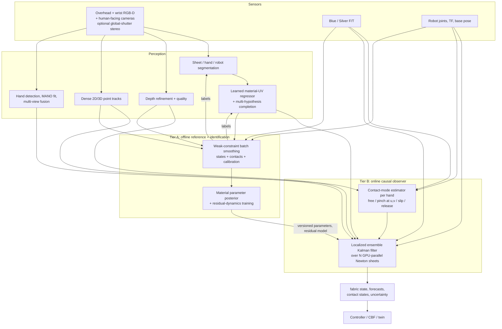

> Repository findings below were first written against the pre-hardening snapshot (`a6eb6fa`) and are annotated with the post-hardening status reported in [the platform audit](platform-audit.md). That audit holds the authoritative list of fixes, changed interfaces, and hardware acceptance gates.

> For implementation progress after this proposal, current evidence, and a critical review of the plan, see the [10 November 2026 progress report](fabric-state-estimation-progress-report.md).

**Dry woven carbon-fiber state estimation for OARbot Blue and Silver**

Research and implementation proposal. First version 3 November 2026; **revised 4 November 2026** after a second literature review that deliberately challenged the first recommendation.

**Goal.** Build a system that:

1. Tracks the human's hands and determines whether and where each hand is in contact with the sheet.
2. Detects the composite sheet in every camera.
3. Produces a complete, material-indexed state of the whole sheet (position, velocity, uncertainty, observed/inferred labels).
4. Is accurate enough to **identify and tune the simulation**, not only to display the sheet.
5. Uses every available sensor, including the two wrist force–torque (F/T) sensors.

The confirmed operating case: a human holds two corners and the two robots hold the other two. The production sheet carries no markers. Effort, training data, and implementation complexity are not constraints for this revision. Sheet dimensions, weave, maximum speed, and deployment GPU are still unspecified. All numerical targets are proposed acceptance criteria, not measured performance.

---

## 0. What changed in this revision

The first version recommended one causal multi-view RGB-D mesh observer, with the Newton model for prediction, Azure body tracking for the human corners, and learning postponed. That remains a sound real-time baseline, but challenging it against the literature and the actual goal (tuning the simulator) exposed six weaknesses:

| # | Original assumption | Challenge | Revision |
|---|---|---|---|
| 1 | One causal observer serves both control and simulator identification. | Fitting simulator parameters to the output of an observer that already contains that simulator's prior is circular and biases the parameters toward the prior. A causal filter also discards future measurements. For identification, batch smoothing on raw sensor residuals is the statistically correct estimator. | **Two tiers.** An offline, non-causal *reference reconstruction and joint identification* (Tier A) fits states, contacts, and parameters directly to raw depth/image/wrench data. A separate online causal observer (Tier B) serves control. |
| 2 | Azure ToF depth is the primary measurement; RGB supplies silhouettes and sparse features. | Dark, glossy, woven carbon is a known worst case for ToF (absorption, specular returns, multipath, flying pixels). Depth constrains only normal displacement; tangential sliding, which is exactly what shear-dominated woven fabric does, is nearly unobservable from depth alone. | **Multimodal observation operators:** learned depth refinement, optional passive stereo, photometric residuals from appearance Gaussians attached to the mesh, dense 2D/3D point tracks, silhouettes, and (research item) local yarn-orientation measurement that directly observes shear. |
| 3 | Azure body tracking supplies hand priors. | The Azure skeleton has only hand, hand-tip, and thumb joints per side and loses the body when wrist cameras look down at the sheet. Composite handling normally requires gloves, and published industrial tests show bare-hand detectors collapsing on gloved hands. | **A dedicated hand and contact pipeline:** human-facing static cameras, a modern hand detector with 3D mesh recovery, multi-view MANO fitting, fine-tuning on gloved data from this cell, and a discrete contact-mode estimator that fuses geometry, relative motion, and F/T momentum balance. Instrumented gloves are an accepted option because the marker-free constraint applies to the fabric. |
| 4 | Defer learned models until a baseline exists. | Optimization and physics trackers fail mainly at **initialization and reacquisition**: they assume the prediction is already close to the truth. The project has a simulator, so labelled synthetic data with exact material correspondence costs almost nothing. | **Train early:** a per-pixel material-coordinate (UV) regressor and a multi-hypothesis completion model, trained in simulation and refined with Tier A labels. They are used as priors and for re-initialization, never as unchecked final output. |
| 5 | The second online stage is an iterated EKF or moving-horizon estimator (MHE). | Both need Jacobians or gradients. The installed Style3D solver has no gradient path (Section 3). Building a full-mesh EKF covariance is also infeasible. | **Ensemble data assimilation** (localized ensemble Kalman filter) over GPU-parallel Newton instances is the primary online estimator. It needs no gradients and provides uncertainty directly. Nudging ("visual forces") is the low-latency fallback; MHE is optional with a differentiable surrogate. |
| 6 | F/T is used for validation, slow identification, and a residual-load observer. | F/T is the **only** measurement that makes in-plane tensile stiffness observable: a taut sheet's shape barely changes with stiffness. Combined with sheet mass and centre-of-mass acceleration, the two wrenches also give the **total human force by momentum balance**, which is direct evidence of human contact. | F/T becomes a first-class factor in the reference reconstruction, the contact estimator, and identification. The double-counting rule from the first version still applies. |

The 50 mm p95 target is also split. It remains the **online** target. Simulator tuning needs a tighter **offline reference** target (proposed ≤10–15 mm p95 on visible surface, plus wrench prediction error), derived from a parameter-sensitivity analysis rather than chosen arbitrarily (Section 10).

---

## 1. Recommended architecture



**Representation.** Both tiers share one persistent **material mesh** with fixed topology, rest UV coordinates, and warp/weft axes. Optionally, **appearance Gaussians** are bonded to its triangles. The mesh is the state. Gaussians, point clouds, and image features are observations or measurement models, never state. This keeps material identity, which is needed for velocity, strain, and identification.

**Tier B, online and causal** (controller-facing; 15–30 Hz updates, 60 Hz prediction):

- **Prediction:** an ensemble of N ≈ 32–64 coarse (17×17 to 25×25) Newton sheets, each perturbed in initial state, residual loads, and slow parameters, all driven by measured robot grip poses and estimated human grip poses.
- **Update:** a localized ensemble Kalman update (LETKF-style, localized by geodesic distance on the mesh) against depth, silhouette, point-track, UV, and wrench observations. It runs in observation-time order, then propagates to the present.
- **Fallback:** PEGS-style nudging forces whenever ensemble statistics degrade or latency must be minimal.
- **Initialization and reacquisition:** from the learned UV/completion prior.

**Tier A, offline and non-causal** (simulator-facing; minutes per sequence is acceptable):

- Weak-constraint batch smoothing over whole recorded trajectories, solving jointly for sheet states, grip contacts, small calibration and time-offset corrections, and material parameters. It fits raw residuals (refined depth, bidirectional dense tracks, photometric, silhouette, wrench), with the dynamics as a soft constraint.
- **Outputs:** reference trajectories, a parameter posterior, residual statistics, and training labels.

**Learning loop.** Synthetic Newton data plus Tier A labels train segmentation, depth refinement, UV regression, completion, gloved-hand detection, and the residual dynamics model. Tier A results define each new versioned parameter set used by Tier B.

**Why this ordering is defensible:**

- Data assimilation in high-dimensional, partially observed, nonlinear physical systems has the same structure as this problem. The established answer there is ensemble filtering for real-time operation plus variational smoothing for reanalysis and model tuning ([Evensen's EnKF](https://doi.org/10.1029/94JC00572), [Hunt et al. LETKF](https://doi.org/10.1016/j.physd.2006.11.008)).
- The robotics-specific evidence (Section 4) supports each component separately. No published system solves this exact combination: dry carbon, human/robot co-holding, markerless, simulator-tuning accuracy. This remains an engineering synthesis.

---

## 2. Repository and project findings

The original audit covered the 14 local packages, launch files, the Azure driver, the adjacent simulator, and the installed Newton source. The platform hardening (see [platform-audit.md](platform-audit.md)) has since changed several items. Each row below gives the original finding and its current status per that audit.

| Component | Original finding (pre-hardening) | Status after hardening / remaining work |
|---|---|---|
| Wrist cameras | [Blue](../src/oarbot_launch/launch/oarbot_blue_helper_laptop.launch.py) / [Silver](../src/oarbot_launch/launch/oarbot_silver_helper_laptop.launch.py) launches: 1080P RGB, 15 Hz, body tracking, inherited WFOV_UNBINNED. | Defaults now NFOV_UNBINNED, 15 FPS, no point clouds; serial, sync, depth offset, and exposure are configurable. Wrist cameras are a poor source of human body views (Section 7). |
| Overhead camera | [NUC launch](../src/oarbot_launch/launch/nuc.launch.py): 5 Hz, NFOV_2X2BINNED, ArUco robot localization. | ArUco keeps image stamps and optical frames; camera extrinsics come from `nuc_extrinsics.yaml` (default `publish_camera_tf: false`). Rate and cloth-specific use still need configuration. |
| Camera sync | Wired-sync wrapper existed but was unused. | Configurable. Physical sync, exposure, and inter-host clock checks are gate H9. |
| Human tracking | Azure driver `body_tracking_data` `MarkerArray`, IDs `body_id*100+joint`; joint confidence discarded. | `oarbot_runtime/human_hand_measurements` publishes SDK hand joints 8/15 per camera as `PoseWithCovarianceStamped` with an *assumed* 5 cm σ. No multi-view fusion, no velocity, no contact. Superseded for the fabric work by Section 7. |
| Robot kinematics | Prefixed TF and joint states. | Original stamps preserved; periodic aggregation removed. Grip-patch/TCP calibration still needed (H15). |
| Robot localization | Fixed camera height, gravity-derived tilt, assumed zero yaw, `now()` stamps. | Explicit calibrated extrinsics; stamps preserved; stale detections not refreshed. Moving bases still need odometry fusion (H8). |
| F/T | Missing `frame_id`, host-time stamps, stale republishing, latest-TF gravity compensation. | Fixed: explicit frames, freshness, sample-time TF, diagnostics, YAML calibration, Blue averaging bug. Remaining: device-to-host time mapping, dynamic (inertial) compensation, axis/origin verification (H5/H6). |
| Admittance / guard | 5 N deadband admittance, no command arbitration. | `command_guard` is the sole velocity path; bounded admittance on the helper. The estimator must never treat the admittance deadband as a measurement filter. |
| Network | CycloneDDS on wireless `wlp2s0`. | Unchanged. Full-resolution three-camera streams do not fit; process near each camera (Section 15). |

**Specific facts still relevant to the estimator:**

- Azure SDK joints: left wrist/hand/tip 7/8/9, right 14/15/16, plus thumbs. These are **body-scale** joints. There is no finger articulation and no confidence in the ROS output. Body IDs are local to each camera and can change on reacquisition ([joint definitions](https://learn.microsoft.com/en-us/previous-versions/azure/kinect-dk/body-joints)).
- Body tracking runs on the **host GPU**, not in the camera. Budget for it on the helper laptops, or move it off them.
- The CAD wrist-camera transform is not a hand–eye calibration. Mount compliance and cable loads can change it.
- Microsoft has retired the Azure Kinect DK; its documentation now lives under "previous versions". Before scaling up, plan spare units or a qualified successor. The Orbbec Femto series is marketed as using the same ToF technology, with a K4A-compatible wrapper; verify driver compatibility before buying.

---

## 3. What the simulation already supports

The adjacent [simulation entry point](../../fabric_sim_isaacsim_newton/fabric_newton_isaacsim.py) uses Isaac Sim with Newton Style3D. Its default sheet is 0.84×0.84 m at 56×56 cells (**3,249 vertices**) with four prescribed gripper patches. This is a simulation default, not the physical sheet.

Reuse points (unchanged from the first version):

- [`ClothState`](../../fabric_sim_isaacsim_newton/capsule_cbf/cloth_state.py) holds per-particle position and velocity.
- `/fabric/sim/state` publishes a `PointCloud2` with fields `x y z vx vy vz`. It is output only, with no measured-state input.
- [`ReducedCloth`](../../fabric_sim_isaacsim_newton/capsule_cbf/reduced_cloth.py) preserves fine/coarse material mapping, which is needed to move between the Tier B coarse ensemble and the fine twin.
- [`ClothMechanics`](../../fabric_sim_isaacsim_newton/capsule_cbf/cloth_model.py) computes patch loads. It is the starting point for the predicted-wrench observation operator, after fixing sign, moment-origin, and boundary-mass conventions.
- [`sensitivity_cbf.py`](../../fabric_sim_isaacsim_newton/capsule_cbf/sensitivity_cbf.py) contains a coarse force-bias observer. Choose **one** owner for the disturbance estimate. In this revision, the Tier B ensemble owns it, and the CBF observer either consumes the ensemble's estimate or is disabled.

**Installed Newton (re-verified 4 November 2026).** Newton 1.0.0 is installed at `~/venvs/newton_env/lib/python3.12/site-packages/newton/`. The `/media/...` Isaac path cited previously was not mounted at the time of re-verification. Findings:

- Available solvers: `style3d`, `vbd`, `xpbd`, `semi_implicit`, `implicit_mpm`, `featherstone`, `mujoco`, `kamino`.
- Style3D still hard-codes velocity damping at `style3d/kernels.py:270`: `vel = 0.998 * (pos - prev_pos) / dt`. Effective damping therefore depends on substep rate. Treat damping as a function of `(0.998, dt, substeps)` during identification, or patch it into a parameter.
- **Style3D has no `requires_grad` / tape path; `xpbd/solver_xpbd.py` does.** Gradient-based estimation or identification through Style3D is therefore not available as installed. This drives the estimator choice: ensemble (derivative-free) methods for Tier B; black-box or zero-order optimization of Style3D parameters in Tier A; and, if gradients are wanted, a differentiable XPBD/semi-implicit or custom orthotropic surrogate whose parameters are mapped to Style3D and validated.
- `particle_f` is the external-force input. `ClothRuntime._advance()` clears forces each substep, so residual forces must be written after the clear and before `solver.step()`, including in CUDA-graph capture.
- Newton can replicate many independent cloth worlds on one GPU, which is the basis of the Tier B ensemble. A 64-member ensemble of a 25×25 mesh is about 40 k particles, small compared with the existing 3,249-vertex twin plus Isaac rendering. Measure throughput; do not assume it.

The reduced/linearized predictor is valid near the tensioned regime only. Large slack folds, self-contact, and regrasp need the nonlinear model plus larger ensemble spread.

---

## 4. Literature assessment (revised and expanded)

Reported accuracies come from different objects, sensors, and often synthetic scenes. None was measured on dark dry carbon fabric. Preprints are marked as such.

### 4.1 Physics-in-the-loop tracking and digital twins

| Work | What it shows | Implication here |
|---|---|---|
| [Schulman et al., ICRA 2013](https://rll.berkeley.edu/tracking/paper.pdf) | Real-time point-cloud tracking of rope/cloth with a physics engine in a probabilistic (EM) model. | Still the conceptual template for Tier B. |
| Metaxas & Terzopoulos (physics-based deformable models with an EKF) | Classical second-order deformable dynamics with Kalman updates of state and covariance. | Shows the Kalman form. Full-mesh EKF covariance is infeasible here; use ensembles. |
| [CDCPD (Chi & Berenson)](https://arxiv.org/abs/2101.00733), [CDCPD2](https://arxiv.org/abs/2011.00627) | Coherent point drift with motion and geometric constraints; robust to occlusion without a simulator. | Strong geometric baseline and fallback when physics disagrees. No material parameters. |
| [Physically Embodied Gaussian Splatting (PEGS), 2024](https://arxiv.org/abs/2406.10788) | Particles carry physics (PBD in Warp); bonded Gaussians carry appearance. Photometric error from 3 RealSense cameras is converted into **corrective "visual forces"** at 30 Hz on an RTX 3090 (≈5 ms physics, ≈22 ms optimization at 640×360). | The closest real-time design to Tier B, and essentially *nudging* in data-assimilation terms. Authors' stated limits: deformables tested only on rope; visual forces are weak for deformables and small pixel coverage; symmetric texture causes steady-state error; structure and parameters fixed; prediction must already be close. All of these bite on a uniform carbon weave, hence nudging is the fallback rather than the core. |
| [GaussTwin, 2026 preprint](https://arxiv.org/abs/2603.05108) | PBD + Cosserat rods + Gaussian correction from photometric error and masks; tested on a Franka. | Confirms the direction; not cloth-specific. |
| [PhysTwin, ICCV 2025](https://arxiv.org/abs/2503.17973) | Spring-mass + Gaussians reconstructed from sparse video. Sparse-to-dense inverse modelling: **zero-order** search for non-differentiable parameters, then gradient refinement. | Template for Tier A identification, especially zero-order search, because Style3D is not differentiable. |
| [Simulator-in-the-loop refinement for cloth, 2026 preprint](https://arxiv.org/abs/2606.24552) | An RGB estimator trained only on synthetic data initializes a simulator (FLASH); MPPI rollouts refine actions on real cloth. | Supports training the initializer in simulation. Their task is folding, not dense-state accuracy. |

### 4.2 Learned cloth state estimation and correspondence

| Work | What it shows | Implication here |
|---|---|---|
| [GarmentTracking, CVPR 2023](https://arxiv.org/abs/2303.13913) | Real-time category-level tracking: per-point **canonical (NOCS) coordinates** predicted from point clouds, refined, then warped. Trained on large simulated data. | Direct precedent for the learned material-UV regressor. A rectangle of known size is the easiest possible "category". |
| [RaggeDi, 2024](https://arxiv.org/abs/2409.11831) | Diffusion model maps RGB-D to a full mesh-translation map, including occluded regions; ≈25 ms per state in simulation. Positioned explicitly as an initializer for refinement methods. | Use for **multiple fold hypotheses** to seed ensemble members and for reacquisition. |
| [Cloth-Splatting, CoRL 2024](https://arxiv.org/abs/2501.01715) | Mesh + Gaussian splatting; prediction–update with RGB-only gradients. | Supports appearance residuals; not real time per its authors. |
| [MD-Splatting / DeformGS](https://arxiv.org/abs/2312.00583) | Metric deformation of Gaussians with rigidity/isometry/momentum priors; millimetre-level median tracking on **synthetic** cloth with many views. | A Tier A option for dense appearance tracking; not online. |
| [Mesh dynamics with occlusion reasoning](https://arxiv.org/abs/2206.02881), [action-conditioned reconstruction](https://arxiv.org/abs/2302.09502) | Learned completion of hidden regions. | Priors for hidden regions; must stay measurement-corrected. |

### 4.3 Dense point tracking, depth, and segmentation front ends

| Work | What it shows | Implication here |
|---|---|---|
| [CoTracker3](https://github.com/facebookresearch/co-tracker) | Online/offline 2D point tracking. | Online mode for Tier B (measure latency); offline bidirectional mode for Tier A. |
| [DELTA, ICLR 2025](https://arxiv.org/abs/2410.24211), [DELTAv2](https://arxiv.org/abs/2508.01170), SpatialTracker, [TAPIP3D, NeurIPS 2025](https://en.papernotes.org/NeurIPS2025/3d_vision/tapip3d_tracking_any_point_in_persistent_3d_geometry/) | Dense long-range **3D** point tracking from RGB(-D) video; DELTAv2 reports a large speed-up over DELTA. | Provides the *tangential* correspondence that depth cannot. Repetitive weave and specular highlights are the main risk; validate on the real ply. Best used offline (Tier A) first. |
| [Camera Depth Models, ICLR 2026](https://arxiv.org/abs/2509.02530) | Camera-specific networks take RGB + raw depth and output denoised metric depth, trained with a learned per-camera noise model; models released for several consumer depth cameras. **CC-BY-NC.** | Strong candidate for repairing Azure depth on carbon. Fine-tune on this ply with reference depth from Tier A or stereo. The licence allows research use only. |
| [Prompt Depth Anything](https://arxiv.org/abs/2412.14015) | Sparse or low-resolution metric depth used as a "prompt" for a monocular depth foundation model, giving high-resolution metric depth. | Alternative: Azure depth as the prompt, RGB detail from the model. |
| [FoundationStereo, CVPR 2025](https://arxiv.org/abs/2501.09898) | Zero-shot stereo leading Middlebury/ETH3D; heavy compute. | With an added **global-shutter stereo pair**, it gives depth that does not rely on ToF return from dark fibres and exploits weave texture. Offline first; measure online cost. |
| [SAM 2](https://arxiv.org/abs/2408.00714), [SAM 3](https://arxiv.org/abs/2511.16719), [EfficientTAM](https://arxiv.org/abs/2411.18933), [EdgeTAM, CVPR 2025](https://arxiv.org/abs/2501.07256) | Promptable video segmentation; efficient variants trade speed for accuracy differently on mobile and server hardware. | SAM-class models for labelling; a fine-tuned efficient tracker or small task network for live masks. |

### 4.4 Hands and contact

| Work | What it shows | Implication here |
|---|---|---|
| [WiLoR, CVPR 2025](https://arxiv.org/abs/2409.12259), [HaMeR](https://geopavlakos.github.io/hamer/) | Real-time hand detector plus transformer MANO mesh recovery from single RGB; state of the art on FreiHAND/HO3D. | The per-view hand front end, replacing Azure skeleton hands. |
| [Multi-view triangulation + MANO IK, 2026](https://arxiv.org/abs/2606.06627), [Ego-exo rig, 2025](https://arxiv.org/abs/2510.02601) | Triangulate per-view keypoints, then fit MANO with GPU IK. Random initialization often fails; initialize from a single-view network. | Template for the multi-view hand fuser. |
| [ErgoHand thesis, 2026, unreviewed](https://amslaurea.unibo.it/id/eprint/39233/), [MC-hands-1M](https://arxiv.org/abs/2210.10428), [HAGS](https://arxiv.org/abs/2407.14649) | Industrial and gloved hands: MediaPipe/OpenPose recall reported below 0.07 and WiLoR 0.39 in one industrial study; bare-hand models depend on skin colour; industrial training data helps. | **Gloves are a first-order risk.** Collect and label gloved data in this cell and fine-tune. |
| [ContactOpt](https://openaccess.thecvf.com/content/CVPR2021/papers/Grady_ContactOpt_Optimizing_Contact_To_Improve_Grasps_CVPR_2021_paper.pdf), [HACO, 2025](https://arxiv.org/abs/2505.11152), [HMDO](https://arxiv.org/abs/2301.07652), [ViTaM-D, ICCV 2025](https://en.papernotes.org/ICCV2025/human_understanding/dynamic_reconstruction_of_hand-object_interaction_with_distributed_force-aware_c/) | Dense hand-contact estimation, mostly on rigid objects. HMDO captures hands with deformables; ViTaM-D fuses vision and touch but needs predefined material parameters. | No off-the-shelf hand–cloth contact estimator exists. Contact must be **inferred jointly** with the sheet state (Section 7). |
| [Azure body-tracking evaluations](https://www.ncbi.nlm.nih.gov/pmc/articles/PMC11436157/) | Reasonable for gross arm motion; weaker for fine hand motion and rotation. | Keep the Azure skeleton only for person association and coarse priors. |

### 4.5 Force–vision fusion and human–robot sheet handling

| Work | What it shows | Implication here |
|---|---|---|
| [Kruse, Radke & Wen, ICRA 2015](https://doi.org/10.1109/ICRA.2015.7139725) | RPI's human–Baxter sheet co-manipulation; hybrid force + RGB-D vision control improves tension transients over force alone. | Lab heritage; confirms the value of force + vision without a material model. |
| [Nicola et al., 2023](https://arxiv.org/abs/2301.05609) | CNN estimates deformation state from depth for human–robot soft-material co-manipulation. | Learned low-dimensional state is sufficient for some control, but not for simulator tuning. |
| [Ojanen et al., RO-MAN 2026](https://arxiv.org/abs/2606.11818) | Human-guided co-manipulation of **carbon fibre plies**; compares speech, vision wrist tracking, compliant control, and hybrids. | The closest application. It tracks the wrist, not the ply mesh; a dense observer would be new for this setting. |
| [Aksoy & Wen 2024](https://arxiv.org/abs/2401.16560), [RPI dissertation 2025](https://core.ac.uk/outputs/664599530) | PBD prediction + CBF for human–multi-robot fabric/composite sheet transport, motivated by occluded, limited sensing. | Direct consumer of this estimator; needs calibrated uncertainty. |
| [Shape from force + model (Frontiers 2020)](https://doi.org/10.3389/frobt.2020.00073), [Kinect + F/T shape learning](https://www.ncbi.nlm.nih.gov/pmc/articles/PMC5470473/), [VIRDO++](https://arxiv.org/abs/2210.03701) | Force sensing plus a deformation model constrains shape when vision is degraded; visuo-tactile state estimation. | Supports F/T as a state factor, not only a validator. |
| [Touch G.O.G., 2026](https://arxiv.org/abs/2603.10609), [Sunil et al. 2022](https://arxiv.org/abs/2212.05108) | Vision-based tactile grippers classify cloth grasp state (edge/corner/failure) and support sliding along edges. | Optional robot-side slip sensing if grip slip on carbon becomes an issue. |

### 4.6 Identification, learned dynamics, and control

| Work | What it shows | Implication here |
|---|---|---|
| [DiffCP, RA-L 2024](https://arxiv.org/abs/2311.05141), [DiffCloud](https://arxiv.org/abs/2204.03139), [DiffCloth](https://arxiv.org/abs/2106.05306) | Differentiable cloth identification from RGB-D point clouds; DiffCloud reports about 10 minutes per trajectory. | Gradient path for a differentiable surrogate; not Style3D directly. |
| [Antonova et al., Bayesian real-to-sim](https://arxiv.org/abs/2112.05068) | Simulation-based inference of posteriors over deformable parameters from noisy observations. | Gives a **posterior**, not just a point estimate. Needed to propagate parameter uncertainty into the ensemble. |
| [Real2Sim for dynamic fabric, 2025](https://arxiv.org/abs/2503.16310) | Simulator and real2sim method both matter strongly; the PINN approach works quasi-statically but is weaker on dynamic tasks. | Identify on dynamic excitation as well as static hangs; validate on held-out dynamic tasks. |
| [AdaptiGraph, RSS 2024](https://arxiv.org/abs/2407.07889) | Graph dynamics conditioned on physical properties; few-shot online property adaptation. | Model for online, slowly adapting parameters in Tier B. |
| [PGRD, 2026 preprint](https://arxiv.org/abs/2607.13451), [PhysCoRe, 2026 preprint](https://arxiv.org/abs/2607.20653), [Forouhar et al., 2026 preprint](https://arxiv.org/abs/2610.06641) | Optimizable physics backbone + learned per-particle residual (PGRD); physics-residual recurrent VAE predicting the full cloth from grasp points for human–robot cloth co-transport with MPPI and whole-body planning (Forouhar). | The residual-dynamics stage after Tier A identification. Forouhar et al. is the closest control-side precedent. |
| [Transformer-diffusion cloth dynamics + MPC, 2025](https://arxiv.org/abs/2503.11999) | Learned long-horizon cloth prediction with lower error than GNNs; real robot. | Alternative predictor if physics + residual underperforms. |
| [Conformal perception-based CBF (Yang et al.)](https://arxiv.org/abs/2304.00194) | Conformal prediction regions from a perception map feed a measurement-robust CBF with probabilistic guarantees. | How to turn Tier B error statistics into CBF margins. |

### 4.7 Composite-specific sensing

| Work | What it shows | Implication here |
|---|---|---|
| [Gupta et al., wrinkle/boundary detection](https://doi.org/10.1108/AA-05-2019-0094) | RGB + IR + depth detection of dry-fibre ply boundaries and wrinkles in real time on an industrial gripper. | Boundary detection on dry carbon is feasible; boundaries are the most informative tangential cue. |
| [Osterberger et al., 2023](https://doi.org/10.3389/fmats.2023.1133788), [FibreMap](https://cordis.europa.eu/project/id/608768/reporting/fr) | Laser scans plus robot-mounted **fibre-angle** sensors validate draping simulations. | Fibre orientation is optically measurable on carbon. Use it as the Tier A shear reference and as a research observation (Section 8). |
| [DrapeBot](https://www.profactor.at/en/project/drapebot/) | Human–robot draping of large plies. | Application context. |

**Revised ranking:**

1. **(A)** Tier A reference reconstruction and joint identification, because it is the only path to simulator-tuning accuracy.
2. **(B)** Tier B ensemble observer, with a learned initializer and multimodal observations.
3. **(C)** Dedicated hand and contact pipeline. It is needed by both A and B, so build it in parallel with them.
4. **(D)** Learned depth refinement and UV regression.
5. **(E)** Residual dynamics and online adaptation.
6. **(F)** High-resolution metrology (extra cameras, fibre-angle sensors) for validation.

An unconditioned end-to-end black box is still rejected.

---

## 5. Sensing hardware, synchronization, and calibration

**Cameras.**

- **Overhead:** the global view of the sheet's top surface.
- **Wrists:** close views of the grip regions and of the underside when tilted. Their motion helps coverage but complicates calibration.
- **Add one or two static human-facing cameras** at roughly chest height, covering the human's hands and torso from the side opposite the robots. Wrist and overhead views are poor for body and hand pose. These also add a third, oblique view of the sheet's human-side edge.
- **Optional:** a synchronized **global-shutter stereo pair** over the sheet, for FoundationStereo depth independent of ToF, and as a Tier A reference.
- **For Tier A data collection only:** temporarily add more calibrated cameras. Markerless *operation* does not require markerless *evaluation*.

**Azure depth modes.** Specifications from [Microsoft](https://learn.microsoft.com/en-us/previous-versions/azure/kinect-dk/hardware-specification):

| Mode | Resolution | Max rate | Min range | Use |
|---|---:|---:|---:|---|
| NFOV_UNBINNED | 640×576 | 30 Hz | 0.5 m | Default (now the launch default) |
| WFOV_2X2BINNED | 512×512 | 30 Hz | 0.25 m | Close wrist views |
| WFOV_UNBINNED | 1024×1024 | 15 Hz | 0.25 m | Slow-handling coverage only |

**Carbon observability (gate H11) must come first.**

- ToF error modes on dark or glossy surfaces include low return, specular dropout, multipath, and flying pixels ([Azure evaluation](https://www.ncbi.nlm.nih.gov/pmc/articles/PMC7827245/)).
- Record the actual ply at all distances, incidence angles, yarn orientations, and wrinkle states. Measure valid-depth fraction, plane bias, temporal noise, IR amplitude, and multi-camera interference. Capture raw IR so learned depth refinement can use it.
- Use diffuse, controlled lighting and a matte contrasting background. Test RGB cross-polarization for glare. Do not put polarizers on the ToF optics.
- Let devices warm up before measurement; ToF depth drifts during warm-up.

**Synchronization.** Use one master with subordinates, equal FPS, fixed exposure, and staggered depth emitters (at least 160 µs apart) ([multi-camera guide](https://learn.microsoft.com/en-us/previous-versions/azure/kinect-dk/multi-camera-sync)). Hardware sync and host clock sync are separate problems: use PTP or a validated host synchronization and measure the result (H9). Any stereo pair or human camera must share the trigger or have measured offsets. **Tier A estimates residual per-camera time offsets** as unknowns.

**Calibration.**

1. Intrinsics and RGB–depth registration on targets at working distance.
2. Overhead and static-camera extrinsics to the world with a large ChArUco board.
3. Wrist hand–eye calibration over diverse poses, loaded and unloaded.
4. Grip-patch/TCP and tool calibration (camera, gripper, and F/T payload).
5. Held-out validation.

Target ≈1–2 cm cross-view alignment initially (H7). Tier A refines small extrinsic and time corrections jointly with the sheet, with priors, so calibration error is not absorbed into material parameters.

---

## 6. Sheet detection and segmentation

Per camera, classify pixels as **sheet**, **hand/arm**, **robot**, **background**, or **uncertain boundary**:

- Project robot meshes from TF to mask the robots exactly.
- Hand masks come from the hand pipeline (Section 7).
- **Labelling and bootstrapping:** prompted SAM 2/SAM 3, seeded with the four grasp locations and the predicted sheet outline.
- **Live:** a fine-tuned efficient video segmenter (EfficientTAM/EdgeTAM class) or a small task-specific network using RGB + IR + depth. Train it on synthetic Newton renders with randomized appearance, then refine with Tier A labels from this cell.
- **Prior:** render the current Tier B estimate as a mask prior to reject distractors; never let it override strong contrary evidence.
- **Boundary:** emit a sub-pixel sheet **boundary contour** with per-segment confidence. On dry carbon, the boundary is the most reliable tangential cue ([Gupta et al.](https://doi.org/10.1108/AA-05-2019-0094)).

---

## 7. Human hand tracking and contact estimation

### 7.1 Hand pose

**Per view:**

1. Person detection, using the Azure skeleton only for person association.
2. Hand detection and 3D MANO mesh recovery (WiLoR/HaMeR class).
3. Fine-tune both on **gloved hands recorded in this cell**, using the actual glove type. Labels come from multi-view triangulation, refined in Tier A.
4. Use IR and depth channels where gloves defeat colour cues.

**Multi-view fusion:**

- Triangulate 2D keypoints robustly across synchronized views and fit MANO by GPU IK, initialized from the single-view mesh ([pipeline precedent](https://arxiv.org/abs/2606.06627)). Add a depth-consistency term against fused hand-masked depth.
- Track with a constant-acceleration filter per hand, with an identity layer that keeps a persistent `human_left` / `human_right` across views and dropouts.
- **Output:** per-hand MANO pose, fingertip positions, palm frame, velocity, covariance, and a per-view visibility mask.

**Options that sharply reduce risk:**

1. Gloves with a high-contrast pattern or small passive markers (the marker-free constraint is on the fabric).
2. An instrumented data glove or wrist IMU fused as an additional factor.
3. A wrist-worn ArUco cuff.

Use at least one of these for **ground truth** during development, even if production is markerless.

### 7.2 Contact as a hybrid estimation problem

Treat each hand's interaction with the sheet as a discrete mode plus continuous parameters:

```text
mode_h ∈ {free, pinch(u_h, v_h), slip, release}
(u_h, v_h)    material coordinates of the grip on the sheet (slow random walk)
offset_h      grip point relative to the MANO palm/fingertip frame
```

Evidence used by a per-hand interacting-multiple-model (IMM) or HMM filter:

- **Geometric:** distance between the thumb/index fingertips and the sheet surface/boundary at `(u_h, v_h)`; the sheet locally occluded by the hand; boundary curvature consistent with a pinch.
- **Kinematic:** the relative velocity between the fingertip pinch point and material point `(u_h, v_h)` stays near zero while grasped and grows when slipping.
- **Force (momentum balance):** for a sheet of mass `M` with centre-of-mass acceleration `a_c`,
  ```text
  F_human_total = M a_c − M g − F_blue_on_sheet − F_silver_on_sheet
  ```
  `F_*_on_sheet` are the negated, tool-compensated wrist wrenches, transformed to the world frame at the sample time. In slow handling `M a_c` is small, so the human total force is observable from F/T alone. The moment balance about the centre of mass adds information. The split between the two human hands is not observable from F/T alone; the sheet's tension field in the estimator resolves it. A large `F_human_total` with a hand "free" is a contradiction that flags misclassification.
- **Prior:** the confirmed task starts with each human hand at a known corner.

**Use in the sheet estimator:**

- **Pinch** is an uncertain point constraint between the fingertip pinch point and `(u_h, v_h)`, with covariance from the hand fuser plus offset uncertainty.
- **Slip** relaxes it to a sliding constraint.
- **Free/release** removes it.

Ensemble members can carry different contact modes during ambiguous intervals. This replaces "body tracking as a noisy boundary observation" from the first version.

---

## 8. Sheet observations and material correspondence

All observation operators map an ensemble member (mesh state) to predicted measurements:

| Observation | Operator `h(x)` | Constrains | Notes |
|---|---|---|---|
| Refined depth | Render member mesh depth per camera; robust point-to-plane residuals on sheet pixels, excluding uncertain boundaries | Normal displacement | Raw Azure depth is quality-gated; learned refinement (CDM-style) fine-tuned on this ply; stereo depth where available. |
| Silhouette / boundary | Projected mesh boundary vs detected contour (distance transform) | Edge position, including **tangential** | Most reliable tangential cue on carbon. Valid even where depth fails. |
| Dense point tracks | Material points tracked in 2D/3D; predicted image positions of the tracked UV locations | Tangential motion, velocity | Online tracker in Tier B; bidirectional offline tracker in Tier A. Gate by weave-repetition ambiguity. |
| Learned UV map | Predicted per-pixel material coordinates vs projected UV of the member | Global correspondence, folds, re-initialization | Trained in simulation (GarmentTracking/RaggeDi style). Calibrate its error on Tier A data before trusting it. |
| Photometric (optional) | Render appearance Gaussians bonded to triangles vs image | Fine alignment | Use mainly offline. PEGS's limits on uniform texture apply. |
| Yarn orientation (research) | Local warp/weft directions from image texture (structure tensor or FFT of the weave) vs projected member material axes | **Shear angle directly** | Hypothesis: high-resolution RGB at working distance resolves the weave. Fibre-angle sensing is established at close range ([Osterberger et al.](https://doi.org/10.3389/fmats.2023.1133788)). Test feasibility in stage 0. |
| Grip poses | Robot TCP and estimated human pinch points vs member grip vertices | Boundary conditions | Robot grips are near-exact; human grips are uncertain (Section 7). |
| Wrenches | Predicted patch reaction from member internal forces vs compensated F/T | Tension, stiffness, contact | See Section 11. |

**Rules carried over:**

- Never attract hidden vertices to visible layers by nearest-neighbour matching. Use predicted visibility and depth ordering.
- Do not accumulate a static TSDF over moving cloth.
- Do not smooth across folds or hand contacts.
- Report tangential confidence separately from normal confidence.

---

## 9. Tier B: online causal estimator

**State per ensemble member `i`:** `x_i = [q_i, v_i, d_i, θ_i^slow, mode_i]`:

- `q_i, v_i`: positions and velocities on the coarse mesh.
- `d_i`: coefficients on a low-dimensional residual-load basis `B` (uniform load plus broad regional modes).
- `θ_i^slow`: a few identifiable, slowly varying parameters (for example effective damping or a stiffness scale) around the Tier A posterior.
- `mode_i`: the human contact modes.

**Cycle** (at each image arrival, processed in capture-time order):

1. **Predict:** step every member on the GPU to the capture time, using buffered measured robot grip motion and the hand-fuser estimate. Process noise enters as random residual forces and parameter jitter, which represents model error physically.
2. **Associate:** compute observations against the ensemble mean (visibility, depth ordering, track gating); evaluate `h(x_i)` per member.
3. **Update:** LETKF-style localized update with mesh-geodesic localization radius, multiplicative/additive inflation tuned on replayed data, and robust (Huber) observation weights. Contact modes are updated by the IMM weights.
4. **Project:** constrain members back onto physically admissible states (edge-length bounds, grip constraints) and re-equilibrate velocities consistently; never zero them.
5. **Propagate** to the present and publish the mean, per-vertex covariance blocks, ensemble spread, observed/inferred/stale labels, and forecasts at 0.1/0.2/0.33 s (each member rolled forward under candidate robot commands and sampled human motion).

**Fallbacks and alternatives:**

- **Nudging** (PEGS-style corrective forces on a single model instance): lowest latency, no uncertainty. Use when the ensemble collapses or the deadline is missed, and flag the state as degraded.
- **Reduced MHE / iterated EKF** in a modal or `ReducedCloth` coordinate system with a differentiable surrogate: an option if profiling shows the ensemble cannot meet latency.
- **Reacquisition:** if innovation statistics fail consistency tests or correspondence is lost, re-seed members from the learned UV/completion hypotheses.

**Uncertainty validity:** check the normalized innovation squared and the ensemble rank histogram on held-out replays. Report empirical coverage of the claimed covariance. A scalar confidence is a UI summary only.

**Velocity and acceleration:** velocity is a joint state and is never differentiated from point clouds. Independent 5 mm noise at 30 Hz gives ≈0.21 m/s first-difference noise. Acceleration is a model-derived output only.

---

## 10. Tier A: offline reference reconstruction and joint identification

**Purpose:** produce the best possible estimate of what the sheet actually did, plus the simulator parameters that explain it, without circular reliance on an observer that already embeds those parameters.

**Unknowns per recorded sequence:**

- Fine-mesh states `q_t` (or an initial state plus residual forces).
- Human grip parameters and mode sequence.
- Small extrinsic and time-offset corrections (with priors).
- F/T biases.
- **Shared** material parameters `θ` across all sequences of the same ply.

**Objective (weak-constraint smoothing):**

```text
Σ_t Σ_cameras  ρ(depth residual) + ρ(boundary residual) + ρ(bidirectional track residual)
             + ρ(UV residual) + ρ(photometric residual, optional)
+ Σ_t Σ_hands  contact/grip residuals
+ Σ_t          ρ(wrench residual: predicted patch reaction(q_t, θ) − measured F/T)
+ Σ_t          ‖ q_{t+1} − Φ(q_t, v_t, grips_t; θ) ‖²_Q   (dynamics as a soft constraint)
+ priors on θ, calibration, offsets, biases
```

`Φ` is the simulator step. "Weak constraint" means the model is allowed to be imperfect. Its residuals, the dynamics errors that remain after fitting, are the training signal for the residual-dynamics model, rather than being absorbed into wrong parameters.

**Solving:**

- **States** for fixed `θ`: Gauss–Newton/LM on a sparse factor graph (a natural fit for a factor-graph library) with a differentiable surrogate of `Φ`, or coordinate descent alternating smoothing and simulation.
- **Style3D parameters:** zero-order outer loop (CMA-ES or Bayesian optimization) over a small `θ` evaluated by Style3D rollouts against the smoothed states *and raw residuals*, following PhysTwin's sparse-to-dense strategy. Then estimate a **posterior** with simulation-based inference ([Antonova et al.](https://arxiv.org/abs/2112.05068)), so parameter uncertainty can seed Tier B.
- **Gradient alternative:** fit a differentiable XPBD/semi-implicit orthotropic surrogate (Newton XPBD has a gradient path), then map and validate its parameters in Style3D.

**Identifiability and experiment design:**

- Compute the Fisher information or local sensitivity of every observation channel with respect to each parameter before collecting data. Choose robot trajectories that maximize information on poorly determined parameters (optimal experiment design). This is the principled replacement for "raise speed until it fails".
- **Tensile stiffness** comes mainly from F/T. **Bending** comes from static hangs at several separations. **Shear** comes from picture-frame/bias-extension coupons plus yarn-angle observations. **Damping and grip compliance** come from small oscillations at several frequencies. **Air drag** comes from faster sweeps.
- Hold out entire trajectories and speed ranges. Validate free-running prediction, not only the smoothed fit.

**Material model.** Use orthotropic warp/weft tension, nonlinear shear (stiffening toward locking), directional bending, and tension–shear coupling once residuals demand it. The "locking angle" is not a reliable wrinkling criterion ([discussion](https://www.osti.gov/servlets/purl/1427797)). Do not use cured-laminate moduli. Style3D's effective damping depends on `0.998`, `dt`, and substeps (Section 3).

**Proposed accuracy derivation.** For each parameter, simulate the observable change caused by a just-unacceptable parameter error, for example a 10% bending error, at the sheet scale. Require Tier A p95 surface error to be clearly smaller than that change. On a sagging ~1 m sheet this is expected to land near **10–15 mm p95**, but compute it from the identified model rather than adopting it.

**Reference truth for validating Tier A itself:** temporary markers or motion capture on a sacrificial ply, additional calibrated cameras, laser or structured-light scans of static hangs, and fibre-angle measurements for shear. Keep these out of the estimator inputs.

---

## 11. Force–torque usage

**Processing:** raw wrench in the documented sensor frame, minus the calibrated tool wrench (quasi-static now; inertial compensation needed for faster motion), then transformed at the sample timestamp with the full moment-arm term:

```text
f_world = R f_sensor
τ_O = R τ_S + r_OS × f_world
```

**Uses:**

1. Observation of boundary tension in Tiers A and B, as predicted patch reaction versus measured.
2. The main source of tensile-stiffness and grip-compliance identification.
3. Human-force momentum balance for contact estimation (Section 7.2).
4. Slip and contact anomaly detection.
5. A constraint on the low-dimensional residual-load estimate `d`.

**Avoid double counting.** When grip trajectories are imposed kinematically, the wrench is the *reaction*: compare it, do not re-apply it. To drive a grip by force, model grip compliance and stop imposing those degrees of freedom.

**Single owner.** Exactly one estimator owns `d`: Tier B online, Tier A offline. An unrestricted force field is not identifiable from two wrist sensors.

Gates H5/H6 (axes, origin, signs, drift, inertial effects) must pass before F/T enters identification.

---

## 12. Learning: data, training, adaptation

| Model | Training data | Use | Adaptation |
|---|---|---|---|
| Sheet/hand/robot segmentation | Synthetic Newton renders with randomized carbon-like BRDF, lighting, and backgrounds; SAM-bootstrapped and Tier A real labels | Masks and boundaries | Periodic fine-tune on new cell data |
| Depth refinement (CDM-style) | Real Azure RGB+IR+depth paired with reference depth from stereo, static scans, or Tier A | Repaired depth, per-pixel quality | Per camera and per ply |
| Material-UV regressor | Synthetic sheets of the actual dimensions, weave orientation, and grip configurations; Tier A real labels | Dense correspondence, initialization | Self-training on accepted Tier A outputs |
| Multi-hypothesis completion (diffusion) | Synthetic occlusion scenarios | Ensemble seeding, reacquisition | — |
| Gloved hand detector / MANO | Public hand data + gloved data from this cell (triangulated, then Tier A-refined) | Hand pose | Per glove type |
| Residual dynamics (PGRD/Forouhar style) | Tier A dynamics residuals across held-out speeds | Better forecasts in Tier B and the twin | Material-conditioned (AdaptiGraph style); slow online update gated by excitation |

**Sim-to-real practice:**

- Model sensor noise explicitly, learning the Azure noise on carbon rather than adding Gaussian noise.
- Randomize appearance more than geometry.
- Keep the geometry and material axes of the real ply exact.
- Evaluate every learned component only on real held-out Tier A data.
- Never let a learned prediction re-enter the estimator as an independent measurement of itself.

**Licences:** check each model's licence before deployment. CDM is CC-BY-NC.

---

## 13. ROS 2 and simulator integration

| Package | Responsibility |
|---|---|
| `fabric_state_msgs` | Mesh/model (topology, rest UV, material axes, version), estimated state, ensemble statistics, contact states, hand states, forecasts, parameters, health |
| `fabric_perception` | Per-camera segmentation, depth refinement and quality, boundary contours, point tracks, UV inference; runs near each camera |
| `human_hand_tracking` | Per-view hand detection/MANO, multi-view fusion, identity, velocity; replaces `human_hand_measurements` for fabric work |
| `fabric_contact_estimation` | Per-hand IMM over contact modes and grip UV; F/T momentum balance |
| `fabric_state_estimator` | Tier B ensemble (Newton), nudging fallback, forecasts, consistency monitoring |
| `fabric_reference_reconstruction` | Tier A batch smoothing on recorded MCAP, calibration and time refinement, label export |
| `fabric_identification` | Sensitivity and experiment design, zero-order and SBI parameter estimation, residual-model training, versioned parameter release |
| `fabric_sim_bridge` | Assimilate estimates and accepted residual loads into the fine twin at step boundaries; free-running validation instance |

**Inputs** (post-hardening names from the platform audit):

```text
/<robot>/azure_kinect/{rgb,depth,depth_to_rgb,ir}/image_raw + camera_info
/nuc/... (overhead), /<human_cam>/... (new static cameras)
/<robot>/joint_states            measured partial samples, source stamps
/<robot>/force_torque_raw        WrenchStamped, raw measurement frame
/<robot>/force_torque_calibrated WrenchStamped, gravity/bias compensated
/tf, /tf_static, ArUco base observations, diagnostics
```

**Outputs:**

```text
/fabric/model               transient-local; topology, UV, material axes, version
/fabric/estimated_state     q, v, covariance blocks, ensemble spread, visibility, age
/fabric/predicted_states    horizons, conditional forecasts, uncertainty
/fabric/hand_states         per-hand MANO pose, fingertips, velocity, covariance
/fabric/contact_states      per-hand mode probabilities, grip UV, human force estimate
/fabric/residual_loads      basis coefficients, covariance, owner, version
/fabric/material_parameters accepted set, posterior summary, provenance
/fabric/estimator_status    latency, coverage, consistency tests, degraded/fallback flags
```

**Twin assimilation**, unchanged in principle:

- Take a coherent snapshot and map through material coordinates.
- Correct `q` and `v` together, weighted by uncertainty.
- Refresh caches, write residual loads after force clearing, and preserve CUDA-graph buffers.
- Keep a separate free-running instance for validation.
- Use explicit clocks: live capture time online, bag time in replay.
- Bridge simulator `/robot_{left,right}/ee_cmd_vel` to the guarded `commands/*` inputs only after shadow-mode validation.

---

## 14. Control interface

The estimator exists to enable control that the current stack cannot do safely:

- **Margins:** a 5 cm p95 online error does **not** justify keeping the current 5 cm CBF clearance. Use conformal regions computed from Tier B residuals on held-out replays, and inflate by latency × speed ([Yang et al.](https://arxiv.org/abs/2304.00194)). Remember that conformal guarantees assume exchangeability; dropouts and regrasp break it, so add explicit degraded-mode behaviour.
- **Forecasts:** physics + residual forecasts conditioned on candidate commands feed an MPPI/MPC planner ([Forouhar et al.](https://arxiv.org/abs/2610.06641), [Aksoy & Wen](https://arxiv.org/abs/2401.16560)).
- **Hybrid force/vision tension regulation** ([Kruse et al.](https://doi.org/10.1109/ICRA.2015.7139725)) remains a robust low-level fallback that needs no dense state.
- **Human intent:** the hand velocity and human force estimate (Section 7.2) are direct inputs for leader–follower behaviour.

---

## 15. Compute, latency, and resolution budgets

**Placement:**

- **Helper laptops and the NUC:** capture, segmentation, depth refinement, point tracking, and per-view hand inference. Send compact observations (contours, sparse tracks, decimated quality-gated depth on sheet pixels, hand keypoints).
- **Estimator host:** the ensemble and contact IMM.
- **Offline machines:** Tier A.
- **Isaac rendering:** lowest priority.

**Payloads:** three uncompressed 1080p BGRA streams at 30 Hz are ≈6 Gbit/s, which does not fit Wi-Fi. A 3,249-vertex position+velocity state is ≈78 kB, or ≈4.7 MB/s at 60 Hz.

| Item | Online (Tier B) target | Offline (Tier A) target |
|---|---|---|
| Visual updates | 15 Hz min, 30 Hz preferred | All frames, all cameras, bidirectional |
| Published state | 60 Hz prediction | — |
| Mesh | 17×17 to 25×25, ensemble N 32–64 | Simulator mesh (57×57) or finer |
| Surface accuracy | p95 ≤ 50 mm (whole sheet, visible and inferred reported separately) | p95 ≈ 10–15 mm visible, derived per Section 10 |
| Capture-to-state age | p95 ≤ 100 ms at ≤ 0.1 m/s | n/a |
| Hand position | p95 ≤ 20–30 mm (proposed) | ≤ 10 mm with ground-truth aids |
| Contact mode | ≥ 95% frame accuracy; transitions within 200 ms (proposed) | Reference labels |
| Wrench prediction | Report RMS vs measured | Used in identification |

All targets above are proposals pending stage-0 measurements. At 0.1 m/s, 100 ms of age is 10 mm; at 0.5 m/s it is 50 mm. A faster predictor cannot recover information blurred during exposure.

---

## 16. Validation

**Ground truth** comes from independent sources: temporary markers or mocap on a sacrificial ply, extra calibrated cameras, scans, and fibre-angle measurement. Hand ground truth comes from instrumented or marked gloves.

**Ablations:**

1. Corners only.
2. Each camera subset.
3. Depth only, then add boundary, then tracks, then UV, then photometric.
4. With and without the yarn-orientation measurement.
5. Physics vs no physics.
6. With and without F/T.
7. Ensemble vs nudging vs reduced MHE.
8. Azure skeleton hands vs the new hand pipeline, bare vs gloved.
9. Tier B vs Tier A against independent truth.

**Metrics:**

- Whole-sheet and visible p50/p95/max error; tangential (correspondence) error.
- Velocity error.
- Forecast error at each horizon.
- Latency percentiles.
- Uncertainty coverage.
- Contact-mode confusion matrix and transition delay.
- Human force estimate vs an instrumented handle (optional).
- Reacquisition time.
- Parameter posterior width and held-out free-running prediction error.

**Scenarios:** flat and sagging sheets, twists, partial folds, glancing views, human occlusion, camera dropout, regrasp and slip, base motion, and speed sweeps after stationary-base tests. This matches gate H14 in the platform audit.

---

## 17. Staged roadmap

Effort figures are indicative, for one experienced engineer with working hardware. Tracks B and C can run in parallel with A once stage 1 is done.

| Stage | Work | Exit criterion | Indicative effort |
|---|---|---|---|
| 0. Observability | Gates H11/H9/H12: carbon ToF quality; RGB weave resolvability and yarn-angle feasibility; glove hand-detection recall; stereo test; timestamps | Measured valid-depth/boundary/weave statistics; decision on adding stereo or human cameras | 1 week |
| 1. Calibration and recording | H5/H7/H9/H15; human-facing cameras; synchronized MCAP recording incl. IR; ground-truth rig (markers on a sacrificial ply, marked gloves) | Held-out calibration within a documented share of the error budget | 1–2 weeks |
| 2A. Tier A v1 | Batch smoothing with depth, boundary, grips, F/T; fixed nominal `θ`; reference-truth evaluation | Visible p95 meets the derived Tier A target on static and slow sequences | 2–3 weeks |
| 2B. Hand and contact v1 | Per-view detector + MANO, multi-view fit, gloved fine-tune, contact IMM with momentum balance | Hand/contact targets met against glove ground truth | 2–3 weeks (parallel) |
| 3. Identification v1 | Sensitivity analysis and experiment design; coupon tests; zero-order Style3D fit; SBI posterior | Held-out free-running shape and wrench prediction beats nominal; posterior widths reported | 2–3 weeks |
| 4. Learned priors | Synthetic data engine; UV regressor, completion, segmentation, depth refinement; Tier A labels | Measured gains in Tier A/B ablations on real held-out data | 3–4 weeks (parallel from stage 2) |
| 5. Tier B ensemble | GPU ensemble, LETKF update, contact modes, nudging fallback, forecasts, consistency tests | Online p95 ≤ 50 mm, latency target, calibrated coverage on replays and then live | 3–4 weeks |
| 6. Twin and shadow control | Sim bridge, residual dynamics from Tier A residuals, conformal margins, shadow-mode planner | Twin follows reality without energy spikes; shadow commands validated | 2–4 weeks |
| 7. Speed and adaptation | Inertial F/T compensation, faster acquisition, online slow-parameter adaptation | Targets met at each declared speed | Iterative |

**First tickets:**

1. Stage-0 carbon/glove/weave observability study, with the existing recorder plus IR.
2. Human-facing camera installation and calibration.
3. Ground-truth rig.
4. Tier A batch smoother skeleton on replayed MCAP.
5. Gloved hand-pipeline prototype.

---

## 18. Risks and open decisions

- **Carbon depth may be unusable at some angles.** Mitigations: learned refinement, stereo, boundary- and track-driven estimation. Decide after stage 0.
- **The weave may be too repetitive** for reliable dense tracking and yarn-angle sensing at working distance. Fallback: boundary + physics + F/T for tangential states, with lower reported tangential confidence.
- **Glove domain gap.** Mitigations: in-cell data and marked gloves.
- **The ensemble may not fit in the latency budget** at the needed N. Fallbacks: nudging or reduced MHE.
- **Style3D lacks gradients.** Mitigations: zero-order identification, or a differentiable surrogate plus validated mapping.
- **Parameter non-identifiability.** Mitigations: experiment design, coupon tests, posterior reporting.
- **Hardware longevity:** the Azure Kinect is retired.

**Inputs still needed:**

- Sheet dimensions, areal mass, weave type, and orientation.
- Glove type.
- Grip patch sizes.
- Whether regrasp and slip are allowed.
- Helper/NUC/estimator GPU inventory.
- Budget for added cameras.
- Maximum speed.
- Obstacle-clearance requirement.

This document is a research and design deliverable. No robot code, calibration, simulator, or hardware settings were changed while preparing it.
