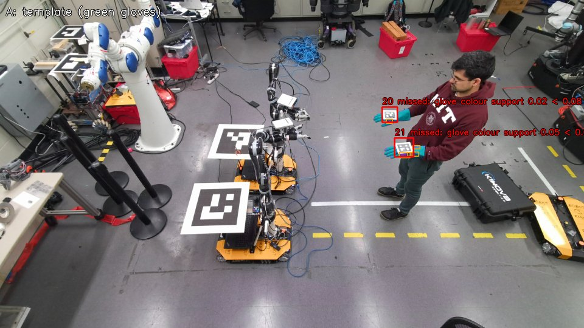
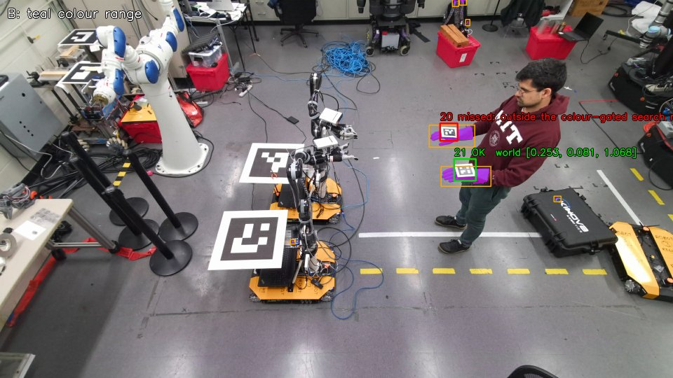
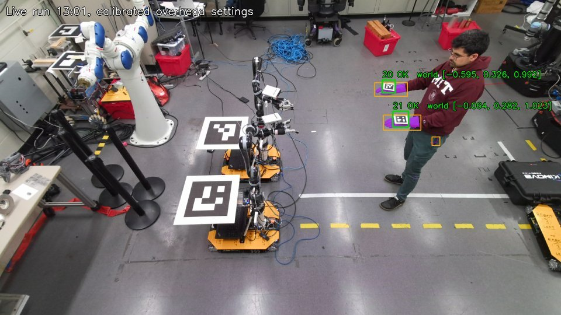
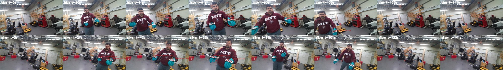
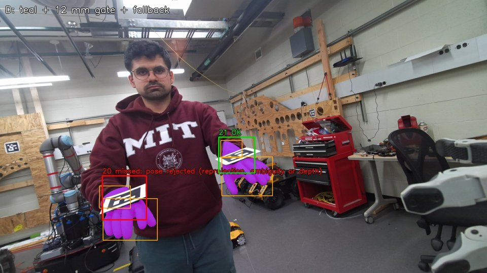
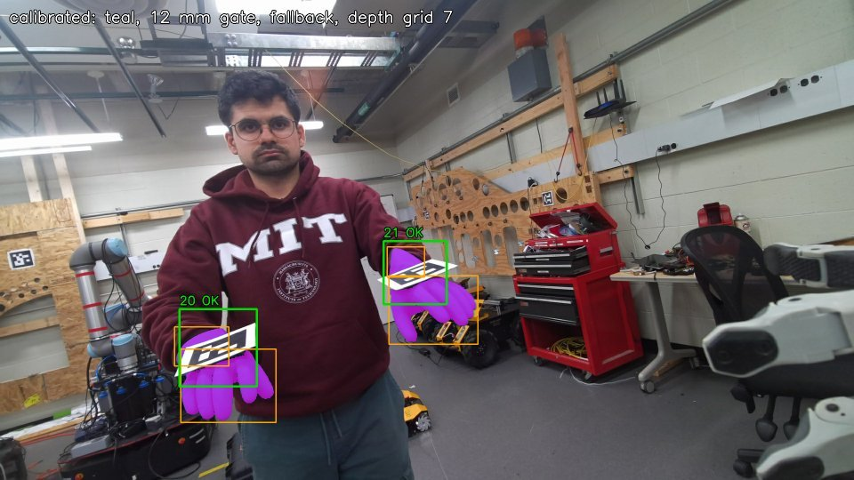
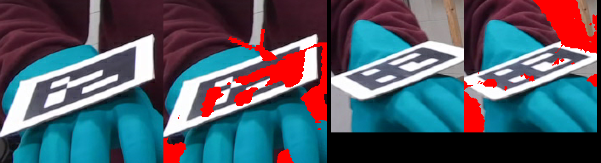
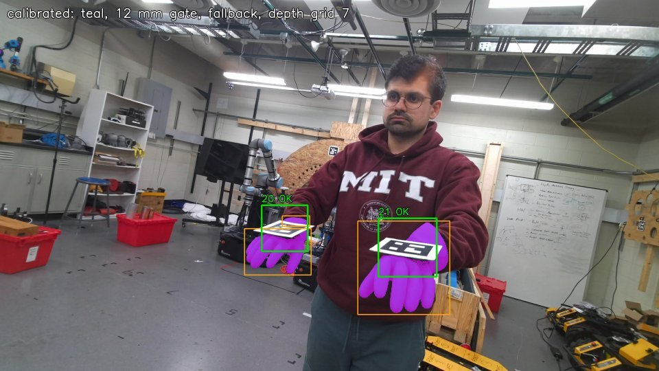
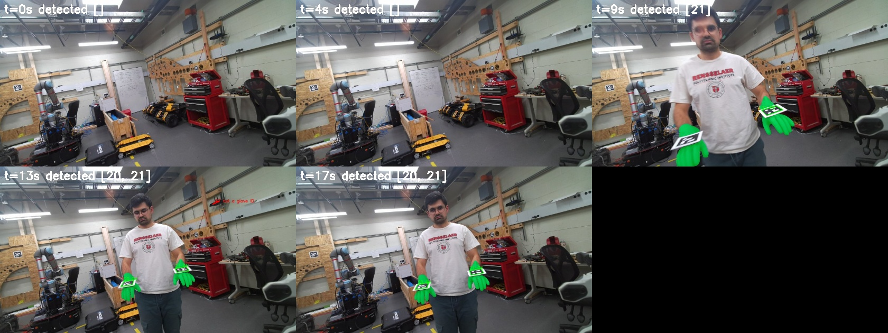
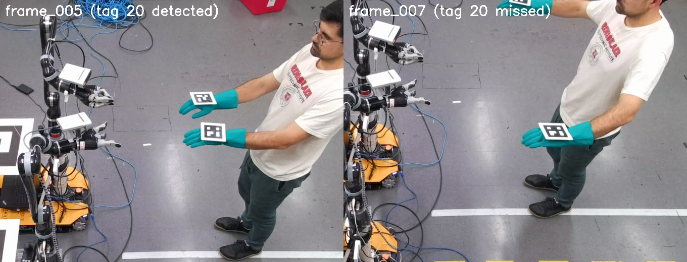

# Glove test: overhead and wrist cameras (2026-11-18)

The person wears two gloves with ArUco tags (DICT_4X4_50, IDs 20 and 21) on the backs of the hands.
`fabric_perception` finds them in each camera with `human_hand_tracking.tags.GloveDetector` and reports
each hand's grip point, which drives the fabric estimator and the twin. The detector's settings came
from the simulated cell: green gloves, ~17 px tags and ideal depth. This test calibrates them for the
real overhead camera and the real gloves, and records every step so it can be repeated for the wrist
cameras or new gloves.

Result on recorded frames, shipped settings -> calibrated settings (`experiments/hardware/cell/perception_*.yaml`):

| Camera | Tag sightings | Shipped | Calibrated |
| --- | --- | --- | --- |
| Overhead (NUC), tags 24-32 px at 2.1-2.4 m | 43 | 0 | **43** |
| Blue wrist, tags 43-178 px at 0.4-1.0 m | 42 | 0 | **40** |
| Silver wrist, tags 45-191 px at 0.4-1.0 m | 45 | 0 | **39** |

What had to change: the glove colour (per camera), the depth gate that settles the pose ambiguity of
small tags, the tag search size (new fallback option), where depth is sampled on a tag (new grid option:
the wrist cameras' depth has holes on the tags), and the perception nodes' sheet-processing rate (they
could not keep up at 15 fps). **Live** (16:12-16:21, final settings, 15 Hz nodes): overhead 96 % / 89 % (left / right hand, hands
steady at waist height), Blue wrist 98 % / 46 %, Silver wrist 100 % / 100 %. The later
[grasp-pose capture](../2026-11-18_sheet_capture/README.md) provides separate evidence for actual sheet
handling, including wrist pose rejections.

The [live JSONL recordings](live/) and [images](images/) remain with this record. An external raw
archive at `/media/taha/ExtermeLinux/claude-1000/lab/captures/2026-11-18_glove_test/` combines the
laptop's captures with additional diagnostic frames recovered from Claude's scratchpad.
The [SHA-256 manifest](raw_files.sha256) covers all 1,102 files in that archive.

## How the detector decides

For every colour frame (with registered depth):

1. **Glove colour mask:** pixels inside an HSV range (`glove_hsv_lower/upper`).
2. **Search regions:** each mask region of at least `glove_min_area_px` is padded into a box; boxes that
   overlap are merged. More than 8 boxes means a cluttered mask: the whole image is searched instead
   (slower).
3. **Tag search** in each box, optionally enlarged `tag_roi_upscale` times first.
4. **Colour support:** a glove ID counts only if at least `tag_min_color_support` (8 %) of the square
   around the tag (2.8 tag widths across) is glove colour. A tag on paper or a wall is ignored.
5. **Pose:** the tag's 3D pose from its four corners (OpenCV IPPE). The fit must reproject within
   `tag_max_reprojection_px` (2 px). A small, nearly frontal tag has **two** poses that fit almost
   equally (tilted one way or the other); if their grip points differ by more than 3 cm, depth decides:
   the pose whose tilt matches the measured depth over the tag (mean residual of 5 samples) must fit
   within `tag_depth_gate_m` and the other must fit at least 2x worse; otherwise the tag is dropped.
   The tag's range is then taken from the depth (corner localisation on small tags reads them a few
   per cent too far).
6. **Grip point:** the tag pose plus `tag_to_grip_offsets_m` (tag to pinch point; still a template).

`scripts/hw/glove_check.py` runs this on a camera host and, for every tag, also says why it was not
detected. `scripts/hw/glove_tune.py` repeats it offline on saved frames with any parameter set.

## Setup

- **Camera:** overhead Azure Kinect on the NUC, 1920x1080 colour at 15 fps with depth registered to colour
  (our session), 2.6 m above the floor, tilted 40 deg. World frame: 2026-11-17 definition (robots at
  y = -1.07, person side +y).
- **Gloves:** teal rubber gloves; tags printed with a white margin, taped to the backs of the hands; the
  black square is assumed 8 cm (not yet measured with a ruler; the depth agrees to about 2.5 %).
- **Person:** standing about 1.1 m in front of the robots, facing them, hands at waist height, tags up:
  still for ~10 s, then moving. The tags appeared 24-32 px wide at 2.1-2.4 m from the camera.
- **Capture** (`runs/overhead_20261118_120147/`): 150 s, 281 frames analysed at 2 Hz, a frame saved every
  3 s. Tag 20 was in view in 101 frames and tag 21 in 154 (full-image search); 26 saved frames show glove
  tags (17 sightings of tag 20, 26 of tag 21), used for everything below. Raw frames (colour PNG,
  16-bit depth PNG, 145 MB) are on the compute laptop in `/home/taha/fabric_hw_data/2026-11-18_glove_test/`,
  not in git.

What the three cameras saw before the test (`runs/first_look_120038/`): the overhead camera the whole
cell; the wrist cameras, with the arms at Home, look sideways into the room at shoulder height, not at
the cell.

## Step 1: capture

On the NUC, in the fabric session (`glove_check.py` copied to `/dev/shm/fabric` for the day):

```bash
scripts/hw/lab.sh session nuc exec python3 /dev/shm/fabric/glove_check.py --camera overhead \
    --params /dev/shm/fabric/perception_overhead.yaml --seconds 150 --rate 2 --save-every 3 \
    --out /dev/shm/fabric/glove_check
```

It prints one line per frame: every tag found anywhere in the image, detected or not and why, the
colour support and the colour right around the tag.



*01: the shipped (green) range. Both tags are found in the image, but only 2-7 % of the square around each
tag is "glove colour" (8 % needed): 0 of 43 sightings detected.*

## Step 2: glove colour


*02: the gloves are teal (exact pixels, frame 012). OpenCV hue runs 0-179: green is ~60, teal ~90-95,
blue ~105-120.*

**2a. Which hues belong to the gloves.** Coloured pixels (S >= 60, V >= 40) within 3.5 tag widths of a
glove tag (tag and margin excluded) against the rest of the image (`glove_tune.py colour`,
`results/1a_hue_near_tags.json`):

| Hue | Share near the tags | Share elsewhere | Enrichment | What it is |
| --- | --- | --- | --- | --- |
| 90-95 | 28.0 % | 2.9 % | 8-11x | glove |
| 98-101 | 7.5 % | 1.1 % | 6-8x | glove (shaded parts) |
| 102-107 | 3.2 % | 6.8 % | 0.2-1.2x | blue cables |
| 170-173 | 35.6 % | 5.4 % | 4-7x | the sleeves (maroon) |

**2b. The glove band** (H 88-101, near the tags, `results/1b_glove_band.json`): hue 90-101 (1st-99th
percentile), but saturation is bimodal (median 67, 75th percentile 225): the gloves (mostly 90-255) and
the person's dark teal-grey trousers (70-100), which are also next to the hands. 2c separates them.

**2c. Look-alikes**, sampled in boxes on frame 033 within the wide range H 85-105, S >= 70
(`glove_tune.py sample`, `results/1d_lookalikes_frame_033.json`), 5th-95th percentiles:

| Object | Hue | Saturation | Brightness |
| --- | --- | --- | --- |
| Glove with tag 20 | 90-94 | 128-255 | 73-185 |
| Glove with tag 21 | 90-101 | 72-255 | 44-192 |
| Blue cable pile behind the robots | 102-105 | 96-249 | 91-222 |
| Trousers | 93-103 | 70-100 | 40-82 |
| Objects at the right edge | 89-105 | 71-225 | 42-217 |


*03: the wide range H 85-105, S >= 70 (magenta) takes the gloves but also the cable pile, the trousers
and objects around the room: 43 colour regions per frame (orange boxes), so the detector would search
the whole image every frame.*

**2d. Candidate ranges** (`results/1c_range_*.json`):

| Range (H, S, V lower .. upper) | Colour regions per frame (median / max) | Regions away from the gloves |
| --- | --- | --- |
| 35,80,60 .. 90,255,255 (template, green) | 3 / 5 | 0 |
| 85,70,35 .. 105,255,255 | 43 / 53 | 32 |
| 86,80,35 .. 101,255,255 | 16 / 23 | 10 |
| **88,100,35 .. 100,255,255 (chosen)** | **7 / 9** | 5 |

H <= 100 drops the cables (H 102-105), S >= 100 the trousers (S <= 100), V >= 35 keeps the shaded side of
the gloves. Colour support around the tags becomes at least 0.24 (median 0.25-0.27; 0.08 needed).


*04: the chosen range: the gloves, plus a few small regions elsewhere (7 per frame).*

## Step 3: the pose ambiguity and the depth gate

With the teal range (step B below) only 23 of 43 sightings were detected. 16 misses (15 of tag 21, one
of tag 20) were the pose step: the tag is ambiguous (the second pose also reprojects within 0.5 px) and
depth was asked to decide. The other 4 were the search (step 4). Depth does decide clearly, but the gate
expected simulated depth:

- the right pose fits the measured depth within **2.5-7.6 mm** (median 5.0, 34 ambiguous tags);
- the wrong pose is off by **25.7-32.0 mm**, at least 3.5 times worse in every case;
- the gate `tag_depth_gate_m` was **5 mm**, below the real camera's noise at 2.1-2.4 m.

`tag_depth_gate_m: 0.012` lies between the two groups. The 2x rule stays.



*05 (step B, frame 021): tag 21 detected with its world position; tag 20 missed. Frames 012 and 038 in
`images/05_*` show the depth-gate misses.*

## Step 4: tag search size

With the 12 mm gate, 39 of 43 were detected. The last four were tag 20 under glare on its print: the
search enlarges each box 2x (cubic) before looking for tags, and in those frames the enlarged image did
not decode, while the original size did.


*08: tag 20 in frame 021 (4x, nearest neighbour): washed-out cells on the left half.*

Searching at the original size only (step E) finds all 43, but the corners of these small tags are
found much less precisely: reprojection error median 1.07 px and up to 1.77 px (gate 2 px), and the
right pose's depth residual reaches 11.9 mm (gate 12 mm). Both at the edge of their gates, so the live
camera would drop tags. Hence a new option in `GloveDetector`, `tag_roi_fallback_unscaled`: search at 2x
as before and, only for a glove ID the 2x search did not find, also at the original size. Precise corners
where 2x works, a detection where it does not (unit test
`test_unscaled_fallback_supplies_only_glove_tags_the_enlarged_search_missed`). The option is off by
default, so the simulated cell behaves as before.


*07 (calibrated, frame 021): both tags detected. `images/07_*` has frames 012 and 038 too.*

## Results, step by step

All on the same 26 frames (43 tag sightings), `glove_tune.py evaluate`, `results/2*.json`. Corner fit
and depth residual are for the corners the detector's own search produced.

| Step | Settings | Tag 20 | Tag 21 | Corner fit (median / max) | Right-pose depth residual (median / max) | Time |
| --- | --- | --- | --- | --- | --- | --- |
| A | template | 0/17 | 0/26 | | | 3 ms |
| B | teal colour | 12/17 | 11/26 | 0.06 / 0.11 px | 5.0 / 7.6 mm | 7 ms |
| C | B + depth gate 12 mm | 13/17 | 26/26 | 0.06 / 0.11 px | 5.0 / 7.6 mm | 8 ms |
| E | C, original-size search only | 17/17 | 26/26 | 1.07 / 1.77 px | 3.8 / 11.9 mm | 5 ms |
| **D** | **C + 2x search with original-size fallback** | **17/17** | **26/26** | 0.07 / 1.21 px | 5.0 / 8.9 mm | 8 ms |

The wrong pose of an ambiguous tag was 25.7-32.8 mm off in every step. Times are `detect()` on the
compute laptop; the NUC is slower but the whole overhead pipeline must stay within 67 ms per frame.

**Plausibility (step D):** holding still (frames 010-012), each grip point stayed within 6-19 mm per axis;
the two grips were 0.39-0.51 m apart (17 frames with both); grip height 1.02-1.08 m above the floor
(hands at waist height).

## Live check, overhead camera (13:01)

The real perception node (`fabric_cell camera_host.launch.py camera:=overhead`) on the NUC, its glove
output recorded on the laptop with `scripts/hw/glove_record.py` (`live/overhead_live_130153.jsonl`), and
`glove_check.py` at 2 Hz beside it for the reasons of any miss. Settings: this test's overhead calibration
with five-point depth (the depth grid below came later).

**The node first could not keep up.** A full frame (sheet segmentation, depth, gloves) takes 88-105 ms on
the NUC's CPU; processing every frame (`fabric_rate_hz` 0, the default) left frames 0.249 s old at
publication, past the node's 0.25 s limit, and it dropped nearly all of them (3 messages in 8 s). The
node can process the sheet at a lower rate and the gloves on every frame: at `fabric_rate_hz: 5` the glove
messages run at 15.0 Hz, 0.115 s old (p95 0.178 s). The simulated cell's monitor profile also ran the
overhead camera at 5 Hz. Now in the configuration.

| Over the 37 s the person was in view (553 messages) | Left hand (tag 21) | Right hand (tag 20) |
| --- | --- | --- |
| Detected | **543 (98 %)** | **424 (77 %)** |
| Gaps over 0.5 s | none | 4, longest 0.9 s |
| Scatter about a 1 s running median (x, y, z; upper bound, the hands were moving) | 4.3, 1.8, 3.5 mm | 7.3, 3.8, 7.6 mm |
| Mean position (world) | x +0.30 (Silver's side) | x -0.19 (Blue's side) |

Both hands in 76 % of the messages. In `glove_check`'s frames over the same time every tag that was in
the image was detected (tag 21: 68 of 68, tag 20: 32 of 32): the misses are the right hand's tag turned
away or hidden by the body, not detection. The saved frames, re-run with the final settings: 10 of 10
tags detected.



*16: a frame of the live run, final overhead settings: both gloves detected, positions in the world frame.*

## Wrist cameras (13:04-13:30)

With the arms at Home the wrist cameras look sideways into the room at shoulder height, so the person
held the gloves up 0.4-1.0 m in front of each lens (tags 43-191 px), moving between the two cameras; both
recorded at once with `glove_check.py`, 150 s, a frame saved every 2 s (`blue_wrist_20261118_130948`,
`silver_wrist_20261118_130948` in the raw-data folder). Blue's camera saw tag 21 in 134 and tag 20 in
106 frames, Silver's 145 and 123; 32 and 29 saved frames show glove tags.



*09: Blue's wrist camera (top row) and Silver's (bottom) over the capture.*

**Colour.** Up close and from the front, the 3.5-tag-width neighbourhood used for the overhead camera is
mostly the person's maroon sleeves and chest; a ring just outside each tag's paper margin (0.8-2.0 tag
widths, `glove_tune.py colour --reach 2 --margin 1.6`) is mostly glove: teal H 92-97, up to 3.4 times more common there than elsewhere
(`results/3a_*`; teal also appears in the room behind). The wrist cameras see it greener and far more saturated than the overhead camera
(`results/3b_*`, 5th-95th percentiles):

| Wrist camera | Hue | Saturation (5th %ile, median) | Brightness |
| --- | --- | --- | --- |
| Blue | 94-97 | 180, 249 | 80-181 |
| Silver | 93-97 | 151, 249 | 85-170 |

The overhead camera's range left 9-10 colour regions per frame (up to 18, often above the 8 that send the
detector to a whole-image search); **H 90-99, S >= 120, V >= 40** leaves 4 (at most 6), 0-1 of them away from
the gloves. Colour support around the tags 0.20-0.35 (0.08 needed).

**Steps** (`glove_tune.py evaluate`, `results/4*_*.json`):

| Step | Blue: tag 20 | Blue: tag 21 | Silver: tag 20 | Silver: tag 21 |
| --- | --- | --- | --- | --- |
| A template (green) | 0/21 | 0/21 | 0/20 | 0/25 |
| B teal colour | 9/21 | 21/21 | 15/20 | 2/25 |
| D B + 12 mm gate + fallback search (the overhead settings) | 9/21 | 21/21 | 17/20 | 2/25 |
| E B, original-size search only | 9/21 | 20/21 | 17/20 | 2/25 |
| **F D + depth sampled on a 7 x 7 grid** | **19/21** | **21/21** | **20/20** | **19/25** |

No tag was ambiguous at these sizes, so the depth gate does nothing here. The misses at B-E are the depth
check: the tag's depth range is checked against the measured depth, and a tag whose depth samples are
missing is dropped.



*11: Blue's wrist camera, teal colour, five-point depth: tag 20 dropped ("pose rejected"). 10 shows the
same frame with the template settings, 12 with the final ones.*



*12: the same frame with the depth sampled on a 7 x 7 grid: both tags detected. The grey shapes at the
right edge are Blue's own gripper fingers (to be masked out for the sheet: `static_exclusion_mask`).*

**Depth holes on the tags.** The rejected tags had 7-45 % valid depth at their centre. The holes come as
blotches and streaks, where the depth image is mapped onto the 1080p colour image at close range, and
they are not the black ink (frame 004, tag 20: 15 % invalid on black pixels, 20 % on white).



*15: Blue's wrist camera, frame 004: tags 20 and 21 and, in red, the pixels without depth.*

The detector sampled depth at five points (the centre and 70 % of the way to each corner, 3 x 3 pixels
each) and needed four. A new option, `depth_grid` in `GloveDetector` (`tag_depth_grid` in the node, off by
default so the simulated cell is unchanged), samples an n x n grid over the tag face and keeps every
sample with depth, still requiring samples in three of the tag's four quarters so the tilt check keeps
its meaning (unit test `test_depth_grid_keeps_a_tag_whose_depth_has_holes_at_the_five_default_samples`).
With a 7 x 7 grid: Blue 30 -> 40 of 42, Silver 19 -> 39 of 45. Of the 8 left, 7 have no depth over two or
more quarters and one has depth from behind the tag (32 % beyond its range): rightly dropped. Where depth
is valid it agrees with the tag's size (depth/PnP range 0.98-1.06 on Blue, 0.96-1.03 on Silver, 90 %),
which also confirms the 8 cm tag size. On the overhead camera the grid changes nothing in detection
(43/43) and tightens the depth residuals (right pose 3.1-6.3 mm, wrong 23.2-27.6 mm; `results/2f_*`).



*14: Silver's wrist camera, final settings (13: the same frame with five-point depth, tag 21 dropped).*

**Frame rate.** Like the overhead node, the wrist nodes processed the sheet on every frame (~102-115 ms on
the helpers; the template sheet thresholds take ~830 000 pixels of a wrist image as sheet) and published
no gloves at all. With `fabric_rate_hz: 5`: gloves at 15.1 Hz on both, full frames 147 and 163 ms old.

## Live check of all three cameras (16:12-16:21)

After the power cycle and the redeployment, with the final settings on every camera (NUC `6fc4c70`,
helpers `c24b943`). Each camera's perception node ran alone and `glove_record.py` recorded its glove
output on the camera's own computer, 40 s per camera, while the person stood at that camera and said
"ready" (`live/final_*.jsonl`; scored over the seconds a glove was in view, jitter about a 1 s running
median, which also contains the hands' own motion).

| Camera (time) | Node rate, age (median, p95) | Left hand (tag 21) | Right hand (tag 20) | Both | Jitter left / right (x, y, z) |
| --- | --- | --- | --- | --- | --- |
| Overhead, hands steady at waist height (16:15) | 14.4 Hz, 0.144 / 0.213 s | **96 %**, longest gap 1.5 s | **89 %**, longest gap 1.0 s | 88 % | 3.6, 1.6, 2.1 / 7.9, 4.0, 2.7 mm |
| Blue wrist, 0.6-1.3 m (16:17) | 15.0 Hz, 0.132 / 0.170 s | **98 %** | **46 %**, 11 gaps up to 2.3 s | 46 % | 2.2, 1.3, 2.8 / 2.8, 1.5, 10.9 mm |
| Silver wrist, 0.5-0.9 m (16:20) | 15.0 Hz, 0.183 / 0.227 s | **100 %** | **100 %** (598 of 600) | 100 % | 1.2, 1.0, 0.9 / 0.6, 0.8, 0.9 mm |

- **Visibility limited these individual-camera runs.** A first overhead run (16:12) with the hands moving freely
  found the right hand in 24 %: it was raised and tilted, its tag out of sight (image 18); `glove_check`
  beside it detected every tag that was in the image. On Blue's wrist camera the right hand was often at
  the image edge or tilted up close (image 17, t = 9 s); `glove_check` over 20 s detected 22 of 22 and 17 of
  17 visible tags. Kept at about 1 m, flat, both tags were seen (image 17, t = 13 and 17 s).
- **The reported uncertainty is conservative:** the nodes report a position sd of ~10 mm across and
  12-58 mm along the line of sight; the observed jitter is a few millimetres.
- **Timing margin:** the overhead node ran at 14.4 Hz with two gloves in view (data up to 0.213 s old), and
  Silver's wrist node reached 0.227 s at p95 against the 0.25 s limit (its full frames take ~115 ms): the
  nodes keep up, but with little margin. A diagnostic run beside the overhead node (`glove_check`, saving
  frames) dropped it to 6.5 Hz: do not run both on the NUC during a test.
- The positions confirm the hand names: the left hand on Silver's side (overhead x +0.27), the right on
  Blue's (x -0.27).



*17: Blue's wrist camera during the live check (`glove_check`, 20 s): at 9 s the right glove is tilted at
the image edge (only tag 21 detected); at 13 and 17 s both are detected.*



*18: overhead, 16:12: both tags detected with the hands at waist height (left), the right hand raised and
its tag out of sight (right).*

A first attempt at 16:01 recorded nothing useful: nobody was in view of any camera.

## Found on the way

- **Tag 20 is on the person's right hand.** Facing the robots (-y), tag 20's grip is at world x = -0.14
  and tag 21's at +0.25 (frame 021). At the time `human_left`/`human_right` named sheet sides
  (`human_left` = corner (0, 1) on Blue's side), so tag 20 was correctly the Blue-side corner, but under a
  name that suggested the left hand. Swapping only the IDs would have crossed the sheet. Instead the
  names now mean the person's own hands (user's decision, same day): `glove_tag_ids: [21, 20]` and
  `human_corner_uv: [1, 1, 0, 1]` everywhere (left hand first), with code defaults, the simulated cell's
  glove mapping and the tests changed to match. The corner each glove drives is unchanged: tag 20 still
  holds (0, 1) on Blue's side.
- The wrist cameras at Home cannot see the person; their glove calibration used gloves held up in front
  of them. At a grasp pose they will see the person from closer and at another angle: check there too.
- Colour regions away from the gloves remain (5 per frame) at the room's edges; restricting the glove
  search to the cell's region would remove them (the segmenter has `workspace_roi`, the glove detector
  does not).

## Not done yet

1. ~~Live check of all three cameras~~: done 16:12-16:21 (above). For the demo: hands flat at waist
   height, within ~1 m of a wrist camera; timing margin of the nodes is small (above).
2. ~~Which hand has which tag~~: settled (above): tag 20 on the right hand, Blue's side; names renamed.
3. ~~Tag size~~: 8 cm, from the user's documentation (`docs/fabric-hardware-demo-plan.md`); the wrist
   cameras' depth agrees with the tags' apparent size within 2-4 %.
4. **Tag-to-pinch offsets** (`tag_to_grip_offsets_m`, still a template): pivot calibration.
5. ~~Wrist cameras~~: calibrated on recorded frames (above); check again at a grasp pose.
6. **Sheet:** segmentation (`cloth_*`, `workspace_roi`) for all three cameras once the sheet is in view,
   and `static_exclusion_mask` for the wrist cameras' own gripper fingers.
7. **Hands in the world frame from all cameras** (`human_hand_tracking` fusion): needs the cell
   calibration published, which waits for the measured `fabric_grip` transforms (gate H15).

## Repeat it

```bash
# 1. capture on the camera's computer (wrist cameras: blue / silver with --camera blue_wrist / silver_wrist)
scripts/hw/lab.sh session nuc exec python3 fabric_ws/scripts/hw/glove_check.py --camera overhead \
    --seconds 150 --rate 2 --save-every 3
# 2. copy the run folder from ~/fabric_ws/run/glove_check/ to the laptop, then:
python3 scripts/hw/glove_tune.py colour RUN                            # which hues sit next to the tags
python3 scripts/hw/glove_tune.py colour RUN --hue 88 101 --min-s 30    # that band's S and V
python3 scripts/hw/glove_tune.py sample RUN frame_033 --range 85 70 35 105 255 255 --box glove x0 y0 x1 y1 --box cables ...
python3 scripts/hw/glove_tune.py colour RUN --range 88 100 35 100 255 255   # regions per frame
python3 scripts/hw/glove_tune.py evaluate RUN --params experiments/hardware/cell/perception_overhead.yaml \
    --images out/ --json out/result.json
# wrist cameras: sample the glove colour in a ring just outside the tags (the body dominates further out)
python3 scripts/hw/glove_tune.py colour RUN --reach 2 --margin 1.6
# 3. live: the camera's perception node, then its glove output (rate, age, per-hand detection, gaps)
scripts/hw/lab.sh session nuc start-cell /home/nuc/fabric_ws/experiments/hardware/cell
source scripts/hw/laptop_env.sh
python3 scripts/hw/glove_record.py --camera overhead --seconds 90 --out live.jsonl
python3 scripts/hw/glove_record.py --score live.jsonl     # scores over the seconds a glove was in view
```

Raw frames of every run (colour PNG, 16-bit depth PNG, `frames.jsonl`) are on the compute laptop in
`/home/taha/fabric_hw_data/2026-11-18_glove_test/`.
