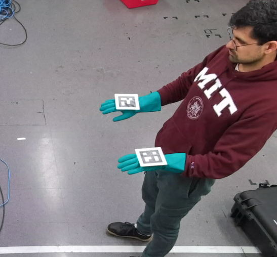
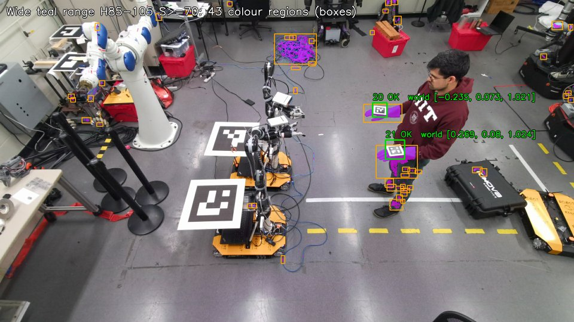
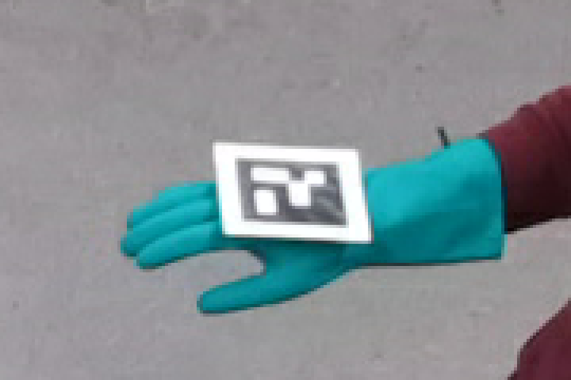
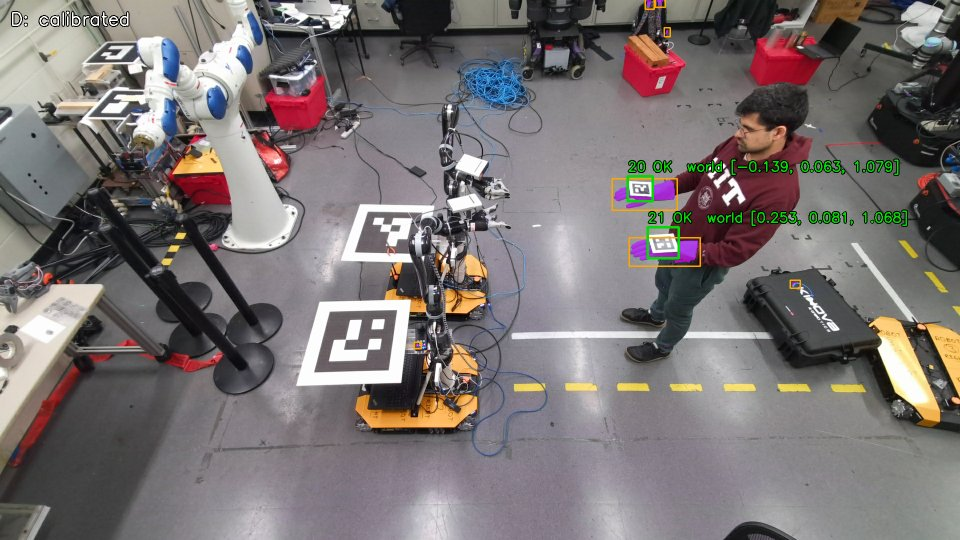

# Glove test, overhead camera (2026-11-18)

The person wears two gloves with ArUco tags (DICT_4X4_50, IDs 20 and 21) on the backs of the hands.
`fabric_perception` finds them in each camera with `human_hand_tracking.tags.GloveDetector` and reports
each hand's grip point, which drives the fabric estimator and the twin. The detector's settings came
from the simulated cell: green gloves, ~17 px tags and ideal depth. This test calibrates them for the
real overhead camera and the real gloves, and records every step so it can be repeated for the wrist
cameras or new gloves.

Result: with the shipped settings the overhead camera detected **0 of 43** glove-tag sightings; with the
calibrated settings ([`experiments/hardware/cell/perception_overhead.yaml`](../../cell/perception_overhead.yaml))
**43 of 43**, in ~8 ms per frame. Three things had to change: the glove colour, the depth gate that
settles the pose ambiguity of small tags, and how the tag search enlarges the image. The live check
with the new settings is still to do (see "Not done yet").

## How the detector decides

For every colour frame (with registered depth):

1. **Glove colour mask:** pixels inside an HSV range (`glove_hsv_lower/upper`).
2. **Search regions:** each mask region of at least `glove_min_area_px` is padded into a box; boxes that
   overlap are merged. More than 8 boxes means a cluttered mask: the whole image is searched instead
   (slower).
3. **Tag search** in each box, optionally enlarged `tag_roi_upscale` times first.
4. **Colour support:** a glove ID counts only if at least `tag_min_color_support` (8 %) of the square
   around the tag (2.8 tag widths across) is glove colour. A tag on paper or a wall is ignored.
5. **Pose:** the tag's 3D pose from its four corners (OpenCV IPPE). The fit must reproject within
   `tag_max_reprojection_px` (2 px). A small, nearly frontal tag has **two** poses that fit almost
   equally (tilted one way or the other); if their grip points differ by more than 3 cm, depth decides:
   the pose whose tilt matches the measured depth over the tag (mean residual of 5 samples) must fit
   within `tag_depth_gate_m` and the other must fit at least 2x worse; otherwise the tag is dropped.
   The tag's range is then taken from the depth (corner localisation on small tags reads them a few
   per cent too far).
6. **Grip point:** the tag pose plus `tag_to_grip_offsets_m` (tag to pinch point; still a template).

`scripts/hw/glove_check.py` runs this on a camera host and, for every tag, also says why it was not
detected. `scripts/hw/glove_tune.py` repeats it offline on saved frames with any parameter set.

## Setup

- **Camera:** overhead Azure Kinect on the NUC, 1920x1080 colour at 15 fps with depth registered to colour
  (our session), 2.6 m above the floor, tilted 40 deg. World frame: 2026-11-17 definition (robots at
  y = -1.07, person side +y).
- **Gloves:** teal rubber gloves; tags printed with a white margin, taped to the backs of the hands; the
  black square is assumed 8 cm (not yet measured with a ruler; the depth agrees to about 2.5 %).
- **Person:** standing about 1.1 m in front of the robots, facing them, hands at waist height, tags up:
  still for ~10 s, then moving. The tags appeared 24-32 px wide at 2.1-2.4 m from the camera.
- **Capture** (`runs/overhead_20261118_120147/`): 150 s, 281 frames analysed at 2 Hz, a frame saved every
  3 s. Tag 20 was in view in 101 frames and tag 21 in 154 (full-image search); 26 saved frames show glove
  tags (17 sightings of tag 20, 26 of tag 21), used for everything below. Raw frames (colour PNG,
  16-bit depth PNG, 145 MB) are on the compute laptop in `/home/taha/fabric_hw_data/2026-11-18_glove_test/`,
  not in git.

What the three cameras saw before the test (`runs/first_look_120038/`): the overhead camera the whole
cell; the wrist cameras, with the arms at Home, look sideways into the room at shoulder height, not at
the cell.

## Step 1: capture

On the NUC, in the fabric session (`glove_check.py` copied to `/dev/shm/fabric` for the day):

```bash
scripts/hw/lab.sh session nuc exec python3 /dev/shm/fabric/glove_check.py --camera overhead \
    --params /dev/shm/fabric/perception_overhead.yaml --seconds 150 --rate 2 --save-every 3 \
    --out /dev/shm/fabric/glove_check
```

It prints one line per frame: every tag found anywhere in the image, detected or not and why, the
colour support and the colour right around the tag.


*01: the shipped (green) range. Both tags are found in the image, but only 2-7 % of the square around each
tag is "glove colour" (8 % needed): 0 of 43 sightings detected.*

## Step 2: glove colour



*02: the gloves are teal (exact pixels, frame 012). OpenCV hue runs 0-179: green is ~60, teal ~90-95,
blue ~105-120.*

**2a. Which hues belong to the gloves.** Coloured pixels (S >= 60, V >= 40) within 3.5 tag widths of a
glove tag (tag and margin excluded) against the rest of the image (`glove_tune.py colour`,
`results/1a_hue_near_tags.json`):

| Hue | Share near the tags | Share elsewhere | Enrichment | What it is |
| --- | --- | --- | --- | --- |
| 90-95 | 28.0 % | 2.9 % | 8-11x | glove |
| 98-101 | 7.5 % | 1.1 % | 6-8x | glove (shaded parts) |
| 102-107 | 3.2 % | 6.8 % | 0.2-1.2x | blue cables |
| 170-173 | 35.6 % | 5.4 % | 4-7x | the sleeves (maroon) |

**2b. The glove band** (H 88-101, near the tags, `results/1b_glove_band.json`): hue 90-101 (1st-99th
percentile), but saturation is bimodal (median 67, 75th percentile 225): the gloves (mostly 90-255) and
the person's dark teal-grey trousers (70-100), which are also next to the hands. 2c separates them.

**2c. Look-alikes**, sampled in boxes on frame 033 within the wide range H 85-105, S >= 70
(`glove_tune.py sample`, `results/1d_lookalikes_frame_033.json`), 5th-95th percentiles:

| Object | Hue | Saturation | Brightness |
| --- | --- | --- | --- |
| Glove with tag 20 | 90-94 | 128-255 | 73-185 |
| Glove with tag 21 | 90-101 | 72-255 | 44-192 |
| Blue cable pile behind the robots | 102-105 | 96-249 | 91-222 |
| Trousers | 93-103 | 70-100 | 40-82 |
| Objects at the right edge | 89-105 | 71-225 | 42-217 |



*03: the wide range H 85-105, S >= 70 (magenta) takes the gloves but also the cable pile, the trousers
and objects around the room: 43 colour regions per frame (orange boxes), so the detector would search
the whole image every frame.*

**2d. Candidate ranges** (`results/1c_range_*.json`):

| Range (H, S, V lower .. upper) | Colour regions per frame (median / max) | Regions away from the gloves |
| --- | --- | --- |
| 35,80,60 .. 90,255,255 (template, green) | 3 / 5 | 0 |
| 85,70,35 .. 105,255,255 | 43 / 53 | 32 |
| 86,80,35 .. 101,255,255 | 16 / 23 | 10 |
| **88,100,35 .. 100,255,255 (chosen)** | **7 / 9** | 5 |

H <= 100 drops the cables (H 102-105), S >= 100 the trousers (S <= 100), V >= 35 keeps the shaded side of
the gloves. Colour support around the tags becomes at least 0.24 (median 0.25-0.27; 0.08 needed).


*04: the chosen range: the gloves, plus a few small regions elsewhere (7 per frame).*

## Step 3: the pose ambiguity and the depth gate

With the teal range (step B below) only 23 of 43 sightings were detected. 16 misses (15 of tag 21, one
of tag 20) were the pose step: the tag is ambiguous (the second pose also reprojects within 0.5 px) and
depth was asked to decide. The other 4 were the search (step 4). Depth does decide clearly, but the gate
expected simulated depth:

- the right pose fits the measured depth within **2.5-7.6 mm** (median 5.0, 34 ambiguous tags);
- the wrong pose is off by **25.7-32.0 mm**, at least 3.5 times worse in every case;
- the gate `tag_depth_gate_m` was **5 mm**, below the real camera's noise at 2.1-2.4 m.

`tag_depth_gate_m: 0.012` lies between the two groups. The 2x rule stays.


*05 (step B, frame 021): tag 21 detected with its world position; tag 20 missed. Frames 012 and 038 in
`images/05_*` show the depth-gate misses.*

## Step 4: tag search size

With the 12 mm gate, 39 of 43 were detected. The last four were tag 20 under glare on its print: the
search enlarges each box 2x (cubic) before looking for tags, and in those frames the enlarged image did
not decode, while the original size did.



*08: tag 20 in frame 021 (4x, nearest neighbour): washed-out cells on the left half.*

Searching at the original size only (step E) finds all 43, but the corners of these small tags are
found much less precisely: reprojection error median 1.07 px and up to 1.77 px (gate 2 px), and the
right pose's depth residual reaches 11.9 mm (gate 12 mm). Both at the edge of their gates, so the live
camera would drop tags. Hence a new option in `GloveDetector`, `tag_roi_fallback_unscaled`: search at 2x
as before and, only for a glove ID the 2x search did not find, also at the original size. Precise corners
where 2x works, a detection where it does not (unit test
`test_unscaled_fallback_supplies_only_glove_tags_the_enlarged_search_missed`). The option is off by
default, so the simulated cell behaves as before.



*07 (calibrated, frame 021): both tags detected. `images/07_*` has frames 012 and 038 too.*

## Results, step by step

All on the same 26 frames (43 tag sightings), `glove_tune.py evaluate`, `results/2*.json`. Corner fit
and depth residual are for the corners the detector's own search produced.

| Step | Settings | Tag 20 | Tag 21 | Corner fit (median / max) | Right-pose depth residual (median / max) | Time |
| --- | --- | --- | --- | --- | --- | --- |
| A | template | 0/17 | 0/26 | | | 3 ms |
| B | teal colour | 12/17 | 11/26 | 0.06 / 0.11 px | 5.0 / 7.6 mm | 7 ms |
| C | B + depth gate 12 mm | 13/17 | 26/26 | 0.06 / 0.11 px | 5.0 / 7.6 mm | 8 ms |
| E | C, original-size search only | 17/17 | 26/26 | 1.07 / 1.77 px | 3.8 / 11.9 mm | 5 ms |
| **D** | **C + 2x search with original-size fallback** | **17/17** | **26/26** | 0.07 / 1.21 px | 5.0 / 8.9 mm | 8 ms |

The wrong pose of an ambiguous tag was 25.7-32.8 mm off in every step. Times are `detect()` on the
compute laptop; the NUC is slower but the whole overhead pipeline must stay within 67 ms per frame.

**Plausibility (step D):** holding still (frames 010-012), each grip point stayed within 6-19 mm per axis;
the two grips were 0.39-0.51 m apart (17 frames with both); grip height 1.02-1.08 m above the floor
(hands at waist height).

## Found on the way

- **Tag 20 is worn on the person's right hand, and that is correct.** Facing the robots (-y), tag 20's
  grip is at world x = -0.14 and tag 21's at +0.25 (frame 021). In this code `human_left` and
  `human_right` name sheet corners, not the person's hands: `human_left` is corner (u, v) = (0, 1), on
  Blue's side (-x), next to Blue's corner (0, 0) (`fabric_twin/cloth.py`, `human_corner_uv` in
  `fusion.yaml`). A person facing the robots has their right hand on Blue's side, so tag 20 on the right
  hand is assigned to the corner next to Blue, as it should be. (A first reading of this test took
  `human_left` for the person's left hand and suggested swapping the IDs; that would have crossed the
  sheet. The IDs stay `[20, 21]`.)
- The wrist cameras at Home cannot see the person; their glove calibration needs the arms at a grasp
  pose or the gloves held up in front of them.
- Colour regions away from the gloves remain (5 per frame) at the room's edges; restricting the glove
  search to the cell's region would remove them (the segmenter has `workspace_roi`, the glove detector
  does not).

## Not done yet

1. **Live check** with the calibrated settings. A 60 s run at 12:08 (`runs/overhead_20261118_120823/`)
   happened while nobody was in view: no glove tags in 253 frames, so it confirms nothing. Needs the
   code change deployed to the NUC first (`lab.sh setup nuc`).
2. ~~Which hand has which tag~~: settled (above): tag 20 on the hand on Blue's side.
3. **Tag size** with a ruler (black square edge).
4. **Tag-to-pinch offsets** (`tag_to_grip_offsets_m`, still a template): pivot calibration.
5. **Wrist cameras:** the same steps per camera.
6. Sheet segmentation (`cloth_*`, `workspace_roi`) for the overhead camera, once the sheet is in view.

## Repeat it

```bash
# 1. capture on the camera's computer (wrist cameras: blue / silver with --camera blue_wrist / silver_wrist)
scripts/hw/lab.sh session nuc exec python3 fabric_ws/scripts/hw/glove_check.py --camera overhead \
    --seconds 150 --rate 2 --save-every 3
# 2. copy the run folder from ~/fabric_ws/run/glove_check/ to the laptop, then:
python3 scripts/hw/glove_tune.py colour RUN                            # which hues sit next to the tags
python3 scripts/hw/glove_tune.py colour RUN --hue 88 101 --min-s 30    # that band's S and V
python3 scripts/hw/glove_tune.py sample RUN frame_033 --range 85 70 35 105 255 255 --box glove x0 y0 x1 y1 --box cables ...
python3 scripts/hw/glove_tune.py colour RUN --range 88 100 35 100 255 255   # regions per frame
python3 scripts/hw/glove_tune.py evaluate RUN --params experiments/hardware/cell/perception_overhead.yaml \
    --images out/ --json out/result.json
```
